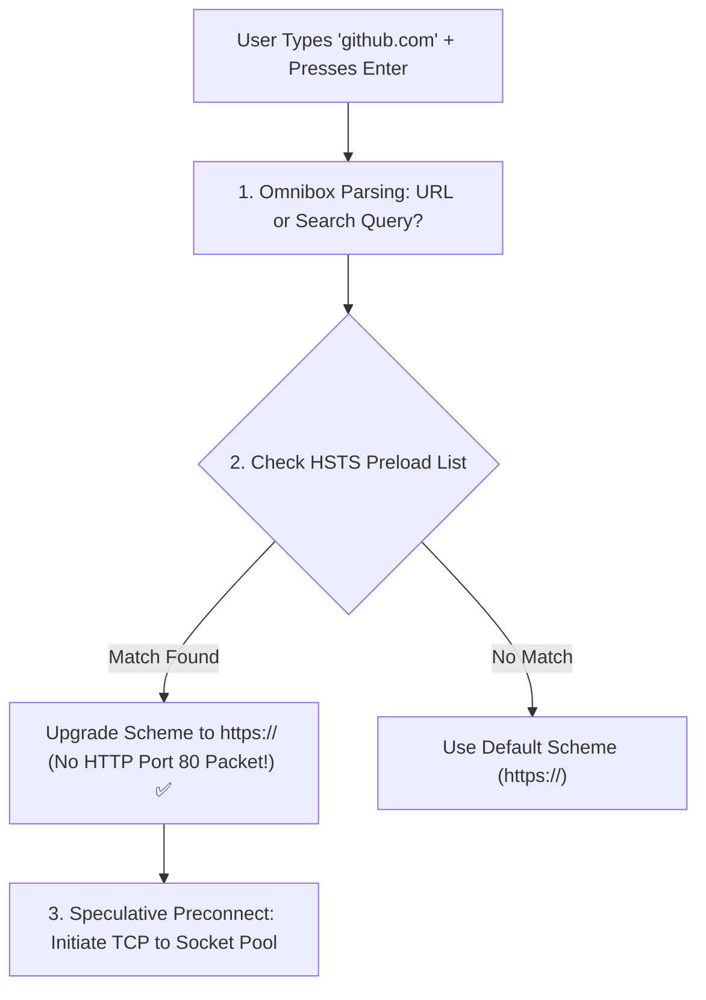
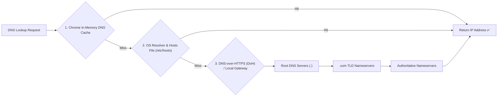
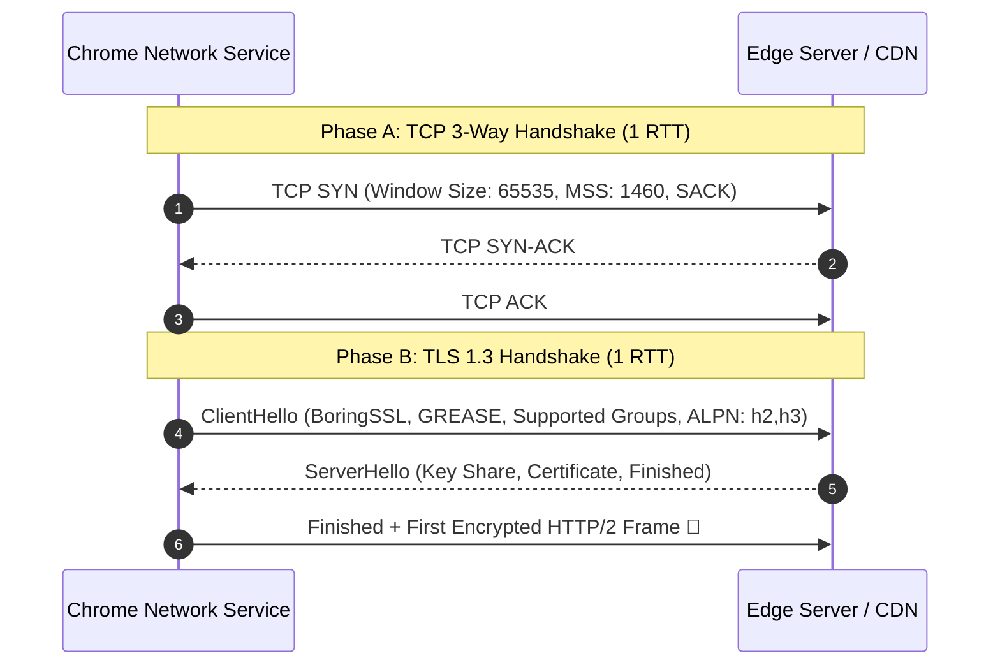
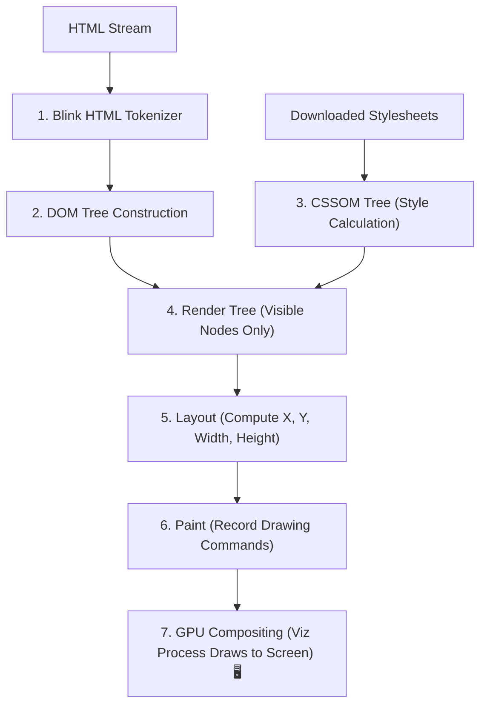

It is the most famous interview question in computer science: *"What happens when you type google.com into your browser and press Enter?"*

Most candidates recite a superficial five-sentence summary: the browser resolves DNS, connects over TCP, negotiates TLS, downloads HTML, and renders the page.

While that answer passes an introductory screening, it barely scratches the surface of what modern operating systems and web engines actually do. 

Within the first **300 milliseconds** of striking the Enter key, Google Chrome executes millions of lines of C++ code. It queries static security databases, initiates speculative socket warm-ups, negotiates zero-copy shared memory frames, and dispatches parallel GPU rendering pipelines.


<p class="chart-note" style="text-align: center; margin-top: -12px; margin-bottom: 24px;"><em>The millisecond journey: a single URL keystroke triggers a coordinated dance of OS kernel interrupts, recursive network resolution, and multi-threaded rendering pipelines.</em></p>

Here is the comprehensive, production-grade engineering breakdown of every microsecond of the journey.

---

## Desktop Chrome vs Headless Script Execution at a Glance

Comparing a human user's Chrome navigation with a headless Python script illustrates why real browsers behave so distinctly on the network.

<div class="vs-cards">
  <div class="vs-card v12">
    <div class="vs-card-header">
      <h3>Headless Script / HTTP Client</h3>
      <span class="vs-tag legacy">Python requests / curl</span>
    </div>
    <div class="vs-feature-list">
      <div class="vs-feature-item">
        <div class="vs-feature-title">
          <span class="vs-icon">📦</span>
          <strong>Linear Execution Pipeline</strong>
        </div>
        <p class="vs-feature-desc">Executes one step at a time: blocks on DNS, blocks on TCP connect, blocks on response read.</p>
      </div>
      <div class="vs-feature-item">
        <div class="vs-feature-title">
          <span class="vs-icon">🚫</span>
          <strong>Zero Speculative Preconnect</strong>
        </div>
        <p class="vs-feature-desc">Never predicts future user intent; cannot warm up sockets or pre-resolve DNS while typing.</p>
      </div>
      <div class="vs-feature-item">
        <div class="vs-feature-title">
          <span class="vs-icon">📄</span>
          <strong>Raw String Ingestion Only</strong>
        </div>
        <p class="vs-feature-desc">Downloads raw HTML bytes without parsing stylesheets, fetching images, or running JavaScript.</p>
      </div>
      <div class="vs-feature-item">
        <div class="vs-feature-title">
          <span class="vs-icon">⚡</span>
          <strong>Isolated Resource Fetching</strong>
        </div>
        <p class="vs-feature-desc">Subresources (CSS/JS) are ignored unless manually scripted, creating abnormal network waterfall signatures.</p>
      </div>
    </div>
  </div>

  <div class="vs-card v13">
    <div class="vs-card-header">
      <h3>Google Chrome Browser</h3>
      <span class="vs-tag modern">Multi-Process Desktop Engine</span>
    </div>
    <div class="vs-feature-list">
      <div class="vs-feature-item">
        <div class="vs-feature-title">
          <span class="vs-icon">🔮</span>
          <strong>Speculative Prerendering & DNS</strong>
        </div>
        <p class="vs-feature-desc">Pre-resolves hostnames and initiates TCP preconnects while the user is still typing in the Omnibox.</p>
      </div>
      <div class="vs-feature-item">
        <div class="vs-feature-title">
          <span class="vs-icon">🔒</span>
          <strong>HSTS Preload Enforcement</strong>
        </div>
        <p class="vs-feature-desc">Forces instant HTTPS redirection using an in-memory database before transmitting any cleartext packet.</p>
      </div>
      <div class="vs-feature-item">
        <div class="vs-feature-title">
          <span class="vs-icon">🧵</span>
          <strong>Multi-Process Isolation</strong>
        </div>
        <p class="vs-feature-desc">Distributes work across Browser, Network Service, Renderer, and GPU processes over IPC channels.</p>
      </div>
      <div class="vs-feature-item">
        <div class="vs-feature-title">
          <span class="vs-icon">🌊</span>
          <strong>Full Resource Waterfall</strong>
        </div>
        <p class="vs-feature-desc">Blink preload scanner identifies and fetches subresources concurrently with prioritized streams.</p>
      </div>
    </div>
  </div>
</div>

---

## 1. Phase 1: The Omnibox and HSTS Preloading (0ms – 10ms)

The journey begins before you even release the Enter key.

As you type, Chrome’s address bar (the **Omnibox**) continuously evaluates your keystrokes inside `//chrome/browser/ui/omnibox`. 



### 1. URL vs Search Disambiguation
If you type `github.com`, Chrome identifies a valid top-level domain (TLD) and treats it as a URL. If you type `github documentation`, Chrome routes the query to your default search provider.

### 2. The HSTS Preload Check
Before sending any network request, Chrome inspects its compiled-in **HSTS Preload List** (`net/base/transport_security_state.cc`). 

HTTP Strict Transport Security (HSTS) guarantees that domains like `github.com`, `google.com`, and `bank.com` are never contacted over insecure HTTP. Chrome intercepts the navigation locally and rewrites `http://github.com` to `https://github.com` **without making a single plaintext round trip**.

---

## 2. Phase 2: DNS Resolution & DoH (10ms – 35ms)

To connect to a server, Chrome must convert the human-readable domain `github.com` into an IP address (e.g., `140.82.121.4`).

Chrome resolves DNS through a strict **tiered caching hierarchy**:



### Modern DNS: DNS-over-HTTPS (DoH)
In modern Chrome builds, DNS requests rarely travel as unencrypted UDP packets on port 53. 

Instead, Chrome uses **DNS-over-HTTPS (DoH)**, sending an encrypted HTTP/2 or HTTP/3 query to secure recursive resolvers (such as Cloudflare `1.1.1.1` or Google `8.8.8.8`). This prevents local internet providers or network snoopers from logging which domains you visit.

---

## 3. Phase 3: The Transport Layer — TCP & TLS 1.3 (35ms – 95ms)

Once Chrome has the target IP address, the **Network Service process** checks the **`ClientSocketPoolManager`**.

If Chrome already has an active, idle TCP socket to `github.com` from a recent page view, it reuses that socket immediately (**0ms connection overhead**).

If no socket exists, Chrome initiates a **Cold Connection**:



### TLS 1.3 Optimization:
In TLS 1.2, establishing an encrypted session required two full network round trips (2-RTT). 

With **TLS 1.3**, the client transmits its cryptographic ephemeral key share inside the very first `ClientHello`. The handshake completes in a **single round trip (1-RTT)**, cutting secure connection latency in half.

During ALPN (Application-Layer Protocol Negotiation), the server tells Chrome: *"I speak `h2` (HTTP/2)."*

---

## 4. Phase 4: HTTP/2 Request & TTFB (95ms – 160ms)

Now that the encrypted tunnel is established, Chrome sends an HTTP `GET` request inside an **HTTP/2 `HEADERS` frame**:

```http
:method: GET
:scheme: https
:authority: github.com
:path: /
sec-ch-ua: "Chromium";v="128", "Google Chrome";v="128"
sec-fetch-dest: document
sec-fetch-mode: navigate
sec-fetch-site: none
```

The time that elapses between Chrome dispatching this frame and receiving the first byte of response data is the **Time to First Byte (TTFB)**.

The edge server looks up the cached page, runs backend logic, and streams back:
* An HTTP/2 `HEADERS` frame with `:status: 200`.
* A sequence of `DATA` frames containing the raw compressed HTML document (typically encoded in **Brotli** or **Gzip**).

---

## 5. Phase 5: The Critical Rendering Path (160ms – 300ms)

The moment the first chunk of HTML arrives, the **Blink Rendering Engine** awakens inside an isolated Renderer process.

Chrome does not wait for the entire HTML document to download. It parses the data as a streaming pipe:



### 1. The Preload Scanner
While the primary HTML parser processes the document linearly, a lightweight secondary thread called the **Preload Scanner** races ahead. It scans the incoming bytes for external resources (`<link rel="stylesheet">`, `<script src="...">`, ``) and immediately issues background requests to the Network Service.

### 2. DOM & CSSOM Construction
* **DOM (Document Object Model)**: HTML tokens are converted into a hierarchical object graph of HTML elements.
* **CSSOM (CSS Object Model)**: Stylesheets are parsed into styling rules.

### 3. Layout & Paint
* **Layout (Reflow)**: Blink calculates the exact geometric coordinates and bounding boxes of every visible element.
* **Paint**: The engine generates a list of display items (e.g. "draw blue rectangle at (0, 0)", "render text 'Sign In' at (120, 45)").

### 4. GPU Compositing
Finally, the **Viz Display Compositor** inside the GPU Process receives these drawing commands. It breaks the page into distinct layers, uploads them into GPU texture memory, and composites them onto your physical monitor at 60 or 120 frames per second.

The webpage is now fully interactive.

---

## 6. Benchmark: Latency Breakdown Across Phases

Where does time actually go during a 300ms page load?

{% include chart.html type="columns" title="Milliseconds Spent Per Lifecycle Phase (Cold Navigation)" labels="Omnibox & HSTS|DNS Resolution (DoH)|TCP Handshake|TLS 1.3 Negotiation|Server Processing (TTFB)|DOM Parsing & Render" values="8|24|28|35|85|120" suffix="ms" scale="150" highlight="DOM Parsing & Render" note="Rendering and server processing account for over 65% of total navigation latency." %}

{% include chart.html type="grouped" title="Cold Navigation vs Warm Socket Reuse Latency (ms)" series="Cold First Visit|Warm Session (Socket Reused)" labels="Fiber Broadband (10ms RTT)|4G Mobile (50ms RTT)|Satellite Internet (250ms RTT)" values="180,65|450,140|1650,420" suffix="ms" scale="1800" note="Reusing an existing TCP/TLS socket eliminates 60% to 75% of total page load time." %}

---

## 7. How to Audit the Navigation Waterfall via CLI

You can measure each individual networking phase directly from your command line using `curl`:

```bash
curl -w "\n
--- Performance Breakdown ---
DNS Lookup Time:        %{time_namelookup}s
TCP Connect Time:       %{time_connect}s
TLS Handshake Time:     %{time_appconnect}s
Time to First Byte:     %{time_starttransfer}s
Total Request Time:     %{time_total}s
Speed:                  %{speed_download} bytes/sec
\n" -so /dev/null https://github.com
```

Sample output:
```
--- Performance Breakdown ---
DNS Lookup Time:        0.018s
TCP Connect Time:       0.046s
TLS Handshake Time:     0.082s
Time to First Byte:     0.165s
Total Request Time:     0.210s
Speed:                  184520 bytes/sec
```

---

## Production Takeaways for Web Engineers

| Navigation Phase | Performance Bottleneck | Engineering Optimization |
| :--- | :--- | :--- |
| **Initial Routing** | Plaintext HTTP-to-HTTPS redirect round trip | Submit domain to the official **HSTS Preload List**. |
| **Name Resolution** | High latency on slow ISP recursive resolvers | Deploy **DNS-over-HTTPS** with low-TTL Anycast DNS providers. |
| **Connection Setup** | Multiple RTT delays across high-latency links | Enforce **TLS 1.3** and enable **HTTP/3 (QUIC)** UDP transport. |
| **Subresource Load** | Waterfall blocking on external CSS and scripts | Preload critical fonts and CSS using `<link rel="preload">`. |
| **Rendering** | Excessive JavaScript blocking main thread | Defer non-critical scripts (`defer` or `async`) to prevent parser stalls. |

A single keystroke in Chrome coordinates one of the most sophisticated distributed engineering workflows in modern computing. By understanding how each microsecond is spent, you can optimize your web infrastructure to deliver instantaneous, zero-friction user experiences.
