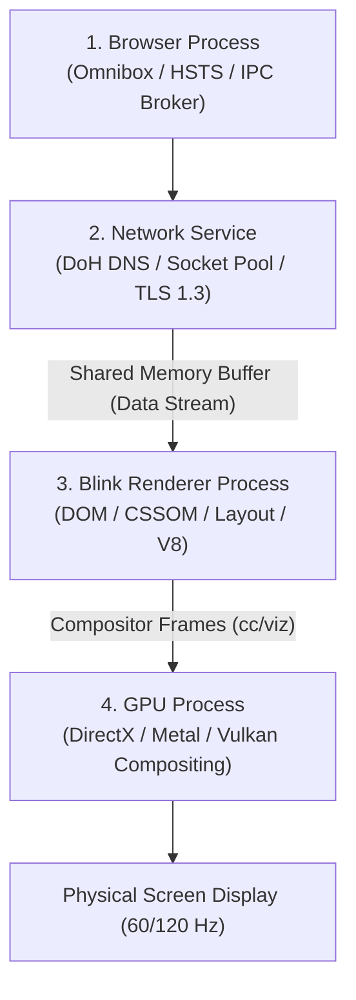
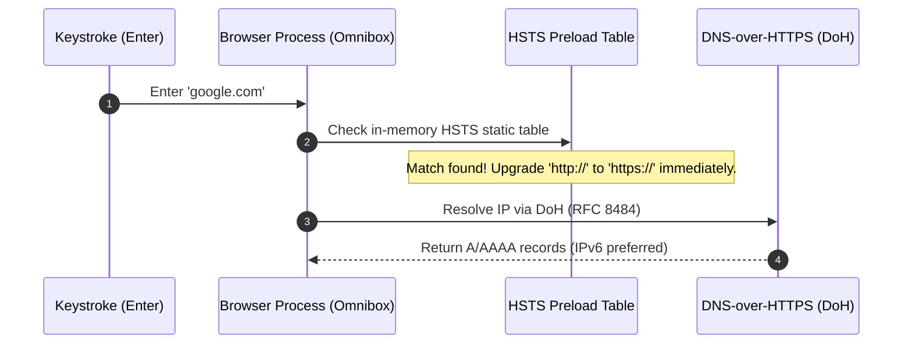
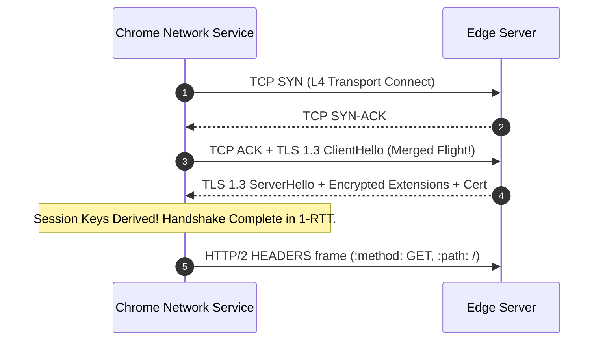
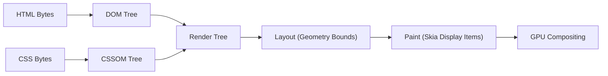

> #### ⚡ TL;DR in 30 Seconds
> * **The Omnibox is a Predictive Engine:** Before you hit Enter, Chrome has already parsed HSTS preload lists and speculative DNS preconnects for likely destinations.
> * **The Network Service Boundary:** Networking does not run in the renderer. The Browser process coordinates with a sandboxed **Network Service** via Mojo IPC, managing socket pools, DoH resolution, and TLS 1.3 sessions.
> * **Zero-Copy Payload Transfer:** When HTML arrives, the Network Service writes byte streams directly into shared memory buffers consumed by the **Blink Renderer Process**.
> * **The Critical Rendering Pipeline:** Blink parses HTML & CSS into DOM and Style trees, generates a Layout geometry tree, paints display items via Skia, and sends GPU draw calls to the physical compositor.

---

## Stage 1: The UI & Predictive Preconnect Pipeline

When your keystroke hits the Enter key, Chrome executes three rapid security checks:

1. **URL Classification:** Chrome evaluates whether the input is a search query or a valid URL.
2. **HSTS Preload Interception:** Chrome queries its internal compiled-in HSTS (HTTP Strict Transport Security) database. If the domain is listed (like Google or banking sites), Chrome rewrites `http://` to `https://` internally before issuing any network packet, preventing SSL-stripping attacks.
3. **Speculative Socket Warm-Up:** Chrome checks its `ClientSocketPool`. If an idle, pre-warmed TCP socket exists for that host, it reuses it instantly without a new 3-way handshake.

---

## Stage 2: Network Service & Socket Negotiation

If no warm socket exists, the Network Service initiates transport negotiation:

* **DNS Resolution:** Chrome uses **DNS-over-HTTPS (DoH)**, sending an encrypted JSON or binary DNS query over an existing HTTPS tunnel, preventing ISP sniffing.
* **TLS 1.3 Key Exchange:** Chrome sends an ephemeral Diffie-Hellman key share directly inside its `ClientHello`. The server responds with its key share, establishing forward secrecy in a single round trip.

---

## Stage 3: The Blink Critical Rendering Path

Once the first chunk of HTML bytes arrives, the Network Service commits the navigation and hands the data stream over to an isolated **Renderer Process**:

1. **Incremental HTML Parsing:** Blink does not wait for the entire HTML document to download. As chunks arrive, the parser constructs the DOM tree incrementally.
2. **Preload Scanner:** While the main thread parses HTML, an internal background thread (the Preload Scanner) scans ahead for critical `<link rel="stylesheet">` and `<script>` tags, dispatching high-priority network fetches before the DOM parser encounters them.
3. **Layout & Paint:** Blink calculates the exact pixel coordinates of every visible element (Layout), records Skia 2D drawing instructions (Paint), and divides the page into layers.
4. **GPU Compositing:** The Compositor thread coordinates with the GPU process to rasterize layers into GPU textures, compositing the final image onto your monitor at 60 or 120 frames per second.

---

## Hands-On Verification: Export Live Chrome NetLogs

You can inspect every microsecond of this pipeline inside Chrome right now:

1. Open a new tab and navigate to: `chrome://net-export/`
2. Click **Start Logging to Disk** and save the file.
3. Open another tab and visit any website (e.g., `https://example.com`).
4. Return to the net-export tab, click **Stop Logging**, and upload the file to [netlog-viewer.appspot.com](https://netlog-viewer.appspot.com).

You will see the exact timeline of DNS queries, socket pool warm-ups, TLS extension handshakes, and Mojo IPC message boundaries.
