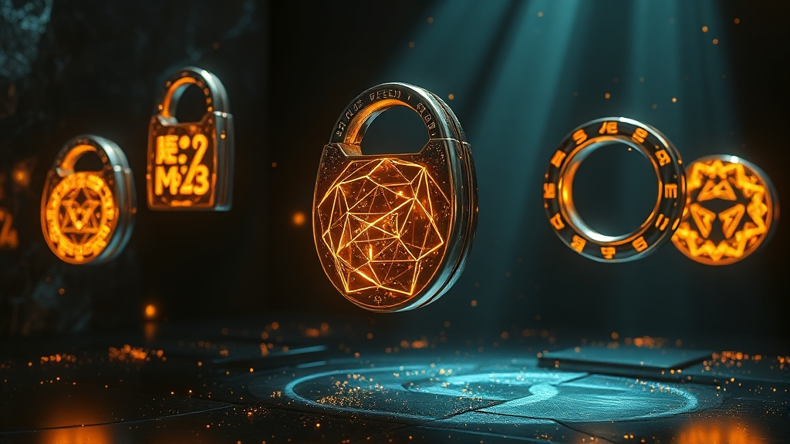
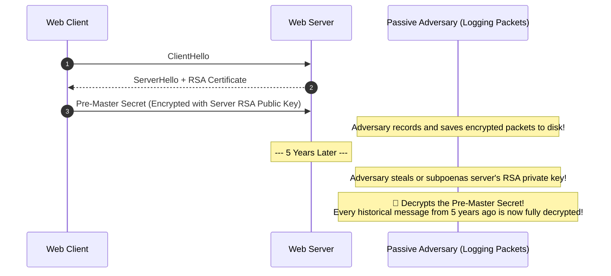
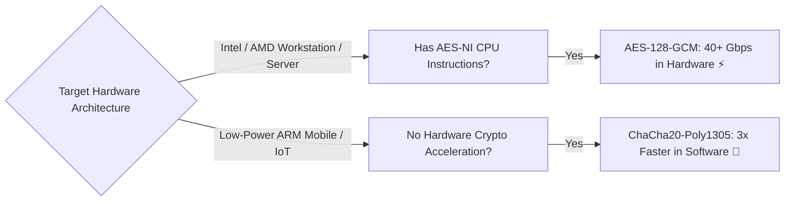

Open your terminal and ask `openssl` to show you the cryptographic algorithms it supports. 

You will be greeted by an overwhelming wall of cryptic acronyms:

```
ECDHE-RSA-AES128-GCM-SHA256
DHE-RSA-AES256-GCM-SHA384
ECDHE-ECDSA-CHACHA20-POLY1305
TLS_AES_128_GCM_SHA256
```

To most software engineers and web developers, these strings look like meaningless strings of letters mashed together by cryptographers.

Yet every single HTTPS connection you establish—whether loading a webpage in Google Chrome, executing an API call, or running a web scraper—depends on negotiating a mutually supported **cipher suite**.

What do all these abbreviations actually mean? Why did TLS 1.3 throw almost all of them in the trash? And why does the exact order of these ciphers allow anti-bot systems like Cloudflare to identify automated scripts within milliseconds?


<p class="chart-note" style="text-align: center; margin-top: -12px; margin-bottom: 24px;"><em>The cryptographic toolkit: a cipher suite is a formal negotiation defining how keys are exchanged, how certificates are verified, and how bulk payload bytes are scrambled.</em></p>

Here is the engineering breakdown of how cipher suites work, how to read them effortlessly, and why they matter in production.

---

## TLS 1.2 Monolithic Ciphers vs TLS 1.3 AEAD Ciphers at a Glance

Comparing legacy cipher suites with modern TLS 1.3 suites illustrates how the cryptographic industry radically simplified secure communication.

<div class="vs-cards">
  <div class="vs-card v12">
    <div class="vs-card-header">
      <h3>TLS 1.2 Cipher Suites</h3>
      <span class="vs-tag legacy">Monolithic & Complex</span>
    </div>
    <div class="vs-feature-list">
      <div class="vs-feature-item">
        <div class="vs-feature-title">
          <span class="vs-icon">📜</span>
          <strong>All-in-One Monolithic Naming</strong>
        </div>
        <p class="vs-feature-desc">Combines key exchange, server authentication, bulk cipher, mode, and hash algorithm into a single string.</p>
      </div>
      <div class="vs-feature-item">
        <div class="vs-feature-title">
          <span class="vs-icon">⚠️</span>
          <strong>Permitted Insecure Algorithms</strong>
        </div>
        <p class="vs-feature-desc">Allowed legacy RSA key exchange (no forward secrecy) and vulnerable CBC block modes prone to padding oracles.</p>
      </div>
      <div class="vs-feature-item">
        <div class="vs-feature-title">
          <span class="vs-icon">🐘</span>
          <strong>Combinatorial Explosion</strong>
        </div>
        <p class="vs-feature-desc">Over 37 standardized permutations led to buggy client-server negotiation and insecure fallback states.</p>
      </div>
    </div>
  </div>

  <div class="vs-card v13">
    <div class="vs-card-header">
      <h3>TLS 1.3 Cipher Suites</h3>
      <span class="vs-tag modern">Modular AEAD Only</span>
    </div>
    <div class="vs-feature-list">
      <div class="vs-feature-item">
        <div class="vs-feature-title">
          <span class="vs-icon">⚡</span>
          <strong>Decoupled Key Exchange</strong>
        </div>
        <p class="vs-feature-desc">Negotiates keys via <code>supported_groups</code> extensions, freeing cipher suites to handle payload encryption only.</p>
      </div>
      <div class="vs-feature-item">
        <div class="vs-feature-title">
          <span class="vs-icon">🔒</span>
          <strong>Mandatory AEAD Protection</strong>
        </div>
        <p class="vs-feature-desc">Restricts choices strictly to Authenticated Encryption with Associated Data (GCM, Poly1305, CCM).</p>
      </div>
      <div class="vs-feature-item">
        <div class="vs-feature-title">
          <span class="vs-icon">🎯</span>
          <strong>Just 5 Standardized Suites</strong>
        </div>
        <p class="vs-feature-desc">Only five streamlined, battle-tested suites exist in the entire protocol specification.</p>
      </div>
    </div>
  </div>
</div>

---

## 1. Anatomy of a Legacy TLS 1.2 Cipher Suite

In TLS 1.2, every cipher suite was an exhaustive recipe. 

Let us dissect one of the most widely used legacy cipher suites:

$$\mathbf{TLS\_ECDHE\_RSA\_WITH\_AES\_128\_GCM\_SHA256}$$

```
TLS_  ECDHE_  RSA_  WITH_  AES_128_GCM_  SHA256
 |      |      |               |           |
(1)    (2)    (3)             (4)         (5)
```

### 1. Protocol Prefix (`TLS_`)
Identifies the protocol family.

### 2. Key Exchange (`ECDHE`)
* **ECDHE (Elliptic Curve Diffie-Hellman Ephemeral)**: The mathematical algorithm used by the client and server to compute a shared secret key across an open, untrusted network.
* **Why "Ephemeral" Matters**: A brand-new temporary key pair is generated for every single session. Even if an adversary records all encrypted internet traffic today and steals the server's private key ten years from now, they **cannot decrypt historical traffic**. This property is called **Forward Secrecy**.

### 3. Authentication Algorithm (`RSA`)
Defines how the server proves its identity. The server signs the key exchange parameters using its private key, which corresponds to the public key in its SSL certificate.

### 4. Bulk Encryption Cipher and Mode (`AES_128_GCM`)
* **AES (Advanced Encryption Standard)**: The symmetric cipher that actually encrypts the HTTP request and response payload.
* **128**: The encryption key length in bits.
* **GCM (Galois/Counter Mode)**: An AEAD mode that encrypts the data and generates an authentication tag simultaneously, guaranteeing both **confidentiality** and **tamper-proof integrity**.

### 5. Hash / PRF Algorithm (`SHA256`)
The cryptographic hash function used by the Pseudorandom Function (PRF) to derive session keys and verify handshake integrity.

---

## 2. Why Did TLS 1.3 Throw Out RSA Key Exchange?

Historically, many servers used plain **RSA key exchange** (`TLS_RSA_WITH_AES_128_CBC_SHA`).

In static RSA key exchange:
1. The client generates a random pre-master secret.
2. The client encrypts this secret using the server’s public RSA certificate.
3. The server decrypts it using its private key.



This lack of forward secrecy was an unacceptable architectural flaw. 

In **TLS 1.3, static RSA key exchange was completely abolished**. All TLS 1.3 connections are mathematically forced to use ephemeral Diffie-Hellman key exchange (ECDHE or DHE), guaranteeing forward secrecy on 100% of connections.

---

## 3. The 5 Elegant Cipher Suites of TLS 1.3

Because key exchange and server authentication are now negotiated independently through TLS extensions (`supported_groups` and `signature_algorithms`), TLS 1.3 cipher suite names shrank dramatically:

```
TLS_AES_128_GCM_SHA256
TLS_AES_256_GCM_SHA384
TLS_CHACHA20_POLY1305_SHA256
TLS_AES_128_CCM_SHA256
TLS_AES_128_CCM_8_SHA256
```

Notice what is missing: **no key exchange algorithm and no certificate type**.

A TLS 1.3 cipher suite defines strictly two things:
1. The **Symmetric Bulk Encryption Algorithm** (and mode).
2. The **Hash Algorithm** used for HKDF (HMAC-based Extract-and-Expand Key Derivation).

---

## 4. Hardware Acceleration: AES-GCM vs ChaCha20-Poly1305

Why does Google Chrome support both **AES-GCM** and **ChaCha20-Poly1305**?

The choice comes down to **physical hardware architecture**.



### AES-GCM (The Desktop King)
Modern x86_64 processors from Intel and AMD include specialized hardware circuits called **AES-NI (New Instructions)**. 

When AES-NI is available, the CPU encrypts and decrypts AES-GCM blocks directly in hardware silicon, achieving speeds exceeding 40 Gigabits per second per core with near-zero CPU load.

### ChaCha20-Poly1305 (The Mobile Hero)
Many budget Android smartphones, smart TVs, and embedded IoT processors lack dedicated AES hardware instructions. 

Executing AES in software on these chips is slow and susceptible to **cache-timing side-channel attacks**.

Google designed **ChaCha20-Poly1305** (invented by cryptographer Daniel J. Bernstein) specifically to run blazing fast in pure software using basic 32-bit integer arithmetic. On chips without AES-NI, ChaCha20 is up to **300% faster** than AES.

Google Chrome automatically prioritizes `TLS_CHACHA20_POLY1305_SHA256` when running on mobile devices without AES hardware, while prioritizing `TLS_AES_128_GCM_SHA256` on high-end laptops and servers.

---

## 5. Benchmark: Cryptographic Throughput Across Hardware

How do bulk ciphers perform across different computing environments?





---

## 6. The Anti-Bot & Fingerprinting Trap

When your client initiates an HTTPS connection, it transmits its supported cipher suites in the `ClientHello` packet as a list of 16-bit integers:

```
Cipher Suites:
  0x1301 - TLS_AES_128_GCM_SHA256
  0x1302 - TLS_AES_256_GCM_SHA384
  0x1303 - TLS_CHACHA20_POLY1305_SHA256
  0xc02b - TLS_ECDHE_ECDSA_WITH_AES_128_GCM_SHA256
  0xc02f - TLS_ECDHE_RSA_WITH_AES_128_GCM_SHA256
```

In **JA3** and **JA4** fingerprinting:
* The exact cryptographic suites supported,
* The exact order in which they appear,
* And the presence or absence of TLS 1.3 GREASE values,

create a unique fingerprint hash.

### Why Python `requests` Gets Flagged:
Standard Python `requests` links against your operating system's standard **OpenSSL** library. OpenSSL advertises dozens of legacy suites (like CBC modes) that Google Chrome removed years ago, and places them in an order completely foreign to Chromium's **BoringSSL** engine.

When an anti-bot system like Cloudflare or DataDome inspects the `ClientHello`, it compares the advertised ciphers against the client's `User-Agent`. If your User-Agent claims to be Chrome 128 but your cipher list matches OpenSSL 3.0, the request is flagged immediately.

---

## 7. How to Inspect Cipher Suites via Terminal

You can test and inspect which cipher suites a server supports using `openssl`:

```bash
# 1. Connect and inspect the negotiated cipher suite:
openssl s_client -connect github.com:443 -tls1_3 < /dev/null 2>/dev/null | grep -E "Protocol|Cipher"

# Sample Output:
# Protocol  : TLSv1.3
# Cipher    : TLS_AES_128_GCM_SHA256

# 2. Test if a server supports ChaCha20:
openssl s_client -connect github.com:443 -ciphersuites TLS_CHACHA20_POLY1305_SHA256 < /dev/null 2>/dev/null | grep "Cipher is"
```

---

## Production Takeaways for Engineers

| Property | Legacy TLS 1.2 | Modern TLS 1.3 | Production Standard |
| :--- | :--- | :--- | :--- |
| **Forward Secrecy** | Optional (Static RSA allowed) | **Mandatory** (ECDHE / DHE only) | Disable static RSA on all web servers. |
| **Integrity Check** | MAC-then-Encrypt / Encrypt-then-MAC | **AEAD Only** (GCM / Poly1305) | Never permit legacy CBC block ciphers. |
| **Complexity** | 37+ monolithic permutations | **5 clean AEAD suites** | Streamlines security audits and configuration. |
| **Mobile Speed** | Slow software AES | **ChaCha20-Poly1305** | Prioritize ChaCha20 for mobile app backends. |
| **Bot Detection** | Handshake order cataloged in JA3 | Normalized in JA4 | Use `curl_cffi` to mirror Chromium BoringSSL ordering. |

Cipher suites are no longer confusing once you understand their modular building blocks. By migrating to TLS 1.3 and ensuring your automation tools emit realistic cipher profiles, you guarantee both unbreakable cryptographic security and seamless protocol identity.
