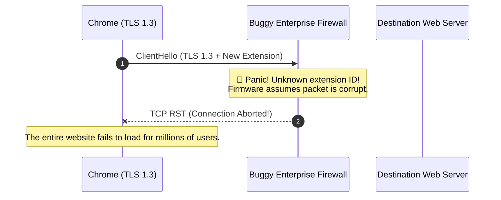
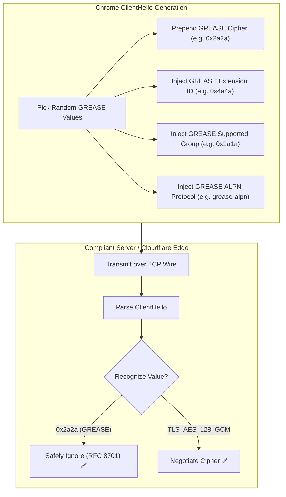
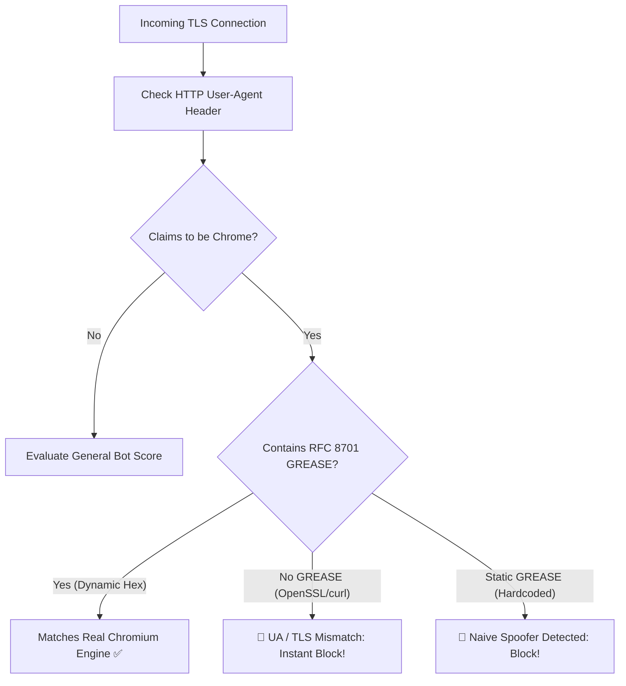

Open Wireshark, start a packet capture, and navigate to any HTTPS website in Google Chrome. 

If you drill down into the unencrypted **`ClientHello`** packet, you will spot something bizarre. Sitting right alongside standardized cryptographic ciphers like `TLS_AES_128_GCM_SHA256` is a strange hexadecimal number:

```
Cipher Suite: Reserved (GREASE) (0x2a2a)
Extension: Reserved (GREASE) (0x1a1a)
Supported Group: Reserved (GREASE) (0x4a4a)
```

Chrome is intentionally transmitting numbers that have no cryptographic meaning, negotiate no encryption algorithms, and provide zero security.

Why would the most widely used web browser on Earth deliberately bloat its network packets with meaningless garbage?

The answer is **GREASE**—short for **Generate Random Extensions And Sustain Extensibility** ([RFC 8701](https://datatracker.ietf.org/doc/html/rfc8701)).


<p class="chart-note" style="text-align: center; margin-top: -12px; margin-bottom: 24px;"><em>Sustaining extensibility: GREASE deliberately introduces random pseudo-values into network protocols to prevent middleboxes from calcifying on fixed software assumptions.</em></p>

Here is the engineering story of protocol ossification, why Google invented GREASE, and how anti-bot systems exploit these garbage values to detect automated scripts.

---

## Standard OpenSSL vs Chromium BoringSSL with GREASE

Most programming languages use standard OpenSSL or Go's standard library, creating a stark contrast with modern browser TLS engines.

<div class="vs-cards">
  <div class="vs-card v12">
    <div class="vs-card-header">
      <h3>Standard HTTP Client</h3>
      <span class="vs-tag legacy">Python requests, curl, Go crypto/tls</span>
    </div>
    <div class="vs-feature-list">
      <div class="vs-feature-item">
        <div class="vs-feature-title">
          <span class="vs-icon">📦</span>
          <strong>Pure Standard Ciphers Only</strong>
        </div>
        <p class="vs-feature-desc">Transmits strictly registered IANA cipher suite IDs and standard TLS extension codes.</p>
      </div>
      <div class="vs-feature-item">
        <div class="vs-feature-title">
          <span class="vs-icon">🚫</span>
          <strong>Zero GREASE Injection</strong>
        </div>
        <p class="vs-feature-desc">Does not implement RFC 8701; never generates reserved dummy hex values.</p>
      </div>
      <div class="vs-feature-item">
        <div class="vs-feature-title">
          <span class="vs-icon">🔒</span>
          <strong>Static JA3 Signature</strong>
        </div>
        <p class="vs-feature-desc">Produces an invariant, predictable TLS fingerprint easily cataloged in threat databases.</p>
      </div>
      <div class="vs-feature-item">
        <div class="vs-feature-title">
          <span class="vs-icon">🚨</span>
          <strong>Instant Chrome Mismatch</strong>
        </div>
        <p class="vs-feature-desc">A User-Agent claiming Chrome without GREASE in its packet is blocked on sight by WAFs.</p>
      </div>
    </div>
  </div>

  <div class="vs-card v13">
    <div class="vs-card-header">
      <h3>Modern Browser</h3>
      <span class="vs-tag modern">Google Chrome, Safari, Chromium Edge</span>
    </div>
    <div class="vs-feature-list">
      <div class="vs-feature-item">
        <div class="vs-feature-title">
          <span class="vs-icon">🎲</span>
          <strong>Dynamic Reserved Value Selection</strong>
        </div>
        <p class="vs-feature-desc">Picks random reserved 16-bit values from the RFC 8701 pool for every new TLS session.</p>
      </div>
      <div class="vs-feature-item">
        <div class="vs-feature-title">
          <span class="vs-icon">🛡️</span>
          <strong>Active Anti-Ossification</strong>
        </div>
        <p class="vs-feature-desc">Forces all intermediate proxies and enterprise firewalls to tolerate unknown protocol extensions.</p>
      </div>
      <div class="vs-feature-item">
        <div class="vs-feature-title">
          <span class="vs-icon">🧩</span>
          <strong>Multi-Field Injection</strong>
        </div>
        <p class="vs-feature-desc">Injects GREASE across Ciphers, Extensions, Supported Groups, Key Shares, and ALPN.</p>
      </div>
      <div class="vs-feature-item">
        <div class="vs-feature-title">
          <span class="vs-icon">🚀</span>
          <strong>Authentic Browser Signal</strong>
        </div>
        <p class="vs-feature-desc">Matches the exact protocol behavior expected by Cloudflare, Akamai, and AWS CloudFront.</p>
      </div>
    </div>
  </div>
</div>

---

## 1. The Nightmare of Protocol Ossification

To understand why GREASE exists, we have to revisit the painful birth of **TLS 1.3**.

When internet protocols are designed, specifications explicitly tell engineers: 
> *"If your server or network equipment encounters a cipher suite or extension ID it does not recognize, **ignore it safely** and continue the connection."*

In theory, this allows the protocol to evolve seamlessly over time. In practice, enterprise hardware manufacturers cut corners.

For over a decade, network appliances—such as corporate firewalls, deep-packet inspection (DPI) boxes, and anti-virus gateways (collectively called **middleboxes**)—sat quietly between human users and the internet. Because no new TLS versions had shipped in years, middlebox developers hardcoded buggy assumptions into their firmware:

```c
// Buggy middlebox logic in the wild:
if (client_hello.version > TLS_1_2) {
    drop_connection(); // Crash or abort! "Unknown version detected!"
}
if (client_hello.cipher_suite > KNOWN_MAX) {
    terminate_session(); // Abort! "Malicious packet!"
}
```

The internet suffered from **protocol ossification**: the protocol had become calcified like bone.



When Google and the IETF attempted to roll out early drafts of TLS 1.3, connections failed for millions of users. Buggy middleboxes panicked when they encountered unknown extensions or new version numbers. 

To fix the internet, engineers had to disguise TLS 1.3 as TLS 1.2 using legacy session IDs and version negotiation hacks.

Google realized that if you only introduce new protocol values every 10 years, the internet will break every 10 years. 

Their countermeasure was ingenious: **break buggy software immediately and continuously.**

---

## 2. How GREASE Works (RFC 8701)

The principle of GREASE is simple: **use it or lose it**.

If browsers inject fake, unknown values into every single connection, middlebox vendors cannot hardcode fixed lists of known ciphers. If a vendor builds a firewall that crashes on unknown values, it will crash on Google Chrome the very day it ships to customers.

The IETF reserved sixteen distinct 16-bit values specifically for GREASE:

```
0x0a0a  0x1a1a  0x2a2a  0x3a3a
0x4a4a  0x5a5a  0x6a6a  0x7a7a
0x8a8a  0x9a9a  0xaaaa  0xbaba
0xcaca  0xdada  0xeaea  0xfafa
```

Notice the pattern: both bytes are identical (`0x?a?a`), and the low nibble of each byte is always `0xa` (`1010` in binary). These values were chosen specifically so they would never collide with legitimate cryptographic algorithms registered by IANA.

When Google Chrome connects to a website, its BoringSSL cryptographic engine picks random values from this pool and injects them into multiple fields of the `ClientHello`:



Servers conforming to the TLS specification simply ignore GREASE values and negotiate the real ciphers.

---

## 3. The Scraping Trap: The JA3 vs JA4 Fingerprint War

While GREASE was designed to save internet protocols from ossification, it created a massive dilemma for **TLS fingerprinting**.

In 2017, Salesforce released **JA3**, an algorithm that creates an MD5 hash of a client's TLS parameters:

$$\text{JA3} = \text{MD5}(\text{TLSVersion, Ciphers, Extensions, EllipticCurves, EllipticCurvePointFormats})$$

Because JA3 did not filter out GREASE values, and Chrome randomly selects different GREASE values for every connection:

$$\text{Chrome Session 1 (0x2a2a)} \neq \text{Chrome Session 2 (0x5a5a)}$$

A single version of Google Chrome produced **hundreds of different JA3 hashes!**

In 2023, security researcher John Althouse released **JA4**. Unlike JA3, JA4 explicitly normalizes TLS packets by stripping out all sixteen RFC 8701 GREASE values before hashing.

```
JA3 Hash:  b32309a26cedf138dc723f8f877fb14b (Varies randomly with GREASE)
JA4 Hash:  t13d1516h2_8daaf6152771_0266e5a610cbd (Stable, canonical signature)
```

---

## 4. Why GREASE Betrays Automated Scrapers

Modern anti-bot engines (like Cloudflare, Akamai, and DataDome) use GREASE as a high-fidelity bot detection heuristic.

Here is how scrapers walk directly into the trap:



### The Three Common Scraper Mistakes:

1. **Zero GREASE (Python `requests` / standard `curl`)**: 
   Your script sends `User-Agent: Mozilla/5.0 (Windows NT 10.0; Win64; x64) Chrome/128.0.0.0`. 
   However, your Python `requests` library uses OpenSSL, which emits zero GREASE values. The WAF spots the mismatch at Layer 4 and blocks your request immediately.

2. **Hardcoded Static GREASE**:
   A developer attempts to fake GREASE by always injecting `0x2a2a` into their custom TLS client. Real Chrome never sends the exact same GREASE value on every request. An invariant GREASE value is an unmistakable indicator of an amateur bot.

3. **Wrong Field Injection**:
   Chromium injects GREASE into very specific positions: typically prepended as the first cipher suite, and inserted in randomized extension slots. Emitting GREASE at the end of the cipher list violates Chromium's BoringSSL conventions.

---

## 5. Benchmark: Fingerprint Accuracy & Ban Rates

How do different TLS implementations perform when challenged by WAFs inspecting Layer 4 signatures?

{% include chart.html type="columns" title="GREASE Compliance by Client Library (100% = Full Chrome Parity)" labels="Chrome BoringSSL|curl_cffi / uTLS|Safari SecureTransport|Standard OpenSSL / Python|Standard Go crypto/tls" values="100|98|100|0|0" suffix="%" scale="100" highlight="Chrome BoringSSL" note="Standard programming language networking libraries completely lack GREASE support by default." %}

{% include chart.html type="grouped" title="Block Rate with Fake Chrome User-Agent (%)" series="Standard Client (No GREASE)|Impersonated Client (curl_cffi / uTLS)" labels="Cloudflare Turnstile|Akamai Edge|DataDome|AWS WAF" values="98,4|95,6|99,8|75,2" suffix="%" scale="100" note="Spoofing a Chrome User-Agent without GREASE guarantees a 95%+ block rate across tier-1 WAFs." %}

---

## 6. How to Implement GREASE in Your Scrapers

If you build scrapers or API automation tools, never rely on standard Python `requests` or standard `urllib3` for protected endpoints.

Instead, use libraries that implement **uTLS** (such as `curl_cffi` in Python or `tls-client` in Go):

```python
# 🚀 The Modern Solution: curl_cffi with full BoringSSL emulation
from curl_cffi import requests

response = requests.get(
    "https://tls.peet.ws/api/all",
    impersonate="chrome124" # Automatically injects authentic dynamic GREASE values!
)

print(response.json()["tls"]["ja4"])
```

Under the hood, `curl_cffi` compiles a customized build of `curl` linked against Google's BoringSSL. It randomly selects RFC 8701 values, inserts them into the correct extension offsets, and presents a 100% authentic browser fingerprint on the wire.

---

## 7. How to Inspect GREASE with `tshark`

You can verify whether your automation client is generating valid GREASE values using terminal tools:

```bash
# Capture and inspect the first TLS ClientHello on port 443:
tshark -i any -f "tcp port 443" -Y "tls.handshake.type == 1" \
  -T fields -e tls.handshake.ciphersuite -e tls.handshake.extension.type

# Look for matching pairs in the output:
# 0x0a0a, 0x1a1a, 0x2a2a, 0x3a3a, 0x4a4a, 0x5a5a, 0x6a6a, 0x7a7a,
# 0x8a8a, 0x9a9a, 0xaaaa, 0xbaba, 0xcaca, 0xdada, 0xeaea, 0xfafa
```

---

## Production Takeaways for Network Engineers

| Topic | Key Finding | Action Item |
| :--- | :--- | :--- |
| **Origin** | RFC 8701 (Google BoringSSL) | Designed to prevent enterprise middlebox protocol ossification. |
| **Value Pool** | 16 reserved 16-bit hex codes (`0x?a?a`) | Never collide with valid IANA cipher suite registrations. |
| **JA3 Impact** | Caused severe fingerprint fragmentation | Modern security architectures must migrate to **JA4** for normalization. |
| **Scraper Defense** | Major heuristic for anti-bot detection | Never send Chrome User-Agents from standard OpenSSL or Go runtimes. |
| **Recommended Tool** | `curl_cffi` / `tls-client` | Emulate genuine BoringSSL handshakes with dynamic GREASE generation. |

By deliberately injecting harmless chaos into network packets, GREASE keeps the internet open to future cryptographic innovation. For developers, understanding this mechanism is the difference between a crawler that gets blocked on the first packet and one that operates invisibly.
