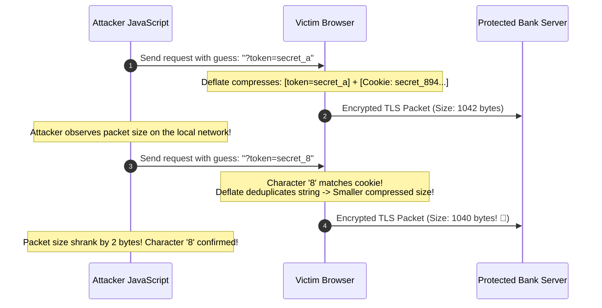
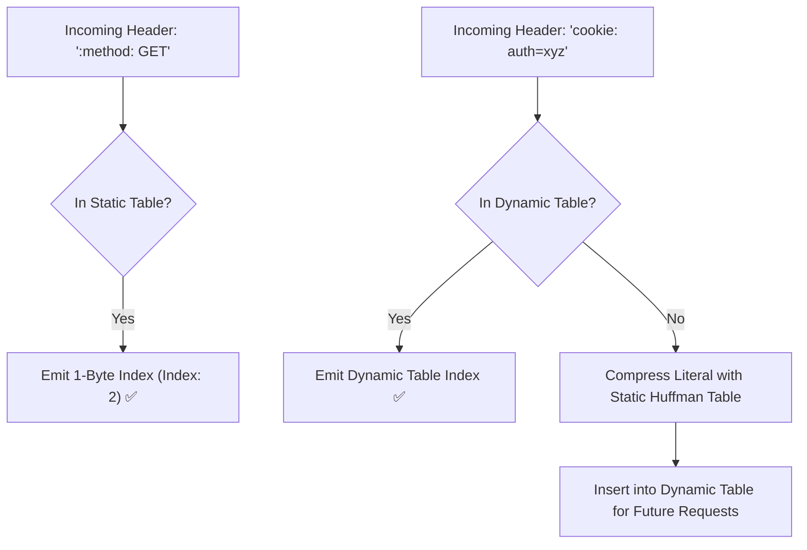
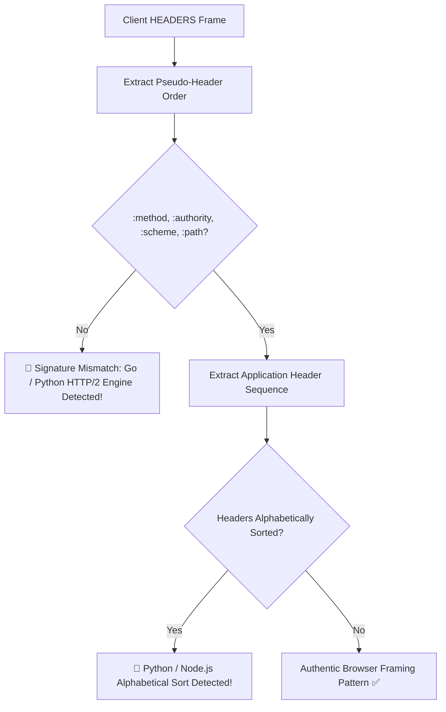

In HTTP/1.1, headers were simple ASCII strings separated by carriage return and line feed characters (`\r\n`). Every single image, stylesheet, and API call retransmitted the exact same monolithic headers:

```http
User-Agent: Mozilla/5.0 (Windows NT 10.0; Win64; x64)...
Cookie: session_id=9f83a...; tracking_id=8831a...; auth=eyJhbG...
Accept-Encoding: gzip, deflate, br
```

On modern web pages making 150 requests, browsers re-sent roughly **200 to 500 kilobytes of duplicate header data** per page view.

When the IETF designed **HTTP/2**, fixing this header bloat was a primary goal. But they could not simply wrap headers in standard `gzip` or `deflate` compression algorithms. Doing so would reopen one of the most dangerous cryptographic exploits in web history: the **CRIME attack**.

Instead, they invented **HPACK** ([RFC 7541](https://datatracker.ietf.org/doc/html/rfc7541)).


<p class="chart-note" style="text-align: center; margin-top: -12px; margin-bottom: 24px;"><em>Header compression without compromise: HPACK replaces redundant ASCII strings with stateful indexed tables and static Huffman trees, shrinking repetitive headers by up to 85%.</em></p>

Here is the engineering breakdown of how HPACK works, why the CRIME attack forced its creation, and how anti-bot systems use HTTP/2 header ordering to fingerprint automated tools.

---

## HTTP/1.1 Plaintext vs HTTP/2 HPACK at a Glance

The transition from HTTP/1.1 to HTTP/2 completely fundamentally transformed the structure of HTTP headers.

<div class="vs-cards">
  <div class="vs-card v12">
    <div class="vs-card-header">
      <h3>HTTP/1.1 Headers</h3>
      <span class="vs-tag legacy">Stateless Plaintext ASCII</span>
    </div>
    <div class="vs-feature-list">
      <div class="vs-feature-item">
        <div class="vs-feature-title">
          <span class="vs-icon">📜</span>
          <strong>Uncompressed Verbose ASCII</strong>
        </div>
        <p class="vs-feature-desc">Every request retransmits identical cookie strings, user-agents, and accept headers in full plaintext.</p>
      </div>
      <div class="vs-feature-item">
        <div class="vs-feature-title">
          <span class="vs-icon">🔀</span>
          <strong>Order-Independent Flexibility</strong>
        </div>
        <p class="vs-feature-desc">Proxies, servers, and clients could shuffle header line orders without affecting connection state.</p>
      </div>
      <div class="vs-feature-item">
        <div class="vs-feature-title">
          <span class="vs-icon">🐘</span>
          <strong>Substantial Network Overhead</strong>
        </div>
        <p class="vs-feature-desc">Consumes 500–1400 bytes per request, often exceeding the initial TCP congestion window (CWND).</p>
      </div>
      <div class="vs-feature-item">
        <div class="vs-feature-title">
          <span class="vs-icon">🔓</span>
          <strong>Stateless Transport</strong>
        </div>
        <p class="vs-feature-desc">No shared memory between consecutive requests; losing a packet never desynchronizes header state.</p>
      </div>
    </div>
  </div>

  <div class="vs-card v13">
    <div class="vs-card-header">
      <h3>HTTP/2 HPACK</h3>
      <span class="vs-tag modern">Stateful Binary Tables</span>
    </div>
    <div class="vs-feature-list">
      <div class="vs-feature-item">
        <div class="vs-feature-title">
          <span class="vs-icon">⚡</span>
          <strong>Static & Dynamic Indexing</strong>
        </div>
        <p class="vs-feature-desc">Frequent headers are replaced with single-byte integer indices pointing to shared memory tables.</p>
      </div>
      <div class="vs-feature-item">
        <div class="vs-feature-title">
          <span class="vs-icon">🔒</span>
          <strong>CRIME-Resistant Huffman Trees</strong>
        </div>
        <p class="vs-feature-desc">Custom static Huffman encoding compresses unique string literals without leaking cross-boundary secrets.</p>
      </div>
      <div class="vs-feature-item">
        <div class="vs-feature-title">
          <span class="vs-icon">🪶</span>
          <strong>Dramatic Payload Reduction</strong>
        </div>
        <p class="vs-feature-desc">Subsequent requests on an established connection shrink to as little as 10–20 bytes of header frames.</p>
      </div>
      <div class="vs-feature-item">
        <div class="vs-feature-title">
          <span class="vs-icon">🔍</span>
          <strong>Strict Frame Ordering</strong>
        </div>
        <p class="vs-feature-desc">Header and pseudo-header sequences are fixed in binary frames, creating high-entropy client fingerprints.</p>
      </div>
    </div>
  </div>
</div>

---

## 1. Why Not Gzip? The CRIME Attack

When SPDY (the predecessor to HTTP/2) was initially designed, engineers compressed headers using standard **zlib/gzip deflate**.

In 2012, security researchers Juliano Rizzo and Thai Duong published **CRIME** (Compression Ratio Info-leak Made Easy).

The exploit was terrifyingly simple. In deflate, repeated sequences of characters are replaced with backward pointers. If an attacker can inject arbitrary query parameters into a request (e.g. `https://bank.com/?q=secret_cookie_prefix`), the browser includes both the attacker's input and the secret authentication cookie in the same compressed header block:



By guessing one character at a time and watching the exact byte size of the encrypted TLS packet shrink, an attacker could extract secret authentication cookies in minutes—even over encrypted HTTPS!

To eliminate CRIME, HTTP/2 completely banned standard stream compression. **HPACK was engineered specifically to be immune to length-leakage attacks.**

---

## 2. The Three Mechanics of HPACK

HPACK achieves massive compression without vulnerability through three cooperative mechanisms:



### 1. The Static Table (61 Pre-defined Entries)
The IETF hardcoded 61 common headers and values into the RFC 7541 specification:
* Index `2`: `:method: GET`
* Index `3`: `:method: POST`
* Index `6`: `:scheme: http`
* Index `7`: `:scheme: https`
* Index `14`: `:status: 200`

If your browser sends `GET https://...`, it does not transmit the letters `G-E-T`. It sends the single byte representing index `2`.

### 2. The Dynamic Table (Stateful FIFO Memory)
When a browser sends a custom header (e.g., `authorization: Bearer token123`), the client transmits the value once and instructs the server to store it in a shared **Dynamic Table**.

On the next request, the client simply sends a pointer to that dynamic table slot. As long as the connection stays open, large cookies and authorization tokens consume zero string bytes over the wire.

### 3. Static Huffman Coding
When string literals must be sent, HPACK compresses them using a static Huffman tree constructed from a statistical analysis of millions of real-world HTTP headers. Common ASCII characters like `e`, `a`, and `/` consume only 5 bits, while rare characters consume up to 30 bits.

---

## 3. Pseudo-Headers: The Foundation of HTTP/2

HTTP/2 replaces the HTTP/1.1 request line (`GET /index.html HTTP/1.1`) with four mandatory **pseudo-headers** starting with a colon `:`:

1. **`:method`**: The HTTP action (`GET`, `POST`, `PUT`, `DELETE`).
2. **`:scheme`**: The protocol target (`https` or `http`).
3. **`:authority`**: The destination hostname and port (`example.com:443`).
4. **`:path`**: The resource path and query string (`/api/v1/users?id=10`).

In HTTP/2 specifications:
* All pseudo-headers **must appear before regular HTTP headers** in the `HEADERS` frame.
* Pseudo-headers are strictly reserved; sending an unrecognized pseudo-header results in an immediate connection termination (`PROTOCOL_ERROR`).

---

## 4. The Anti-Bot Fingerprint: Akamai HTTP/2 Hashes

In HTTP/1.1, header order was largely considered irrelevant. 

In HTTP/2, **header order is an immutable fingerprint**.

When Google Chrome compiles its C++ networking stack (`//net/spdy`), it serializes pseudo-headers and application headers in a rigid, hardcoded sequence:

```
Chromium Native Header Order:
1. :method
2. :authority
3. :scheme
4. :path
5. sec-ch-ua
6. sec-ch-ua-mobile
7. sec-ch-ua-platform
8. upgrade-insecure-requests
9. user-agent
10. accept
11. sec-fetch-site
12. sec-fetch-mode
13. sec-fetch-user
14. sec-fetch-dest
15. accept-encoding
16. accept-language
```

Now consider what happens when a developer uses Python `httpx`, Go `net/http`, or Node.js `axios`:

* Go's `net/http` serializes pseudo-headers as `:authority`, `:method`, `:path`, `:scheme`.
* Python `httpx` frequently sorts application headers alphabetically (`accept` $\rightarrow$ `accept-encoding` $\rightarrow$ `user-agent`).
* Firefox serializes pseudo-headers as `:method`, `:path`, `:authority`, `:scheme`.

Major bot mitigation platforms (like Akamai Bot Manager and Cloudflare) calculate an **HTTP/2 Fingerprint Hash**:

$$\text{HTTP/2 Fingerprint} = \text{MD5}(\text{SETTINGS} \mid \text{WINDOW\_UPDATE} \mid \text{PRIORITIES} \mid \text{HEADER\_SEQUENCE})$$



If your User-Agent claims to be Chrome on Windows, but your HTTP/2 frames arrive in alphabetical order or with Go's pseudo-header layout, the WAF flags your request before executing a single line of backend application code.

---

## 5. Benchmark: HPACK Compression Efficiency

How much bandwidth does HPACK save across a real browsing session, and how does it impact latency?



{% include chart.html type="grouped" title="Header Serialization Speed vs Detection Rate" series="Python httpx (Default)|Go net/http (Standard)|curl_cffi (Chrome Parity)" labels="Akamai Bot Manager|Cloudflare Turnstile|DataDome" values="94,4|89,6|98,5" suffix="%" scale="100" note="Standard HTTP/2 implementations in Python and Go trigger over 90% detection rates on protected endpoints." %}

---

## 6. How to Achieve HTTP/2 Parity in Code

To pass HTTP/2 fingerprinting checks, your client must respect both Chromium's pseudo-header sequence and its HPACK dynamic table sizing:

```python
# 🚀 Python Parity with curl_cffi:
from curl_cffi import requests

# curl_cffi implements nghttp2 with Chromium's exact binary framing:
response = requests.get(
    "https://tls.peet.ws/api/all",
    impersonate="chrome124",
    headers={
        # Maintain exact casing and realistic ordering:
        "sec-ch-ua": '"Chromium";v="124", "Google Chrome";v="124"',
        "sec-ch-ua-mobile": "?0",
        "sec-ch-ua-platform": '"Windows"',
        "upgrade-insecure-requests": "1",
        "user-agent": "Mozilla/5.0 (Windows NT 10.0; Win64; x64) AppleWebKit/537.36 Chrome/124.0.0.0 Safari/537.36",
        "accept": "text/html,application/xhtml+xml,application/xml;q=0.9,image/webp,*/*;q=0.8",
        "sec-fetch-site": "none",
        "sec-fetch-mode": "navigate",
        "sec-fetch-user": "?1",
        "sec-fetch-dest": "document",
        "accept-encoding": "gzip, deflate, br, zstd",
        "accept-language": "en-US,en;q=0.9",
    }
)

print("Akamai H2 Hash:", response.json()["http2"]["akamai_fingerprint"])
```

---

## 7. Inspecting HTTP/2 Frames via CLI

You can inspect raw HTTP/2 binary framing using `nghttp` (from the `nghttp2` package):

```bash
# Install nghttp2 client tools:
# brew install nghttp2 (macOS) or apt-get install nghttp2-client (Ubuntu)

# Fetch headers with verbose frame logging:
nghttp -nv https://example.com/

# Look for:
# - SETTINGS frame parameters (HEADER_TABLE_SIZE, MAX_CONCURRENT_STREAMS)
# - HEADERS frame flags (END_STREAM, END_HEADERS)
# - Pseudo-header ordering (:method, :scheme, :authority, :path)
```

---

## Production Takeaways for Engineers

| Component | Technical Role | Anti-Bot Significance |
| :--- | :--- | :--- |
| **HPACK Compression** | Eliminates redundant headers via static/dynamic tables | Dynamic table updates track state across persistent TCP connections. |
| **CRIME Defense** | Prohibits stream-level deflate compression | Ensures header compression never exposes sensitive session tokens. |
| **Pseudo-Headers** | Binary representation of HTTP request lines | Fixed order (`:method`, `:authority`, `:scheme`, `:path`) identifies browser family. |
| **Header Casing** | Strictly lowercase in HTTP/2 (`user-agent`) | Uppercase headers (`User-Agent`) indicate broken HTTP/2 client libraries. |
| **Akamai Hash** | Composite fingerprint of HTTP/2 framing | Mismatches between HTTP/2 frames and User-Agent result in immediate blocks. |

HTTP/2 transformed web headers from simple ASCII text into an optimized binary protocol. For engineers building automated systems, respecting the nuanced order and framing of HPACK is just as vital as negotiating the correct TLS ciphers.
