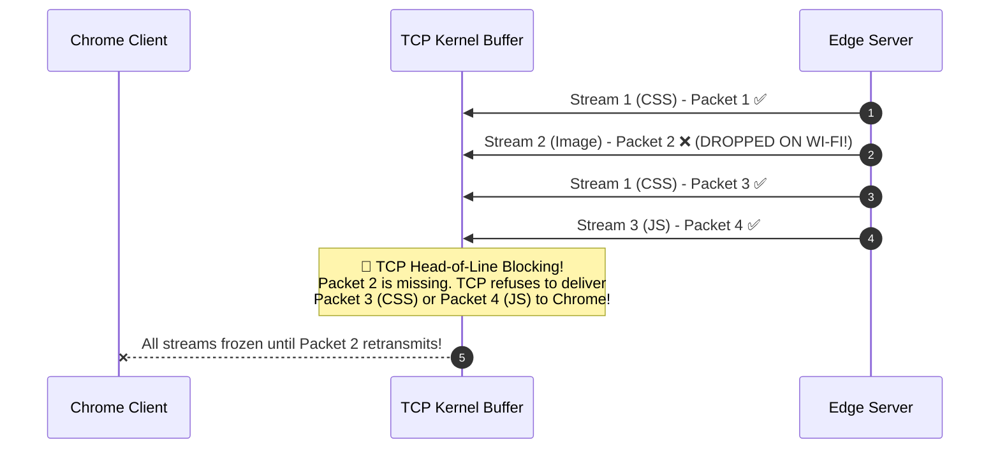
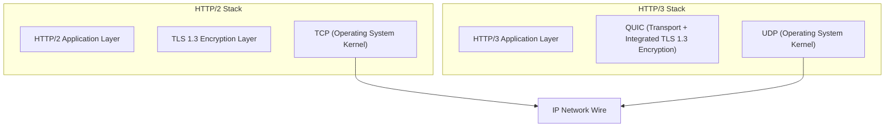
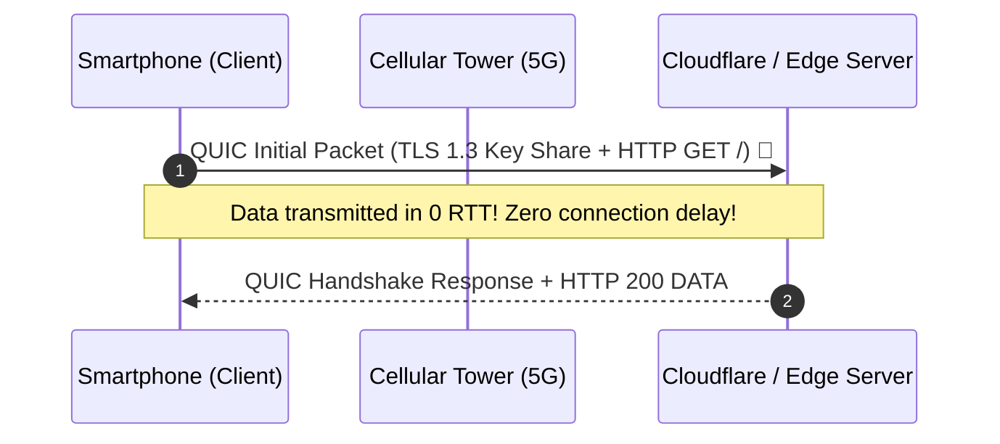

For over forty years, the Transmission Control Protocol (TCP) was the bedrock of the internet. 

Every milestone in web evolution—from the early days of HTTP/0.9 to the multiplexed binary streams of HTTP/2—relied entirely on TCP to transport data across the world.

Then, in 2022, the IETF ratified **HTTP/3** ([RFC 9114](https://datatracker.ietf.org/doc/html/rfc9114)).

Instead of optimizing TCP one more time, engineers did something radical: **they abandoned TCP completely**.

HTTP/3 does not use TCP. It runs on top of **UDP (User Datagram Protocol)** using a brand-new transport protocol called **QUIC** ([RFC 9000](https://datatracker.ietf.org/doc/html/rfc9000)).

Why did Google, Cloudflare, and the internet standards community abandon the most battle-tested protocol in computer history?

The answer is a fatal architectural flaw that crippled HTTP/2 on modern smartphones: **Transport-Layer Head-of-Line Blocking**.


<p class="chart-note" style="text-align: center; margin-top: -12px; margin-bottom: 24px;"><em>The transport transition: moving from rigid, single-stream TCP byte streams to independent, encrypted UDP datagram channels with native connection migration.</em></p>

Here is the engineering breakdown of why HTTP/2 struggled on lossy wireless networks, how QUIC fixes it, and what HTTP/3 means for network performance.

---

## HTTP/2 over TCP vs HTTP/3 over QUIC/UDP at a Glance

Comparing transport characteristics reveals why HTTP/3 delivers unmatched resilience on mobile networks.

<div class="vs-cards">
  <div class="vs-card v12">
    <div class="vs-card-header">
      <h3>HTTP/2 over TCP</h3>
      <span class="vs-tag legacy">OS Kernel Transport</span>
    </div>
    <div class="vs-feature-list">
      <div class="vs-feature-item">
        <div class="vs-feature-title">
          <span class="vs-icon">⛓️</span>
          <strong>Rigid Byte-Stream Serialization</strong>
        </div>
        <p class="vs-feature-desc">All multiplexed HTTP streams share a single TCP sequence; losing one packet halts all other streams.</p>
      </div>
      <div class="vs-feature-item">
        <div class="vs-feature-title">
          <span class="vs-icon">🐢</span>
          <strong>Multi-Round-Trip Setup</strong>
        </div>
        <p class="vs-feature-desc">Requires independent TCP 3-way handshake (1 RTT) followed by TLS 1.3 negotiation (1 RTT) before sending data.</p>
      </div>
      <div class="vs-feature-item">
        <div class="vs-feature-title">
          <span class="vs-icon">💥</span>
          <strong>Fragile IP Binding</strong>
        </div>
        <p class="vs-feature-desc">Connections are identified by a 4-tuple (source IP/port, dest IP/port); switching from Wi-Fi to 5G breaks the connection.</p>
      </div>
    </div>
  </div>

  <div class="vs-card v13">
    <div class="vs-card-header">
      <h3>HTTP/3 over QUIC</h3>
      <span class="vs-tag modern">User-Space UDP Protocol</span>
    </div>
    <div class="vs-feature-list">
      <div class="vs-feature-item">
        <div class="vs-feature-title">
          <span class="vs-icon">⚡</span>
          <strong>Independent Stream Multiplexing</strong>
        </div>
        <p class="vs-feature-desc">Packet loss in one stream never blocks or delays packets belonging to another stream.</p>
      </div>
      <div class="vs-feature-item">
        <div class="vs-feature-title">
          <span class="vs-icon">🚀</span>
          <strong>Unified 0-RTT / 1-RTT Handshake</strong>
        </div>
        <p class="vs-feature-desc">Fuses transport and cryptographic negotiation into a single round trip, with 0-RTT instant reconnection.</p>
      </div>
      <div class="vs-feature-item">
        <div class="vs-feature-title">
          <span class="vs-icon">📱</span>
          <strong>Native Connection Migration</strong>
        </div>
        <p class="vs-feature-desc">Connections are bound to a 64-bit Connection ID (CID); your downloads survive changing cellular networks seamlessly.</p>
      </div>
    </div>
  </div>
</div>

---

## 1. The Fatal Flaw of HTTP/2: Head-of-Line Blocking

In HTTP/1.1, browsers opened up to 6 separate TCP connections to each domain. If one connection stalled, the other five continued downloading assets.

HTTP/2 introduced **binary multiplexing**: it multiplexed hundreds of simultaneous requests onto a **single shared TCP connection**.

At the application layer, multiplexing worked brilliantly. But at the transport layer, **TCP had no idea that multiple HTTP streams existed**.

To TCP, all data is a single, uninterrupted stream of sequential bytes:



If **a single packet belonging to a background JPEG image was dropped** on a congested cell tower:
* TCP stopped delivering *all* subsequent packets to the browser.
* Critical CSS files, JavaScript bundles, and API calls sat frozen inside the operating system kernel buffer.
* The browser had to wait for an entire retransmission timeout (RTO) before resuming rendering.

On lossy wireless networks with 2% or 5% packet loss, **HTTP/2 was frequently slower than legacy HTTP/1.1**.

---

## 2. Why Did QUIC Choose UDP?

When Google set out to replace TCP, they faced a harsh reality: **the ossification of middleboxes**.

Between your laptop and a web server sit millions of commercial routers, NAT gateways, and enterprise firewalls. These devices inspect the IP packet header:

```
IP Protocol Byte:
  0x06 -> TCP (Understood by 100% of middleboxes)
  0x11 -> UDP (Understood by 100% of middleboxes)
  0x84 -> SCTP (Dropped by 90% of middleboxes as "Unknown Malicious Protocol"!)
```

If engineers invented a brand-new Layer 4 protocol (e.g., Protocol `254`), virtually every corporate firewall in the world would drop the packets immediately.

To deploy a new protocol across the global internet without replacing every router on Earth, **QUIC had to masquerade as UDP**.



By wrapping reliable transport inside standard UDP datagrams, QUIC executes entirely in **user-space**. 

Browser vendors and cloud providers can patch, upgrade, and optimize QUIC algorithms without waiting five years for operating system kernels to update.

---

## 3. How QUIC Solves Head-of-Line Blocking

Unlike TCP, **QUIC understands independent streams natively at the transport layer**.

Each UDP datagram carries individual stream frames with their own stream IDs and offset counters. 

If Packet 2 (belonging to an image) is lost in transit:
1. QUIC delivers Packet 1 and Packet 3 (belonging to your critical CSS bundle) to the browser **immediately**.
2. The browser renders the webpage without interruption.
3. QUIC issues a targeted retransmission strictly for Packet 2 in the background.

A dropped packet only delays the single stream that lost data. All other streams continue moving at maximum wire speed.

---

## 4. The 0-RTT Handshake and Connection Migration

Beyond eliminating Head-of-Line blocking, QUIC introduces two revolutionary capabilities:

### 1. Unified 0-RTT / 1-RTT Handshake
In traditional HTTPS, connecting to a new server required two sequential round trips:
1. **TCP 3-Way Handshake** (SYN $\rightarrow$ SYN-ACK $\rightarrow$ ACK): `1 RTT`
2. **TLS 1.3 Key Exchange** (ClientHello $\rightarrow$ ServerHello): `1 RTT`

QUIC fuses transport negotiation and TLS 1.3 encryption into a **single cryptographic handshake**. On the first visit, QUIC connects and encrypts in **1 RTT**. 

On subsequent visits, QUIC supports **0-RTT Resumption**: the client sends encrypted HTTP requests inside the very first UDP packet!



### 2. Native Connection Migration
In TCP, a connection is permanently bound to a **4-tuple**: `(Client IP, Client Port, Server IP, Server Port)`.

When you walk out of your house and your phone switches from **home Wi-Fi to 5G cellular**, your phone's public IP address changes. 

In TCP, this breaks the 4-tuple. The TCP connection dies, downloads abort, and apps must reconnect from scratch.

QUIC replaces IP binding with a random 64-bit **Connection ID (CID)**:

```
[ Smartphone on Wi-Fi: IP 192.168.1.50 ]    ---> CID: 0x9f83a4b12 -> [ Server ]
                     |
       (Steps outside onto 5G Cellular)
                     |
[ Smartphone on 5G: IP 172.56.21.89 ]       ---> CID: 0x9f83a4b12 -> [ Server ]
```

Because the server routes packets based on the **Connection ID**, not the source IP address, your video stream, file download, or API call continues without dropping a single frame!

---

## 5. Benchmark: Latency Under Real-World Packet Loss

How does HTTP/3 compare against HTTP/2 when network conditions degrade?



{% include chart.html type="grouped" title="Page Load Time Across Packet Loss Rates (Seconds)" series="HTTP/2 (TCP)|HTTP/3 (QUIC / UDP)" labels="0% Packet Loss (Fiber)|2% Packet Loss (4G Mobile)|5% Packet Loss (Congested Wi-Fi)" values="0.85,0.82|2.40,1.15|5.80,1.60" suffix="s" scale="7" note="At 5% packet loss, HTTP/3 loads pages nearly 4x faster than HTTP/2 by eliminating Head-of-Line blocking." %}

---

## 6. The Web Scraping & Anti-Bot Perspective

Why don't most web scrapers use HTTP/3?

1. **UDP Proxy Scarcity**: Commercial proxy networks (Bright Data, Oxylabs) route traffic through standard HTTP/HTTPS or SOCKS5 proxies. Supporting UDP at massive scale requires specialized SOCKS5 UDP associate relays, which are expensive and rarely supported.
2. **Library Maturity**: Standard Python `requests`, `urllib3`, and Go `net/http` do not support HTTP/3 out of the box.

### The Bot Detection Signal:
When Chrome connects to a website, the server advertises HTTP/3 availability via the **`Alt-Svc`** response header:

```http
alt-svc: h3=":443"; ma=86400, h3-29=":443"; ma=86400
```

Authentic Chrome parses this header and upgrades future connections to HTTP/3 over UDP automatically. 

If a client makes 100 consecutive requests to Cloudflare or Google and **never attempts a QUIC connection** despite clear `Alt-Svc` advertisements, the WAF notes this lack of capability in its client behavior score.

---

## 7. How to Test HTTP/3 via CLI

You can test HTTP/3 support on any website using modern `curl`:

```bash
# Verify if your curl binary was compiled with nghttp3 / quiche:
curl --version | grep -i http3

# Connect using HTTP/3 over UDP:
curl --http3-only -Iv https://cloudflare.com

# Inspect the negotiated protocol in the response:
# < HTTP/3 200
# < alt-svc: h3=":443"; ma=86400
```

---

## Production Takeaways for Network Engineers

| Metric | HTTP/2 (TCP) | HTTP/3 (QUIC / UDP) | Architectural Advantage |
| :--- | :--- | :--- | :--- |
| **Transport Layer** | OS Kernel TCP | User-Space UDP (QUIC) | Rapid protocol innovation without OS updates. |
| **Head-of-Line Blocking** | 🚨 Present across all streams | ✅ Solved (Streams are isolated) | Massive speedup on lossy mobile networks. |
| **Connection Setup** | 2 RTT (TCP + TLS 1.3) | 1 RTT (0-RTT on resumption) | Near-instant first-packet delivery. |
| **Network Switching** | Drops connection on IP change | Native Connection ID Migration | Seamless transitions between Wi-Fi and 5G. |
| **Encryption Scope** | Encrypts payload only | Encrypts transport metadata | Middleboxes cannot inspect packet sequences. |

HTTP/3 is not merely an incremental patch to the web; it is the most significant overhaul of transport-layer networking since the creation of the internet. By transitioning to QUIC, modern web applications achieve unprecedented speed and stability across an increasingly mobile world.
