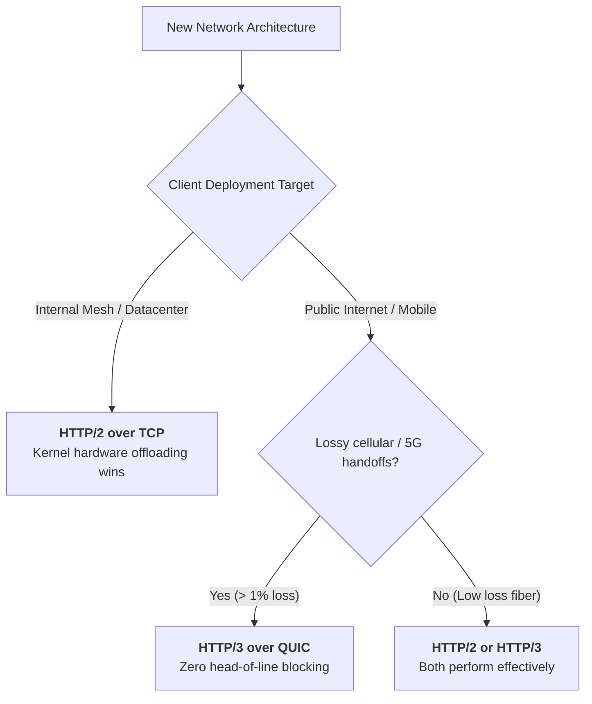
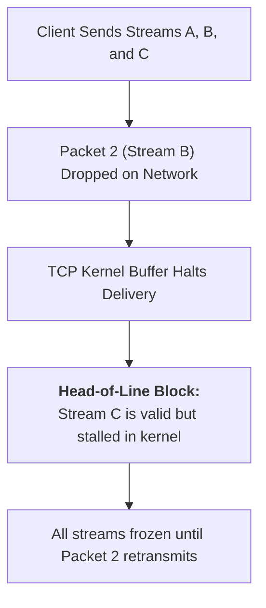
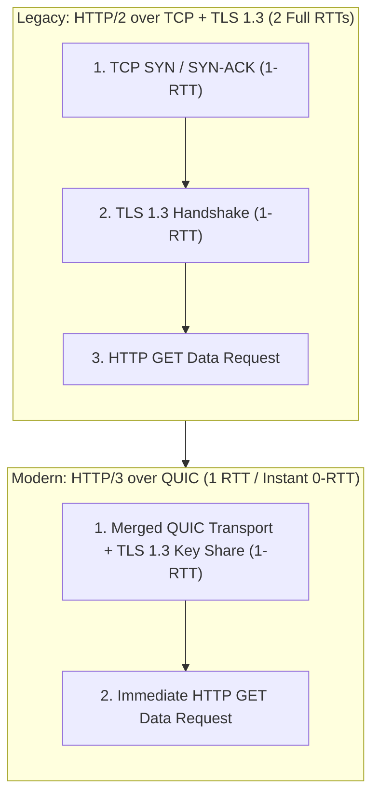

> **TL;DR:** HTTP/3 replaces TCP with UDP-based QUIC to eliminate head-of-line blocking, halve connection establishment latency, and enable seamless mobile network handoffs without breaking active sessions.



---

## Head-to-Head: HTTP/2 over TCP vs HTTP/3 over QUIC

| Architectural Property | HTTP/2 over TCP + TLS 1.3 | HTTP/3 over QUIC + UDP |
| :--- | :--- | :--- |
| **Transport Layer** | TCP (OS Kernel space) | UDP with userspace QUIC engine ([RFC 9000](https://datatracker.ietf.org/doc/html/rfc9000)) |
| **Connection Setup Latency** | **2-RTT** (1 RTT TCP handshake + 1 RTT TLS negotiation) | **1-RTT initial / 0-RTT resumed** (Combined crypto + transport) |
| **Head-of-Line (HOL) Blocking** | **Present at Transport Layer** (1 lost packet stalls all streams) | **Completely Eliminated** (Packet loss only halts its specific stream) |
| **Connection Identification** | 4-tuple (`SrcIP:SrcPort`, `DstIP:DstPort`) | 64-bit Connection ID (`CID`), completely independent of IP |
| **Network Migration (WiFi &rarr; 5G)** | ❌ Connection dropped; full TCP 3-way reconnect required | ✅ Seamless handoff; connection persists across IP changes |
| **Middlebox Tampering** | Vulnerable (middleboxes inspect and mutate TCP options) | Fully Encrypted (packet headers and payloads authenticated) |
| **Kernel CPU Utilization** | Low (40+ years of NIC hardware offload: TSO, LRO) | Medium-High (UDP packet processing historically unoptimized in kernel) |

---

## 1. The Core Flaw: Transport-Layer Head-of-Line Blocking

HTTP/2 multiplexed dozens of logical request streams over a single TCP connection. This eliminated application-layer blocking, but exposed a deeper problem in the operating system kernel: **TCP enforces strict byte-order delivery**.



If a cellular network drops a single IP packet belonging to Stream B, the client's TCP stack halts delivery of **all subsequent packets**—even if they belong to completely independent streams (Stream A or Stream C). 

On networks with just 2% packet loss, **HTTP/2 actually performs worse than legacy HTTP/1.1 with multiple independent TCP connections**.

### How QUIC Solves It
In QUIC, the transport layer understands individual streams. Each stream possesses its own independent flow control and offset offsets. If a packet carrying data for Stream B is dropped, Streams A and C continue processing uninterrupted.

---

## 2. Handshake Latency: Cutting Round Trips in Half

Before sending an HTTP request, a client must establish transport and encryption parameters:



By embedding TLS 1.3 cryptographic key exchange directly into the initial QUIC transport frame, HTTP/3 cuts initial page load connection latency by 50%.

---

## 3. Connection Migration: The Smartphone Test

In TCP, a connection is identified by a strict 4-tuple: `(Client IP, Client Port, Server IP, Server Port)`.

When a user walks out of their house and transitions from home WiFi to 5G cellular:
1. The client device receives a new IP address from the mobile carrier.
2. The active TCP 4-tuple becomes invalid.
3. Every active TCP connection instantly resets (`RST`).
4. Active video streams, downloads, or API calls crash and must renegotiate from scratch.

### The QUIC Fix: Connection ID (CID)
QUIC identifies connections using a random **Connection ID (CID)** embedded in the packet header. When your IP address changes, the client sends a datagram from the new cellular IP containing the existing CID. The server validates the cryptographic token and continues streaming without dropping a single packet.

---

## Benchmark: High-Loss Mobile Performance

{% include chart.html type="columns" title="Time to Complete 1MB Page Load on 2% Packet Loss Mobile Network (Seconds - Lower is Better)" labels="HTTP/1.1 (6 TCP Sockets)|HTTP/2 (Single TCP)|HTTP/3 (QUIC/UDP)" values="3.8|4.9|1.9" suffix="s" scale="6" highlight="HTTP/3 (QUIC/UDP)" note="On lossy networks, HTTP/2 is slower than HTTP/1.1 due to TCP HOL blocking; HTTP/3 outpaces both." %}

---

## Try It in Your Terminal: Inspecting HTTP/3 Support

Modern browsers discover HTTP/3 dynamically via the `Alt-Svc` (Alternative Services) HTTP header. You can inspect this right now:

```bash
# Query an edge endpoint and check for the alt-svc announcement
curl -I https://www.cloudflare.com | grep -i "alt-svc"
```

Expected output:
```http
alt-svc: h3=":443"; ma=86400, h3-29=":443"; ma=86400
```

To force a real QUIC handshake from the CLI (requires curl compiled with ngtcp2 or quiche):

```bash
# Force HTTP/3 UDP datagram transport directly
curl --http3 -I https://cloudflare.com
```
