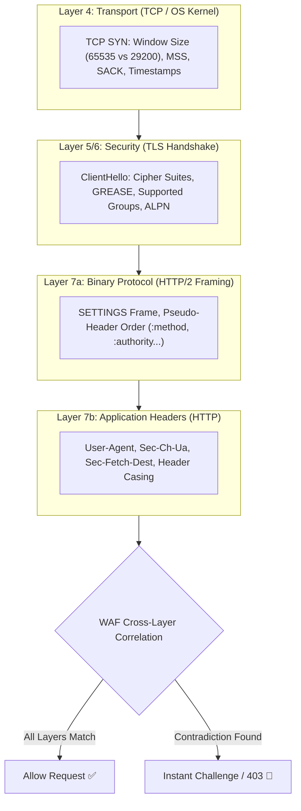

Every developer building their first web scraper follows the exact same tutorial. 

You write a Python script using `requests`, hit a 403 Forbidden error, search StackOverflow, and paste in the universal "magic fix":

```python
headers = {
    'User-Agent': 'Mozilla/5.0 (Windows NT 10.0; Win64; x64) AppleWebKit/537.36 (KHTML, like Gecko) Chrome/128.0.0.0 Safari/537.36'
}
response = requests.get('https://example.com', headers=headers)
```

For about thirty seconds, you feel victorious. 

Then you target a website protected by Cloudflare Turnstile, DataDome, or Akamai Bot Manager. Your script is blocked instantly on the first request.

Why did copying a real desktop User-Agent string fail?

Because the `User-Agent` is just a single string of arbitrary text sent at Layer 7 (the Application Layer). Changing your User-Agent is like drawing a Ferrari badge on the hood of a golf cart: the moment you drive onto the highway, everyone immediately sees through the disguise.


<p class="chart-note" style="text-align: center; margin-top: -12px; margin-bottom: 24px;"><em>The contradiction trap: anti-bot systems do not evaluate headers in isolation; they correlate Layer 4 TCP, Layer 5 TLS, and Layer 7 HTTP structures to expose forged identities.</em></p>

Here is the engineering breakdown of how anti-bot systems cross-reference network layers to unmask fake browser identities.

---

## Naive Header Spoofing vs Authentic Browser Stack

When an anti-bot system receives a connection, it looks for harmony across all layers of the Open Systems Interconnection (OSI) network stack.

<div class="vs-cards">
  <div class="vs-card v12">
    <div class="vs-card-header">
      <h3>Naive Header Spoofing</h3>
      <span class="vs-tag legacy">Python requests + Chrome UA</span>
    </div>
    <div class="vs-feature-list">
      <div class="vs-feature-item">
        <div class="vs-feature-title">
          <span class="vs-icon">📜</span>
          <strong>Surface-Level Text Claim</strong>
        </div>
        <p class="vs-feature-desc">Transmits <code>User-Agent: Chrome/128 (Windows 10)</code> at the HTTP application layer.</p>
      </div>
      <div class="vs-feature-item">
        <div class="vs-feature-title">
          <span class="vs-icon">⚠️</span>
          <strong>OpenSSL Handshake Contradiction</strong>
        </div>
        <p class="vs-feature-desc">TLS layer negotiates standard OpenSSL cipher suites with zero GREASE extension values.</p>
      </div>
      <div class="vs-feature-item">
        <div class="vs-feature-title">
          <span class="vs-icon">📦</span>
          <strong>Missing Client Hints</strong>
        </div>
        <p class="vs-feature-desc">Lacks mandatory Chromium modern headers: <code>Sec-Ch-Ua</code>, <code>Sec-Ch-Ua-Mobile</code>, and <code>Sec-Ch-Ua-Platform</code>.</p>
      </div>
      <div class="vs-feature-item">
        <div class="vs-feature-title">
          <span class="vs-icon">🚨</span>
          <strong>Fatal Contradiction Score</strong>
        </div>
        <p class="vs-feature-desc">WAF flags the deliberate forgery, assigning a higher threat score than an honest bot.</p>
      </div>
    </div>
  </div>

  <div class="vs-card v13">
    <div class="vs-card-header">
      <h3>Authentic Browser Stack</h3>
      <span class="vs-tag modern">Real Chromium or curl_cffi</span>
    </div>
    <div class="vs-feature-list">
      <div class="vs-feature-item">
        <div class="vs-feature-title">
          <span class="vs-icon">🔒</span>
          <strong>BoringSSL Cryptographic Parity</strong>
        </div>
        <p class="vs-feature-desc">Emits authentic RFC 8701 GREASE values, ALPN ordering, and matching elliptic curve extensions.</p>
      </div>
      <div class="vs-feature-item">
        <div class="vs-feature-title">
          <span class="vs-icon">⚡</span>
          <strong>HTTP/2 Framing Consistency</strong>
        </div>
        <p class="vs-feature-desc">Preserves exact pseudo-header sequence (<code>:method</code>, <code>:authority</code>, <code>:scheme</code>, <code>:path</code>) and window settings.</p>
      </div>
      <div class="vs-feature-item">
        <div class="vs-feature-title">
          <span class="vs-icon">🛡️</span>
          <strong>Complete Sec-Fetch Metadata</strong>
        </div>
        <p class="vs-feature-desc">Populates contextual browser security metadata including <code>Sec-Fetch-Dest</code> and <code>Sec-Fetch-Site</code>.</p>
      </div>
      <div class="vs-feature-item">
        <div class="vs-feature-title">
          <span class="vs-icon">🚀</span>
          <strong>Seamless Verification</strong>
        </div>
        <p class="vs-feature-desc">Passes Layer 4 through Layer 7 correlation checks without triggering friction gates.</p>
      </div>
    </div>
  </div>
</div>

---

## 1. The Multi-Layer Inspection Pyramid

A network request is not a monolithic file. It is assembled layer by layer through the operating system network stack:



When an anti-bot system evaluates your request, it does not stop at the `User-Agent`. It cross-references the User-Agent against every layer underneath it.

If any layer tells a conflicting story, you are caught in the **Contradiction Trap**.

---

## 2. Contradiction #1: The TLS vs User-Agent Mismatch

This is the most common failure mode in modern scraping.

When your Python `requests` script connects to a server, it uses **OpenSSL**. OpenSSL generates a `ClientHello` packet containing OpenSSL's default cipher suite list and extension layout.

Then, your script sends this HTTP header:
```http
User-Agent: Mozilla/5.0 (Windows NT 10.0; Win64; x64) AppleWebKit/537.36 Chrome/128.0.0.0 Safari/537.36
```

Inside the WAF edge:
1. **The TLS Inspector** parses your `ClientHello` and computes your **JA4 fingerprint**:
   `t12d190900_...` (Standard OpenSSL / Python signature).
2. **The HTTP Inspector** reads the `User-Agent`:
   `Chrome 128 on Windows 10`.
3. **The Correlation Rule** fires:
   > *"A client claiming to be Google Chrome 128 just completed a TLS handshake using OpenSSL without TLS 1.3 GREASE or Chromium extension ordering."*

Result: **Instant Block**. You did not hide your bot—you proved to the firewall that you are actively impersonating a browser.

---

## 3. Contradiction #2: Missing Modern Client Hints (`Sec-Ch-Ua`)

In 2021, Google began freezing the traditional `User-Agent` string to improve user privacy. In its place, Chromium browsers send **Client Hints**:

```http
GET / HTTP/2
Host: example.com
sec-ch-ua: "Chromium";v="128", "Not;A=Brand";v="24", "Google Chrome";v="128"
sec-ch-ua-mobile: ?0
sec-ch-ua-platform: "Windows"
sec-fetch-site: none
sec-fetch-mode: navigate
sec-fetch-user: ?1
sec-fetch-dest: document
```

Notice the details:
* Real Chrome **never** sends just a `User-Agent` header.
* Real Chrome sends `Sec-Ch-Ua` containing a randomized "Not;A=Brand" brand to prevent servers from hardcoding brand names.
* Real Chrome sends **Sec-Fetch Metadata** describing the navigation context.

If your scraper provides a modern Chrome 128 User-Agent but omits `Sec-Ch-Ua` and `Sec-Fetch-Dest`, any modern anti-bot script flags the request immediately.

---

## 4. Contradiction #3: HTTP/2 Header Ordering and Pseudo-Headers

In HTTP/1.1, headers were plain text lines. In HTTP/2, headers are binary frames compressed with **HPACK**.

Furthermore, HTTP/2 introduces **pseudo-headers** (headers starting with a colon `:`). The exact order in which these pseudo-headers are transmitted is determined by the browser's internal C++ implementation:

```
Chromium Order:
1. :method
2. :authority
3. :scheme
4. :path

Firefox Order:
1. :method
2. :path
3. :authority
4. :scheme

Go net/http Order:
1. :authority
2. :method
3. :path
4. :scheme
```

If your User-Agent says "Chrome", but your HTTP/2 library sends `:authority` before `:method`, the WAF's **HTTP/2 fingerprinting engine (such as Akamai's HTTP2 fingerprint hash)** flags your client before reading the body of your request.

---

## 5. Contradiction #4: Operating System TCP Stack Fingerprinting

Can a server tell what operating system you are running before TLS or HTTP even starts?

Yes. It is called **p0f (Passive OS Fingerprinting)** at Layer 4:

```
[ Scraper on Ubuntu Linux Server ] 
  --> TCP SYN Packet: Initial Window Size = 29200, MSS = 1460, SACK Permitted, Window Scale = 7
```

A real Windows 10 desktop computer uses a default TCP initial window size of `65535` or `64240` with specific TCP option orderings (MSS $\rightarrow$ NOP $\rightarrow$ WS $\rightarrow$ NOP $\rightarrow$ NOP $\rightarrow$ SACK).

If your script sends a User-Agent claiming `Windows NT 10.0`, but your TCP SYN packet exhibits the unmistakable signature of the Linux 5.15 kernel, sophisticated anti-bot systems like DataDome detect the operating system mismatch at the TCP layer.

---

## 6. Benchmark: Detection Rates Across Identity Setups

How do different levels of header and protocol spoofing fare against modern firewalls?

{% include chart.html type="columns" title="Block Rate on Protected Endpoints (Lower is Better)" labels="requests + Fake UA|Honest curl (No Spoof)|curl_cffi (Full Parity)|Real Headless Chromium" values="98|74|6|2" suffix="%" scale="100" highlight="Real Headless Chromium" note="A naive fake User-Agent suffers a 98% block rate because contradictory signals trigger higher risk scores than an honest tool." %}

{% include chart.html type="grouped" title="Contradiction Flag Rate Across Major WAFs (%)" series="Python requests + Fake UA|Standard curl + Fake UA|curl_cffi (Impersonating Chrome)" labels="Cloudflare Turnstile|DataDome|Akamai Bot Manager|PerimeterX" values="100,94,4|100,98,6|96,89,5|100,92,7" suffix="%" scale="100" note="Cloudflare and DataDome correlate TLS and HTTP/2 fingerprints on 100% of incoming connections." %}

---

## 7. How to Achieve True Protocol Parity

If you want to make HTTP requests that are indistinguishable from Google Chrome without the heavy resource overhead of launching a full browser, you must emulate all layers simultaneously:

```python
# 🚀 The Modern Solution: curl_cffi
from curl_cffi import requests

# curl_cffi synchronizes:
# 1. TLS BoringSSL ciphers and GREASE
# 2. HTTP/2 pseudo-header ordering
# 3. Modern Client Hints (Sec-Ch-Ua)
# 4. Sec-Fetch metadata
response = requests.get(
    "https://example.com/api/data",
    impersonate="chrome124",
    headers={
        "Accept-Language": "en-US,en;q=0.9",
    }
)

print("Status Code:", response.status_code)
```

By using `curl_cffi` or Go's `tls-client`, you align the TLS handshake, the HTTP/2 framing, and the application headers into a single harmonious identity.

---

## 8. Verifying Your Stack Consistency via CLI

You can test your client's full cross-layer footprint against public fingerprinting APIs:

```bash
# Test with standard curl (Exposes OpenSSL / curl signature):
curl -s https://tls.peet.ws/api/all | jq '{tls: .tls.ja4, http2: .http2}'

# Test with Python curl_cffi:
python3 -c "
from curl_cffi import requests
res = requests.get('https://tls.peet.ws/api/all', impersonate='chrome124').json()
print('JA4 Fingerprint:', res['tls']['ja4'])
print('HTTP/2 Akamai Fingerprint:', res['http2']['akamai_fingerprint'])
"
```

---

## Production Takeaways for Engineers

| Layer | Component Inspected | Common Contradiction Trap | Correct Fix |
| :--- | :--- | :--- | :--- |
| **Layer 4** | TCP SYN Window & Options | Linux kernel window size claiming Windows desktop | Match OS or use proxies in matching environments. |
| **Layer 5/6** | TLS ClientHello & JA4 | Standard OpenSSL ciphers claiming Chrome | Use BoringSSL-based clients (`curl_cffi`). |
| **Layer 7a** | HTTP/2 Pseudo-Header Order | `:authority` sent before `:method` | Use clients that preserve Chromium framing order. |
| **Layer 7b** | Modern Client Hints | Missing `Sec-Ch-Ua` and `Sec-Fetch-*` | Always supply complete browser header sets. |
| **Layer 7c** | JavaScript Runtime | `navigator.userAgentData` mismatch | Run in real browsers or patch prototype trees. |

A User-Agent header is an assertion, not a proof. Modern anti-bot engineering is built on verifying the mechanical truth of how your client connects. When all layers of your networking stack align, your requests move through firewalls without friction.
