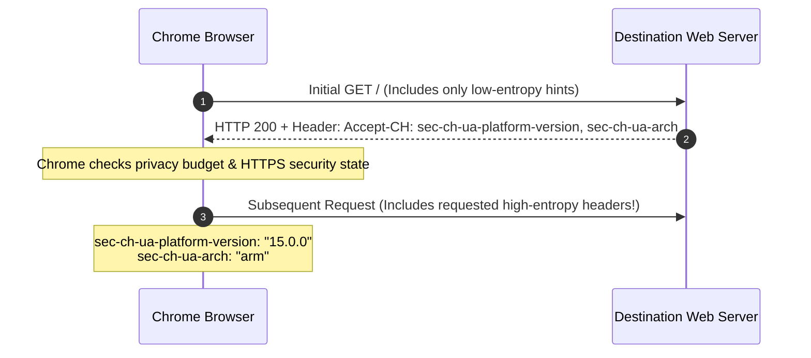

Open Google Chrome's DevTools console right now and evaluate this single line of JavaScript:

```javascript
navigator.userAgent;
```

In a fraction of a millisecond, your screen returns a familiar string:

```
Mozilla/5.0 (Macintosh; Intel Mac OS X 10_15_7) AppleWebKit/537.36 (KHTML, like Gecko) Chrome/128.0.0.0 Safari/537.36
```

To a web developer, `navigator.userAgent` looks like a simple static string property sitting on the global `window.navigator` object.

To the engineers who maintain Chromium, however, that single line of code is the result of a multi-tiered journey traversing **Web IDL bindings**, **V8 JavaScript engine hooks**, **Blink rendering C++ classes**, and **cross-process IPC calls** to the browser's content layer.

Why does modern Chrome report `Mac OS X 10_15_7` even on a brand-new M3 Mac running macOS 15 Sequoia? Why is the minor version frozen at `.0.0.0`? And where does `navigator.userAgentData` live in the C++ source?


<p class="chart-note" style="text-align: center; margin-top: -12px; margin-bottom: 24px;"><em>Inside the rendering engine: navigator.userAgent is not a JavaScript variable; it is a native C++ getter tied to Chromium's privacy-preserving Client Hints pipeline.</em></p>

Here is the engineering breakdown of how Chromium generates, stores, and gates user-agent data under the hood.

---

## Legacy Frozen User-Agent vs Modern Client Hints at a Glance

Comparing the legacy string with modern User-Agent Client Hints (UA-CH) illustrates Google's architectural shift toward passive fingerprint minimization.

<div class="vs-cards">
  <div class="vs-card v12">
    <div class="vs-card-header">
      <h3>Legacy Frozen User-Agent</h3>
      <span class="vs-tag legacy">navigator.userAgent</span>
    </div>
    <div class="vs-feature-list">
      <div class="vs-feature-item">
        <div class="vs-feature-title">
          <span class="vs-icon">🧊</span>
          <strong>Frozen Platform Version</strong>
        </div>
        <p class="vs-feature-desc">Locks OS version to <code>Windows NT 10.0</code> or <code>Mac OS X 10_15_7</code> regardless of actual host OS version.</p>
      </div>
      <div class="vs-feature-item">
        <div class="vs-feature-title">
          <span class="vs-icon">🚫</span>
          <strong>Stripped Build Numbers</strong>
        </div>
        <p class="vs-feature-desc">Replaces fine-grained version increments with static zeroes: <code>Chrome/128.0.0.0</code>.</p>
      </div>
      <div class="vs-feature-item">
        <div class="vs-feature-title">
          <span class="vs-icon">📜</span>
          <strong>High-Entropy Passive Leak</strong>
        </div>
        <p class="vs-feature-desc">Historically broadcasted complete CPU architectures and patch levels to every web server visited.</p>
      </div>
    </div>
  </div>

  <div class="vs-card v13">
    <div class="vs-card-header">
      <h3>User-Agent Client Hints (UA-CH)</h3>
      <span class="vs-tag modern">navigator.userAgentData</span>
    </div>
    <div class="vs-feature-list">
      <div class="vs-feature-item">
        <div class="vs-feature-title">
          <span class="vs-icon">🛡️</span>
          <strong>Tiered Information Disclosure</strong>
        </div>
        <p class="vs-feature-desc">Splits device identity into automatic low-entropy hints and server-permissioned high-entropy hints.</p>
      </div>
      <div class="vs-feature-item">
        <div class="vs-feature-title">
          <span class="vs-icon">🎲</span>
          <strong>GREASE Brand Rotation</strong>
        </div>
        <p class="vs-feature-desc">Injects arbitrary dummy brands (e.g. <code>Not/A)Brand</code>) to prevent servers from hardcoding brand checks.</p>
      </div>
      <div class="vs-feature-item">
        <div class="vs-feature-title">
          <span class="vs-icon">🔒</span>
          <strong>Cryptographic Permission Gating</strong>
        </div>
        <p class="vs-feature-desc">High-entropy fields require explicit server opt-in via HTTPS <code>Accept-CH</code> response headers.</p>
      </div>
    </div>
  </div>
</div>

---

## 1. The C++ Path: From JavaScript to Blink

When your script calls `navigator.userAgent`, it triggers a native C++ getter generated by Chromium’s **Web IDL (Interface Definition Language)** compiler:

```
[ JavaScript: navigator.userAgent ]
               |
               v
[ V8 C++ Wrapper: V8Navigator::UserAgentAttributeGetCallback ]
               |
               v
[ Blink C++ Core: NavigatorID::userAgent() ]
               |
               v
[ Content Embedder: user_agent_utils.cc: GetUserAgent() ]
```

### Step 1: The IDL Definition
Inside the Chromium source tree at `third_party/blink/renderer/core/frame/navigator_id.idl`, you will find the formal specification:

```webidl
// third_party/blink/renderer/core/frame/navigator_id.idl
[Exposed=Window]
interface mixin NavigatorID {
    [HighEntropy=Direct, Measure] readonly attribute DOMString userAgent;
};
```

Notice the attributes:
* **`[HighEntropy=Direct]`**: Signals to Chromium's privacy budgeting engine that reading this property exposes significant device entropy.
* **`[Measure]`**: Increments internal Chrome UseCounter telemetry so Google engineers know how many web pages still read this property.

### Step 2: The C++ Implementation
The IDL compiler generates C++ bindings that route into `third_party/blink/renderer/core/frame/navigator_id.cc`:

```cpp
String NavigatorID::userAgent(ExecutionContext* context) const {
  // If the user agent is frozen or modified by DevTools emulation:
  return GetUserAgent(context);
}
```

Blink does not construct the string itself. It asks the **Content Embedder** via `components/embedder_support/user_agent_utils.cc`:

```cpp
std::string BuildUserAgentFromOSAndProduct(const std::string& os_info,
                                          const std::string& product) {
  // Enforces the "Mozilla/5.0 (" prefix and WebKit layout tokens
  return base::StringPrintf("Mozilla/5.0 (%s) AppleWebKit/537.36 "
                            "(KHTML, like Gecko) %s Safari/537.36",
                            os_info.c_str(), product.c_str());
}
```

---

## 2. Why Is macOS Frozen at `10_15_7` and Windows at `10.0`?

If you run macOS 15 Sequoia or Windows 11, your User-Agent string **lies to the website**.

* On **Windows 11**, Chrome sends: `Windows NT 10.0; Win64; x64`
* On **macOS 15**, Chrome sends: `Macintosh; Intel Mac OS X 10_15_7`
* On **Android 14**, Chrome sends: `Linux; Android 10; K`

This was deliberately introduced in the **Chromium User-Agent Reduction Project**.

In `components/embedder_support/user_agent_utils.cc`:

```cpp
std::string GetUnifiedPlatform() {
#if BUILDFLAG(IS_WIN)
  return "Windows NT 10.0; Win64; x64"; // Frozen!
#elif BUILDFLAG(IS_MAC)
  return "Macintosh; Intel Mac OS X 10_15_7"; // Frozen!
#elif BUILDFLAG(IS_ANDROID)
  return "Linux; Android 10; K"; // Frozen!
#endif
}
```

Why did Google freeze these strings?

Historically, ad trackers and fingerprinting companies used granular operating system patch versions (e.g., `Mac OS X 10_15_4` vs `10_15_7`) to track users across unrelated websites without cookies. 

By freezing the OS version to standard static values, Chromium destroyed millions of bits of tracking entropy across the web.

---

## 3. The Modern Successor: `navigator.userAgentData`

Because developers still need to know whether a user is on Windows or Android to serve the correct download links, Google introduced **User-Agent Client Hints (UA-CH)**:

```javascript
// Low-Entropy Hints (Available synchronously without permission):
console.log(navigator.userAgentData.brands);
console.log(navigator.userAgentData.mobile);
console.log(navigator.userAgentData.platform);
```

### The Output:
```json
{
  "brands": [
    { "brand": "Chromium", "version": "128" },
    { "brand": "Not;A=Brand", "version": "24" },
    { "brand": "Google Chrome", "version": "128" }
  ],
  "mobile": false,
  "platform": "macOS"
}
```

### Notice the GREASE Brand!
Notice `{"brand": "Not;A=Brand", "version": "24"}`.

Just like **TLS GREASE**, Chromium intentionally injects randomized dummy brand names into `brands`. 

If a lazy developer writes `if (brand === "Google Chrome")`, their code breaks when Chrome shuffles the order. This forces developers to use standard array iteration (`brands.some(b => b.brand === "Google Chrome")`).

---

## 4. How High-Entropy Hints Are Gated

What if a website genuinely needs to know your exact CPU architecture or your precise operating system version?

They must explicitly request **High-Entropy Client Hints** via HTTPS response headers:



In JavaScript, requesting high-entropy hints returns a Promise that queries the internal Blink browser process:

```javascript
navigator.userAgentData.getHighEntropyValues([
  "architecture",
  "bitness",
  "model",
  "platformVersion",
  "fullVersionList"
]).then(values => console.log(values));
```

If the connection is not secure HTTPS, or if the website has exceeded its tracking budget, Chromium rejects the request, protecting the user's privacy.

---

## 5. Benchmark: Entropy Reduction Across Generations

How much tracking entropy did the User-Agent freeze eliminate?



{% include chart.html type="grouped" title="High-Entropy Adoption Across Top 10,000 Websites (%)" series="Frozen navigator.userAgent|Low-Entropy Client Hints|High-Entropy Requested (Accept-CH)" labels="E-Commerce Platforms|Banking & Financial Services|Social Media & Media" values="98,82,12|99,75,28|95,89,18" suffix="%" scale="100" note="Only 12% to 28% of top enterprise sites request high-entropy hardware hints." %}

---

## 6. The Scraper's Trap: Prototype Tampering

When developers attempt to spoof their User-Agent in Puppeteer or Playwright, they often try:

```javascript
// ❌ THE PROTOTYPE SPOOFING DISASTER:
await page.evaluateOnNewDocument(() => {
  Object.defineProperty(navigator, 'userAgent', {
    get: () => 'Custom Bot UA 1.0',
  });
});
```

Here is why anti-bot systems like DataDome catch this immediately:

```javascript
// 1. Check if userAgent is an 'own property' on navigator:
navigator.hasOwnProperty('userAgent');
// Real Chrome: false (It belongs to Navigator.prototype!)
// Naive Hack: true (🚨 CAUGHT!)

// 2. Check navigator.userAgentData:
// In real Chrome, navigator.userAgentData matches navigator.userAgent!
// If your script modifies navigator.userAgent but leaves userAgentData.brands empty,
// you have created a fatal contradiction.
```

---

## Production Takeaways for Engineers

| Component | Architecture Role | Anti-Bot Consideration |
| :--- | :--- | :--- |
| **Blink IDL Binding** | Defines native getter on `Navigator.prototype` | Never use `Object.defineProperty` on the instance. |
| **UA Reduction** | Freezes OS versions to static baselines | Do not configure scrapers with hyper-specific OS sub-versions. |
| **`userAgentData`** | Modern asynchronous replacement API | Always synchronize `navigator.userAgentData` with `userAgent`. |
| **GREASE Brands** | Random dummy brand insertion | Emulate randomized brand lists to avoid detection. |
| **`Accept-CH` Header** | Server-side opt-in for high-entropy values | High-performance HTTP clients must respond to `Accept-CH` headers. |

Understanding that `navigator.userAgent` is a carefully controlled C++ interface allows you to avoid naive JavaScript tampering hacks and build automation tools that accurately mirror the internal architecture of modern Chromium.
