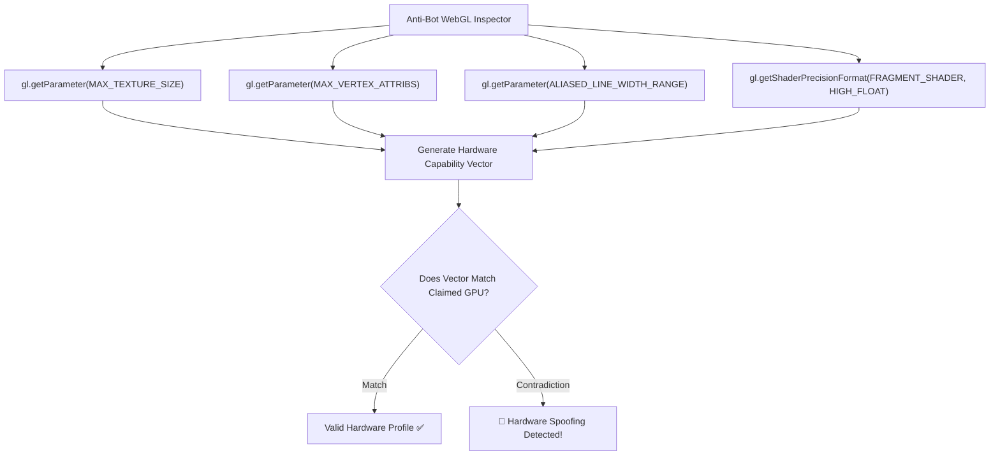
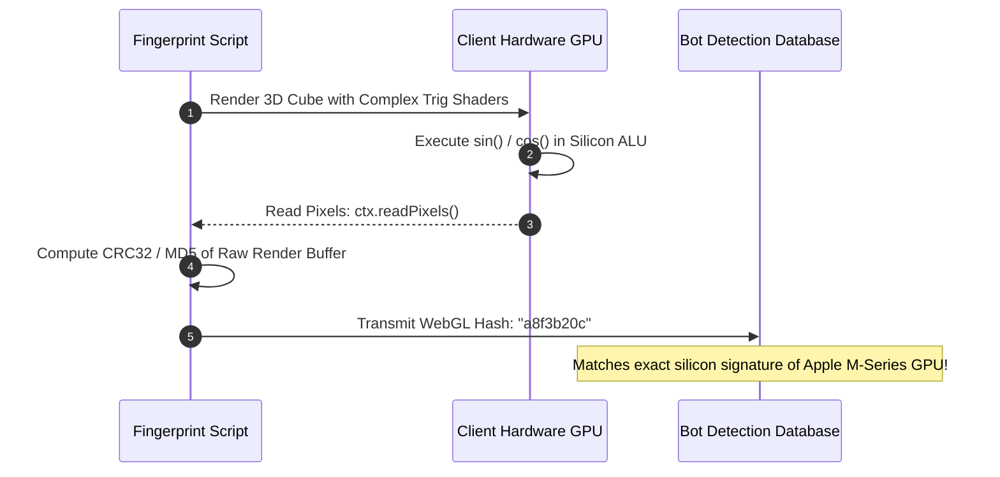

You open an Incognito window. You route your connection through a fresh residential proxy. You delete every cookie and local storage record on your system.

Yet the moment you visit a fraud detection checkpoint or an anti-bot protected target, you are tracked with uncanny precision.

How did the website recognize you?

It asked your **Graphics Processing Unit (GPU)** to draw a 3D picture.

**WebGL (Web Graphics Library)** is the JavaScript API that allows web browsers to render interactive 2D and 3D graphics inside an HTML `<canvas>` element without external plugins. 

While WebGL was built for web games, data visualizations, and maps, it also serves as one of the most powerful hardware fingerprinting surfaces in modern cybersecurity. 


<p class="chart-note" style="text-align: center; margin-top: -12px; margin-bottom: 24px;"><em>The hardware signature: subtle mathematical variations in floating-point ALU pipelines and GPU drivers turn 3D rendering into an indelible device fingerprint.</em></p>

Here is the engineering breakdown of how WebGL fingerprinting works, why headless cloud instances get caught, and why simple property spoofing often backfires.

---

## Desktop Hardware GPU vs Cloud Headless SwiftShader at a Glance

Comparing a human user's physical graphics card with a headless container reveals why cloud scraping environments stand out immediately.

<div class="vs-cards">
  <div class="vs-card v12">
    <div class="vs-card-header">
      <h3>Discrete Hardware GPU</h3>
      <span class="vs-tag modern">Apple Metal / NVIDIA / AMD</span>
    </div>
    <div class="vs-feature-list">
      <div class="vs-feature-item">
        <div class="vs-feature-title">
          <span class="vs-icon">⚡</span>
          <strong>Hardware Shader Silicon</strong>
        </div>
        <p class="vs-feature-desc">Shaders execute directly on physical GPU silicon cores with dedicated hardware rasterization.</p>
      </div>
      <div class="vs-feature-item">
        <div class="vs-feature-title">
          <span class="vs-icon">🏷️</span>
          <strong>Authentic Unmasked Metadata</strong>
        </div>
        <p class="vs-feature-desc">Reports legitimate consumer hardware: <code>Apple M3 Max</code>, <code>NVIDIA GeForce RTX 4080</code>, or <code>AMD Radeon</code>.</p>
      </div>
      <div class="vs-feature-item">
        <div class="vs-feature-title">
          <span class="vs-icon">🎯</span>
          <strong>Realistic Precision Tolerances</strong>
        </div>
        <p class="vs-feature-desc">Subtle micro-differences in trigonometric calculations match known consumer chip families.</p>
      </div>
    </div>
  </div>

  <div class="vs-card v13">
    <div class="vs-card-header">
      <h3>Headless Cloud Server</h3>
      <span class="vs-tag legacy">SwiftShader / llvmpipe</span>
    </div>
    <div class="vs-feature-list">
      <div class="vs-feature-item">
        <div class="vs-feature-title">
          <span class="vs-icon">⚙️</span>
          <strong>Software CPU Emulation</strong>
        </div>
        <p class="vs-feature-desc">Uses Google SwiftShader or Mesa llvmpipe to emulate GPU rasterization on server CPU cores.</p>
      </div>
      <div class="vs-feature-item">
        <div class="vs-feature-title">
          <span class="vs-icon">🚨</span>
          <strong>Telltale Software Strings</strong>
        </div>
        <p class="vs-feature-desc">Unmasked renderer explicitly outputs <code>Google SwiftShader Device (Subzero)</code> or <code>Mesa OffScreen</code>.</p>
      </div>
      <div class="vs-feature-item">
        <div class="vs-feature-title">
          <span class="vs-icon">💥</span>
          <strong>Instant Threat Escalation</strong>
        </div>
        <p class="vs-feature-desc">Anti-bot engines flag software rasterizers immediately because real humans do not browse on SwiftShader.</p>
      </div>
    </div>
  </div>
</div>

---

## 1. Layer 1: The Debug Renderer Query (The Direct Give-Away)

The simplest and most direct method anti-bot systems use to read your GPU is querying the **`WEBGL_debug_renderer_info`** extension:

```javascript
const canvas = document.createElement('canvas');
const gl = canvas.getContext('webgl') || canvas.getContext('experimental-webgl');
const debugInfo = gl.getExtension('WEBGL_debug_renderer_info');

if (debugInfo) {
  const vendor = gl.getParameter(debugInfo.UNMASKED_VENDOR_WEBGL);
  const renderer = gl.getParameter(debugInfo.UNMASKED_RENDERER_WEBGL);
  
  console.log('Vendor:', vendor);
  console.log('Renderer:', renderer);
}
```

### What Real Browsers Emit:
* **macOS (Safari / Chrome)**: `Vendor: Google Inc. (Apple)` / `Renderer: ANGLE (Apple, Apple M3 Pro, OpenGL 4.1)`
* **Windows (Chrome / Edge)**: `Vendor: Google Inc. (NVIDIA)` / `Renderer: ANGLE (NVIDIA, NVIDIA GeForce RTX 3070 Direct3D11 vs_5_0 ps_5_0, D3D11)`

### What Headless Linux Containers Emit:
* `Vendor: Google Inc. (Google)`
* `Renderer: ANGLE (Google, Vulkan 1.3.0 (SwiftShader Device (Subzero)), SwiftShader driver)`

When Cloudflare Turnstile, DataDome, or Akamai inspects this string, detecting `SwiftShader`, `llvmpipe`, or `Mesa` triggers an immediate challenge. 

---

## 2. Layer 2: Deep WebGL Parameter Probing

Even if a developer overrides `UNMASKED_RENDERER_WEBGL` via JavaScript monkey-patching, anti-bot scripts don't stop there.

They query **dozens of low-level GPU hardware limits and capabilities**:



### Key Hardware Boundaries:
1. **`MAX_TEXTURE_SIZE`**: High-end desktop GPUs support `16384` or `32768`. Software CPU rasterizers or mobile chips often report `4096` or `8192`.
2. **`MAX_VERTEX_TEXTURE_IMAGE_UNITS`**: Reflects the physical number of texture sample units wired into the hardware shaders.
3. **Shader Precision (`precision`, `rangeMin`, `rangeMax`)**: The bit-depth of floating-point operations in fragment shaders.

If your script claims to be an **NVIDIA GeForce RTX 4090** but reports a `MAX_TEXTURE_SIZE` of `4096` and lacks standard Direct3D11 extension lists, the contradiction exposes you as an automated bot trying to hide its identity.

---

## 3. Layer 3: The Floating-Point Math Trap (Shader Execution)

Can a script identify your GPU if `WEBGL_debug_renderer_info` is completely removed?

Yes. It is done by executing **GLSL fragment shaders**.

The IEEE 754 standard specifies floating-point arithmetic for CPUs, but GPU manufacturers (NVIDIA, AMD, Apple, Qualcomm, Intel) take mathematical shortcuts in hardware to maximize frame rates. 

Microscopic differences exist in how different GPU Arithmetic Logic Units (ALUs) compute complex trigonometric operations like `sin()`, `cos()`, and `tan()`:

```glsl
// Custom fragment shader used in fingerprinting:
precision highp float;
varying vec2 v_texCoord;

void main() {
    float x = sin(v_texCoord.x * 12.9898 + v_texCoord.y * 78.233) * 43758.5453;
    gl_FragColor = vec4(fract(x), fract(x * 1.5), fract(x * 2.0), 1.0);
}
```



When the GPU renders this shader offscreen into a 256x256 framebuffer and reads back the pixels via `gl.readPixels()`, an Apple M3 chip produces slightly different subpixel RGB values than an Intel Iris Xe or an NVIDIA RTX chip.

Anti-bot systems hash these pixel buffers. If your User-Agent says "Windows 11 with NVIDIA GPU", but the rendered pixel hash matches the **Linux Mesa software rasterizer**, the request is flagged instantly.

---

## 4. Benchmark: WebGL Hardware Entropy & Detection Rates

How unique is a WebGL fingerprint, and how reliably does it detect unconfigured cloud scrapers?



{% include chart.html type="grouped" title="Detection Rate of Cloud Scrapers by WebGL Setup (%)" series="SwiftShader (Default Docker)|Naive JS Override (Spoofed)|Virtual Framebuffer + Real GPU" labels="Cloudflare Turnstile|DataDome|FingerprintJS Pro|Kasada" values="99,74,4|100,82,6|98,79,3|100,88,5" suffix="%" scale="100" note="Default SwiftShader in cloud containers is caught over 98% of the time across all providers." %}

---

## 5. Why Naive Property Overrides Fail

The most common mistake developers make when trying to evade WebGL detection is overriding `gl.getParameter`:

```javascript
// ❌ THE NAIVE OVERRIDE TRAP:
const getParameter = WebGLRenderingContext.prototype.getParameter;
WebGLRenderingContext.prototype.getParameter = function(parameter) {
  if (parameter === 37446) { // UNMASKED_RENDERER_WEBGL
    return 'ANGLE (NVIDIA, NVIDIA GeForce RTX 3080 Direct3D11 vs_5_0 ps_5_0, D3D11)';
  }
  return getParameter.apply(this, arguments);
};
```

Anti-bot engineers easily expose this hack using **Prototype Integrity Checks**:

```javascript
// Test 1: Check function serialization:
WebGLRenderingContext.prototype.getParameter.toString();
// Real Chrome: "function getParameter() { [native code] }"
// Naive Hack: "function(parameter) { ... }" (🚨 CAUGHT!)

// Test 2: Check WebGL2 parity:
// Did you remember to patch WebGL2RenderingContext as well?
// Real browsers have matching parameters across WebGL 1 and WebGL 2.
```

If an anti-bot system catches you tampering with native prototypes, it assigns a **maximum threat penalty**, blocking the request immediately.

---

## 6. How to Inspect Your WebGL Footprint via DevTools

You can inspect your own browser's complete WebGL hardware report by pasting this snippet into your browser console:

```javascript
(() => {
  const canvas = document.createElement('canvas');
  const gl = canvas.getContext('webgl');
  if (!gl) return console.error('WebGL not supported');

  const debug = gl.getExtension('WEBGL_debug_renderer_info');
  console.table({
    Vendor: gl.getParameter(gl.VENDOR),
    Renderer: gl.getParameter(gl.RENDERER),
    UnmaskedVendor: debug ? gl.getParameter(debug.UNMASKED_VENDOR_WEBGL) : 'N/A',
    UnmaskedRenderer: debug ? gl.getParameter(debug.UNMASKED_RENDERER_WEBGL) : 'N/A',
    MaxTextureSize: gl.getParameter(gl.MAX_TEXTURE_SIZE),
    MaxVertexAttribs: gl.getParameter(gl.MAX_VERTEX_ATTRIBS),
    ShadingLanguageVersion: gl.getParameter(gl.SHADING_LANGUAGE_VERSION),
  });
})();
```

---

## Production Takeaways for Scraping Engineers

| WebGL Layer | Common Automation Leak | Production Fix |
| :--- | :--- | :--- |
| **Unmasked Metadata** | Outputs `Google SwiftShader` or `llvmpipe` | Run headed Chrome with physical GPU passthrough or ANGLE flags. |
| **Parameter Matrix** | Mismatch between claimed GPU and `MAX_TEXTURE_SIZE` | Never spoof hardware names without aligning underlying capabilities. |
| **Shader Execution** | CPU software ALU math differs from physical GPU | Use virtualization environments that pass through real GPU hardware (`/dev/dri`). |
| **Prototype Tampering** | Modified `getParameter.toString()` | Avoid naive monkey-patching; configure at the Chromium engine level. |

WebGL is a window directly into the physical silicon powering your computer. By understanding how anti-bot systems probe both string metadata and floating-point shader math, you can architect scraping infrastructure that presents a completely authentic hardware identity.
