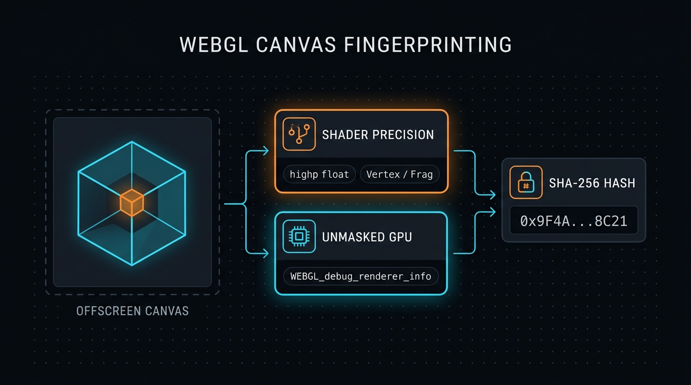

<div class="terminal-callout" style="background: #161b22; border-left: 4px solid #f85149; padding: 12px 16px; border-radius: 6px; font-family: monospace; font-size: 0.9rem; margin-bottom: 20px;">
  <span style="color: #f85149; font-weight: bold;">[!] HARDWARE LEAK:</span> WebGL Debug Renderer Query<br/>
  <span style="color: #8b949e;">&gt; UNMASKED_VENDOR_WEBGL:   </span><span style="color: #ffa657;">Google Inc.</span><br/>
  <span style="color: #8b949e;">&gt; UNMASKED_RENDERER_WEBGL: </span><span style="color: #f85149;">Google SwiftShader (LLVM 10.0.0, 128 bits)</span><br/>
  <span style="color: #8b949e;">&gt; RISK ENGINE ASSESSMENT: </span><span style="color: #f85149;">100% CONFIDENCE AUTOMATED LINUX HEADLESS RUNNER</span>
</div>

> **TL;DR:** WebGL exposes raw GPU hardware models and sub-pixel shader rendering variations to client scripts. Anti-bot systems hash off-screen rendered geometries to unmask virtual machines and detect artificial canvas spoofing.

---

## 1. The Two Layers of WebGL Fingerprinting

```text
┌────────────────────────────────────────────────────────────────────────┐
│                        WEBGL FINGERPRINT LAYERS                        │
├───────────────────────────────────┬────────────────────────────────────┤
│ LAYER 1: METADATA PARAMETERS      │ LAYER 2: SHADER PRECISION MATH     │
│ Querying static GPU attributes    │ Rendering off-screen 3D geometries │
│ Unmasked Vendor, Unmasked Renderer│ Floating-point rounding deviations │
│ Max texture size, vertex uniforms │ Subpixel rasterization hash        │
└───────────────────────────────────┴────────────────────────────────────┘
```

### Layer 1: Querying the Unmasked Renderer
In modern browsers, the WebGL extension `WEBGL_debug_renderer_info` exposes two critical constants:

```javascript
const canvas = document.createElement('canvas');
const gl = canvas.getContext('webgl');
const debugInfo = gl.getExtension('WEBGL_debug_renderer_info');

if (debugInfo) {
  const vendor = gl.getParameter(debugInfo.UNMASKED_VENDOR_WEBGL);
  const renderer = gl.getParameter(debugInfo.UNMASKED_RENDERER_WEBGL);
  
  console.log("Vendor:", vendor);     // e.g. "Apple Inc."
  console.log("Renderer:", renderer); // e.g. "ANGLE (Apple, Apple M2 Max, OpenGL 4.1)"
}
```

On a consumer desktop, this reveals genuine hardware. On an AWS EC2 instance running headless Chromium, it outputs:
* `Google SwiftShader` (Google CPU software rasterizer)
* `llvmpipe (LLVM 15.0.7, 256 bits)` (Mesa Linux CPU rasterizer)
* `Microsoft Basic Render Driver` (Windows Server CPU fallback)

Every modern anti-bot system maintains a strict blacklist of these software rasterizers.

---

## 2. Layer 2: Trigonometric Shader Precision Hash

What if a scraper overrides the `getParameter` function to return an Apple M2 string?

Anti-bot engines bypass static string spoofing by compiling a real **GLSL fragment shader** and executing trigonometric calculations on the GPU:

```glsl
// GLSL Fragment Shader
precision mediump float;
varying vec2 v_texCoord;

void main() {
  float r = sin(v_texCoord.x * 100.0) * cos(v_texCoord.y * 100.0);
  gl_FragColor = vec4(r, r, r, 1.0);
}
```

Because IEEE-754 floating-point hardware implementations vary across NVIDIA, AMD, Intel, and Apple GPUs:
1. The shader draws an off-screen 3D cube.
2. The script extracts the rendered pixel buffer via `gl.readPixels()`.
3. It computes a SHA-256 hash of the raw RGBA byte buffer.
4. An emulated SwiftShader running on an Intel Xeon CPU produces different mathematical values than a real Apple Silicon chip, exposing the mock.



---

## Hands-On Verification: Inspect Your WebGL Fingerprint

Paste this snippet into your browser's Developer Console (`F12`) to inspect your real GPU fingerprint:

```javascript
(() => {
  const canvas = document.createElement('canvas');
  const gl = canvas.getContext('webgl') || canvas.getContext('experimental-webgl');
  if (!gl) return console.log("WebGL not supported");

  const debug = gl.getExtension('WEBGL_debug_renderer_info');
  const report = {
    vendor: debug ? gl.getParameter(debug.UNMASKED_VENDOR_WEBGL) : 'N/A',
    renderer: debug ? gl.getParameter(debug.UNMASKED_RENDERER_WEBGL) : 'N/A',
    maxTextureSize: gl.getParameter(gl.MAX_TEXTURE_SIZE),
    maxRenderbufferSize: gl.getParameter(gl.MAX_RENDERBUFFER_SIZE),
    aliasedLineWidthRange: gl.getParameter(gl.ALIASED_LINE_WIDTH_RANGE)
  };

  console.table(report);
})();
```

### The Production Rule for Scrapers:
Never attempt to mock WebGL by monkey-patching `gl.getParameter` with prototype overrides. 

If your scraper operates in a headless Linux environment, either:
1. Pass through a genuine physical GPU to your container using NVIDIA Container Toolkit (`--gpus all`), or
2. Use an anti-detect browser binary that patches WebGL at the native C++ level inside Chromium's ANGLE translation layer.
