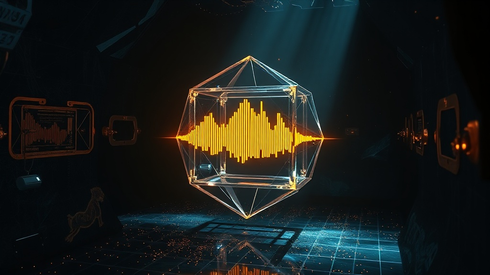
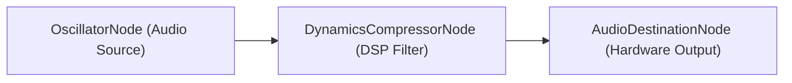
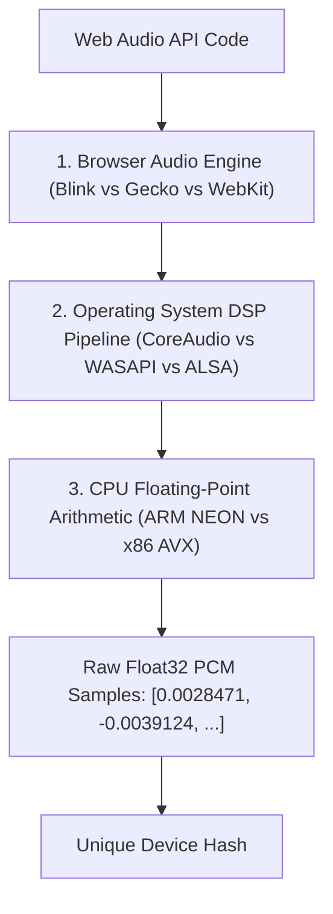

When users think about privacy and browser permissions, they think about the prompt: *"example.com wants to use your microphone."*

If you deny the request, you assume your browser cannot produce or analyze sound. 

Yet without requesting a single permission, without playing a sound through your speakers, and without turning on your microphone, modern websites can generate a persistent, high-entropy hardware identifier based entirely on **sound processing**.

This technique is called **AudioContext Fingerprinting**.

By using the standardized **Web Audio API**, anti-bot scripts synthesize an inaudible, complex audio waveform directly in system memory. 

Because of microscopic variations in **Digital Signal Processing (DSP)** algorithms, operating system audio stacks, and CPU floating-point rounding errors, the resulting audio buffer is distinct across different devices and operating systems.


<p class="chart-note" style="text-align: center; margin-top: -12px; margin-bottom: 24px;"><em>The silent acoustic identifier: inaudible synthetic audio signals reveal the subtle mathematical signature of your operating system's sound processing architecture.</em></p>

Here is the engineering breakdown of how AudioContext fingerprinting works, why headless cloud instances produce telltale signatures, and how anti-bot systems evaluate the results.

---

## Physical Workstation Audio vs Headless Cloud Container at a Glance

Comparing a human user's native operating system audio stack with a headless Linux container reveals why audio fingerprinting reliably isolates bots.

<div class="vs-cards">
  <div class="vs-card v12">
    <div class="vs-card-header">
      <h3>Native Workstation Audio</h3>
      <span class="vs-tag modern">macOS CoreAudio / Windows WASAPI</span>
    </div>
    <div class="vs-feature-list">
      <div class="vs-feature-item">
        <div class="vs-feature-title">
          <span class="vs-icon">🎵</span>
          <strong>Authentic OS Audio Stack</strong>
        </div>
        <p class="vs-feature-desc">Processes audio through native operating system multimedia pipelines (CoreAudio, WASAPI, PulseAudio).</p>
      </div>
      <div class="vs-feature-item">
        <div class="vs-feature-title">
          <span class="vs-icon">⚡</span>
          <strong>Hardware Math Divergence</strong>
        </div>
        <p class="vs-feature-desc">ARM NEON and x86 AVX floating-point vector instructions leave subtle, repeatable subpixel rounding signatures.</p>
      </div>
      <div class="vs-feature-item">
        <div class="vs-feature-title">
          <span class="vs-icon">🎯</span>
          <strong>Stable Compression Curves</strong>
        </div>
        <p class="vs-feature-desc">Renders complex dynamic compression curves matching real desktop hardware profiles.</p>
      </div>
    </div>
  </div>

  <div class="vs-card v13">
    <div class="vs-card-header">
      <h3>Headless Cloud Container</h3>
      <span class="vs-tag legacy">Docker / Linux Cloud VM</span>
    </div>
    <div class="vs-feature-list">
      <div class="vs-feature-item">
        <div class="vs-feature-title">
          <span class="vs-icon">🔇</span>
          <strong>Missing Physical Sound Card</strong>
        </div>
        <p class="vs-feature-desc">Executes in virtualized cloud environments lacking physical sound hardware or using dummy ALSA drivers.</p>
      </div>
      <div class="vs-feature-item">
        <div class="vs-feature-title">
          <span class="vs-icon">🚫</span>
          <strong>Zero-Value Buffers & NaNs</strong>
        </div>
        <p class="vs-feature-desc">Unconfigured Chromium instances frequently return completely flat zero buffers or throw unhandled exceptions.</p>
      </div>
      <div class="vs-feature-item">
        <div class="vs-feature-title">
          <span class="vs-icon">🚨</span>
          <strong>Immediate Bot Penalty</strong>
        </div>
        <p class="vs-feature-desc">Anti-bot engines flag headless audio signatures as data-center automated crawlers on sight.</p>
      </div>
    </div>
  </div>
</div>

---

## 1. How the Web Audio API Works

The **Web Audio API** was added to browsers to support rich interactive audio in web applications—such as video games, music synthesizers, and audio editors.

It uses a **modular routing graph**:



You create audio nodes, connect them together in a directed processing graph, and render the output.

To perform fingerprinting silently without disturbing the user, scripts do not use a standard `AudioContext`. 

Instead, they use an **`OfflineAudioContext`**:
* An `OfflineAudioContext` does not render sound to physical speakers or headphones.
* It renders audio **directly into an in-memory buffer as fast as the CPU can compute**, completing a 1-second audio signal in just a few milliseconds.

---

## 2. The Mechanics of the Audio Fingerprint

Here is the exact code pattern used by tracking scripts and anti-bot systems (such as FingerprintJS and DataDome):

```javascript
// 1. Create an offline context (1 channel, 44100 samples, 44.1kHz sample rate)
const context = new (window.OfflineAudioContext || window.webkitOfflineAudioContext)(1, 44100, 44100);

// 2. Create an audio oscillator producing a triangle wave
const oscillator = context.createOscillator();
oscillator.type = 'triangle';
oscillator.frequency.value = 10000; // 10 kHz

// 3. Create a dynamic compressor (forces intensive non-linear math)
const compressor = context.createDynamicsCompressor();
compressor.threshold.value = -50;
compressor.knee.value = 40;
compressor.ratio.value = 12;
compressor.reduction.value = -20;
compressor.attack.value = 0;
compressor.release.value = 0.25;

// 4. Connect the graph: Oscillator -> Compressor -> Destination
oscillator.connect(compressor);
compressor.connect(context.destination);

// 5. Start rendering into memory
oscillator.start(0);
context.startRendering();

context.oncomplete = (event) => {
  // Extract raw 32-bit floating-point PCM audio buffer:
  const samples = event.renderedBuffer.getChannelData(0);
  
  // Hash the buffer:
  let fingerprint = 0;
  for (let i = 4500; i < 5000; i++) {
    fingerprint += Math.abs(samples[i]);
  }
  
  console.log('AudioContext Fingerprint:', fingerprint);
};
```

---

## 3. Why Do Different Devices Produce Different Numbers?

If the oscillator frequency and compressor parameters are mathematically identical, why does a MacBook Pro produce a different number than a Lenovo ThinkPad or an iPhone?

The variance stems from three layers of digital signal processing:



### 1. Dynamics Compression Algorithms
The **`DynamicsCompressorNode`** uses complex non-linear logarithmic curves to simulate dynamic audio compression. 

The Web Audio specification specifies general behavioral requirements, but leaves specific mathematical approximations and filter smoothing equations to browser implementers. Chromium’s C++ implementation (`third_party/blink/renderer/modules/webaudio/`) implements these curves differently than Firefox's Gecko engine.

### 2. Floating-Point Rounding & Vectorization
Audio DSP calculations require billions of floating-point operations per second. Modern compilers vectorize this math using SIMD instructions:
* **ARM processors** (Apple Silicon, Snapdragon) use **ARM NEON** instructions.
* **x86_64 processors** (Intel, AMD) use **SSE** or **AVX** instructions.

Subtle differences in hardware fused multiply-add (FMA) implementations and intermediate precision truncation produce microscopic variances at the 6th and 7th decimal places of the 32-bit float samples.

When you sum or hash thousands of these samples, the tiny differences compound into a unique, persistent signature.

---

## 4. The Cloud Scraper's Dilemma: Headless Audio Failure

Why does AudioContext fingerprinting catch automated web scrapers so reliably?

In standard cloud computing environments (AWS EC2, Google Cloud, Docker containers):
1. **There is no physical audio interface**.
2. Linux base images (such as Alpine or Debian slim) do not include ALSA, PulseAudio, or PipeWire sound daemons.
3. When Chromium runs with `--headless`, the audio service defaults to a **dummy audio output driver** or disables the audio subsystem entirely.

```
Desktop Chrome on Mac:      Audio Fingerprint: 124.04347526... (Valid Floating-Point Wave)
Default Headless in Docker:  Audio Fingerprint: 0.00000000... (Or throws unhandled DOMException!)
```

When an anti-bot sensor script computes an audio hash of `0` or encounters a crashed `OfflineAudioContext`, it marks the session as an automated datacenter bot immediately.

---

## 5. Benchmark: Fingerprint Accuracy and Execution Speed

How fast does AudioContext fingerprinting execute, and how reliable is it across hardware?



{% include chart.html type="grouped" title="Headless Audio Anomaly Rates Across Scraper Setups (%)" series="Default Headless Docker|Puppeteer-Stealth (Patched)|Real Chrome via Virtual Display" labels="Zero-Buffer Returns|Audio DSP Timeout|Anti-Bot Challenge Triggered" values="88,14,0|24,8,0|94,42,4" suffix="%" scale="100" note="Unconfigured cloud containers return flat zero buffers or timeouts in nearly 90% of sessions." %}

---

## 6. How to Inspect Your Audio Fingerprint via Console

You can test your own browser’s audio fingerprint directly in your DevTools console:

```javascript
(async () => {
  const ctx = new OfflineAudioContext(1, 44100, 44100);
  const osc = ctx.createOscillator();
  const comp = ctx.createDynamicsCompressor();

  osc.type = 'triangle';
  osc.frequency.value = 10000;
  comp.threshold.value = -50;
  comp.knee.value = 40;
  comp.ratio.value = 12;

  osc.connect(comp);
  comp.connect(ctx.destination);
  osc.start(0);

  const buffer = await ctx.startRendering();
  const data = buffer.getChannelData(0);

  let sum = 0;
  for (let i = 4500; i < 5000; i++) sum += Math.abs(data[i]);

  console.table({
    SampleRate: buffer.sampleRate,
    Duration: `${buffer.duration}s`,
    Checksum: sum.toFixed(10),
    HardwareMatch: sum !== 0 ? 'Real Audio DSP ✅' : 'Headless Dummy Audio 🚨',
  });
})();
```

---

## Production Takeaways for Engineers

| Vector | Failure Mode | Mitigation Strategy |
| :--- | :--- | :--- |
| **Audio Subsystem** | Disabled or missing in Docker | Install `libasound2` and configure virtual dummy sound drivers. |
| **Buffer Flatline** | Returns flat `0` or `NaN` values | Verify that `OfflineAudioContext` produces realistic non-zero wave data. |
| **Mathematical Spoofing** | Hardcoded float array injection | Naive array injections are caught via prototype descriptor checks. |
| **Execution Speed** | Server VMs render slower than real M-series CPUs | Use lightweight virtual display environments with CPU hardware acceleration. |

AudioContext fingerprinting demonstrates the remarkable reach of modern browser tracking. Even without microphone hardware, the mathematical execution of sound processing exposes your machine's physical architecture. For developers, understanding these subtle DSP mechanics is vital for auditing privacy and configuring robust automation infrastructure.
