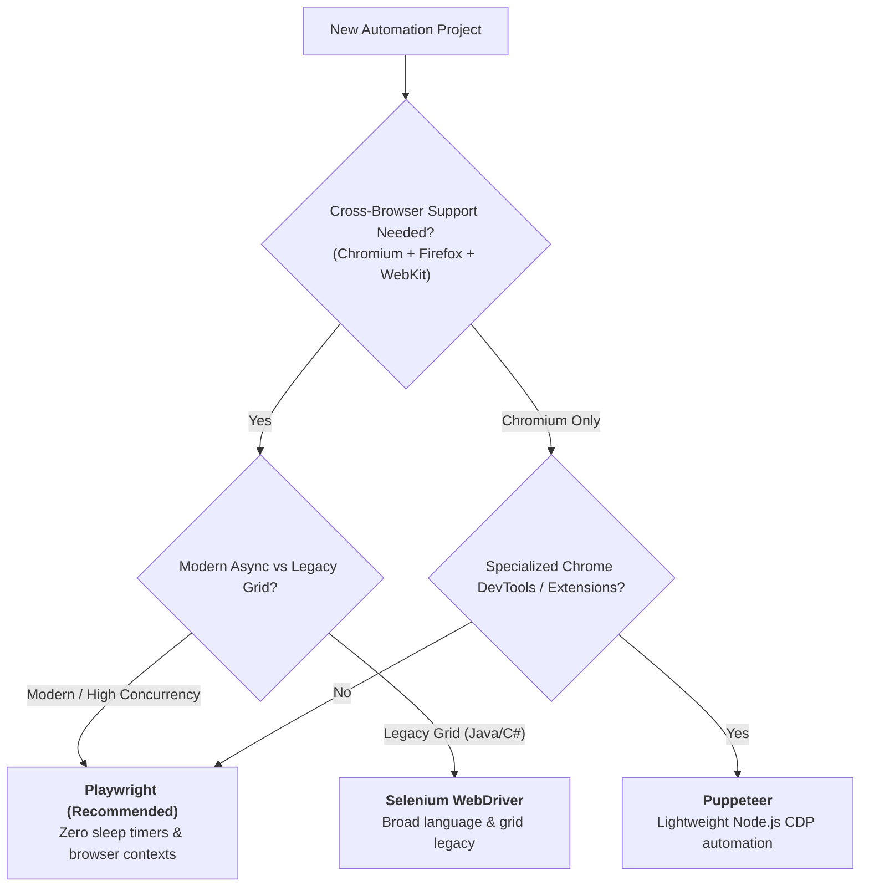
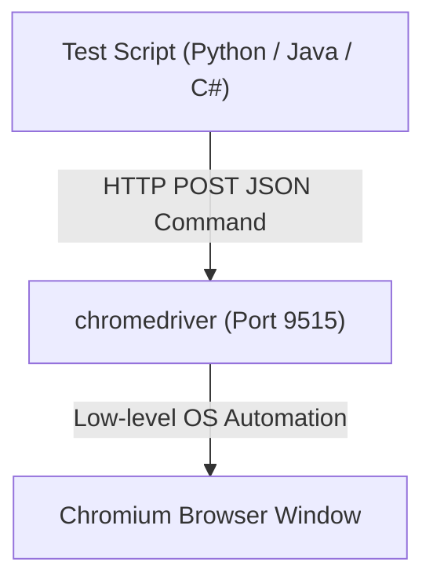
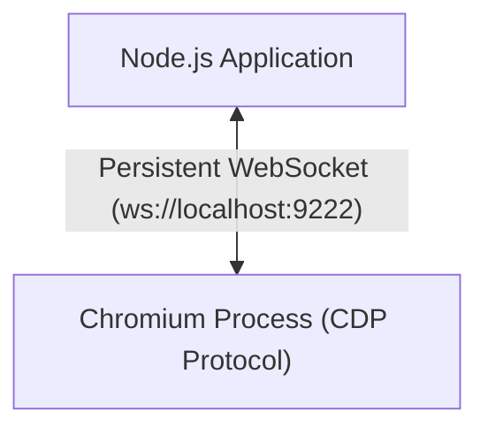
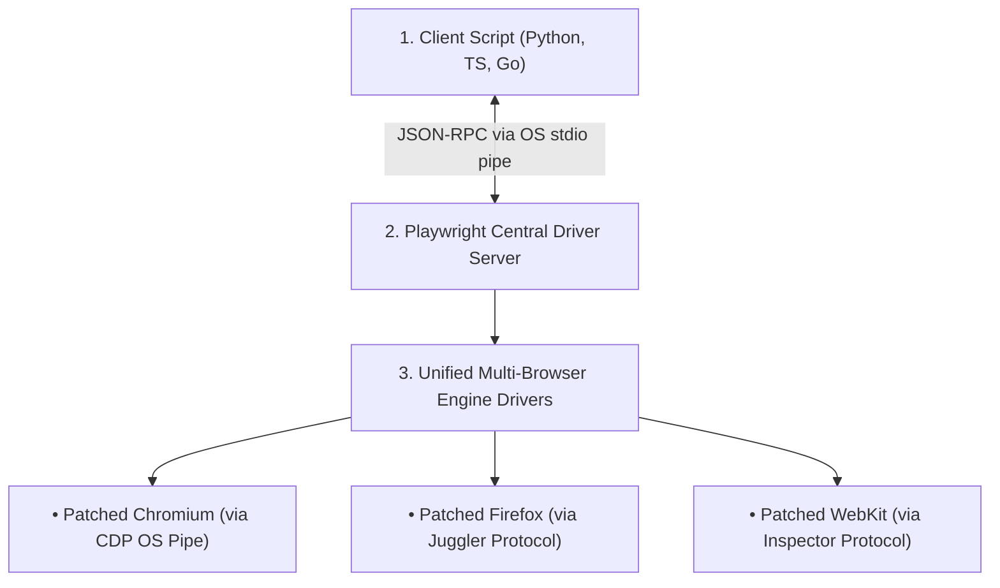

> **TL;DR:** Playwright delivers modern multi-browser automation with isolated contexts and auto-waiting; Puppeteer is optimal for lightweight Chrome-specific tooling; Selenium remains the legacy standard for enterprise cross-language grids.



---

## The Head-to-Head Architectural Matrix

| Capability | Selenium WebDriver (Gen 1) | Puppeteer (Gen 2) | Playwright (Gen 3) |
| :--- | :--- | :--- | :--- |
| **Underlying Wire Protocol** | W3C HTTP REST | CDP over WebSocket | Multiplexed JSON-RPC over `stdio` |
| **Driver Dependency** | Standalone binary (`chromedriver`) | Node.js native library | Node.js background driver process |
| **Browser Engines** | All major browsers (external drivers) | Chromium only (Firefox experimental) | Chromium, Firefox, WebKit (patched binaries) |
| **Execution Latency** | High (HTTP round trip per command) | Low (asynchronous event stream) | Ultra-low (OS pipe streaming) |
| **Actionability & Waiting** | ❌ None (manual loops / `sleep`) | ⚠️ Partial (`waitForSelector`) | ✅ Built-in auto-waiting engine |
| **Session Isolation** | 1 Process per browser instance | 1 Process per browser instance | `BrowserContext` (~10ms, shared binary) |
| **Network Interception** | ❌ Complex proxy setup required | ✅ CDP `Fetch` domain | ✅ Native route handlers (`page.route`) |
| **Anti-Bot Footprint** | Extremely high (`$cdc_`, `navigator.webdriver`) | High (`--enable-automation`, stack traces) | Medium (locator artifacts, headless defaults) |

---

## 1. Generation 1: Selenium WebDriver and the HTTP REST Tax

When Selenium launched in 2004, browsers offered zero native debugging interfaces. Selenium solved this by introducing an intermediate bridge: the **W3C WebDriver protocol**.



### Why Selenium Tests Are Inherently Flaky
HTTP is a request-response protocol without a continuous telemetry stream:
1. When your test calls `element.click()`, the client sends an HTTP POST to `http://localhost:9515/session/:id/element/:id/click`.
2. The driver clicks immediately. It cannot know if a CSS animation is currently sliding the button across the viewport or if an overlay is fading out.
3. If the coordinate hit-test fails, Selenium throws `ElementClickInterceptedException`. 

Engineers responded by littering codebases with arbitrary polling loops (`WebDriverWait`) and fragile `time.sleep(2)` calls.

---

## 2. Generation 2: Puppeteer and the CDP Breakthrough

In 2017, Google's Chrome DevTools team bypassed external driver binaries entirely by exposing the browser's internal debugging interface: the **Chrome DevTools Protocol (CDP)**.



### The Architectural Shift
* **Bi-directional Streaming:** Puppeteer establishes a single persistent WebSocket. Chromium streams DOM mutations, console logs, and network events directly to Node.js without polling.
* **CDP Commands:** Commands execute as lightweight JSON-RPC calls (`Runtime.evaluate`, `Page.navigate`).
* **The Limitation:** CDP was designed specifically for Chromium. Puppeteer cannot automate Safari (WebKit) or Firefox with full architectural parity.

---

## 3. Generation 3: Playwright and Unified stdio IPC

In 2020, Microsoft assembled the core engineering team behind Puppeteer to solve multi-browser automation from first principles.



### The Three Innovations That Define Playwright
1. **OS Pipes instead of WebSockets:** Playwright communicates over standard input/output (`stdin`/`stdout`). This eliminates open network ports, firewall interference, and proxy conflicts on locked-down CI machines.
2. **Auto-Waiting Actionability Pipeline:** Before clicking, Playwright verifies five distinct states:
   * Attached to the DOM
   * Visible in the viewport
   * Stable (no active CSS transforms or scroll momentum)
   * Enabled (not disabled via HTML attributes)
   * Hit-testable (not obscured by sticky headers or modals)
3. **`BrowserContext` Isolation:** A single browser binary instance can host hundreds of isolated incognito-like contexts with independent cookies, cache, and storage—spawning in under 10 milliseconds.

---

## Code Comparison: The Same Click Operation

See how each architecture handles a dynamic button click:

```python
# 1. Selenium (Manual wait required; fragile on animated DOM)
from selenium.webdriver.common.by import By
from selenium.webdriver.support.ui import WebDriverWait
from selenium.webdriver.support import expected_conditions as EC

button = WebDriverWait(driver, 10).until(
    EC.element_to_be_clickable((By.ID, "submit"))
)
button.click()

# 2. Puppeteer (Explicit selector wait)
await page.waitForSelector("#submit", { visible: True })
await page.click("#submit")

# 3. Playwright (Built-in actionability; zero manual wait boilerplate)
await page.click("#submit")  # Automatically asserts attachment, visibility, stability!
```

---

## Performance & Flakiness Benchmarks



{% include chart.html type="grouped" title="Test Flakiness on Modern Single-Page Apps (%)" series="Selenium|Puppeteer|Playwright" labels="CSS Animated Modals|Lazy-Loaded Elements|Dynamic Route Shifts" values="24,8,0.5|18,5,1.2|31,12,0.8" suffix="%" scale="35" note="Playwright's auto-waiting reduces test failures from 25%+ down to under 1%." %}

---

## 1-Minute Diagnostic Check

To inspect how your current runner launches Chromium under the hood, execute this command in terminal to see active debugging flags:

```bash
# Look for automation flags in running Chromium instances
ps aux | grep -E "chromedriver|remote-debugging-port|remote-debugging-pipe|enable-automation"
```

If you see `--remote-debugging-port`, your runner is on a WebSocket bridge (Puppeteer/CDP). If you see `--remote-debugging-pipe`, it is running modern multiplexed OS pipes (Playwright).
