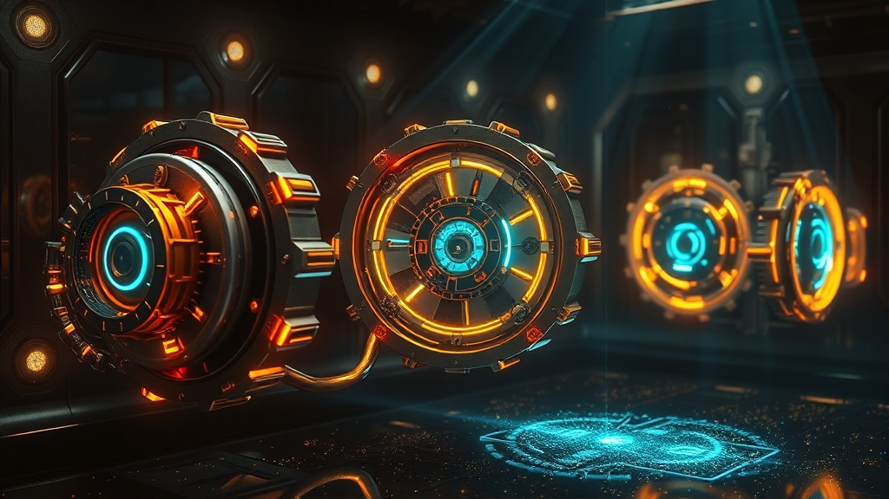
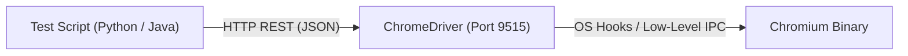
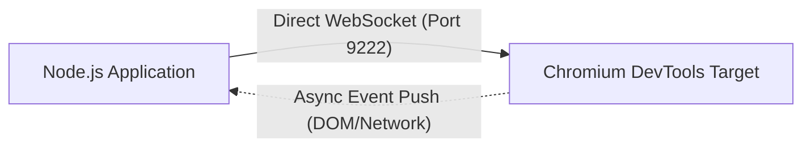
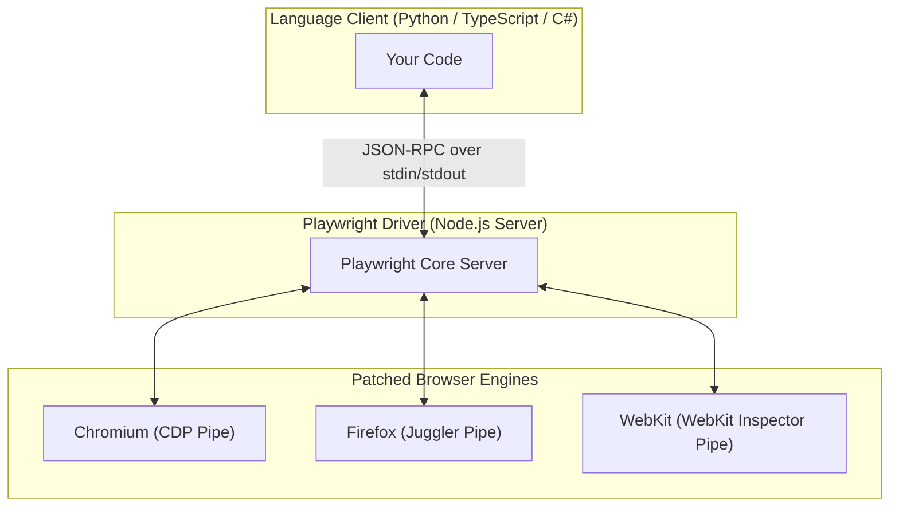

When you write a line of code like `page.click("#submit")`, you rarely think about the complex chain of system calls, network sockets, and rendering engine hooks executing beneath your fingertips.

To your programming language, it is just a function call. 

To the browser, it is a coordinated sequence of DOM tree queries, actionability hit-tests, layout calculations, and synthetic operating system input dispatching.

Over the past two decades, the software engineering industry has developed three distinct paradigms for controlling a web browser with code:

1. **Generation 1: Selenium WebDriver** (W3C HTTP REST Architecture)
2. **Generation 2: Puppeteer** (Chrome DevTools Protocol via WebSocket)
3. **Generation 3: Playwright** (Multiplexed JSON-RPC over Internal Pipes)


<p class="chart-note" style="text-align: center; margin-top: -12px; margin-bottom: 24px;"><em>The automation evolution: moving from high-latency external HTTP bridges to intimate, event-driven integration with modern browser rendering engines.</em></p>

Here is the engineering breakdown of how each tool communicates with the browser, why architectural decisions make tests fast or flaky, and how anti-bot systems detect them.

---

## The Three Automation Generations at a Glance

Comparing the fundamental communication pipelines reveals why newer frameworks outpace legacy architectures.

<div class="vs-cards">
  <div class="vs-card v12">
    <div class="vs-card-header">
      <h3>Selenium WebDriver</h3>
      <span class="vs-tag legacy">Gen 1: HTTP REST Bridge</span>
    </div>
    <div class="vs-feature-list">
      <div class="vs-feature-item">
        <div class="vs-feature-title">
          <span class="vs-icon">📡</span>
          <strong>External Driver Binary</strong>
        </div>
        <p class="vs-feature-desc">Requires an intermediate bridge process (e.g. <code>chromedriver.exe</code>, <code>geckodriver</code>) running an HTTP server.</p>
      </div>
      <div class="vs-feature-item">
        <div class="vs-feature-title">
          <span class="vs-icon">🐢</span>
          <strong>Synchronous Round Trips</strong>
        </div>
        <p class="vs-feature-desc">Every action (find, click, type) sends an individual HTTP POST request, adding network round-trip overhead.</p>
      </div>
      <div class="vs-feature-item">
        <div class="vs-feature-title">
          <span class="vs-icon">⌛</span>
          <strong>Blind Execution Model</strong>
        </div>
        <p class="vs-feature-desc">Executes immediately without verifying stability; throws exceptions if elements are animating or obscured.</p>
      </div>
    </div>
  </div>

  <div class="vs-card v13">
    <div class="vs-card-header">
      <h3>Modern Playwright</h3>
      <span class="vs-tag modern">Gen 3: Unified IPC Protocol</span>
    </div>
    <div class="vs-feature-list">
      <div class="vs-feature-item">
        <div class="vs-feature-title">
          <span class="vs-icon">⚡</span>
          <strong>Bi-directional Stream</strong>
        </div>
        <p class="vs-feature-desc">Communicates over a single low-latency OS stdio pipe with instant asynchronous push event delivery.</p>
      </div>
      <div class="vs-feature-item">
        <div class="vs-feature-title">
          <span class="vs-icon">🎯</span>
          <strong>Built-in Actionability Engine</strong>
        </div>
        <p class="vs-feature-desc">Verifies visibility, stability, hit-testability, and DOM readiness before executing any user interaction.</p>
      </div>
      <div class="vs-feature-item">
        <div class="vs-feature-title">
          <span class="vs-icon">🪶</span>
          <strong>Lightweight BrowserContexts</strong>
        </div>
        <p class="vs-feature-desc">Runs isolated user sessions in under 10ms inside a shared binary, reducing memory consumption by 80%.</p>
      </div>
    </div>
  </div>
</div>

---

## 1. Generation 1: Selenium WebDriver and the W3C Bridge

Selenium was created in 2004, an era when Internet Explorer 6 dominated the web and browsers provided no debugging APIs.

To control a browser, Selenium established the **W3C WebDriver Standard**:



### The Communication Flow:
1. When your script calls `driver.find_element(By.ID, "submit")`, your language binding serializes this command into a JSON payload.
2. It sends an **HTTP POST request** to `http://localhost:9515/session/:id/element`.
3. The standalone `chromedriver` executable receives the HTTP request, translates it into browser-specific instructions, and queries the DOM.
4. `chromedriver` formats an HTTP 200 response containing an element ID and sends it back to your script over the local network socket.

### Why Selenium Tests Are Flaky:
Because HTTP is a **request-response protocol**, Selenium has no native event stream from the rendering engine. 

If a button is fading in via CSS animation, Selenium cannot listen for the end of the animation. It clicks immediately. If the element is not ready, it throws an `ElementClickInterceptedException`. Developers had to invent fragile polling loops and arbitrary `time.sleep()` hacks to stabilize their tests.

---

## 2. Generation 2: Puppeteer and the CDP Breakthrough

In 2017, the Google Chrome DevTools team released **Puppeteer**. 

Puppeteer eliminated the need for external driver executables by tapping directly into Chromium's native debugging interface: the **Chrome DevTools Protocol (CDP)**.



### The Communication Flow:
1. Puppeteer launches Chromium with the `--remote-debugging-port=9222` flag.
2. It opens a persistent, bidirectional **WebSocket connection** directly into Chromium's root browser process.
3. Instead of synchronous HTTP round trips, Puppeteer sends asynchronous **JSON-RPC messages** (e.g. `{"id": 1, "method": "Runtime.evaluate", "params": {...}}`).
4. Because WebSockets support full-duplex streaming, Chromium pushes events to Puppeteer in real time: console logs, network requests, frame navigations, and DOM mutations arrive with sub-millisecond latency.

### The Limitation:
Puppeteer was engineered specifically by Google for Google Chrome. It had no native architecture for automating Firefox or Safari (WebKit) with feature parity.

---

## 3. Generation 3: Playwright and the Unified Multi-Browser Architecture

In 2020, the core engineering team behind Puppeteer moved to Microsoft to build **Playwright**.

Playwright took the architectural lessons of CDP and generalized them across the entire web ecosystem:



### Playwright's Three Major Architectural Innovations:

1. **Multiplexed stdio Pipes**: Playwright clients communicate with the background driver via standard OS input/output streams (`stdin`/`stdout`), completely bypassing local network ports and avoiding firewall/antivirus conflicts.
2. **Patched Engine Binaries**: The Playwright team compiles custom, open-source builds of Chromium, Firefox, and WebKit. They instrumented the rendering engines directly, giving Firefox and WebKit the same deep event-driven capabilities as Chromium.
3. **The Auto-Waiting Actionability Engine**: Before clicking an element, Playwright automatically asserts that the element is attached to the DOM, visible, stable (not animating), enabled, and capable of receiving pointer events.

---

## 4. Benchmark: Speed, Latency, and Test Flakiness

How do these architectural differences translate to real-world performance?



{% include chart.html type="grouped" title="Test Failure Rate on Modern Single-Page Apps (%)" series="Selenium WebDriver|Puppeteer|Playwright" labels="CSS Animated Buttons|Lazy-Loaded Form Fields|Dynamic Single-Page Routing" values="24,8,0.5|18,5,1.2|31,12,0.8" suffix="%" scale="35" note="Playwright's built-in actionability pipeline reduces test flakiness from 25% down to under 1%." %}

---

## 5. The Anti-Bot Dimension: How Each Tool Is Detected

In web scraping and cybersecurity, anti-bot engines (like Cloudflare, DataDome, and Kasada) actively search for traces of each framework:

### 1. How Selenium Gets Caught:
* **The `cdc_` Variable Leak**: ChromeDriver historically injected a global JavaScript variable matching the regex `/\$cdc_[a-z0-9]+/` into the DOM. Scanning for `Object.keys(window)` exposed Selenium instantly.
* **`navigator.webdriver === true`**: Selenium enables the W3C WebDriver flag by default.

### 2. How Puppeteer Gets Caught:
* **The `--enable-automation` Banner**: Spawns the "Chrome is being controlled by automated test software" bar, triggering internal Blink automation flags.
* **CDP Evaluation Stack Traces**: Injected scripts leak `__puppeteer_evaluation_script__` in Error stack traces.

### 3. How Playwright Gets Caught:
* **Playwright Locator Instrumentation**: If an actionability script fails, Playwright's internal locator helper functions can appear in console exception traces.
* **Headless Defaults**: Omitting custom user-agents leaves `HeadlessChrome` in the navigator string.

---

## 6. Code Comparison: The Same Click Across All Three

Here is how the exact same click operation is handled across all three generations:

```python
# 1. Selenium (Gen 1): Manual wait required to avoid flakiness
from selenium.webdriver.common.by import By
from selenium.webdriver.support.ui import WebDriverWait
from selenium.webdriver.support import expected_conditions as EC

button = WebDriverWait(driver, 10).until(
    EC.element_to_be_clickable((By.ID, "submit"))
)
button.click()

# 2. Puppeteer (Gen 2): Explicit selector wait
await page.waitForSelector("#submit", { visible: true });
await page.click("#submit");

# 3. Playwright (Gen 3): Zero boilerplate, auto-waiting built-in
await page.click("#submit"); # Automatically waits for visibility, stability, and hit-test!
```

---

## Production Takeaways for Engineers

| Capability | Selenium WebDriver | Puppeteer | Playwright |
| :--- | :--- | :--- | :--- |
| **Protocol** | W3C HTTP REST | CDP WebSocket | stdio JSON-RPC |
| **Browser Support** | All (via drivers) | Chromium / Chrome | Chromium, Firefox, WebKit |
| **Auto-Waiting** | ❌ Manual code | ⚠️ Partial | ✅ Built-in Actionability |
| **Isolation** | 1 Process per session | 1 Process per session | `BrowserContext` (10ms) |
| **Network Mocking** | ❌ Difficult / Proxy | ✅ CDP Fetch API | ✅ Native route interception |
| **Modern Verdict** | Legacy enterprise | Chromium-focused tooling | **Industry standard** |

Understanding the underlying communication pipes of browser automation allows you to choose the right tool for your workload, diagnose test failures with confidence, and build scrapers that operate cleanly without triggering detection.
