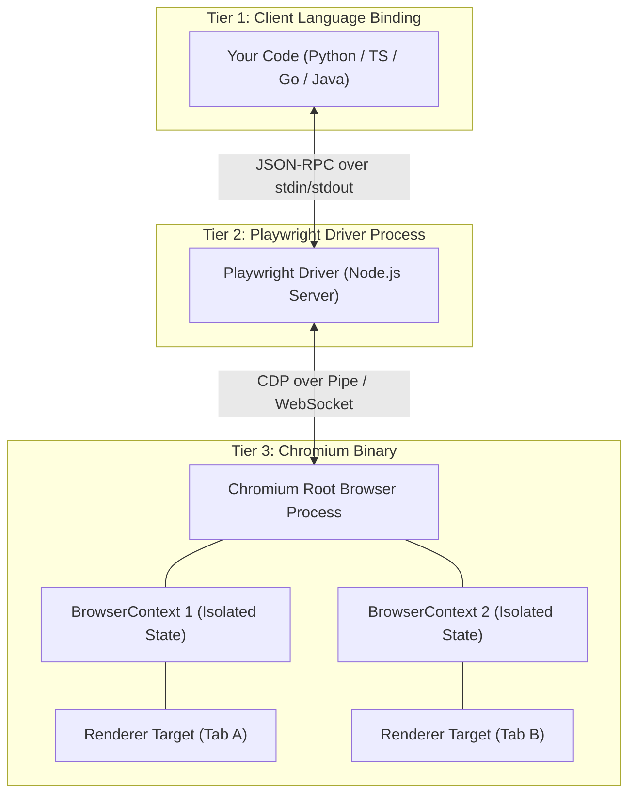
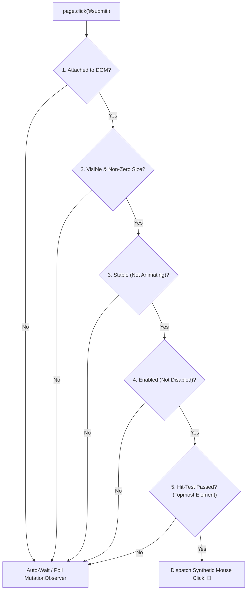

If you have automated browsers for more than a few years, you remember the pain of legacy testing frameworks. 

Tests failed randomly because a button was not clickable yet. Developers littered their codebases with brittle hacks like `time.sleep(5)` or fragile polling loops. Spawning a new browser window took several seconds, and running parallel tests quickly consumed every gigabyte of available RAM.

Then **Playwright** arrived. Suddenly, automated browser tests ran with remarkable speed, parallel test suites spawned in milliseconds, and random flakiness dropped toward zero.

How did the Microsoft Playwright team pull this off?

Playwright does not simply wrap legacy tools in new syntax. It re-architected the entire browser automation stack from the ground up, replacing clumsy HTTP WebDriver bridges with direct asynchronous **Chrome DevTools Protocol (CDP)** sockets and internal OS pipes.


<p class="chart-note" style="text-align: center; margin-top: -12px; margin-bottom: 24px;"><em>The automation puppet master: Playwright commands Chromium through bidirectional event streams, replacing synchronous HTTP polling with low-latency protocol pipes.</em></p>

Here is the engineering breakdown of how Playwright communicates with Chromium, how it executes actionability checks, and how its session architecture works under the hood.

---

## Selenium WebDriver vs Modern Playwright at a Glance

To appreciate Playwright's speed, we must contrast its communication pipeline with traditional Selenium WebDriver.

<div class="vs-cards">
  <div class="vs-card v12">
    <div class="vs-card-header">
      <h3>Selenium WebDriver</h3>
      <span class="vs-tag legacy">W3C WebDriver over HTTP</span>
    </div>
    <div class="vs-feature-list">
      <div class="vs-feature-item">
        <div class="vs-feature-title">
          <span class="vs-icon">📡</span>
          <strong>Synchronous HTTP REST Calls</strong>
        </div>
        <p class="vs-feature-desc">Every action (click, type, find) sends an independent HTTP request to a standalone ChromeDriver executable.</p>
      </div>
      <div class="vs-feature-item">
        <div class="vs-feature-title">
          <span class="vs-icon">⏳</span>
          <strong>Blind Execution & Sleep Hacks</strong>
        </div>
        <p class="vs-feature-desc">Fails immediately if elements are animating or obscured; relies on manual timeouts and wait conditions.</p>
      </div>
      <div class="vs-feature-item">
        <div class="vs-feature-title">
          <span class="vs-icon">🐘</span>
          <strong>Heavyweight Process Spawning</strong>
        </div>
        <p class="vs-feature-desc">Parallel isolation requires launching a full separate OS browser process for every test case (~150MB+ RAM).</p>
      </div>
      <div class="vs-feature-item">
        <div class="vs-feature-title">
          <span class="vs-icon">🐢</span>
          <strong>High Network Latency</strong>
        </div>
        <p class="vs-feature-desc">Round-trip HTTP connection overhead adds noticeable lag to high-frequency test suites.</p>
      </div>
    </div>
  </div>

  <div class="vs-card v13">
    <div class="vs-card-header">
      <h3>Playwright</h3>
      <span class="vs-tag modern">CDP WebSocket / stdio JSON-RPC</span>
    </div>
    <div class="vs-feature-list">
      <div class="vs-feature-item">
        <div class="vs-feature-title">
          <span class="vs-icon">⚡</span>
          <strong>Persistent Bidirectional Event Stream</strong>
        </div>
        <p class="vs-feature-desc">Communicates over a single low-latency WebSocket or OS pipe with instantaneous asynchronous push events.</p>
      </div>
      <div class="vs-feature-item">
        <div class="vs-feature-title">
          <span class="vs-icon">🎯</span>
          <strong>Built-in Auto-Waiting Engine</strong>
        </div>
        <p class="vs-feature-desc">Verifies visibility, stability, hit-testability, and DOM readiness before executing any user interaction.</p>
      </div>
      <div class="vs-feature-item">
        <div class="vs-feature-title">
          <span class="vs-icon">🪶</span>
          <strong>Ultra-Fast BrowserContexts</strong>
        </div>
        <p class="vs-feature-desc">Runs multiple fully isolated user sessions inside a single shared Chromium binary in under 10 milliseconds.</p>
      </div>
      <div class="vs-feature-item">
        <div class="vs-feature-title">
          <span class="vs-icon">🔍</span>
          <strong>Native Network Layer Interception</strong>
        </div>
        <p class="vs-feature-desc">Hooks directly into Chromium's network service; modifies, aborts, or mocks requests with zero proxy lag.</p>
      </div>
    </div>
  </div>
</div>

---

## 1. The Multi-Tier Process Architecture

When you run a Playwright script in Python, TypeScript, or Go, your code does not talk directly to Chromium. 

Instead, Playwright operates as a **three-tier architecture**:



### Tier 1: Language Client
Whether you write in Python (`playwright.sync_api`), Java, or Go, the client is a lightweight wrapper. Its sole responsibility is serializing your API calls into **JSON-RPC messages** and sending them over standard I/O streams (`stdin`/`stdout`).

### Tier 2: The Playwright Driver
Playwright bundles a specialized Node.js runtime driver. When your Python script starts, it spawns this driver as a background child process. The driver parses the JSON-RPC commands and translates them into low-level browser debugging instructions.

### Tier 3: Chromium via CDP
The driver communicates with Chromium using the **Chrome DevTools Protocol (CDP)** over an operating system pipe (or a local WebSocket on port `9222`). Because the pipe is a full-duplex byte stream, the browser can push DOM events, network frames, and console logs back to Playwright instantly with sub-millisecond latency.

---

## 2. Why Playwright Never Sleeps: The Actionability Engine

In Selenium, calling `driver.find_element_by_id("submit").click()` is a blind action. If the button is fading in via CSS animation, covered by a cookie banner, or detached from the DOM, Selenium throws an immediate exception:

`ElementClickInterceptedException: Element is not clickable at point (X, Y)`.

Playwright eliminates this through its **Actionability Pipeline**. Before executing a `page.click('button')`, Playwright automatically runs a strict series of checks:



### The 5 Actionability Guarantees:
1. **Attached**: The element exists inside the target frame's DOM tree.
2. **Visible**: Computed CSS is not `display: none` or `visibility: hidden`, and bounding box has non-zero width and height.
3. **Stable**: Consecutive animation frames (via `requestAnimationFrame`) show the element has stopped moving across the screen.
4. **Enabled**: The element does not possess the `disabled` HTML attribute.
5. **Receives Events**: Playwright calls `document.elementFromPoint(x, y)`. If an invisible overlay or loading spinner sits on top of the button, Playwright waits until the overlay disappears.

Only when all five conditions pass does Playwright dispatch the pointer event. If any check fails, Playwright keeps waiting until the timeout expires (default: 30 seconds), completely removing the need for manual `sleep()` calls.

---

## 3. The Superpower: BrowserContexts vs Full Browsers

In traditional automation, if you wanted 10 separate isolated sessions (different cookies, logged-in users, or proxy configurations), you had to launch **10 distinct browser instances**.

Each browser process consumes 150MB–300MB of RAM, compiles its own V8 JavaScript engine, and initializes its own GPU compositing stack.

Playwright introduced **`BrowserContext`**:

```javascript
// Launch ONE heavy browser binary:
const browser = await chromium.launch();

// Spawn 100 ultra-lightweight, isolated sessions:
const context1 = await browser.newContext({ locale: 'en-US' });
const context2 = await browser.newContext({ locale: 'fr-FR' });

// Context 1 and Context 2 share ZERO cookies or storage!
```

```
[ Chromium Browser Process (150MB RAM) ]
├── Context 1 (Cookies A, LocalStorage A, Cache A) -> 2MB RAM
├── Context 2 (Cookies B, LocalStorage B, Cache B) -> 2MB RAM
└── Context 3 (Cookies C, LocalStorage C, Cache C) -> 2MB RAM
```

Under the hood, Playwright maps each `BrowserContext` to an independent **Chromium Storage Partition**. 

They share the same underlying binary, rendering threads, and network cache disk structures, but maintain completely separated cookie stores, localStorage databases, and session caches. Spawning a new context takes **under 10 milliseconds**.

---

## 4. Benchmark: Speed and Memory Footprint

How do BrowserContexts and CDP compare against traditional multi-browser spawning?



{% include chart.html type="grouped" title="Memory Consumption for 20 Parallel Sessions (MB)" series="Selenium Instances|Puppeteer Browsers|Playwright Contexts" labels="Base Startup|Active Page Load|Peak Execution" values="3200,2800,450|4800,4100,720|6200,5400,980" suffix="MB" scale="7000" note="Running 20 Playwright contexts inside a single browser uses 80% less RAM than 20 individual browser processes." %}

---

## 5. The Anti-Bot Angle: Does Playwright Leave Traces?

Because Playwright controls Chromium via CDP, it leaves subtle technical footprints that specialized anti-bot scripts (like DataDome, Cloudflare Turnstile, and Kasada) actively search for:

### 1. Isolated Execution Context Leaks
Playwright executes page-level helper scripts in an **isolated world** so they do not pollute the website's `window` object. 

However, if an injected script throws an unhandled error, the stack trace can leak internal Playwright identifiers like `__playwright_evaluation_script__`.

### 2. CDP Runtime Side Effects
When Playwright connects CDP to a page, Chromium sets internal flags. For example, calling `Runtime.enable` modifies how the V8 engine reports certain function breakpoints and console instrumentation.

### 3. How to Clean Your Playwright Instances:

```javascript
// Clean launcher configuration for scraping:
const context = await browser.newContext({
  // 1. Never advertise headless mode in User-Agent
  userAgent: 'Mozilla/5.0 (Windows NT 10.0; Win64; x64) AppleWebKit/537.36 (KHTML, like Gecko) Chrome/128.0.0.0 Safari/537.36',
  
  // 2. Realistic desktop viewport
  viewport: { width: 1920, height: 1080 },
  
  // 3. Match system locale and timezone
  locale: 'en-US',
  timezoneId: 'America/New_York',
});

// Remove automation flags natively:
await context.addInitScript(() => {
  delete Object.getPrototypeOf(navigator).webdriver;
});
```

---

## 6. How to Inspect Playwright's Raw CDP Traffic

You can watch Playwright talk to Chromium in real time by setting the `DEBUG` environment variable:

```bash
# Print every internal CDP method and payload to the terminal:
DEBUG=pw:browser* node scraper.js

# Or inspect API calls and actionability waits:
DEBUG=pw:api node scraper.js
```

Sample output:
```
  pw:browser [SEND] {"id":14,"method":"Page.navigate","params":{"url":"https://example.com"}}
  pw:browser [RECV] {"id":14,"result":{"frameId":"A1B2C3"}}
  pw:api waiting for locator('#submit') to be visible...
  pw:api element is visible, enabled and stable
  pw:api scrolling into view if needed
  pw:api done waiting for locator('#submit')
```

---

## Production Takeaways for Engineers

| Capability | Architectural Mechanism | Engineering Advantage |
| :--- | :--- | :--- |
| **Communication** | Bidirectional CDP socket / OS pipe | Replaces synchronous HTTP round-trips with instant asynchronous events. |
| **Flakiness Protection** | Built-in Actionability Engine | Eliminates arbitrary `sleep()` calls by auto-waiting for element stability. |
| **Concurrency** | `BrowserContext` Storage Partitions | Spawns isolated sessions in 8ms with 80% less memory consumption. |
| **Network Control** | Direct CDP Fetch / Network domain hooks | Intercepts, modifies, and aborts HTTP requests with zero proxy latency. |
| **Anti-Bot Hygiene** | Clean isolated contexts & custom flags | Prevents common automation leaks and stack trace signatures. |

Playwright's architectural leap moved browser automation from crude external driving to intimate, low-latency collaboration with the rendering engine. Understanding these internal mechanics allows you to write rock-solid test suites and high-throughput scraping pipelines that execute with maximum speed and stability.
