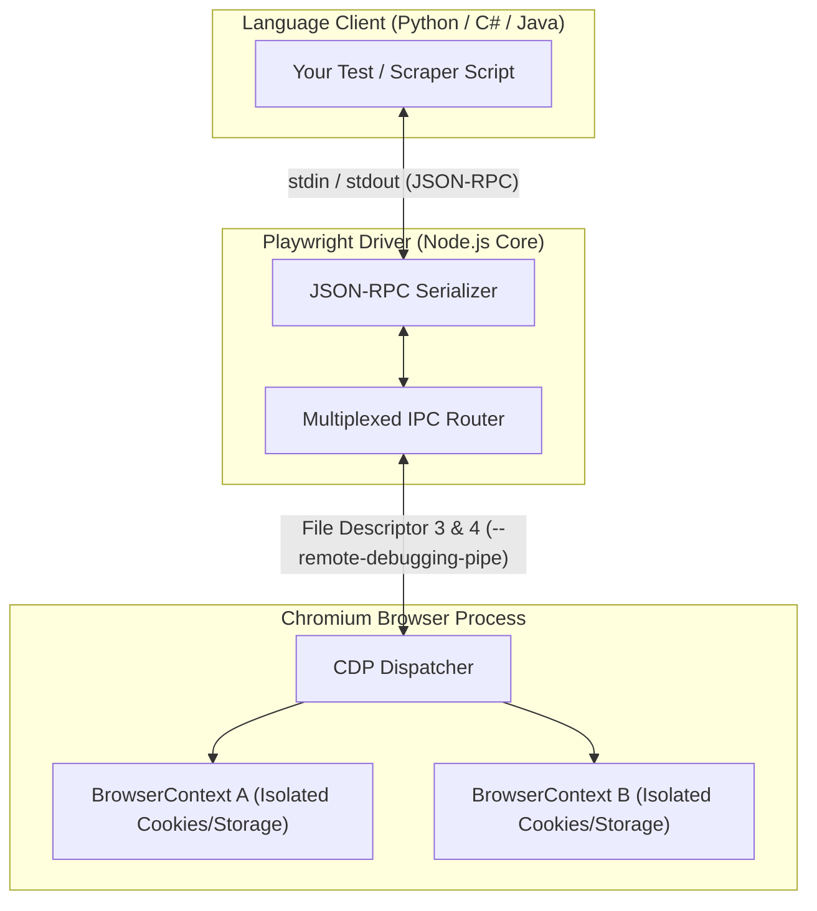
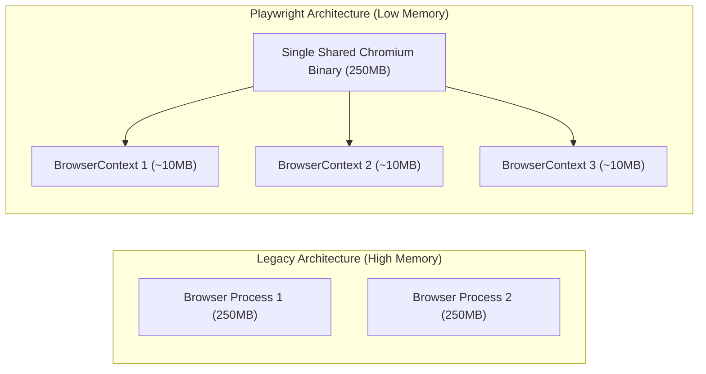
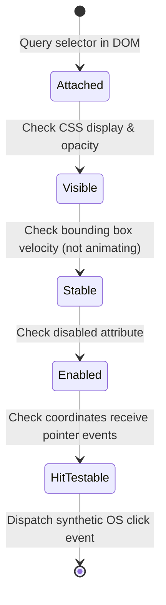

> #### ⚡ TL;DR in 30 Seconds
> * **No Network Ports:** Unlike Selenium or Puppeteer, Playwright avoids local TCP/WebSocket ports (`localhost:9222`). It communicates with Chromium over standard operating system I/O streams: `--remote-debugging-pipe`.
> * **The Multiplexed Driver Server:** Python, TypeScript, and C# clients communicate with a single background Node.js driver process via JSON-RPC over `stdin`/`stdout`.
> * **Lightweight `BrowserContext` Isolation:** Playwright does not launch a new Chromium instance for every test. It provisions isolated `BrowserContext` sandboxes sharing a single browser binary in under 10 milliseconds.
> * **Engine-Level Patching:** Playwright compiles custom Chromium, Firefox, and WebKit builds, instrumenting the rendering engines directly for auto-waiting and zero-flakiness actionability tests.



---

## 1. The Pipe Innovation: Why Playwright Ditched WebSockets

Puppeteer launched Chromium with `--remote-debugging-port=9222`, connecting via an internal WebSocket. While revolutionary in 2017, network sockets introduced severe production failure modes:
* Port collisions on parallel CI runners
* Host firewall and antivirus proxy interference
* Socket exhaustion when spinning up dozens of workers

Playwright replaced WebSockets with **OS File Descriptor Pipes**:

```bash
# How Playwright launches Chromium internally:
/path/to/chrome --remote-debugging-pipe --headless=new ...
```

Chromium allocates two standard OS file descriptors:
* **FD 3:** Input stream for incoming CDP commands from Playwright
* **FD 4:** Output stream for outgoing event telemetry pushed to Playwright

Because communication occurs entirely in kernel memory without traversing the TCP loopback network stack, communication latency drops to near zero and port collisions become mathematically impossible.

---

## 2. Multi-Session Scaling: `BrowserContext` vs Browser Processes

In legacy automation architectures, isolating two user sessions required launching two separate browser binaries:



A `BrowserContext` operates like a dedicated incognito profile:
1. **Isolated Storage:** Completely independent cookies, localStorage, indexedDB, and cache.
2. **Instant Creation:** Spawns in less than **10 milliseconds** (compared to 1,500ms to boot a fresh browser process).
3. **80% Memory Reduction:** A 100-worker scraping fleet runs inside a single parent Chromium instance using 1.2GB of RAM instead of 25GB.

---

## 3. The Auto-Waiting Actionability State Machine

Before Playwright executes an action (like `page.click("#submit")`), it runs an internal C++ state machine asserting that the element is ready:



If an element fails any condition (e.g. an overlay modal is fading out), Playwright retries the actionability check continuously up to the configured timeout, eliminating race conditions without manual `sleep` statements.

---

## Hands-On Verification: Inspect Playwright Process Trees

Run Playwright in your terminal and inspect the process hierarchy:

```bash
# In one terminal, run Playwright with headed mode
python3 -c "from playwright.sync_api import sync_playwright; p = sync_playwright().start(); b = p.chromium.launch(headless=False); input('Press Enter...')"
```

In a second terminal, inspect the active file descriptors:

```bash
# Find the Chromium process and inspect its open pipes
ps aux | grep "remote-debugging-pipe"
```

Notice that Chromium has no `--remote-debugging-port` assigned. It communicates solely through anonymous OS pipes bound directly to the parent Node.js driver process.
