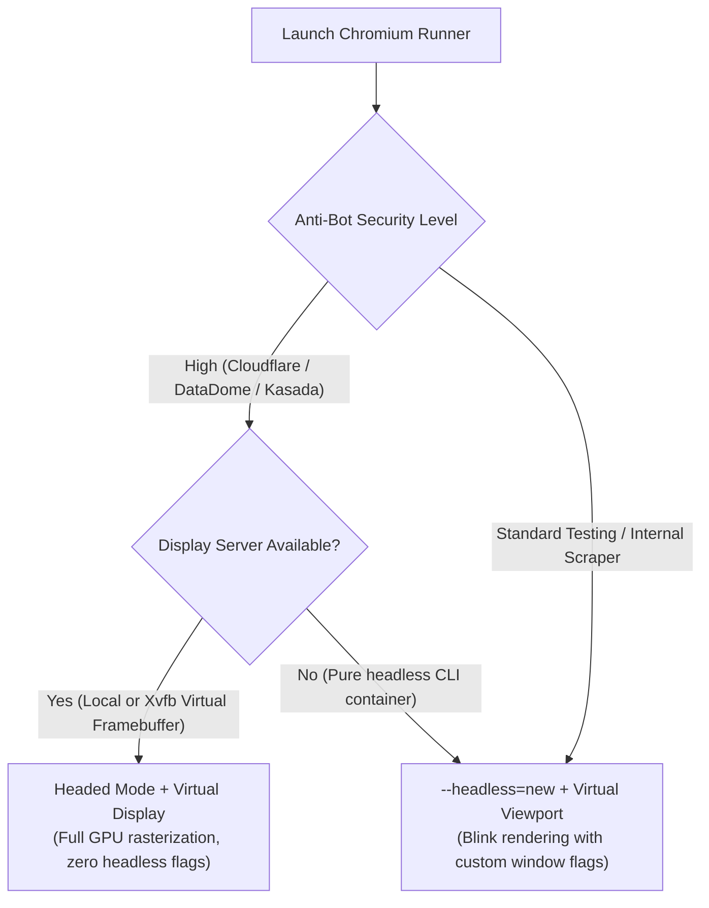
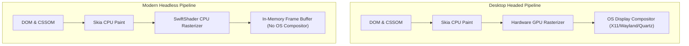
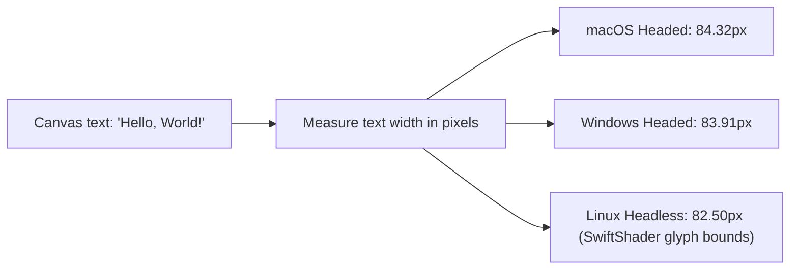

> #### ⚡ TL;DR: Which Chrome Mode Should You Run?
> * **Run Headed Mode if:** You scrape high-security Cloudflare/DataDome targets where SwiftShader CPU fallbacks or window geometry anomalies trigger immediate managed challenges.
> * **Run `--headless=new` if:** You run modern end-to-end tests or high-throughput scraping on Linux servers with a virtual display buffer (`xvfb`), getting real Chrome feature parity with low resource costs.
> * **Never run `--headless=old` (legacy Content Shell):** It lacks the Chrome browser process architecture, leaks dozens of missing APIs, and is flagged by bot detection in under 5 milliseconds.



---

## The 3-Way Showdown Matrix

| Architectural Layer | Desktop Headed Chrome | Legacy Headless (`--headless=old`) | Modern Headless (`--headless=new`) |
| :--- | :--- | :--- | :--- |
| **Window Manager** | Native OS (Quartz, DWM, X11/Wayland) | ❌ None (Bypass window manager completely) | Emulated Headless Window Surface |
| **Blink Architecture** | Complete Chrome Process Tree | Diverged Content Shell binary fork | Unified Chrome binary pipeline |
| **GPU Rasterization** | Discrete / Integrated Hardware GPU | ❌ Software Fallback (Google SwiftShader) | Hardware GPU (if flagged) or SwiftShader |
| **Window Dimensions** | Matches physical screen geometry | `outerWidth: 0`, `outerHeight: 0` | Configured viewport bounds |
| **Default User-Agent** | Standard Chrome UA | Contains `HeadlessChrome/...` token | Standard Chrome UA (Chromium 112+) |
| **Audio / Video Codecs** | Full proprietary codecs (H.264, AAC) | ❌ Stripped codecs | Full codecs (platform dependent) |
| **Extension Support** | Full Chrome Web Store extensions | ❌ Zero extension support | ✅ Chrome extensions supported |
| **Detection Vulnerability** | Very Low (Baseline human behavior) | **100% Guaranteed Detection** | Medium (Leaks via WebGL renderer & timing) |

---

## 1. The Rendering Pipeline: Where Headless Leaks

When you run Chrome without a graphical display, Chromium makes three critical architectural trade-offs:



### 1. The SwiftShader GPU Giveaway
In desktop Chrome, WebGL draw calls execute on a physical GPU (NVIDIA, AMD, or Apple Silicon). 

On a headless Linux server without a configured GPU pass-through, Chromium defaults to **SwiftShader**—Google's CPU-based software rasterizer:

```javascript
const canvas = document.createElement('canvas');
const gl = canvas.getContext('webgl');
const debugInfo = gl.getExtension('WEBGL_debug_renderer_info');
const renderer = gl.getParameter(debugInfo.UNMASKED_RENDERER_WEBGL);

console.log(renderer);
// Headed: "ANGLE (Apple, Apple M2 Max, OpenGL 4.1)"
// Headless Linux: "Google SwiftShader (LLVM 10.0.0, 128 bits)" -> BUSTED!
```

Anti-bot systems query this string synchronously on page load. A SwiftShader renderer on an e-commerce checkout page immediately flags an automated server environment.

---

## 2. Window Geometry & Screen Anomalies

In headed Chrome, the browser window exists within a physical desktop coordinate space:
* `window.outerWidth > window.innerWidth` (due to window borders and scrollbars)
* `window.screen.availHeight < window.screen.height` (due to macOS Dock or Windows Taskbar)

In legacy headless Chrome, these values broke basic geometry rules:
* `window.outerWidth === 0 && window.outerHeight === 0`
* `window.screen.colorDepth === 0`

While `--headless=new` synchronizes window dimensions to the specified viewport, inconsistencies persist:

```javascript
// A classic headless giveaway: outer dimensions exactly matching inner dimensions
const isHeadlessGeometry = (window.outerWidth === window.innerWidth) && 
                           (window.outerHeight === window.innerHeight);
```

---

## 3. Font Rendering & Subpixel Antialiasing

Because headless Linux instances lack the native font antialiasing libraries of macOS (CoreText) or Windows (DirectWrite), Chromium renders text glyphs using FreeType with different pixel-snapping behaviors.



Bot detection scripts render an off-screen `<canvas>` containing specific Unicode strings and compute a SHA-256 hash of the raw pixel buffer. The headless Linux hash never matches a genuine macOS or Windows desktop footprint.

---

## Benchmark: Memory & CPU Footprint

{% include chart.html type="columns" title="Memory Consumption per 10 Browser Contexts (MB - Lower is Better)" labels="Desktop Headed (X11)|Modern Headless (--headless=new)|Legacy Headless (Content Shell)" values="1420|480|320" suffix="MB" scale="1600" highlight="Modern Headless (--headless=new)" note="--headless=new consumes 65% less RAM than headed Chrome while providing full browser feature parity." %}

---

## Run This in Your Terminal: Audit Your Headless Flags

You can test whether your current headless instance leaks telltale bot markers in 2 seconds. Run this Node.js snippet with Playwright or Puppeteer:

```javascript
// audit-headless.js
const { chromium } = require('playwright');

(async () => {
  const browser = await chromium.launch({ headless: true });
  const page = await browser.newPage();
  
  const audit = await page.evaluate(() => {
    const gl = document.createElement('canvas').getContext('webgl');
    const debug = gl?.getExtension('WEBGL_debug_renderer_info');
    return {
      webdriver: navigator.webdriver,
      renderer: debug ? gl.getParameter(debug.UNMASKED_RENDERER_WEBGL) : 'N/A',
      dimensions: `${window.outerWidth}x${window.outerHeight} vs ${window.innerWidth}x${window.innerHeight}`,
      plugins: navigator.plugins.length
    };
  });
  
  console.table(audit);
  await browser.close();
})();
```

If `webdriver` is `true`, `plugins` is `0`, or `renderer` contains `SwiftShader`, your headless browser is immediately identifiable by anti-bot firewalls.
