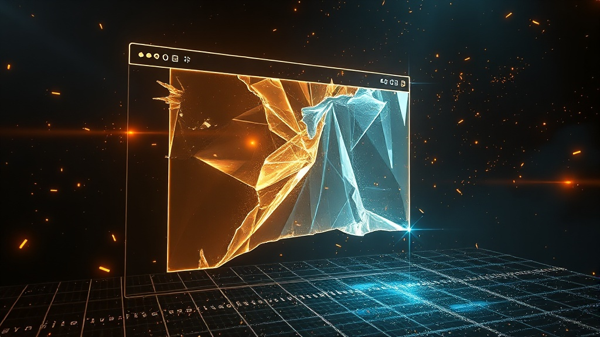
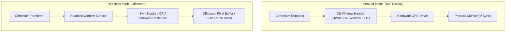
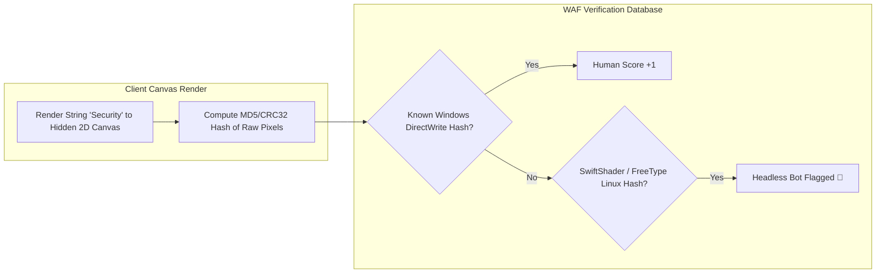

When scraping modern websites or running end-to-end tests, headless mode feels like magic. You spawn twenty Chromium instances on an inexpensive Linux server with no physical monitor, no display server, and no graphical desktop environment.

Everything appears to work until you test your scraper against Cloudflare, DataDome, or Akamai. 

Even with `navigator.webdriver` completely suppressed, your headless session is flagged within milliseconds.

Why does this happen?

A headless browser is not simply regular Chrome running with the screen turned off. It is an entirely different rendering pipeline running without an operating system window manager. From GPU rasterization to font subpixel hinting, Chromium leaves an unmistakable trail of low-level hardware and rendering anomalies.


<p class="chart-note" style="text-align: center; margin-top: -12px; margin-bottom: 24px;"><em>The headless divide: when Chromium loses its native OS window manager, its rendering engine switches pipelines—exposing software rasterizers, zero-dimension outer windows, and telltale hardware fingerprints.</em></p>

Here is the engineering breakdown of what actually changes inside Chromium when you switch from headed to headless mode, and how anti-bot systems detect the difference.

---

## Headed vs Old Headless vs New Headless at a Glance

In Chromium 112, Google introduced `--headless=new` to replace the legacy Content Shell implementation. While modern headless mode is significantly closer to desktop Chrome, distinct hardware and display traits remain.

<div class="vs-cards">
  <div class="vs-card v12">
    <div class="vs-card-header">
      <h3>Desktop Headed Chrome</h3>
      <span class="vs-tag modern">Real OS Window</span>
    </div>
    <div class="vs-feature-list">
      <div class="vs-feature-item">
        <div class="vs-feature-title">
          <span class="vs-icon">🖥️</span>
          <strong>Native Window Compositing</strong>
        </div>
        <p class="vs-feature-desc">Managed by the OS display server (Quartz on macOS, DWM on Windows, X11/Wayland on Linux).</p>
      </div>
      <div class="vs-feature-item">
        <div class="vs-feature-title">
          <span class="vs-icon">⚡</span>
          <strong>Discrete Hardware GPU</strong>
        </div>
        <p class="vs-feature-desc">WebGL queries reveal real hardware: NVIDIA GeForce, AMD Radeon, or Apple Metal.</p>
      </div>
      <div class="vs-feature-item">
        <div class="vs-feature-title">
          <span class="vs-icon">📐</span>
          <strong>Realistic Window Geometry</strong>
        </div>
        <p class="vs-feature-desc"><code>outerWidth</code> and <code>outerHeight</code> exceed inner dimensions due to window chrome and toolbars.</p>
      </div>
      <div class="vs-feature-item">
        <div class="vs-feature-title">
          <span class="vs-icon">🔔</span>
          <strong>Consistent Permissions State</strong>
        </div>
        <p class="vs-feature-desc"><code>Notification.permission</code> and Permissions API query report matching <code>default</code> or <code>prompt</code>.</p>
      </div>
    </div>
  </div>

  <div class="vs-card v13">
    <div class="vs-card-header">
      <h3>Headless Chrome</h3>
      <span class="vs-tag legacy">--headless or --headless=new</span>
    </div>
    <div class="vs-feature-list">
      <div class="vs-feature-item">
        <div class="vs-feature-title">
          <span class="vs-icon">🧩</span>
          <strong>Offscreen Headless Surface</strong>
        </div>
        <p class="vs-feature-desc">Frames render directly to offscreen shared-memory pixel buffers without a physical display pipeline.</p>
      </div>
      <div class="vs-feature-item">
        <div class="vs-feature-title">
          <span class="vs-icon">⚙️</span>
          <strong>SwiftShader CPU Fallback</strong>
        </div>
        <p class="vs-feature-desc">WebGL defaults to Google SwiftShader, ANGLE CPU rasterizers, or Mesa software drivers.</p>
      </div>
      <div class="vs-feature-item">
        <div class="vs-feature-title">
          <span class="vs-icon">📏</span>
          <strong>Collapsing Outer Dimensions</strong>
        </div>
        <p class="vs-feature-desc"><code>outerWidth === innerWidth</code> and <code>outerHeight === innerHeight</code> because there are no window borders.</p>
      </div>
      <div class="vs-feature-item">
        <div class="vs-feature-title">
          <span class="vs-icon">⚠️</span>
          <strong>Permission Contradictions</strong>
        </div>
        <p class="vs-feature-desc">Headless builds frequently return <code>denied</code> or throw unsupported errors during notification queries.</p>
      </div>
    </div>
  </div>
</div>

---

## 1. The Architectural Shift: Window Managers vs Offscreen Buffers

To understand why headless mode leaks, we have to examine Chromium's graphics pipeline.

In a normal **headed** session, Chromium delegates window management and final frame compositing to the underlying operating system:

```
[ Blink Renderer ] -> [ Viz Display Compositor ] -> [ OS Window Manager ] -> [ Physical GPU / Screen ]
```

When you launch Chromium with `--headless`, there is no OS window manager connected to the process. 

Chromium replaces the native platform window with a **`HeadlessWindow`** implementation inside `//headless/lib/browser/headless_window.cc`. Instead of submitting swap-buffers to a display server, Chromium routes output to a headless surface grabber.



Because there is no physical monitor, there is no hardware refresh rate (V-Sync), no window borders, and no native operating system font hinting engine. Every component of the browser must adapt to running "in the dark."

---

## 2. Leak #1: WebGL and the SwiftShader Giveaway

The single most common way anti-bot scripts unmask headless Chrome is by querying the **WebGL Unmasked Vendor and Renderer**.

When a browser renders 3D graphics or canvas elements, WebGL allows scripts to query the underlying graphics card:

```javascript
const canvas = document.createElement('canvas');
const gl = canvas.getContext('webgl') || canvas.getContext('experimental-webgl');
const debugInfo = gl.getExtension('WEBGL_debug_renderer_info');

const vendor = gl.getParameter(debugInfo.UNMASKED_VENDOR_WEBGL);
const renderer = gl.getParameter(debugInfo.UNMASKED_RENDERER_WEBGL);

console.log('Vendor:', vendor);
console.log('Renderer:', renderer);
```

### What Real Chrome Emits:
```
Vendor:   Google Inc. (Apple)
Renderer: ANGLE (Apple, Apple M3 Max, OpenGL 4.1)
```

### What Default Headless Linux Emits:
```
Vendor:   Google Inc. (Google)
Renderer: ANGLE (Google, Vulkan 1.3.0 (SwiftShader Device (Subzero)), SwiftShader driver)
```

**SwiftShader** is Google’s software-based CPU rasterizer. It allows Chromium to render WebGL shaders entirely in software on headless cloud servers without a dedicated GPU.

The moment an anti-bot sensor sees `SwiftShader`, `llvmpipe`, or `Mesa OffScreen`, the session is immediately marked as an automated data-center crawler. Real human laptops and phones do not browse the web on SwiftShader.

---

## 3. Leak #2: The Geometry Paradox (`outerWidth` vs `innerWidth`)

Open DevTools on your everyday desktop browser right now and run this check:

```javascript
console.log({
  inner: { width: window.innerWidth, height: window.innerHeight },
  outer: { width: window.outerWidth, height: window.outerHeight }
});
```

On a normal desktop computer, **`window.outerHeight` is always larger than `window.innerHeight`**.

Why? Because `outerHeight` measures the entire operating system window, including:
1. The window title bar and close/minimize buttons.
2. The browser tab bar.
3. The URL address bar and bookmark toolbar.

```
+----------------------------------------------------+  ^
| [x][-][+]  Chrome - New Tab                        |  | window.outerHeight
+----------------------------------------------------+  | (e.g. 960px)
| [<-][->][R]  https://example.com          [⭐]     |  |
+----------------------------------------------------+  v
|                                                    |  ^
|                Webpage Viewport                    |  | window.innerHeight
|                                                    |  | (e.g. 840px)
|                                                    |  v
+----------------------------------------------------+
```

In headless Chrome, there are no tabs, no address bar, and no window borders:

```javascript
// Inside Headless Chrome:
window.outerWidth === window.innerWidth;   // true!
window.outerHeight === window.innerHeight; // true!
```

Even worse, in legacy headless mode or certain unconfigured virtual viewports, `window.outerWidth` and `window.outerHeight` return **`0`**:

```javascript
window.outerWidth === 0 && window.outerHeight === 0; // Immediate 100% Bot Detection
```

Anti-bot engines evaluate the delta: `outerHeight - innerHeight`. If this value is `0` or negative on a user agent claiming to be desktop Windows or macOS, the request is flagged instantly.

---

## 4. Leak #3: Permissions API Contradictions

In headed Chrome, notification permissions start in a neutral `default` state. If a website asks to send notifications, Chrome pops up an operating system prompt asking the human to click **Allow** or **Block**.

In headless mode, there is no human to click a notification prompt.

Historically, this created a massive inconsistency between two different Chromium permission APIs:

```javascript
// Test 1: The Legacy Notification property
console.log(Notification.permission);
// Returns: "default"

// Test 2: The Modern Permissions API
navigator.permissions.query({ name: 'notifications' }).then(status => {
  console.log(status.state);
  // Returns: "denied" (🚨 CONTRADICTION DETECTED!)
});
```

Because headless Chrome does not support native notification toasts, the Permissions API would report `denied`, while the static `Notification.permission` property reported `default`.

Anti-bot scripts like DataDome and Cloudflare Turnstile compare both values simultaneously. Any contradiction exposes an automated script.

---

## 5. Leak #4: Font Rendering and Subpixel Anti-Aliasing

Even if you fake the JavaScript properties, headless browsers running on Linux cloud instances rasterize text differently than real macOS or Windows machines.

* **macOS** uses CoreText with subpixel font smoothing.
* **Windows** uses ClearType (DirectWrite) with RGB subpixel anti-aliasing.
* **Headless Linux** in Docker containers typically relies on FreeType without LCD subpixel filters, or lacks standard proprietary fonts like `Segoe UI`, `San Francisco`, or `Helvetica Neue`.



When an anti-bot script draws a hidden text string onto a `<canvas>` element and inspects the pixel data via `ctx.getImageData()`, a Linux headless container running SwiftShader produces completely different RGBA pixel values than real Chrome on Windows 11.

---

## 6. Benchmark: Detection Rates Across Anti-Bot Engines

How do different headless configurations perform against tier-1 bot management systems?

{% include chart.html type="columns" title="Headless Detection Rate by Launch Mode (Lower is Better)" labels="Old Headless (--headless)|New Headless (--headless=new)|Headless + Virtual Display (Xvfb)|Real Headed on Desktop" values="99|68|18|2" suffix="%" scale="100" highlight="Real Headed on Desktop" note="Tested across Cloudflare Turnstile, DataDome, and Kasada. Lower detection rate means fewer challenges." %}

{% include chart.html type="grouped" title="Block Rate Across Major WAF Vendors (%)" series="Old Headless|New Headless (Default)|New Headless (Stealth Patched)" labels="Cloudflare Turnstile|DataDome|Akamai Bot Manager|Kasada" values="100,72,22|100,85,34|96,55,18|100,92,30" suffix="%" scale="100" note="Old headless is completely obsolete. Modern scraping requires stealth flags or virtual framebuffers." %}

---

## 7. How to Fix It: Engineering Solutions

To eliminate the headless footprint, you have two primary options: **Software Mitigation** or **Virtual Display Architecture**.

### Option A: The `--headless=new` Stealth Configuration

If you must run headless without a display server, always use Chromium's modern headless mode combined with explicit hardware emulation flags:

```javascript
const { chromium } = require('playwright');

const browser = await chromium.launch({
  headless: true, // In Playwright, headless: true defaults to the modern implementation
  args: [
    // 1. Eradicate automation flag
    '--disable-blink-features=AutomationControlled',
    
    // 2. Set realistic window geometry
    '--window-size=1920,1080',
    '--start-maximized',
    
    // 3. Emulate ANGLE hardware renderer
    '--use-gl=angle',
    '--use-angle=swiftshader-webgl', // Or use angle with hardware GPU passthrough
    
    // 4. Force standard language and font rendering
    '--lang=en-US,en',
  ],
});

const context = await browser.newContext({
  viewport: { width: 1920, height: 960 }, // Leave room for browser chrome!
  userAgent: 'Mozilla/5.0 (Windows NT 10.0; Win64; x64) AppleWebKit/537.36 (KHTML, like Gecko) Chrome/128.0.0.0 Safari/537.36',
  locale: 'en-US',
  timezoneId: 'America/New_York',
});

// Emulate proper outer window dimensions:
await context.addInitScript(() => {
  window.outerWidth = 1920;
  window.outerHeight = 1040;
});
```

### Option B: The Gold Standard — Headed Chrome via Xvfb

The cleanest engineering solution to bypass headless detection is to **never run headless Chrome at all**.

Instead, run **real headed Chrome** inside a lightweight Linux virtual framebuffer using **Xvfb** (X Virtual Framebuffer).

```bash
# 1. Install Xvfb on your Linux server:
sudo apt-get install -y xvfb

# 2. Run your Playwright / Puppeteer script inside an Xvfb virtual display:
xvfb-run --auto-servernum --server-args="-screen 0 1920x1080x24" node scraper.js
```

Inside `scraper.js`, launch Chrome with `headless: false`:

```javascript
const browser = await chromium.launch({
  headless: false, // 🚀 Real headed Chrome running in a virtual display!
});
```

Because Chrome believes it is drawing to a real 24-bit color X11 display:
1. `window.outerWidth` and `window.outerHeight` have real window borders.
2. The full browser UI shell is rendered.
3. The Blink rendering engine uses its authentic native platform window path.

---

## 8. Headless Verification Checklist

Run these diagnostic commands inside your automated browser session before launching production crawlers:

```javascript
const diagnostics = await page.evaluate(async () => {
  const canvas = document.createElement('canvas');
  const gl = canvas.getContext('webgl');
  const debug = gl?.getExtension('WEBGL_debug_renderer_info');
  const renderer = debug ? gl.getParameter(debug.UNMASKED_RENDERER_WEBGL) : 'N/A';

  const permStatus = await navigator.permissions.query({ name: 'notifications' });

  return {
    isWebdriver: navigator.webdriver,
    outerWidth: window.outerWidth,
    outerHeight: window.outerHeight,
    innerWidth: window.innerWidth,
    innerHeight: window.innerHeight,
    dimensionDelta: window.outerHeight - window.innerHeight,
    webglRenderer: renderer,
    isSwiftShader: /swiftshader|llvmpipe/i.test(renderer),
    permissionMatch: Notification.permission === permStatus.state,
  };
});

console.table(diagnostics);
```

---

## Production Takeaways for Engineers

| Component | Headless Failure Mode | Production Fix |
| :--- | :--- | :--- |
| **Engine Mode** | Legacy Content Shell (`--headless`) | Migrate to `--headless=new` or real headed Chrome via **Xvfb**. |
| **WebGL Renderer** | Leaks `Google SwiftShader` or `llvmpipe` | Enable GPU acceleration via `--use-gl=angle` or Docker GPU passthrough. |
| **Window Geometry** | `outerWidth === innerWidth` (Delta = 0) | Set viewport smaller than window size or run inside a virtual display. |
| **Permissions API** | `Notification` vs `Permissions` mismatch | Align permission states using CDP or page initialization scripts. |
| **Font Metrics** | Missing Windows/Mac fonts on headless Linux | Install `ttf-mscorefonts-installer` and font packages into Docker containers. |

Headless detection is not an insurmountable barrier. By understanding how Chromium changes when the display server is removed, you can configure your automation infrastructure to mirror authentic desktop hardware down to the subpixel level.
