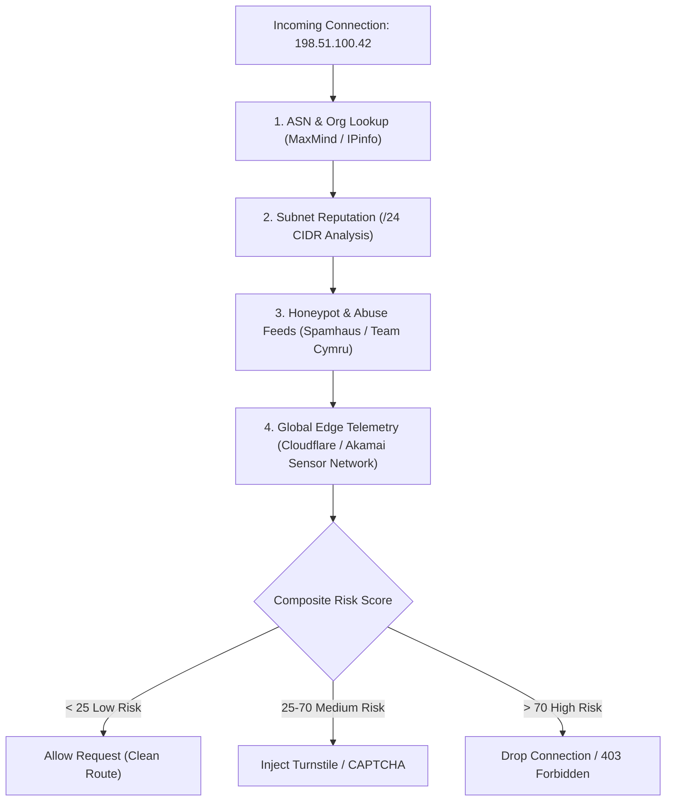
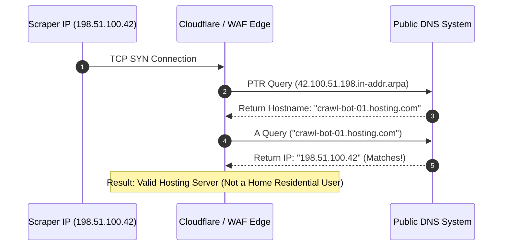

You perfected your TLS handshake. You matched your HTTP/2 header ordering to Google Chrome byte-for-byte. You even patched Chromium's C++ source to eliminate every trace of `navigator.webdriver`.

Yet the very first HTTP request you send returns an immediate **403 Forbidden** or forces an aggressive interactive CAPTCHA.

What betrayed you?

Before your client sent its first encrypted TLS packet or requested an HTML document, the web server already knew who you were. 

It looked up your **IP address**.

To a software engineer, an IP address looks like four simple octets (e.g., `198.51.100.42`). But to a modern Web Application Firewall (WAF), an IP address is a financial credit score. It has an owner, an operational history, a neighborhood, and a live threat index.


<p class="chart-note" style="text-align: center; margin-top: -12px; margin-bottom: 24px;"><em>The global network grid: an IP address is never an anonymous number; it carries real-time telemetry from honeypots, ASN registries, and threat databases across the web.</em></p>

Here is the engineering deep dive into how IP reputation actually works, why residential proxies succeed where cloud servers fail, and how anti-bot systems evaluate your network identity.

---

## Datacenter vs Residential vs Mobile IPs at a Glance

Every IP address on the internet belongs to an Autonomous System Number (ASN). Anti-bot systems categorize your IP into distinct operational tiers before evaluating your request.

<div class="vs-cards">
  <div class="vs-card v12">
    <div class="vs-card-header">
      <h3>Datacenter / Hosting IP</h3>
      <span class="vs-tag legacy">AWS, Hetzner, DigitalOcean</span>
    </div>
    <div class="vs-feature-list">
      <div class="vs-feature-item">
        <div class="vs-feature-title">
          <span class="vs-icon">🏢</span>
          <strong>Hosting ASN Classification</strong>
        </div>
        <p class="vs-feature-desc">Registered under server hosting facilities (e.g. AWS ASN 16509, DigitalOcean ASN 14061).</p>
      </div>
      <div class="vs-feature-item">
        <div class="vs-feature-title">
          <span class="vs-icon">⚡</span>
          <strong>Sub-Millisecond Cloud Latency</strong>
        </div>
        <p class="vs-feature-desc">High-speed gigabit fiber interfaces located directly inside carrier colocation centers.</p>
      </div>
      <div class="vs-feature-item">
        <div class="vs-feature-title">
          <span class="vs-icon">🚫</span>
          <strong>Zero Human Baseline</strong>
        </div>
        <p class="vs-feature-desc">Real everyday humans do not browse consumer shopping sites from inside an Amazon server rack.</p>
      </div>
      <div class="vs-feature-item">
        <div class="vs-feature-title">
          <span class="vs-icon">🚨</span>
          <strong>Strict Threat Threshold</strong>
        </div>
        <p class="vs-feature-desc">Triggers aggressive challenges on Cloudflare, DataDome, and PerimeterX by default.</p>
      </div>
    </div>
  </div>

  <div class="vs-card v13">
    <div class="vs-card-header">
      <h3>Residential / ISP IP</h3>
      <span class="vs-tag modern">Comcast, AT&T, Verizon</span>
    </div>
    <div class="vs-feature-list">
      <div class="vs-feature-item">
        <div class="vs-feature-title">
          <span class="vs-icon">🏠</span>
          <strong>Consumer ISP Classification</strong>
        </div>
        <p class="vs-feature-desc">Assigned by regional consumer internet providers directly to home broadband modems.</p>
      </div>
      <div class="vs-feature-item">
        <div class="vs-feature-title">
          <span class="vs-icon">📶</span>
          <strong>Natural Network Latency & Jitter</strong>
        </div>
        <p class="vs-feature-desc">Exhibits realistic last-mile cable, fiber, or DSL physical latency profiles (20ms–80ms).</p>
      </div>
      <div class="vs-feature-item">
        <div class="vs-feature-title">
          <span class="vs-icon">🛡️</span>
          <strong>High Inherent Trust Score</strong>
        </div>
        <p class="vs-feature-desc">Treated as authentic human traffic; allowed through without CAPTCHAs or verification gates.</p>
      </div>
      <div class="vs-feature-item">
        <div class="vs-feature-title">
          <span class="vs-icon">🔄</span>
          <strong>Dynamic Pool Cycling</strong>
        </div>
        <p class="vs-feature-desc">Shared dynamically across thousands of real household devices over weeks and months.</p>
      </div>
    </div>
  </div>
</div>

---

## 1. Where Does an IP's History Come From?

Anti-bot systems do not maintain their own isolated lists from scratch. Instead, they ingest feeds from specialized **threat intelligence brokers** (such as Spur.us, MaxMind, IPinfo, Team Cymru, and Spamhaus), combined with their own global edge networks.

When an IP connects to an edge server, the security engine evaluates four fundamental layers of history:



### 1. ASN and Organization Type
Every block of IP addresses is assigned to an **Autonomous System Number (ASN)**—a routing identifier managed by regional internet registries like ARIN and RIPE. 

If your IP belongs to **DigitalOcean (ASN 14061)** or **Hetzner (ASN 24940)**, the WAF immediately knows the traffic is generated by code. No human sits at a keyboard using an AWS data center as their home internet provider.

### 2. Live Honeypot Telemetry
Security companies deploy millions of "honeypots" across the web—servers with open ports, fake WordPress login pages, and unpatched vulnerabilities.

If an IP address connected to a honeypot port `22` (SSH) or scanned for open proxies within the last 48 hours, that IP receives an instant negative reputation flag across global firewalls.

### 3. Edge CDN Cross-Domain Tracking
This is Cloudflare and Akamai's superpower. Cloudflare proxies roughly 20% of the entire internet's web traffic.

If an IP address requests 500 different e-commerce checkout pages across 50 different websites within five minutes, Cloudflare's edge network correlates this activity in real time. Even if the scraper visits your website for the very first time, the network already knows it is behaving like a bot.

---

## 2. The Bad Neighbor Problem: Subnet Contamination

Many scraping teams purchase a dedicated `/24` subnet of datacenter IPs (256 addresses) thinking that isolating their IPs will protect them.

In reality, **IP reputation is contagious**.

Security systems do not just score individual IP addresses; they aggregate reputation across entire **CIDR (Classless Inter-Domain Routing)** blocks:

```
Subnet: 198.51.100.0/24 (Addresses .1 through .254)

[ .10 Clean ]   [ .11 Clean ]   [ .12 Abusive Scraper 🚨 ]
[ .13 Clean ]   [ .14 Spam 🚨 ] [ .15 Credential Stuffer 🚨 ]

Result: The entire 198.51.100.0/24 subnet is flagged with high threat score!
```

If five IPs inside a `/24` block engage in aggressive scraping, vulnerability scanning, or spamming, anti-bot systems penalize the **entire 256-address block**. 

Even if your specific IP has never sent a single packet before, you inherit the bad reputation of your neighbors. This is why cheap proxy providers often fail straight out of the box.

---

## 3. Reverse DNS (PTR) and FCrDNS Verification

A subtle technical check performed by modern firewalls is **Forward-Confirmed Reverse DNS (FCrDNS)**:

1. **Reverse Lookup (PTR)**: The server queries the DNS PTR record for the client's IP.
2. **Forward Lookup (A/AAAA)**: The server resolves the resulting hostname back to an IP address.



Real residential broadband IPs typically have PTR records reflecting consumer cable or fiber modems:
* `c-73-15-201-12.hsd1.ca.comcast.net` (Comcast residential broadband)
* `pool-108-45-12-9.verizon.net` (Verizon FiOS consumer)

If an IP claims to be a home user in California but its PTR record points to `static.ovh.net` or has no reverse DNS entry at all, the contradiction raises its risk score immediately.

---

## 4. Benchmark: Trust Scores and Challenge Frequency

How does IP classification directly impact your scraper's ability to reach protected endpoints?



{% include chart.html type="grouped" title="CAPTCHA Trigger Rate on Protected Endpoints (%)" series="Datacenter VPS|Rotating Residential|Mobile 4G Proxy" labels="Cloudflare Turnstile|DataDome|Akamai Bot Manager|PerimeterX" values="94,18,3|98,24,5|88,14,2|96,20,4" suffix="%" scale="100" note="Datacenter IPs are challenged or blocked over 90% of the time on protected targets." %}

---

## 5. The Mobile Carrier Superpower: Carrier-Grade NAT (CGNAT)

Why do **Mobile 4G/5G proxies** achieve the lowest ban rates in the industry?

The answer lies in **Carrier-Grade NAT (CGNAT)**.

Because the world ran out of IPv4 addresses years ago, mobile carriers (such as T-Mobile, AT&T, and Vodafone) do not assign a unique public IPv4 address to every smartphone. Instead, they place **thousands of real human mobile phones behind a single shared public IP address**.

```
[ iPhone 1 (Human) ] \
[ Android (Human)  ]  --> [ Cellular Tower / CGNAT Gateway ] --> Single Public IP: 172.56.21.89
[ Scraper Bot 🤖   ] /
```

If an anti-bot system bans that single mobile IP, it risks accidentally banning **hundreds of legitimate paying customers** who are simultaneously shopping, browsing, or banking on their phones.

Anti-bot engines must maintain extreme tolerance for mobile carrier IPs. As long as the scraper's request volume does not become absurdly aggressive, mobile IPs pass through firewalls with minimal friction.

---

## 6. How to Audit Your IP Reputation via CLI

Before launching a distributed crawler, run these commands to evaluate your IP's current footprint:

```bash
# 1. Query ASN, Organization, and Geolocation:
curl -s https://ipinfo.io/json | jq '{ip, org, city, region, country}'

# Sample Output:
# {
#   "ip": "104.244.72.115",
#   "org": "AS14061 DigitalOcean, LLC",  <-- 🚨 Instantly exposes datacenter traffic
#   "city": "North Bergen",
#   "region": "New Jersey"
# }

# 2. Inspect Reverse DNS (PTR Record):
dig +short -x $(curl -s https://ipinfo.io/ip)

# 3. Check if your IP is listed on major Spamhaus / Abuse blacklists:
IP=$(curl -s https://ipinfo.io/ip)
REVERSED_IP=$(echo $IP | awk -F. '{print $4"."$3"."$2"."$1}')
dig +short ${REVERSED_IP}.zen.spamhaus.org
# If this returns 127.0.0.X, the IP is blacklisted!
```

---

## Production Takeaways for Scraping Engineers

| IP Type | Best Use Case | Risk Factor | Cost Profile |
| :--- | :--- | :--- | :--- |
| **Datacenter** | Unprotected public APIs, internal microservices | 🚨 High (Instant block on tier-1 WAFs) | Lowest (\$0.01 / GB) |
| **Static ISP** | Long-running authenticated sessions | ⚠️ Medium (Good ASN, but fixed address) | Moderate (\$2–\$5 / IP / mo) |
| **Rotating Residential** | High-volume e-commerce and search scraping | 🛡️ Low (Authentic consumer modems) | Metered (\$4–\$12 / GB) |
| **Mobile 4G/5G** | Aggressive checkout flows, anti-bot checkpoints | 🚀 Ultra-Low (Protected by CGNAT sharing) | Premium (\$15–\$35 / GB) |

An IP address is never a clean slate. It is an established identity with a reputation that precedes every packet you transmit. By matching the right IP tier to your target's defense level, you prevent wasted compute cycles and keep your crawlers running reliably.
