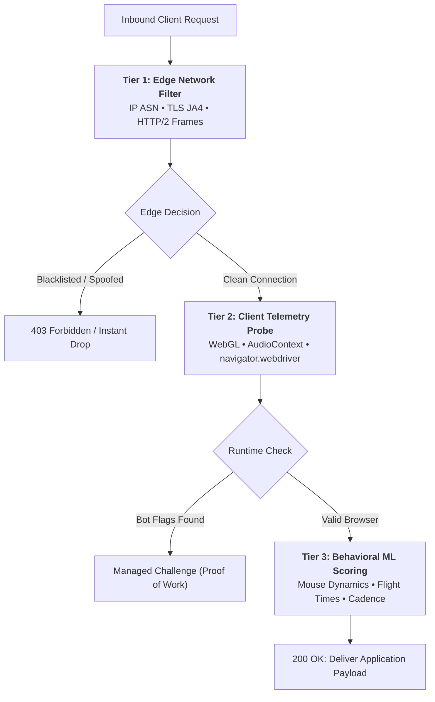
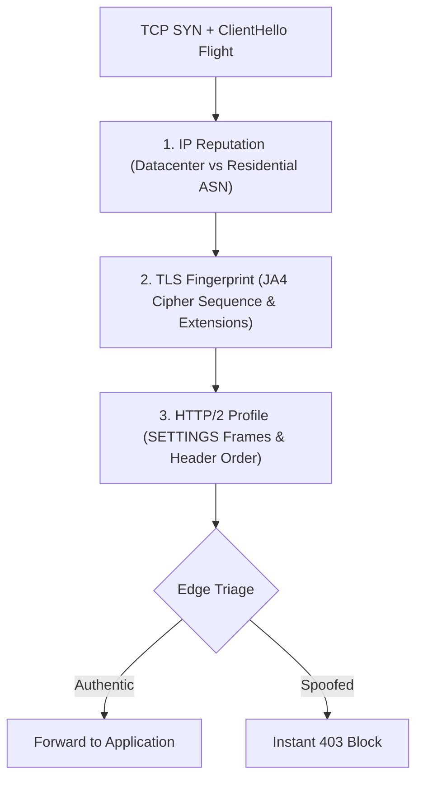
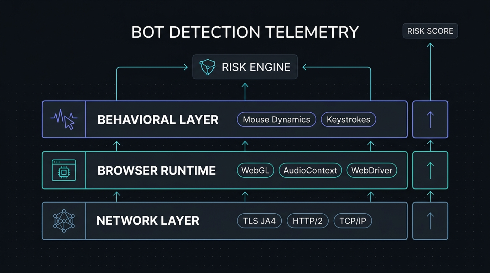
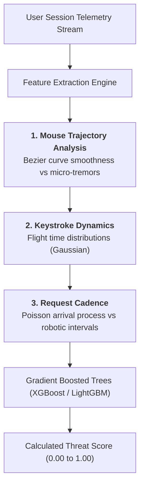

> **TL;DR:** Modern bot detection evaluates four layers simultaneously: network protocol handshakes, hardware runtime fingerprints, JavaScript prototype integrity, and behavioral entropy. Bypassing them requires complete cross-layer consistency.



---

## Tier 1: The Edge Network Filter (Sub-Millisecond Triage)

Before your HTTP request reaches the web application server, edge CDN nodes evaluate the physical connection:



* **ASN Classification:** Is the IP from an Amazon AWS datacenter or a consumer Comcast broadband line?
* **TLS Fingerprint:** Does the advertised cipher suite list match known desktop Chrome versions or standard Python OpenSSL?
* **HTTP/2 SETTINGS:** Does the initial flow control window size match the client's reported `User-Agent`?

If your Python scraper claims to be Chrome on Windows, but the TCP packet was generated by a Linux kernel on a DigitalOcean IP, the edge filter drops the connection in under 2 milliseconds.

---

## Tier 2: Client-Side Telemetry Payloads

If a client passes edge filtering, the server returns an initial HTML shell containing an obfuscated JavaScript telemetry bundle:

```text
┌────────────────────────────────────────────────────────────────────────┐
│                   CLIENT-SIDE FORENSIC TELEMETRY                       │
├───────────────────────────────────┬────────────────────────────────────┤
│ 1. HARDWARE ATTRIBUTES            │ 2. RUNTIME TAMPERING PROBES        │
│ WebGL GPU unmasked renderer       │ navigator.webdriver getter source  │
│ AudioContext DSP floating-point   │ Object.getOwnPropertyDescriptor()  │
│ Hardware concurrency & screen ratio│ Function.prototype.toString() leaks│
├───────────────────────────────────┼────────────────────────────────────┤
│ 3. PERMISSION STATE CONSISTENCY   │ 4. WEBWASSEMBLY PROOF OF WORK      │
│ Notification.permission query     │ Solving dynamic SHA-256 challenges │
│ Web Worker scope feature parity   │ Burning scraper CPU compute cycles │
└───────────────────────────────────┴────────────────────────────────────┘
```

The script encrypts these measurements into a binary payload and submits it via a background HTTP POST (`/cdn-cgi/challenge-platform/...`).



---

## Tier 3: Server-Side Behavioral Machine Learning

For requests that pass client-side execution, a server-side machine learning engine analyzes behavioral patterns over time:



* **Human Inefficiency:** Real humans hesitate, misclick, scroll erratically, and generate micro-tremors with the mouse.
* **Robotic Precision:** Scripted bots move pointers along mathematically perfect lines or jump coordinates instantaneously.

---

## Hands-On Verification: Inspect Response Headers for WAF Telemetry

You can inspect the edge diagnosis returned by major anti-bot engines directly from your terminal:

```bash
# Query a Cloudflare-protected site and check mitigation headers
curl -I -s https://www.cloudflare.com | grep -E "cf-ray|cf-mitigated|server"
```

Expected headers:
* `cf-ray:` The unique request tracking ID across Cloudflare's global edge.
* `cf-mitigated: challenge`: Indicates that your request was flagged by the edge tier and subjected to a managed challenge.
