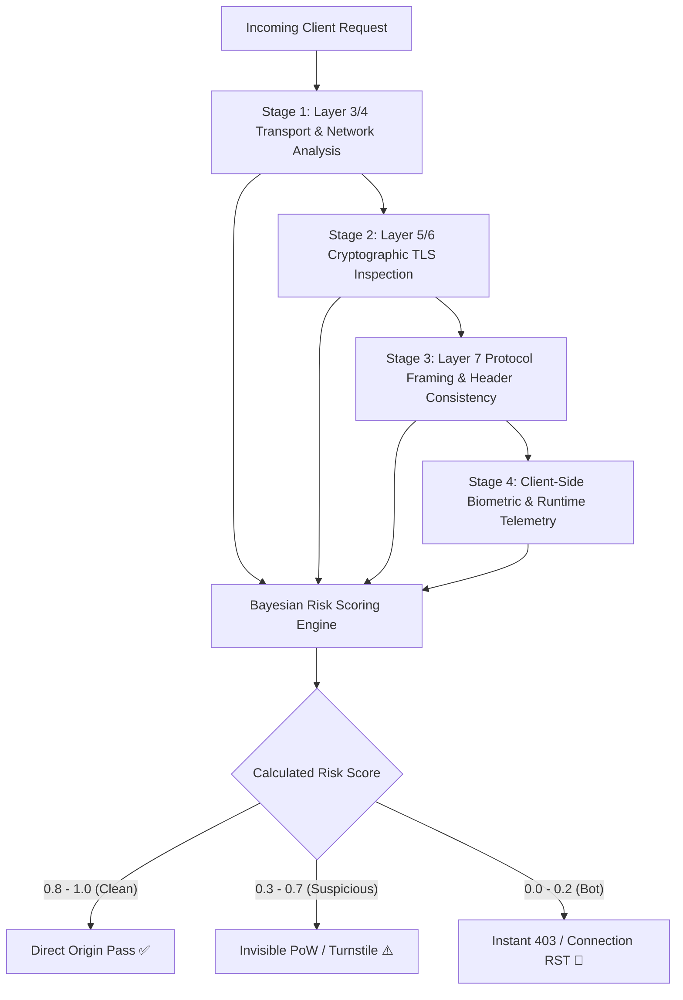
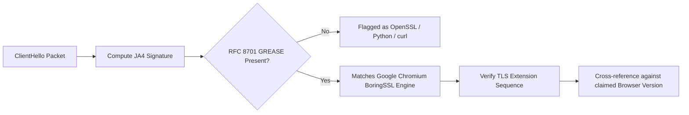
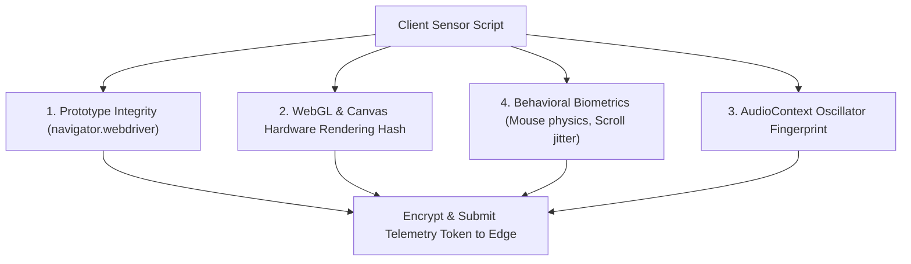

Many developers building automated crawlers or security scanners have a simplistic mental model of how bot protection works.

They assume there is a blacklist of bad IP addresses, a regular expression checking the `User-Agent` string, and maybe a basic rate limit that triggers after twenty rapid requests.

Then they encounter enterprise bot mitigation platforms like **Cloudflare Bot Management**, **DataDome**, **Akamai Bot Manager**, or **Kasada**. 

Even with a brand-new residential proxy, an authentic browser User-Agent, and requests spaced out by five seconds, their script is intercepted and blocked on the very first HTTP request.

What actually caught them?

Modern anti-bot systems are not static firewalls. They are **distributed, multi-stage Bayesian risk scoring engines**. 

They do not look for a single smoking gun. Instead, they ingest dozens of weak, subtle signals across every layer of the network stack, correlating them in real time to calculate a single composite **threat probability score**.


<p class="chart-note" style="text-align: center; margin-top: -12px; margin-bottom: 24px;"><em>The multi-layer radar: modern bot defense does not evaluate requests in isolation; it correlates Layer 3 routing, Layer 5 TLS, Layer 7 framing, and client biometrics.</em></p>

Here is the engineering breakdown of how modern bot detection platforms evaluate incoming traffic, how their risk engines score requests, and how the four-stage detection funnel works.

---

## Traditional Static WAF Rules vs Modern Multi-Signal Risk Engines

Comparing traditional rule-based web application firewalls with modern behavioral bot management systems illustrates why legacy bypass techniques no longer work.

<div class="vs-cards">
  <div class="vs-card v12">
    <div class="vs-card-header">
      <h3>Traditional WAF</h3>
      <span class="vs-tag legacy">Regex & IP Blacklists</span>
    </div>
    <div class="vs-feature-list">
      <div class="vs-feature-item">
        <div class="vs-feature-title">
          <span class="vs-icon">📜</span>
          <strong>Static Rule Matching</strong>
        </div>
        <p class="vs-feature-desc">Evaluates single attributes in isolation: checks if IP is blacklisted or if User-Agent contains <code>python-requests</code>.</p>
      </div>
      <div class="vs-feature-item">
        <div class="vs-feature-title">
          <span class="vs-icon">⚡</span>
          <strong>Deterministic Binary Verdict</strong>
        </div>
        <p class="vs-feature-desc">Yields a hard YES or NO; if no rule matches, the traffic is passed through to the backend server unconditionally.</p>
      </div>
      <div class="vs-feature-item">
        <div class="vs-feature-title">
          <span class="vs-icon">🔓</span>
          <strong>Trivially Bypassed</strong>
        </div>
        <p class="vs-feature-desc">Rotating to a fresh proxy and setting a desktop User-Agent bypasses 100% of static rules.</p>
      </div>
    </div>
  </div>

  <div class="vs-card v13">
    <div class="vs-card-header">
      <h3>Modern Bot Management</h3>
      <span class="vs-tag modern">Multi-Stage Bayesian Engine</span>
    </div>
    <div class="vs-feature-list">
      <div class="vs-feature-item">
        <div class="vs-feature-title">
          <span class="vs-icon">🧠</span>
          <strong>Cross-Layer Signal Fusion</strong>
        </div>
        <p class="vs-feature-desc">Correlates TCP SYN window parameters, TLS JA4 hashes, HTTP/2 framing, and client-side behavioral telemetry.</p>
      </div>
      <div class="vs-feature-item">
        <div class="vs-feature-title">
          <span class="vs-icon">📊</span>
          <strong>Continuous Risk Probability</strong>
        </div>
        <p class="vs-feature-desc">Assigns an anomaly score from 0.0 to 1.0; routes suspicious traffic to invisible Proof-of-Work challenges.</p>
      </div>
      <div class="vs-feature-item">
        <div class="vs-feature-title">
          <span class="vs-icon">🛡️</span>
          <strong>Contradiction Traps</strong>
        </div>
        <p class="vs-feature-desc">Actively penalizes discordant signals: a Chrome User-Agent with OpenSSL ciphers is blocked immediately.</p>
      </div>
    </div>
  </div>
</div>

---

## 1. The Four-Stage Detection Funnel

When an automated client connects to an edge server protected by Cloudflare, DataDome, or Akamai, it must survive four distinct evaluation stages:



---

## 2. Stage 1: Network & OS Kernel Telemetry (Layers 3 & 4)

Before the client sends its first application byte, the security edge inspects the raw TCP connection:

### 1. Autonomous System & Subnet Reputation
The WAF checks the **Autonomous System Number (ASN)**:
* Does the IP belong to a consumer residential ISP (Comcast, AT&T)?
* Does it belong to a public cloud hosting facility (AWS, DigitalOcean, Hetzner)?
* Does the entire `/24` CIDR subnet have a history of spam, port scanning, or scraping?

### 2. Passive OS Fingerprinting (p0f)
The operating system kernel leaves a fingerprint in its initial **TCP SYN packet**:
* Initial TCP Window Size (e.g. `65535` on Windows vs `29200` on Linux).
* TCP Options Ordering: Maximum Segment Size (MSS), Selective Acknowledgment (SACK), Window Scale factor.
* IP Time-to-Live (TTL) baseline.

If the TCP packet indicates a Linux kernel, but subsequent HTTP headers claim Windows 11, the first contradiction point is scored.

---

## 3. Stage 2: The Cryptographic Handshake (Layers 5 & 6)

During the TLS handshake, the client sends an unencrypted **`ClientHello`** message:



The WAF generates a **JA4 fingerprint**:
* The TLS version negotiated.
* The exact list and order of supported cipher suites.
* The list of TLS extensions and elliptic curves.
* The presence of RFC 8701 GREASE values.

Because Python's `requests` library uses OpenSSL and Google Chrome uses BoringSSL, their cryptographic handshakes are completely distinct.

---

## 4. Stage 3: Protocol Framing & Header Harmony (Layer 7)

Once the TLS tunnel is established, the client transmits HTTP frames. In HTTP/2 and HTTP/3:

1. **Pseudo-Header Sequence**: Chrome transmits pseudo-headers in a rigid order: `:method`, `:authority`, `:scheme`, `:path`. Naive HTTP clients or Go's standard library order them differently.
2. **Akamai HTTP/2 Fingerprint**: The edge hashes the client's `SETTINGS` frame, initial `WINDOW_UPDATE`, and priority frames.
3. **Modern Client Hints**: Real Chromium browsers send `sec-ch-ua`, `sec-ch-ua-mobile`, and `sec-ch-ua-platform`. Missing Client Hints on a modern user-agent string is a glaring red flag.

---

## 5. Stage 4: Client-Side Telemetry (The Sensor Tag)

If a request passes Stages 1 through 3, the server serves the webpage, but injects a heavily obfuscated **sensor script** (e.g., DataDome's `tags.js` or Cloudflare's Turnstile payload).

Within 100 milliseconds, this script interrogates the browser environment:



### The Behavioral Biometrics Check:
Humans do not move cursors in mathematically straight lines or teleport between elements in zero milliseconds. 

The sensor tracks:
* **Cursor trajectories**: Evaluates acceleration, deceleration, and micro-tremors along Bézier paths.
* **Keystroke dynamics**: Measures flight time (delay between keys) and dwell time (duration a key is held down).
* **Scroll physics**: Real human scrolling exhibits momentum, friction, and bounce-back.

---

## 6. How the Bayesian Risk Engine Combines Signals

Anti-bot systems do not use simple binary logic. They use **Bayesian probability updating**:

$$P(\text{Bot} \mid S_1, S_2, \dots, S_n) = \frac{P(S_1, \dots, S_n \mid \text{Bot}) \cdot P(\text{Bot})}{P(S_1, \dots, S_n)}$$

Every individual signal modifies the client's trust score:

| Signal Observed | Individual Assessment | Risk Score Impact |
| :--- | :--- | :--- |
| **Residential ISP IP** | Expected human trait | $+15\%$ Trust |
| **AWS Datacenter ASN** | Neutral on API, suspicious on checkout | $-30\%$ Trust |
| **JA4 matches Chrome 128** | Consistent with User-Agent | $+20\%$ Trust |
| **No GREASE in ClientHello** | Contradicts Chrome claim | $-60\%$ Trust (🚨 Contradiction) |
| **Straight-line mouse clicks** | Unnatural kinematic physics | $-40\%$ Trust |
| **`navigator.webdriver === true`** | Explicit automation flag | $-100\%$ Trust (Instant Block) |

If the final composite score drops below the safety threshold, the WAF takes defensive action.

---

## 7. Benchmark: Processing Speed Across Detection Layers

How long does each stage take inside an edge security proxy?



{% include chart.html type="grouped" title="Signal Weighting in Modern Anti-Bot Verdicts (%)" series="DataDome|Cloudflare Bot Management|Kasada" labels="IP & ASN Reputation|TLS / JA4 Fingerprint|HTTP/2 Framing & Headers|Behavioral Biometrics & DOM" values="25,20,10|30,35,25|15,15,10|30,30,55" suffix="%" scale="60" note="Kasada heavily weights client-side execution (55%), while Cloudflare emphasizes TLS/JA4 signatures." %}

---

## 8. How to Inspect Anti-Bot Telemetry via DevTools

You can watch an anti-bot sensor script transmit its payload in real time:

```javascript
// Open DevTools -> Network -> Filter by fetch/XHR
// Look for POST requests to endpoints like:
// - /cdn-cgi/challenge-platform/h/b/cv/result
// - https://api-js.datadome.co/js/

// Intercept and log outbound sensor payloads:
const originalFetch = window.fetch;
window.fetch = async function(...args) {
  if (args[0].includes('challenge-platform') || args[0].includes('datadome')) {
    console.warn('[!] Intercepted Anti-Bot Telemetry Payload:', args[1]?.body);
  }
  return originalFetch.apply(this, args);
};
```

---

## Production Takeaways for Engineers

| Defense Layer | What It Checks | How Scrapers Must Adapt |
| :--- | :--- | :--- |
| **Layer 3 / 4** | IP ASN, BGP routing, TCP SYN window | Route through clean residential or mobile proxies; match host OS. |
| **Layer 5 / 6** | JA4 hash, GREASE, extension order | Use BoringSSL-based clients (`curl_cffi`) or real browser binaries. |
| **Layer 7** | HTTP/2 pseudo-headers, Client Hints | Respect exact browser header casing, ordering, and `sec-ch-ua`. |
| **Client Runtime** | DOM prototypes, WebGL math, mouse biometrics | Execute in headed virtual displays (Xvfb) with natural Bézier mouse paths. |

Modern bot mitigation is an integrated science of cross-layer verification. By understanding that anti-bot platforms operate as comprehensive Bayesian risk engines, you stop chasing fragile single-point hacks and build resilient automation systems engineered for total protocol harmony.
