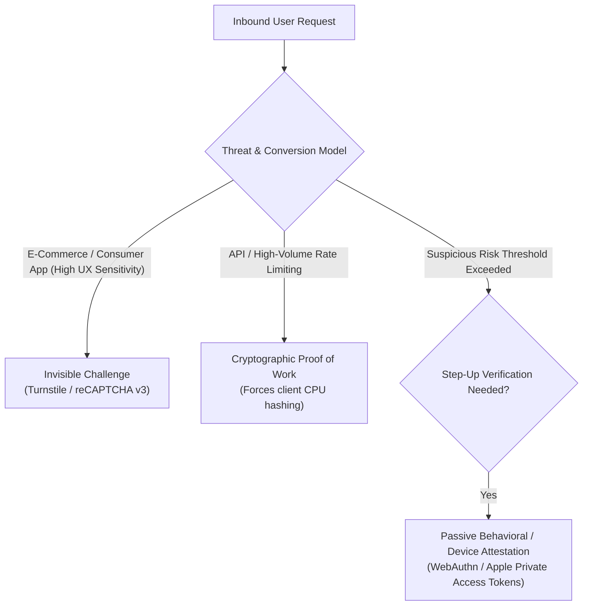
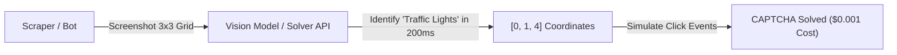
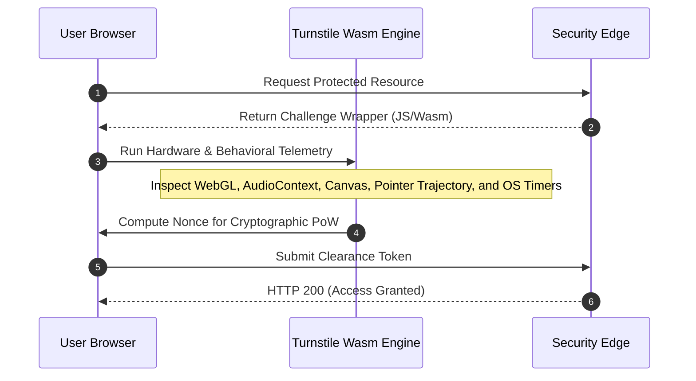

> #### ⚡ TL;DR: Which Verification Model Fits Your Stack?
> * **Deploy Invisible Challenges (Cloudflare Turnstile / reCAPTCHA v3) if:** You need frictionless checkout or signup flows where user conversion rate matters and behavioral telemetry handles bot scoring silently.
> * **Deploy WebAssembly Proof of Work (PoW) if:** You face aggressive Layer 7 DDoS or password-spraying attacks and want to burn attacker CPU cycles without frustrating real users.
> * **Retire Visual Puzzles (reCAPTCHA v2 / hCaptcha grids):** Multimodal LLMs solve 3x3 image grids with 98%+ accuracy for pennies, leaving visual puzzles as a tax on real humans rather than a barrier to bots.



---

## Head-to-Head: Optical Puzzles vs Invisible Behavioral Engines

| Operational Metric | Traditional Visual CAPTCHA | Modern Invisible Challenge (Turnstile/v3) | Cryptographic Proof of Work (PoW) |
| :--- | :--- | :--- | :--- |
| **User Interaction** | Active friction (click 3x3 grids, decipher distorted text) | **Zero friction** (silent JavaScript evaluation) | **Zero friction** (background WebAssembly worker) |
| **Average Verification Time** | **15 – 35 seconds** | **300 – 800 milliseconds** | **500ms – 2 seconds** (scaled to threat level) |
| **Conversion Abandonment** | High (8% – 15% drop-off on checkout) | Negligible (< 0.2% drop-off) | Negligible (< 0.5% drop-off) |
| **AI Bypass Resistance** | ❌ **Broken** (Vision models solve for < $0.002) | ✅ **High** (Evaluates browser environment & timing) | ✅ **Guaranteed Math** (SHA-256 / Argon2 compute cost) |
| **Accessibility (WCAG)** | ❌ Severe barrier for visually impaired users | ✅ 100% accessible (no visual tests) | ✅ 100% accessible |
| **Privacy Footprint** | Cross-site tracking cookies | Privacy-preserving telemetry | Zero tracking (stateless cryptographic challenge) |

---

## 1. Why Vision AI Killed the Optical Puzzle

For two decades, CAPTCHAs relied on an assumption: *computers struggle with unstructured visual interpretation.*

Between 2023 and 2025, modern vision-language models and specialized convolutional networks completely inverted that economic equation:



Today, automated solvers resolve visual CAPTCHAs faster and with higher statistical accuracy than tired human beings. Continuing to force users to click fire hydrants only punishes real customers while doing nothing to deter automated operators with API keys.

---

## 2. Under the Hood: How Invisible Engines Verify You

Modern invisible engines like Cloudflare Turnstile do not ask *"Can you solve this puzzle?"* Instead, they ask: *"Does your environment behave like a real human running a genuine operating system?"*



### The Three Telemetry Pillars:
1. **Hardware Integrity Attestation:** Probing WebGL shader precision, screen coordinate ratios, audio DSP waveforms, and hardware concurrency to ensure the client is not running inside a headless software rasterizer (SwiftShader).
2. **Behavioral Dynamics:** Analyzing mouse trajectory curvature, acceleration jitter, keyup/keydown timing, and touch event pressure. Real human inputs exhibit micro-tremors and variable acceleration that automated Bezier curve scripts fail to replicate.
3. **Micro Proof-of-Work (PoW):** The browser is tasked with finding a SHA-256 hash collision matching a specific difficulty target. A single user solves it in 300ms without noticing; a bot attempting 100,000 requests per minute faces catastrophic CPU saturation.

---

## 3. Proof of Work in Action: The Math That Stops Scrapers

Unlike visual puzzles, **Proof of Work is deterministic**. The server sends a challenge string and a difficulty prefix:

```python
import hashlib
import time

def solve_pow(challenge: str, difficulty_prefix: str = "00000"):
    """Simulates what a browser Wasm worker computes in the background."""
    nonce = 0
    start = time.time()
    while True:
        candidate = f"{challenge}:{nonce}".encode()
        digest = hashlib.sha256(candidate).hexdigest()
        if digest.startswith(difficulty_prefix):
            return nonce, digest, time.time() - start
        nonce += 1

nonce, digest, elapsed = solve_pow("session_token_xyz_8921")
print(f"Solved in {elapsed:.3f}s | Nonce: {nonce} | Hash: {digest}")
```

If an attacker floods the server with 1,000 requests per second, their CPU must compute 1,000 distinct hash collisions, driving their operating costs to untenable levels.

---

## Benchmark: Checkout Funnel Impact

{% include chart.html type="columns" title="Average Checkout Abandonment Rate by Verification Type (% - Lower is Better)" labels="reCAPTCHA v2 (3x3 Grid)|hCaptcha (Visual)|Invisible Turnstile / PoW" values="14.2|16.8|0.4" suffix="%" scale="18" highlight="Invisible Turnstile / PoW" note="Replacing visual puzzles with invisible challenges recovers up to 15% of previously lost conversions." %}

---

## 1-Minute Takeaway for Architects

If your team is still displaying visual challenge grids:
1. **Audit your funnel drop-off:** Check Google Analytics or Mixpanel for user drop-off on pages with active CAPTCHAs.
2. **Switch to invisible token attestation:** Transition to Cloudflare Turnstile, reCAPTCHA Enterprise v3, or native Private Access Tokens (PATs).
3. **Escalate via PoW, not puzzles:** When bot probability exceeds a risk threshold, scale the WebAssembly Proof-of-Work difficulty rather than showing an image grid.
