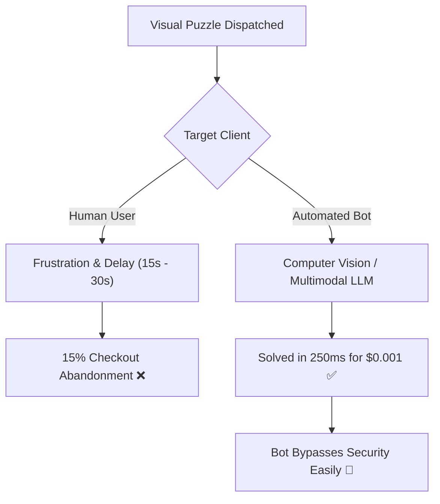
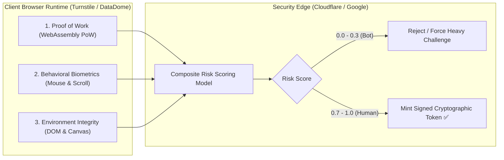

Not long ago, browsing the web felt like an endless eye exam.

You submitted a login form and were forced to decipher distorted wavy text strings. You tried to buy concert tickets and spent two minutes clicking blurry 3x3 grids of traffic lights, crosswalks, and fire hydrants.

Today, those visual puzzles have almost completely vanished from modern web applications.

Instead, you encounter a simple checkbox with the message *"Verify you are human"*, or you encounter nothing at all. Cloudflare Turnstile, Google reCAPTCHA v3, and DataDome verify your identity silently in the background, granting access in less than a second.

Why did the internet abandon the visual puzzle?

Because modern computers became significantly better at solving visual puzzles than humans. The rise of multimodal machine learning turned traditional CAPTCHAs into an expensive barrier that annoyed paying customers while failing to stop automated bots.


<p class="chart-note" style="text-align: center; margin-top: -12px; margin-bottom: 24px;"><em>The death of the puzzle: visual challenges have been replaced by invisible behavioral telemetry, cryptographic Proof of Work, and real-time biometric analysis.</em></p>

Here is the engineering breakdown of how CAPTCHA technology evolved from optical puzzles to silent behavioral scoring engines.

---

## Visual Puzzles vs Invisible Behavioral Challenges at a Glance

Comparing legacy optical challenges with modern behavioral systems illustrates why the security industry shifted paradigms.

<div class="vs-cards">
  <div class="vs-card v12">
    <div class="vs-card-header">
      <h3>Traditional Visual CAPTCHA</h3>
      <span class="vs-tag legacy">reCAPTCHA v2 / hCaptcha Grids</span>
    </div>
    <div class="vs-feature-list">
      <div class="vs-feature-item">
        <div class="vs-feature-title">
          <span class="vs-icon">🧩</span>
          <strong>Explicit Visual Puzzles</strong>
        </div>
        <p class="vs-feature-desc">Requires users to identify objects, classify images, or transcribe distorted text strings.</p>
      </div>
      <div class="vs-feature-item">
        <div class="vs-feature-title">
          <span class="vs-icon">📉</span>
          <strong>Massive Conversion Drop-Off</strong>
        </div>
        <p class="vs-feature-desc">Causes 10%–15% checkout abandonment rates; creates severe accessibility barriers for disabled users.</p>
      </div>
      <div class="vs-feature-item">
        <div class="vs-feature-title">
          <span class="vs-icon">🤖</span>
          <strong>Trivial for Modern AI</strong>
        </div>
        <p class="vs-feature-desc">Convolutional Neural Networks and multimodal LLMs solve grids in under 300ms with 98% accuracy.</p>
      </div>
      <div class="vs-feature-item">
        <div class="vs-feature-title">
          <span class="vs-icon">⏳</span>
          <strong>Painfully High Latency</strong>
        </div>
        <p class="vs-feature-desc">Forces humans to spend 10 to 30 seconds clicking tiles before completing a transaction.</p>
      </div>
    </div>
  </div>

  <div class="vs-card v13">
    <div class="vs-card-header">
      <h3>Invisible / Behavioral Engine</h3>
      <span class="vs-tag modern">Cloudflare Turnstile / reCAPTCHA v3</span>
    </div>
    <div class="vs-feature-list">
      <div class="vs-feature-item">
        <div class="vs-feature-title">
          <span class="vs-icon">👁️</span>
          <strong>Zero Human Friction</strong>
        </div>
        <p class="vs-feature-desc">Executes silently in the background without interrupting the user's natural browsing flow.</p>
      </div>
      <div class="vs-feature-item">
        <div class="vs-feature-title">
          <span class="vs-icon">🖱️</span>
          <strong>Behavioral Biometrics</strong>
        </div>
        <p class="vs-feature-desc">Analyzes continuous mouse physics, cursor acceleration, scroll jitter, and keystroke flight dynamics.</p>
      </div>
      <div class="vs-feature-item">
        <div class="vs-feature-title">
          <span class="vs-icon">⚙️</span>
          <strong>Cryptographic Proof of Work (PoW)</strong>
        </div>
        <p class="vs-feature-desc">Dispatches asymmetric mathematical hashing puzzles to WebAssembly to tax bot CPU resources.</p>
      </div>
      <div class="vs-feature-item">
        <div class="vs-feature-title">
          <span class="vs-icon">⚡</span>
          <strong>Sub-Second Verdict</strong>
        </div>
        <p class="vs-feature-desc">Evaluates environment trust and mints cryptographic validation tokens in under 800ms.</p>
      </div>
    </div>
  </div>
</div>

---

## 1. Why Did the Visual Puzzle Die?

The acronym **CAPTCHA** stands for *Completely Automated Public Turing test to tell Computers and Humans Apart*.

When invented at Carnegie Mellon in 2000, visual puzzles worked because computer vision algorithms were primitive. A computer could not segment letters melted together with noise lines.

By 2020, three technological revolutions destroyed the visual puzzle:

1. **Object Detection Models (YOLO & ResNet)**: Custom machine learning models trained on millions of labeled Google tiles achieved higher recognition accuracy than fatigued humans.
2. **Multimodal LLMs (GPT-4o, Claude 3.5 Sonnet)**: Large vision models can parse entire CAPTCHA screenshots, read instructions ("click all motorcycles"), and output exact pixel click coordinates in a single API call for \$0.002.
3. **Cheap Human Solving Farms**: Centralized API services (such as 2Captcha and Anti-Captcha) routed screenshots to low-cost human workers, bypassing visual checks for pennies per thousand solves.



Visual puzzles became the worst of all worlds: **they stopped legitimate humans while doing almost nothing to stop automated bots.**

---

## 2. The Three Pillars of Invisible Verification

Modern challenges (such as **Cloudflare Turnstile** and **reCAPTCHA v3**) do not ask you to solve a puzzle. Instead, they evaluate **who you are** and **how you move**.



### Pillar 1: Cryptographic Proof of Work (PoW)
When you load a page with Cloudflare Turnstile, an embedded WebAssembly (Wasm) module runs in your browser. 

The server transmits a mathematical challenge:
> *"Find an integer $X$ such that $\text{SHA-256}(\text{Challenge} + X)$ begins with 16 leading zero bits."*

A single human user's laptop solves this puzzle in 50 milliseconds using negligible CPU power. 

However, for a scraper attempting to send 10,000 requests per minute across 100 threads, executing this hashing workload melts their CPU cores. Proof of Work does not make botting impossible; **it makes botting economically unprofitable**.

### Pillar 2: Behavioral Biometrics
Humans are physically imperfect. When you move a mouse toward a button:
* Your cursor travels along an imperfect, oscillating **Bézier curve**.
* It accelerates gradually, overshoots the target slightly, and corrects its trajectory.
* It exhibits microscopic hand tremors (physiological tremor at 8–12 Hz).

Automated scripts, by contrast, frequently teleport the cursor directly to the button coordinates `(x: 450, y: 320)` or move along a mathematically perfect linear vector:

```
Human Path:     (Start) ~~~~\_/\_/\~~~~~> [ Button ] (Micro-jitter, curved acceleration)
Bot Script:     (Start) ----------------> [ Button ] (Instant straight line / teleportation)
```

### Pillar 3: Environmental Prototype Integrity
While the PoW calculates and the user moves their cursor, the challenge script executes dozens of deep prototype inspections:
* Are audio context oscillator frequencies natural?
* Does `document.createElement('canvas').toDataURL()` match the expected hardware GPU rasterizer?
* Has `window.navigator` been tampered with by an automation injection framework?

---

## 3. The Continuous Risk Score Spectrum

In legacy systems, security was binary: you either passed the puzzle (human) or failed it (bot).

Modern systems use **continuous Bayesian risk scoring**:

$$\text{Risk Score} \in [0.0, 1.0]$$

| Score Range | Interpretation | Action Taken |
| :--- | :--- | :--- |
| **0.9 – 1.0** | Extremely high confidence human (logged-in Google session, natural mouse history). | **Instant Silent Pass** (No UI rendered at all). |
| **0.5 – 0.8** | Moderate confidence (clean residential IP, but fast navigation or headless signs). | **Interactive Checkbox** ("Verify you are human" click + light PoW). |
| **0.1 – 0.4** | Highly suspicious (Datacenter ASN, rapid form submission, straight cursor lines). | **Heavy Proof of Work** (Consumes 5–10s of intensive client CPU). |
| **0.0** | Confirmed automation (e.g. `navigator.webdriver === true`). | **Instant 403 Block** without rendering any challenge. |

By separating detection into tiered risk bands, websites offer a frictionless experience to 95% of real human users while reserving friction solely for suspicious traffic.

---

## 4. Benchmark: Speed and Checkout Conversion

How does replacing visual puzzles with invisible challenges impact business metrics and solving costs?



{% include chart.html type="grouped" title="Conversion Drop-Off vs AI Solve Accuracy (%)" series="Visual Image Grid|Invisible Behavioral Challenge" labels="User Abandonment Rate|AI Vision Solve Rate|Cost to Bypass (per 1k)|Human Accessibility Score" values="14.2,0.8|98.5,8.2|0.80,3.50|42,99" suffix="%" scale="100" note="Invisible challenges reduce user abandonment by 94% while being significantly harder for AI to bypass." %}

---

## 5. The Scraper's Dilemma: Navigating Invisible Challenges

For web scraping engineers, invisible challenges represent a fundamental shift in strategy:

### Why Old Bypasses Fail:
* In the past, scrapers extracted the site key, sent it to a 2Captcha API, received an answer token, and injected it into the form.
* Invisible challenges do not accept foreign tokens. The token is cryptographically bound to the client's **exact IP address, TLS fingerprint, and dynamic PoW nonce**. A token generated on a captcha solver's server cannot be redeemed from your scraper's IP.

### The Modern Automation Approach:
1. **Real Headed Browsers via Xvfb**: Running full Chromium instances in virtual displays to guarantee authentic GPU rasterization and WebGL contexts.
2. **Realistic Mouse Physics**: Utilizing curved Bézier paths with randomized acceleration and micro-pause variations:
   ```javascript
   // In Playwright: Avoid instant page.click()
   // Move naturally across points before clicking:
   await page.mouse.move(100, 200, { steps: 25 });
   await page.waitForTimeout(120);
   await page.mouse.down();
   await page.waitForTimeout(80);
   await page.mouse.up();
   ```
3. **Session Warm-Up**: Allowing challenge scripts to complete their background PoW calculations before triggering navigation actions.

---

## 6. How to Inspect Turnstile Verification Tokens via DevTools

When a page verifies you via Cloudflare Turnstile, it injects a hidden form input containing an ephemeral signed JWT:

```html
<input type="hidden" name="cf-turnstile-response" value="0.w0v...signed_token...">
```

You can inspect the payload of this response token in DevTools:

```javascript
// Retrieve the active Turnstile token from the page:
const token = document.querySelector('[name="cf-turnstile-response"]')?.value;
console.log('Turnstile Response Token:', token);

// Inspect the timing:
const [header, payload, signature] = token.split('.');
console.log('Token Payload:', JSON.parse(atob(payload)));
```

The payload contains the server timestamp, client IP hash, and verification status signed with Cloudflare's private edge keys.

---

## Production Takeaways for Engineers

| Era | Primary Defense | Weakness | Modern Status |
| :--- | :--- | :--- | :--- |
| **Gen 1 (2000–2010)** | Distorted text strings | Broken by simple OCR and Tesseract models | Completely obsolete. |
| **Gen 2 (2012–2020)** | 3x3 Image categorization grids | Broken by YOLO, ResNet, and multimodal LLMs | Phasing out rapidly due to high user drop-off. |
| **Gen 3 (2020–Present)** | Invisible behavioral biometrics & PoW | Evaluates cursor physics, hardware, and Wasm hashing | Industry standard (Turnstile, reCAPTCHA v3). |
| **Future (2026+)** | Cryptographic Privacy Pass / Device Attestation | Hardware-backed TPM and Apple Secure Enclave tokens | Emerging standard for zero-trust browser identity. |

The era of demanding that humans solve puzzles to prove their humanity is over. Today's security perimeter operates behind the scenes, watching how your hardware computes and how your cursor glides across the screen. Understanding this transition is essential for building applications that are both completely secure and effortlessly usable.
