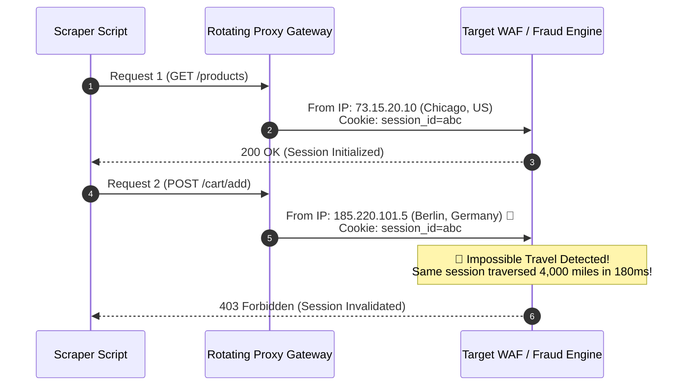
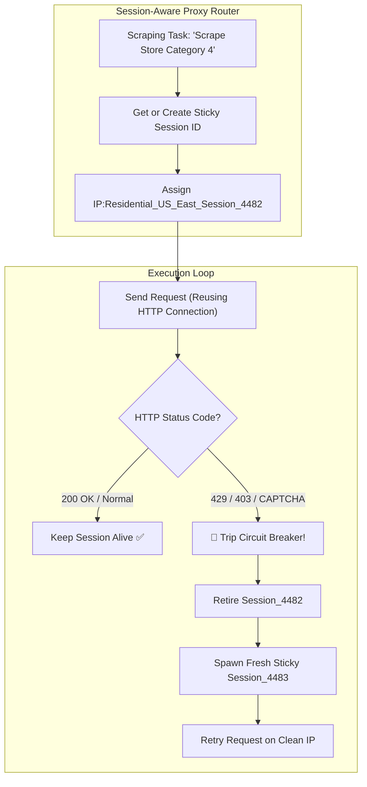

Ask almost any developer how to avoid being blocked while scraping, and they will give you the textbook answer: 
> *"Just buy a residential proxy pool and rotate your IP address on every single request!"*

Most commercial proxy providers even feature this in their marketing, offering a single gateway port that assigns a brand-new IP address to every outbound HTTP connection.

You wire it up to your crawler, send 10,000 requests, and monitor the results.

Instead of clean data, your dashboard lights up with red alerts. Request latency skyrockets from 60ms to nearly a second. Session cookies randomly reset. Shopping carts empty themselves mid-flow. And worst of all, your overall block rate actually *increases*.

Why does rotating your IP on every request make your scraper less reliable?

Because real human users do not teleport across three continents and switch internet providers five times in ten seconds. By rotating your IP randomly on every packet, you break **session affinity**, destroy **TCP connection reuse**, and trigger aggressive **fraud scoring rules**.


<p class="chart-note" style="text-align: center; margin-top: -12px; margin-bottom: 24px;"><em>The rotation trap: blind per-request IP cycling destroys connection reuse and turns ordinary crawling sessions into suspicious impossible-travel anomalies.</em></p>

Here is the engineering breakdown of why naive proxy rotation backfires, and how to build high-throughput, session-aware proxy architectures that actually work.

---

## Per-Request Rotation vs Sticky Session Affinity at a Glance

Comparing naive per-request IP cycling with intelligent session-bound routing reveals why architectures behave so differently.

<div class="vs-cards">
  <div class="vs-card v12">
    <div class="vs-card-header">
      <h3>Naive Per-Request Rotation</h3>
      <span class="vs-tag legacy">Random Port / Endpoint</span>
    </div>
    <div class="vs-feature-list">
      <div class="vs-feature-item">
        <div class="vs-feature-title">
          <span class="vs-icon">🎲</span>
          <strong>Blind IP Cycling</strong>
        </div>
        <p class="vs-feature-desc">Every HTTP request exits through an entirely random residential or datacenter node.</p>
      </div>
      <div class="vs-feature-item">
        <div class="vs-feature-title">
          <span class="vs-icon">🐢</span>
          <strong>TLS Handshake Penalty</strong>
        </div>
        <p class="vs-feature-desc">Forces a full TCP 3-way handshake and TLS negotiation on every request; zero connection reuse.</p>
      </div>
      <div class="vs-feature-item">
        <div class="vs-feature-title">
          <span class="vs-icon">🚨</span>
          <strong>Impossible Travel Alerts</strong>
        </div>
        <p class="vs-feature-desc">Same session cookie jumps from New York to Frankfurt in 200ms, triggering account fraud locks.</p>
      </div>
      <div class="vs-feature-item">
        <div class="vs-feature-title">
          <span class="vs-icon">💥</span>
          <strong>Dirty IP Roulette</strong>
        </div>
        <p class="vs-feature-desc">In a large pool, hitting a single blacklisted IP instantly aborts a multi-step checkout workflow.</p>
      </div>
    </div>
  </div>

  <div class="vs-card v13">
    <div class="vs-card-header">
      <h3>Sticky Session Affinity</h3>
      <span class="vs-tag modern">Session-Aware Proxy Router</span>
    </div>
    <div class="vs-feature-list">
      <div class="vs-feature-item">
        <div class="vs-feature-title">
          <span class="vs-icon">📌</span>
          <strong>Predictable IP Lifespan</strong>
        </div>
        <p class="vs-feature-desc">Pins the IP address for 10–30 minutes or throughout the complete lifecycle of a logical task.</p>
      </div>
      <div class="vs-feature-item">
        <div class="vs-feature-title">
          <span class="vs-icon">⚡</span>
          <strong>Persistent Connection Pooling</strong>
        </div>
        <p class="vs-feature-desc">Reuses HTTP/2 multiplexed streams and keep-alive connections for sub-50ms subsequent requests.</p>
      </div>
      <div class="vs-feature-item">
        <div class="vs-feature-title">
          <span class="vs-icon">🛡️</span>
          <strong>Natural Human Behavior</strong>
        </div>
        <p class="vs-feature-desc">Maintains consistent geographic location, ASN, and session cookies throughout navigation.</p>
      </div>
      <div class="vs-feature-item">
        <div class="vs-feature-title">
          <span class="vs-icon">🔄</span>
          <strong>Targeted Circuit Breaking</strong>
        </div>
        <p class="vs-feature-desc">Rotates IP only when a threshold of 403 Forbidden or 429 Rate Limit responses is reached.</p>
      </div>
    </div>
  </div>
</div>

---

## 1. The Impossible Travel Penalty: Triggering Fraud Engines

Consider what happens inside an e-commerce platform protected by modern fraud engines like Stripe Radar, Cloudflare, or DataDome.

A human user visits an online store:
1. `GET /products/shoes` (IP: `73.15.20.10` - Comcast, Chicago)
2. `POST /cart/add` (IP: `73.15.20.10` - Comcast, Chicago)
3. `GET /checkout` (IP: `73.15.20.10` - Comcast, Chicago)

Now observe what your scraper does when rotating IP addresses blindly on every request:



In the security world, this is known as **Impossible Travel Velocity**. 

If a single session cookie or authenticated token originates from Chicago, and 200 milliseconds later the exact same cookie submits a form from Frankfurt or Tokyo, the server assumes the session token was stolen or hijacked by malware.

The session is terminated immediately, not because of a bad fingerprint, but because of physical impossibility.

---

## 2. Latency Multiplication: Killing TCP and TLS Reuse

Every HTTPS request requires establishing network state. 

On an established connection with **HTTP/2 multiplexing** or HTTP/1.1 `keep-alive`:
* Sending a request takes **1 Round Trip Time (RTT)**: Client sends HTTP request $\rightarrow$ Server returns HTTP response.

When you rotate your IP address on every single request, you discard your connection pool. Every single request must execute:
1. **DNS Resolution**: Look up the proxy node or server (`~15ms`).
2. **TCP 3-Way Handshake**: SYN $\rightarrow$ SYN-ACK $\rightarrow$ ACK (`1 RTT`).
3. **TLS Handshake**: ClientHello $\rightarrow$ ServerHello $\rightarrow$ Key Exchange (`1 RTT` in TLS 1.3, `2 RTT` in TLS 1.2).
4. **Slow-Start TCP CWND**: The initial Congestion Window starts at only 10 packets, limiting bandwidth.

```
Established Connection: [ Request ] -------------> [ Response ] (45ms total)

Rotated Connection:     [ TCP SYN ] -------------> [ SYN-ACK ]
                        [ TLS ClientHello ] -----> [ ServerHello ]
                        [ Request ] -------------> [ Response ] (380ms - 8x Slower!)
```

On high-volume scraping pipelines, this latency penalty increases infrastructure costs and reduces scraping throughput by 70% to 85%.

---

## 3. The Dirty IP Roulette Problem

Commercial residential proxy providers advertise vast pools of "10 million real IPs."

What they do not mention is that in any large residential pool, **3% to 8% of the IPs are currently toxic**:
* Some are blacklisted on Spamhaus or Team Cymru.
* Some were used five minutes earlier by a credential stuffing bot.
* Some have terrible residential upload latency or intermittent packet loss.

If you rotate your IP address randomly on every request, you play **Russian Roulette** with your crawler:

$$\text{Probability of Failure} = 1 - (1 - P_{\text{toxic}})^N$$

If you execute a 10-step scraping pipeline (login $\rightarrow$ search $\rightarrow$ paginate 8 pages) and the toxic IP probability is $5\%$:

$$\text{Failure Probability} = 1 - (1 - 0.05)^{10} \approx 40.1\%$$

Your crawler will fail 4 times out of 10 simply because it was guaranteed to stumble into a dirty node somewhere during the multi-step journey.

---

## 4. Benchmark: Latency and Success Rates

How does proxy session affinity impact real-world scraping performance?



{% include chart.html type="grouped" title="Multi-Step Workflow Completion Rate (%)" series="Per-Request Rotation|Sticky Session (10 Min)|Sticky + Circuit Breaker" labels="Product Detail Scraping|Authenticated Account Crawl|Multi-Page Pagination|Cart & Checkout Flow" values="78,92,99|32,84,97|54,88,98|18,79,96" suffix="%" scale="100" note="Per-request rotation fails catastrophically on authenticated or multi-step checkout workflows." %}

---

## 5. The Correct Architecture: Sticky Sessions & Circuit Breakers

To build a reliable scraping pipeline, implement **Sticky Sessions** with an intelligent **Circuit Breaker**:



### The 4 Golden Rules of Proxy Management:

1. **Pin by Logical Workflow**: If a crawler needs to scrape 15 pages for a single category, route all 15 requests through the same sticky session IP.
2. **Geographic Consistency**: Ensure that when a session rotates, it stays within the same country, state, or metropolitan area.
3. **Connection Pooling**: Use HTTP client sessions that pool connections (`requests.Session()` in Python, `http.Agent` in Node.js, `http.Client` in Go).
4. **Reactive Rotation (Circuit Breaker)**: Only rotate your IP when the server explicitly signals friction (HTTP `429 Too Many Requests`, HTTP `403 Forbidden`, or a Cloudflare challenge page).

---

## 6. Implementation: Python Sticky Session Manager

Here is an architectural pattern for managing sticky sessions with automatic failover in Python:

```python
import time
import uuid
import requests

class StickyProxySession:
    def __init__(self, gateway_url, base_auth, session_ttl_seconds=600):
        self.gateway_url = gateway_url
        self.base_auth = base_auth
        self.ttl = session_ttl_seconds
        self.session_id = None
        self.created_at = 0
        self.client = None
        self._refresh_session()

    def _refresh_session(self):
        """Generates a new sticky session ID for the proxy provider."""
        self.session_id = uuid.uuid4().hex[:8]
        self.created_at = time.time()
        
        # Configure proxy URL with session tag (supported by Bright Data, Oxylabs, Smartproxy, etc.)
        proxy_url = f"http://{self.base_auth}-session-{self.session_id}@{self.gateway_url}"
        
        self.client = requests.Session()
        self.client.proxies = {
            "http": proxy_url,
            "https": proxy_url,
        }

    def get(self, url, **kwargs):
        # Check if session has exceeded its time-to-live:
        if time.time() - self.created_at > self.ttl:
            self._refresh_session()

        response = self.client.get(url, **kwargs)

        # Reactive Rotation: If challenged, immediately cycle session:
        if response.status_code in (403, 429) or "cf-mitigated" in response.headers:
            print(f"[!] Session {self.session_id} blocked. Tripping circuit breaker...")
            self._refresh_session()
            return self.client.get(url, **kwargs)

        return response
```

---

## Production Takeaways for Scraping Engineers

| Practice | Naive Approach | Production Engineering Standard |
| :--- | :--- | :--- |
| **Rotation Trigger** | Rotate every single HTTP request | Rotate on session expiration (10–30 min) or upon encountering 403/429. |
| **Connection State** | Reconnects on every request | Reuses persistent TCP/TLS sockets via client session pools. |
| **Session Cookies** | Shuffled randomly across global nodes | Bound strictly to a single persistent IP address. |
| **Error Handling** | Request fails immediately | Handled gracefully via automated circuit breakers and local retries. |
| **Cost Profile** | High bandwidth waste from connection overhead | Minimal overhead; maximum payload efficiency. |

Proxy rotation is a powerful tool, but like any surgical instrument, it requires precision. By replacing random cycling with sticky, domain-aware session management, you eliminate self-inflicted blocks and build crawling pipelines that operate with rock-solid consistency.
