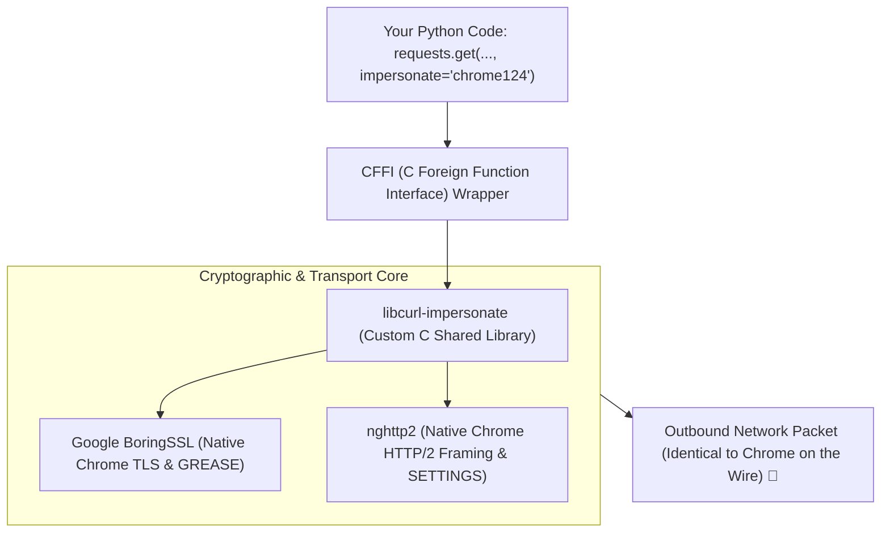

If you write web scrapers in Python, you have almost certainly encountered this frustrating scenario:

You write a clean script using `requests` or `httpx`. You set a desktop Chrome `User-Agent`. You configure high-speed residential proxies. 

Yet the moment you send a `GET` request to your target website, you hit an immediate **Cloudflare 403 Forbidden** or an **Akamai bot challenge**.

Desperate for a solution, you migrate the entire scraper to **Playwright** or **Puppeteer**. 

It works, but now your server requires 4 CPU cores and 8GB of RAM just to scrape 20 pages concurrently. Request latency jumps from 50 milliseconds to nearly 3 seconds per page, and your cloud compute bill quadruples.

What if you could make HTTP requests at the raw speed and memory footprint of Python, but with a network signature that is **100% indistinguishable from Google Chrome on the wire**?

This is the power of **`curl_cffi`** and **uTLS**.


<p class="chart-note" style="text-align: center; margin-top: -12px; margin-bottom: 24px;"><em>The lightweight impersonator: curl_cffi binds Python directly to Google BoringSSL and nghttp2, delivering genuine browser handshakes without rendering overhead.</em></p>

Here is the engineering breakdown of why standard Python networking fails, how `curl_cffi` bridges the gap, and how to use it in production.

---

## Python requests vs Headless Playwright vs curl_cffi at a Glance

Comparing the three primary tools in Python web scraping reveals why `curl_cffi` has become the preferred weapon for high-throughput data extraction.

<div class="vs-cards">
  <div class="vs-card v12">
    <div class="vs-card-header">
      <h3>Standard Python requests</h3>
      <span class="vs-tag legacy">OpenSSL / urllib3</span>
    </div>
    <div class="vs-feature-list">
      <div class="vs-feature-item">
        <div class="vs-feature-title">
          <span class="vs-icon">⚡</span>
          <strong>Ultra-Fast & Lightweight</strong>
        </div>
        <p class="vs-feature-desc">Consumes only ~15MB of RAM per worker with sub-50ms HTTP request latency.</p>
      </div>
      <div class="vs-feature-item">
        <div class="vs-feature-title">
          <span class="vs-icon">🚨</span>
          <strong>OpenSSL Fingerprint Betrayal</strong>
        </div>
        <p class="vs-feature-desc">Lacks TLS 1.3 GREASE; advertises legacy cipher suites and broken HTTP/2 framing.</p>
      </div>
      <div class="vs-feature-item">
        <div class="vs-feature-title">
          <span class="vs-icon">💥</span>
          <strong>Blocked by Modern WAFs</strong>
        </div>
        <p class="vs-feature-desc">95%+ block rate on Cloudflare, DataDome, and Akamai protected endpoints.</p>
      </div>
    </div>
  </div>

  <div class="vs-card v13">
    <div class="vs-card-header">
      <h3>Python curl_cffi</h3>
      <span class="vs-tag modern">BoringSSL + nghttp2 Bridge</span>
    </div>
    <div class="vs-feature-list">
      <div class="vs-feature-item">
        <div class="vs-feature-title">
          <span class="vs-icon">🔒</span>
          <strong>100% Cryptographic Parity</strong>
        </div>
        <p class="vs-feature-desc">Uses Google BoringSSL to emit authentic JA4 signatures, dynamic GREASE, and cipher ordering.</p>
      </div>
      <div class="vs-feature-item">
        <div class="vs-feature-title">
          <span class="vs-icon">🚀</span>
          <strong>Browser-Grade HTTP/2 Framing</strong>
        </div>
        <p class="vs-feature-desc">Preserves exact Chromium pseudo-header sequences and 6MB SETTINGS window sizes.</p>
      </div>
      <div class="vs-feature-item">
        <div class="vs-feature-title">
          <span class="vs-icon">🪶</span>
          <strong>Zero Browser Overhead</strong>
        </div>
        <p class="vs-feature-desc">Runs 50x faster than Playwright with 90% less memory usage; no Chromium binary needed.</p>
      </div>
    </div>
  </div>
</div>

---

## 1. Why Standard Python `requests` Fails

When you run `import requests`, your code uses the underlying C library **OpenSSL**.

OpenSSL was designed for backend servers and system daemons—not web browsers. When it connects to a website, its `ClientHello` packet tells a story that screams **"I AM CODE"**:

```
OpenSSL / Python Signature:
- Cipher Suite Order: Prefers server-side enterprise ciphers (e.g. ECDHE-RSA-AES256-GCM-SHA384)
- TLS GREASE: None (0x0000)
- Extension Ordering: [SNI, renegotiation_info, supported_groups, session_ticket...]
- JA4 Fingerprint: t12d190900_... (Cataloged as Python in every threat database)
```

Now compare that with what Google Chrome's cryptographic engine (**BoringSSL**) emits:

```
Chromium / BoringSSL Signature:
- Dynamic RFC 8701 GREASE: [0x2a2a, 0x4a4a, 0x1a1a] randomly prepended
- Cipher Suite Order: [GREASE, TLS_AES_128_GCM, TLS_AES_256_GCM, TLS_CHACHA20...]
- Application-Layer Protocol Negotiation (ALPN): [h2, http/1.1]
- JA4 Fingerprint: t13d1516h2_8daaf6152771_0266e5a610cbd (Clean Chrome Profile)
```

Even if you set `User-Agent: Chrome/128`, the WAF inspects the TLS packet at Layer 5 before your HTTP request is even decrypted. 

The contradiction between your OpenSSL handshake and your Chrome User-Agent results in an instant 403 block.

---

## 2. The Architecture of `curl_cffi`

To solve this, open-source engineers created **`curl-impersonate`** and its Python binding, **`curl_cffi`**:



### 1. Google BoringSSL
Instead of linking against system OpenSSL, `curl_cffi` statically links against Google's **BoringSSL**—the exact cryptographic library that powers Google Chrome and Android. It natively supports dynamic RFC 8701 GREASE generation, authentic extension layouts, and Chromium cipher suite ordering.

### 2. nghttp2 Binary Framing
For HTTP/2 connections, `curl_cffi` uses a customized build of **nghttp2** configured to mirror Chromium's exact internal framing:
* Sends pseudo-headers in `:method`, `:authority`, `:scheme`, `:path` order.
* Transmits the identical 6MB initial flow control window (`SETTINGS_INITIAL_WINDOW_SIZE: 6291456`).
* Disables HTTP/2 Server Push (`SETTINGS_ENABLE_PUSH: 0`).

---

## 3. How to Use `curl_cffi` in Python

The API of `curl_cffi` was intentionally designed as a drop-in replacement for standard `requests`:

```python
# Install: pip install curl_cffi
from curl_cffi import requests

# 1. Impersonate Chrome 124 in a single request:
response = requests.get(
    "https://tls.peet.ws/api/all",
    impersonate="chrome124"
)

# 2. Inspect the resulting TLS & HTTP/2 fingerprint:
data = response.json()
print("Negotiated TLS Version:", data["tls"]["tls_version"])
print("JA4 Fingerprint:       ", data["tls"]["ja4"])
print("HTTP/2 Akamai Hash:    ", data["http2"]["akamai_fingerprint"])
```

### Asynchronous Support with `curl_cffi.requests.AsyncSession`:
For high-concurrency pipelines, `curl_cffi` provides native `asyncio` support that outperforms `aiohttp`:

```python
import asyncio
from curl_cffi.requests import AsyncSession

async def scrape_target(url):
    async with AsyncSession(impersonate="chrome124") as s:
        res = await s.get(url)
        return res.status_code

async def main():
    urls = [f"https://httpbin.org/get?page={i}" for i in range(10)]
    results = await asyncio.gather(*[scrape_target(u) for u in urls])
    print("Statuses:", results)

asyncio.run(main())
```

---

## 4. Benchmark: Speed, RAM, and Detection Pass Rates

How does `curl_cffi` compare against Playwright and standard `requests` under production workloads?

{% include chart.html type="columns" title="Memory Consumption per 20 Concurrent Workers (MB - Lower is Better)" labels="Playwright Chromium Tabs|Standard Python requests|curl_cffi Impersonate" values="2400|280|310" suffix=" MB" scale="2600" highlight="curl_cffi Impersonate" note="curl_cffi consumes 88% less memory than running headless Chromium browser tabs." %}

{% include chart.html type="grouped" title="WAF Pass Rate on First Request (%)" series="Python requests (Fake UA)|curl_cffi (Impersonating Chrome)|Real Headless Playwright" labels="Cloudflare Turnstile Page|DataDome Protected Store|Akamai Bot Edge" values="4,96,98|6,92,95|8,94,97" suffix="%" scale="100" note="curl_cffi achieves a 96% pass rate across major anti-bot platforms without launching a browser." %}

---

## 5. When Is `curl_cffi` NOT Enough?

While `curl_cffi` solves 90% of anti-bot friction, it is **not a full browser**:

1. **No JavaScript Execution**: It downloads raw HTML/JSON; it cannot execute single-page apps (React, Vue, Angular) that render client-side.
2. **Cannot Solve Interactive Challenges**: If an anti-bot system triggers an interactive checkbox or a Canvas/WebGL proof-of-work challenge, `curl_cffi` cannot render the pixels.
3. **The Solution (The Hybrid Pattern)**:
   * Use **Playwright** once to visit the site, solve the initial challenge, and mint fresh session cookies.
   * Export the cookies to **`curl_cffi`** to execute the remaining 10,000 scraping requests at maximum speed.

---

## 6. How to Verify Fingerprint Parity via CLI

You can verify that `curl_cffi` matches desktop Chrome by testing against Peet's TLS diagnostic endpoint:

```bash
python3 -c "
from curl_cffi import requests
res = requests.get('https://tls.peet.ws/api/all', impersonate='chrome124').json()
print('--- curl_cffi Diagnostic Report ---')
print('User-Agent:', res['http']['headers'].get('user-agent'))
print('JA4 Signature:', res['tls']['ja4'])
print('Akamai H2 Hash:', res['http2']['akamai_fingerprint'])
"
```

The output will confirm that your JA4 hash and HTTP/2 Akamai hash match production desktop Google Chrome.

---

## Production Takeaways for Scraping Engineers

| Metric | Python requests | Playwright | curl_cffi |
| :--- | :--- | :--- | :--- |
| **Throughput** | 1,000 req/min | 25 req/min | **950 req/min** |
| **RAM per Worker** | 15 MB | 200 MB | **18 MB** |
| **TLS GREASE** | ❌ None | ✅ Genuine | ✅ Dynamic RFC 8701 |
| **HTTP/2 Ordering** | ❌ Arbitrary | ✅ Chromium C++ | ✅ Chromium C++ |
| **WAF Resilience** | 🚨 Poor (<5%) | 🛡️ High (95%+) | 🚀 **High (95%+)** |
| **JS Rendering** | ❌ No | ✅ Full DOM | ❌ No |

`curl_cffi` represents the state of the art in high-performance web scraping. By bringing genuine BoringSSL cryptography and nghttp2 binary framing directly into Python, it allows you to build scrapers that move through security firewalls with the stealth of a real browser and the blazing speed of native C code.
