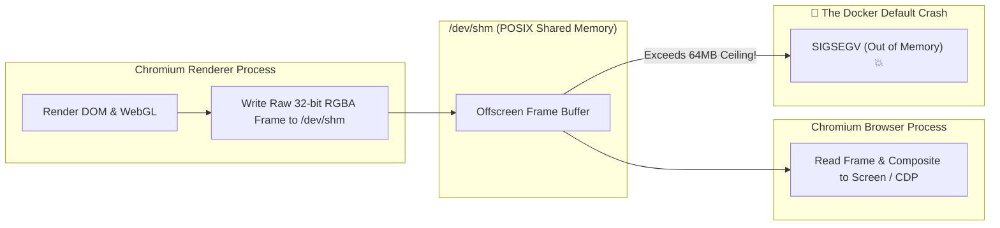

You tested your Playwright or Puppeteer crawler on your development laptop. It scraped 500 pages smoothly without a single hitch.

Then you packaged it into a clean Docker container, deployed it to AWS ECS, Kubernetes, or Google Cloud Run, and started receiving catastrophic error reports within twenty minutes:

```
TargetCloseError: Protocol error (Target.closeTarget): Target closed.
Failed to launch the browser process!
Received signal 11 SEGV_MAPERR
```

The container did not crash because of a syntax error or a bad selector. It crashed because of a fundamental impedance mismatch between **Chromium’s multi-process architecture** and **Linux container isolation primitives**.

Chromium was engineered as a desktop client operating on rich workstation hardware. When forced into a minimalist container namespace, critical assumptions about memory, process reaping, sandboxing, and font rendering break down immediately.


<p class="chart-note" style="text-align: center; margin-top: -12px; margin-bottom: 24px;"><em>The container constraint: running Chromium inside Docker exposes shared memory limits, process reaping failures, and unmasked rendering anomalies.</em></p>

Here is the engineering breakdown of what actually changes when Chromium runs inside Docker, why container crashes happen, and how to build production-hardened browser containers.

---

## Desktop Workstation vs Default Docker Container at a Glance

Comparing native desktop environments with standard container configurations reveals why unconfigured containers fail under load.

<div class="vs-cards">
  <div class="vs-card v12">
    <div class="vs-card-header">
      <h3>Native Host Environment</h3>
      <span class="vs-tag modern">macOS / Ubuntu Desktop</span>
    </div>
    <div class="vs-feature-list">
      <div class="vs-feature-item">
        <div class="vs-feature-title">
          <span class="vs-icon">💾</span>
          <strong>Dynamic Shared Memory (/dev/shm)</strong>
        </div>
        <p class="vs-feature-desc">Defaults to 50% of total physical RAM (typically 8GB–32GB); accommodates thousands of uncompressed render frames.</p>
      </div>
      <div class="vs-feature-item">
        <div class="vs-feature-title">
          <span class="vs-icon">🛡️</span>
          <strong>Multi-Layer Process Sandbox</strong>
        </div>
        <p class="vs-feature-desc">Utilizes unprivileged user namespaces and seccomp filters natively without root privileges.</p>
      </div>
      <div class="vs-feature-item">
        <div class="vs-feature-title">
          <span class="vs-icon">🧹</span>
          <strong>Systemd Init Process Reaping</strong>
        </div>
        <p class="vs-feature-desc">PID 1 (systemd) automatically reaps terminated child processes, preventing zombie accumulation.</p>
      </div>
      <div class="vs-feature-item">
        <div class="vs-feature-title">
          <span class="vs-icon">🔤</span>
          <strong>Comprehensive OS Font Libraries</strong>
        </div>
        <p class="vs-feature-desc">Equipped with complete TrueType and OpenType font packages, emoji sets, and subpixel anti-aliasing.</p>
      </div>
    </div>
  </div>

  <div class="vs-card v13">
    <div class="vs-card-header">
      <h3>Default Docker Container</h3>
      <span class="vs-tag legacy">Unconfigured docker run</span>
    </div>
    <div class="vs-feature-list">
      <div class="vs-feature-item">
        <div class="vs-feature-title">
          <span class="vs-icon">💥</span>
          <strong>64MB /dev/shm Starvation</strong>
        </div>
        <p class="vs-feature-desc">Docker assigns a rigid 64MB shared memory ceiling, crashing rendering engines on heavy graphics.</p>
      </div>
      <div class="vs-feature-item">
        <div class="vs-feature-title">
          <span class="vs-icon">⚠️</span>
          <strong>Dangerous --no-sandbox Fallback</strong>
        </div>
        <p class="vs-feature-desc">Default Docker seccomp rules block user namespaces, tempting engineers to run insecurely as root.</p>
      </div>
      <div class="vs-feature-item">
        <div class="vs-feature-title">
          <span class="vs-icon">🧟</span>
          <strong>The PID 1 Zombie Leak</strong>
        </div>
        <p class="vs-feature-desc">Node.js as PID 1 ignores dead child processes, filling the kernel PID table until execution locks up.</p>
      </div>
      <div class="vs-feature-item">
        <div class="vs-feature-title">
          <span class="vs-icon">🚫</span>
          <strong>Missing Font Glyphs & Blank Boxes</strong>
        </div>
        <p class="vs-feature-desc">Minimalist base images lack system fonts, causing canvas text to render as blank tofu squares <code>[ ]</code>.</p>
      </div>
    </div>
  </div>
</div>

---

## 1. The `/dev/shm` Bottleneck: Why Renderers Crash

The single most frequent cause of Chromium container crashes is **POSIX shared memory exhaustion**.

To render a web page, Chromium uses a multi-process architecture:
* **The Renderer Process**: Executes JavaScript and draws DOM elements into a raw pixel bitmap.
* **The GPU / Browser Process**: Composites the bitmap and transmits it to the screen or DevTools CDP client.

Passing high-resolution uncompressed image frames across process boundaries using standard inter-process pipes is far too slow. 

Instead, Chromium uses **`/dev/shm`**—a temporary filesystem backed directly by RAM (`tmpfs`). The Renderer writes raw pixel data into shared memory, and the Browser process reads it with zero copying overhead:



### The Math Behind the Crash:
A single 1920x1080 display frame at 32-bit color consumes:

$$\text{Frame Size} = 1920 \times 1080 \times 4 \text{ bytes} \approx 8.29 \text{ MB}$$

With multiple tabs, animated transitions, WebGL surfaces, and device scale factors (`deviceScaleFactor: 2` quadruples memory to 33.1MB!), **Docker's default 64MB `/dev/shm` partition overflows in seconds.**

When `/dev/shm` runs out of space, the memory allocation call fails, triggering an uncatchable `SIGSEGV` crash.

### The Fix:
You must expand the shared memory partition during container launch:

```bash
# Option A: Allocate 2GB of shared memory via Docker CLI:
docker run --shm-size=2gb my-crawler

# Option B: Mount host IPC namespace:
docker run --ipc=host my-crawler
```

If you cannot change the container runtime flags (for example, on certain restricted cloud environments like AWS Lambda or older Kubernetes clusters), tell Chromium to write shared memory to disk instead:

```javascript
const browser = await chromium.launch({
  args: ['--disable-dev-shm-usage'], // Uses /tmp instead of /dev/shm (slower, but won't crash)
});
```

---

## 2. The PID 1 Zombie Problem

In Unix operating systems, **PID 1** (the init process, typically `systemd`) has a vital responsibility: when a background child process terminates, its parent must call `wait()` or `waitpid()` to read its exit status and free its kernel process table entry.

If the parent terminates without reaping the child, the kernel re-parents the orphaned process to **PID 1**.

In Docker, whatever command you specify in `ENTRYPOINT` or `CMD` becomes PID 1:

```dockerfile
# ❌ THE ZOMBIE ACCUMULATION TRAP:
ENTRYPOINT ["node", "scraper.js"]
```

When Node.js runs as PID 1, **it does not implement a Unix process reaper**.

As your scraper runs, Chromium spawns and destroys hundreds of short-lived utility, network, and crashpad processes. When these subprocesses die, they remain in the kernel process table as **Zombie Processes (`<defunct>`)**:

```
UID   PID  PPID  C STIME TTY      TIME CMD
root    1     0  0 10:00 ?    00:00:01 node scraper.js
root   14     1  0 10:01 ?    00:00:00 [chrome] <defunct>  🧟
root   15     1  0 10:01 ?    00:00:00 [chrome] <defunct>  🧟
root   16     1  0 10:02 ?    00:00:00 [chrome] <defunct>  🧟
```

Over several hours, thousands of dead processes accumulate until the Linux kernel exhausts its maximum process limit (`pid_max`). At that point, the entire container freezes and refuses to spawn new workers.

### The Fix: Use an Init Reaper (`tini`)
Always run a minimalist init system like **`tini`** to reap orphaned child processes:

```dockerfile
# Install tini in your Dockerfile:
RUN apt-get update && apt-get install -y tini

# Use tini as the container entrypoint:
ENTRYPOINT ["/usr/bin/tini", "--"]
CMD ["node", "scraper.js"]
```

Or pass `--init` directly in your Docker run command:
```bash
docker run --init my-crawler
```

---

## 3. The Sandbox Dilemma: Why `--no-sandbox` Is Dangerous

Chromium relies on an aggressive multi-tier security sandbox. The renderer process, which parses untrusted HTML and executes JavaScript, is locked inside a restricted jail using **Linux User Namespaces** (`CLONE_NEWUSER`) and **seccomp-bpf** system call filters.

However, standard Docker configurations historically disable unprivileged user namespaces. When developers encounter sandbox errors, they invariably copy the most dangerous flag in browser automation:

```javascript
// ⚠️ THE INSECURE FIX:
const browser = await puppeteer.launch({
  args: ['--no-sandbox', '--disable-setuid-sandbox'],
});
```

Running Chromium with `--no-sandbox` as the `root` user in Docker means **any remote code execution exploit on a scraped webpage gives the attacker instant root access to your container**.

If the container mounts the Docker socket or shares host volumes, the attacker can compromise the entire underlying host server.

### The Correct Hardened Pattern:
Run Chromium as an unprivileged dedicated user inside the container:

```dockerfile
# Create a dedicated non-root user:
RUN groupadd -r pptruser && useradd -r -g pptruser -G audio,video pptruser \
    && mkdir -p /home/pptruser/Downloads \
    && chown -R pptruser:pptruser /home/pptruser

USER pptruser
```

---

## 4. Benchmark: Crash Resistance and Resource Usage

How do container configurations impact stability under heavy multi-tab crawling?





---

## 5. Production-Hardened Dockerfile

Here is a complete, production-ready Dockerfile for running Playwright or Puppeteer crawlers reliably:

```dockerfile
FROM node:20-bullseye-slim

# 1. Install necessary dependencies, TrueType fonts, and tini init system
RUN apt-get update && apt-get install -y --no-install-recommends \
    tini \
    fonts-liberation \
    fonts-noto-color-emoji \
    fonts-ipafont-gothic \
    fonts-wqy-zenhei \
    libnss3 \
    libatk-bridge2.0-0 \
    libdrm2 \
    libxcomposite1 \
    libxdamage1 \
    libxrandr2 \
    libgbm1 \
    libasound2 \
    procps \
    && rm -rf /var/lib/apt/lists/*

WORKDIR /app

# 2. Install application dependencies
COPY package*.json ./
RUN npm ci --only=production

# 3. Create unprivileged runner user
RUN groupadd -r scraper && useradd -r -g scraper -G audio,video scraper \
    && mkdir -p /home/scraper \
    && chown -R scraper:scraper /home/scraper /app

COPY . .
RUN chown -R scraper:scraper /app

USER scraper

# 4. Use tini as PID 1 to reap zombie processes
ENTRYPOINT ["/usr/bin/tini", "--"]
CMD ["node", "worker.js"]
```

---

## 6. How to Diagnose Container Health via CLI

If your crawler containers start behaving erratically in staging or production, run these diagnostics:

```bash
# 1. Check shared memory usage inside the running container:
docker exec -it <container_id> df -h /dev/shm

# 2. Inspect active vs zombie processes:
docker exec -it <container_id> ps aux | grep -i defunct

# 3. Verify fonts available to Chromium inside the container:
docker exec -it <container_id> fc-list : family | sort -u | head -20
```

---

## Production Takeaways for DevOps Engineers

| Vector | Failure Mechanism | Production Standard |
| :--- | :--- | :--- |
| **Shared Memory** | 64MB `/dev/shm` partition overflows | Launch with `--shm-size=2gb` or `--ipc=host`. |
| **Process Reaping** | Node.js as PID 1 leaks `<defunct>` zombies | Wrap entrypoint with `/usr/bin/tini --`. |
| **Security Sandbox** | Running as root with `--no-sandbox` | Execute under dedicated non-root user (`pptruser`). |
| **Font Rendering** | Missing fonts trigger canvas bot flags | Pre-install `fonts-liberation` and emoji fonts. |
| **Worker Recycling** | Memory fragmentation accumulates | Recycle browser instances after every 50–100 tasks. |

Docker provides unmatched portability for scraping systems, but Chromium cannot be treated like a simple Node.js microservice. By accommodating its shared memory, process lifecycle, and security needs, you build browser clusters that run smoothly at massive scale.
