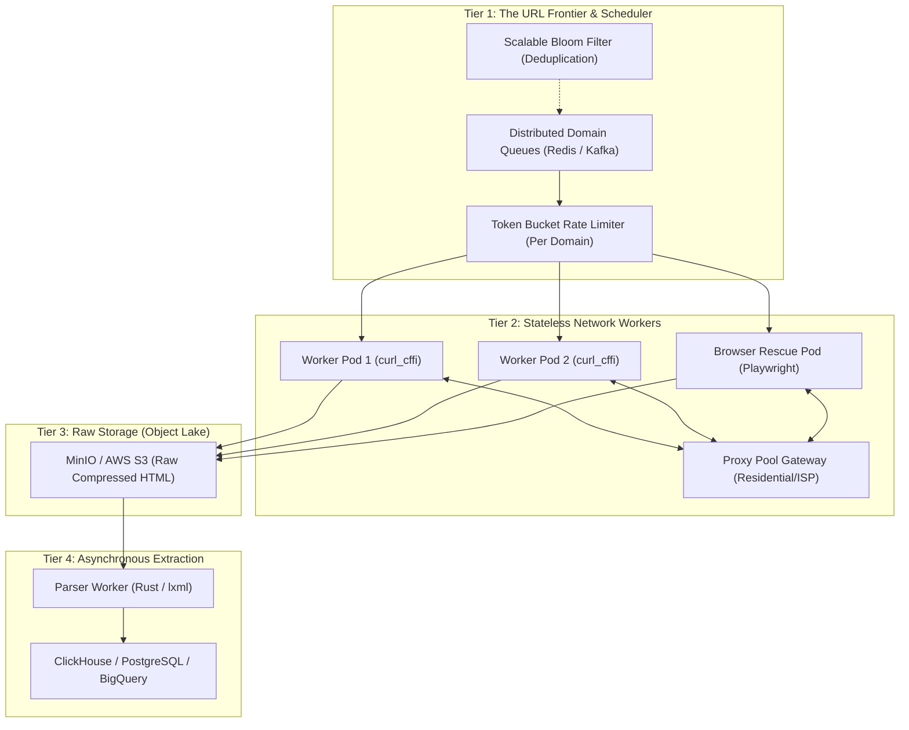
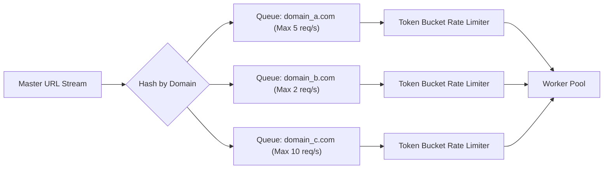

Writing a script that downloads 5,000 product pages from a website is a weekend project. 

Building a data extraction platform that ingests **10 million pages every day** across 50,000 different domains with 99.5% uptime is a distributed systems engineering challenge.

At this volume, ordinary software assumptions shatter:

* Keeping visited URLs in a Python `set()` or Redis `SADD` exhausts gigabytes of expensive RAM.
* Single-threaded worker loops crash from memory fragmentation and unhandled timeouts.
* Firing concurrent requests without domain-aware rate limiters triggers instant IP bans and DDoS alarms.
* Coupling HTML downloading with BeautifulSoup parsing causes your network workers to sit idle while CPU cores max out parsing DOM trees.

How do production web data companies (like Bright Data, Zyte, and Diffbot) engineer systems that scale horizontally without falling apart?


<p class="chart-note" style="text-align: center; margin-top: -12px; margin-bottom: 24px;"><em>The industrial data pipeline: high-scale scraping requires decoupling URL scheduling, proxy egress, raw HTML ingestion, and asynchronous document parsing into stateless micro-tiers.</em></p>

Here is the architectural blueprint for designing high-throughput, fault-tolerant scraping systems capable of handling tens of millions of requests per day.

---

## Monolithic Crawler vs Distributed Pipeline at a Glance

Comparing naive all-in-one crawling scripts with enterprise event-driven architectures highlights the design choices required for scale.

<div class="vs-cards">
  <div class="vs-card v12">
    <div class="vs-card-header">
      <h3>Monolithic Crawler</h3>
      <span class="vs-tag legacy">Coupled Script Loop</span>
    </div>
    <div class="vs-feature-list">
      <div class="vs-feature-item">
        <div class="vs-feature-title">
          <span class="vs-icon">💥</span>
          <strong>Coupled Fetch & Parse</strong>
        </div>
        <p class="vs-feature-desc">A single thread downloads HTML, parses DOM with BeautifulSoup, and writes to database; network stalls idle CPU.</p>
      </div>
      <div class="vs-feature-item">
        <div class="vs-feature-title">
          <span class="vs-icon">🐘</span>
          <strong>In-Memory URL Bloat</strong>
        </div>
        <p class="vs-feature-desc">Stores crawled URLs in raw memory sets; crashes the operating system when queues exceed a few million links.</p>
      </div>
      <div class="vs-feature-item">
        <div class="vs-feature-title">
          <span class="vs-icon">🚨</span>
          <strong>Blind Concurrency</strong>
        </div>
        <p class="vs-feature-desc">Blasts destination servers with concurrent threads, triggering immediate HTTP 429 and Cloudflare blocks.</p>
      </div>
    </div>
  </div>

  <div class="vs-card v13">
    <div class="vs-card-header">
      <h3>Distributed Pipeline</h3>
      <span class="vs-tag modern">Decoupled Micro-Tiers</span>
    </div>
    <div class="vs-feature-list">
      <div class="vs-feature-item">
        <div class="vs-feature-title">
          <span class="vs-icon">⚡</span>
          <strong>Decoupled Ingestion & Extraction</strong>
        </div>
        <p class="vs-feature-desc">Network workers write raw HTML into object storage (S3); dedicated CPU workers parse structured data asynchronously.</p>
      </div>
      <div class="vs-feature-item">
        <div class="vs-feature-title">
          <span class="vs-icon">🪶</span>
          <strong>Scalable Bloom Filter Deduplication</strong>
        </div>
        <p class="vs-feature-desc">Tracks 100 million unique URLs in under 120MB of RAM using probabilistic bit arrays.</p>
      </div>
      <div class="vs-feature-item">
        <div class="vs-feature-title">
          <span class="vs-icon">🛡️</span>
          <strong>Domain-Aware Politeness Queues</strong>
        </div>
        <p class="vs-feature-desc">Enforces token bucket rate limits per target domain, preventing IP bans and respect destination infrastructure.</p>
      </div>
    </div>
  </div>
</div>

---

## 1. The High-Scale Architecture: Four Core Tiers

A resilient high-scale scraping platform separates concerns into four distinct, independently scalable tiers:



---

## 2. Memory-Efficient Deduplication: Bloom Filters

When crawling at scale, you must guarantee that you never scrape the same URL twice.

If you store **50,000,000 URLs** in a standard Python `set()`:

$$\text{Memory} \approx 50{,}000{,}000 \times 80 \text{ bytes (string overhead)} \approx \mathbf{4.2 \text{ GB of RAM!}}$$

Even in Redis, a set of 50M strings consumes over 2.5GB of memory.

Production systems use **Bloom Filters**—a space-efficient probabilistic data structure based on bit arrays and multiple independent hash functions:

```
Bit Array: [0, 1, 0, 0, 1, 1, 0, 1, 0, 1, 0, 0, 1, 0, 1, 1]
URL: "https://example.com/item/42" 
  -> Hash 1: Bit 4  -> 1
  -> Hash 2: Bit 9  -> 1
  -> Hash 3: Bit 12 -> 1
```

A Bloom filter answers two questions:
1. *"Is this URL definitely NOT in the set?"* $\rightarrow$ **100% Guaranteed**.
2. *"Is this URL in the set?"* $\rightarrow$ **Probably Yes** (with an adjustable false-positive rate, typically $0.1\%$).

### The Memory Savings:
To track **50,000,000 URLs** with a $0.1\%$ false positive rate, a Bloom filter requires only **72 Megabytes of RAM**—a **98% reduction in memory**.

---

## 3. Domain Politeness: The Token Bucket Queue

The quickest way to get banned across the web is sending 100 concurrent requests to a single domain from one server.

To avoid this, the **URL Frontier** partitions tasks into independent queues by **target domain**:



Each domain queue is regulated by a **Token Bucket**:
* Tokens are added to the bucket at a constant rate (e.g., 2 tokens per second).
* A worker must acquire a token before sending a request to that domain.
* If no token is available, the request sleeps or yields to tasks targeting other domains.

This guarantees that even if your cluster is pulling 2,000 pages per second globally, no individual target server receives more than a polite trickle of traffic.

---

## 4. Why You Must Decouple Fetching from Parsing

In amateur scrapers, the code looks like this:

```python
# ❌ THE TIGHTLY COUPLED ANTI-PATTERN:
html = requests.get(url).text # Network I/O (Takes 80ms)
soup = BeautifulSoup(html, 'html.parser') # Heavy CPU Parse (Takes 120ms!)
db.save(soup.find('h1').text) # Disk I/O (Takes 10ms)
```

In this model, your network thread is frozen doing nothing for 120ms while the CPU parses the DOM tree. If the target website updates its HTML structure next week, **your entire historical dataset is lost** because you only stored the parsed fields.

### The Production Pattern:
1. **The Ingestion Worker** downloads the raw HTML byte stream, compresses it with gzip or zstandard, and uploads it immediately to an S3 bucket (or MinIO) with key `s3://lake/raw/domain/timestamp_hash.html.gz`.
2. The worker pushes a lightweight message containing the S3 pointer to an **Extraction Queue**.
3. Dedicated **Parsing Workers** consume messages from the queue, download the HTML, parse the data using fast C/Rust libraries (`lxml` or `selectolax`), and store structured JSON.

If a parsing rule has a bug or needs a new column added, you simply replay the parser over the raw S3 archive without re-scraping the target.

---

## 5. Benchmark: Resource Efficiency Across Scales

How do Bloom filters and decoupled pipelines perform at enterprise scale?





---

## 6. Implementation: Distributed Redis Token Bucket

Here is a production-grade token bucket rate limiter in Python using Redis atomic pipelines:

```python
import time
import redis

class DomainRateLimiter:
    def __init__(self, redis_client, rate_per_second=2.0, burst_limit=5):
        self.r = redis_client
        self.rate = rate_per_second
        self.burst = burst_limit

    def acquire(self, domain):
        key = f"ratelimit:{domain}"
        now = time.time()

        pipe = self.r.pipeline()
        pipe.hget(key, "tokens")
        pipe.hget(key, "last_updated")
        tokens, last_updated = pipe.execute()

        tokens = float(tokens) if tokens else self.burst
        last_updated = float(last_updated) if last_updated else now

        # Add new tokens based on elapsed time:
        elapsed = now - last_updated
        tokens = min(self.burst, tokens + elapsed * self.rate)

        if tokens >= 1.0:
            tokens -= 1.0
            pipe = self.r.pipeline()
            pipe.hset(key, "tokens", tokens)
            pipe.hset(key, "last_updated", now)
            pipe.expire(key, 60) # Auto-clean idle domains
            pipe.execute()
            return True # Allowed!

        return False # Rate limited; must wait!
```

---

## Production Takeaways for Scraping Architects

| Architecture Tier | Bottleneck | Production Standard |
| :--- | :--- | :--- |
| **URL Deduplication** | RAM explosion on millions of URLs | Deploy **Scalable Bloom Filters** in Redis. |
| **Worker Ingestion** | Slow DOM parsing blocking network sockets | Decouple ingestion into S3 object storage; parse asynchronously. |
| **Rate Limiting** | Getting IP banned by destination firewalls | Implement **Domain-Aware Token Buckets** per hostname. |
| **Proxy Management** | Dead nodes causing pipeline failures | Wrap proxies in dynamic circuit breakers with automated retirement. |
| **Error Handling** | Permanent failure on transient network blips | Route failed jobs into a **Dead Letter Queue (DLQ)** with exponential backoff. |

Scaling a scraping system to millions of requests per day is not about adding more browser threads; it is about respecting the physics of distributed systems. By decoupling storage, deduplicating with Bloom filters, and enforcing domain politeness, you build an extraction platform that runs reliably at massive scale.
