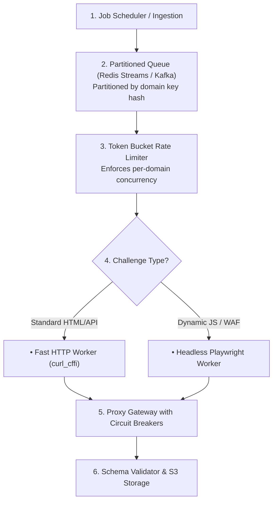
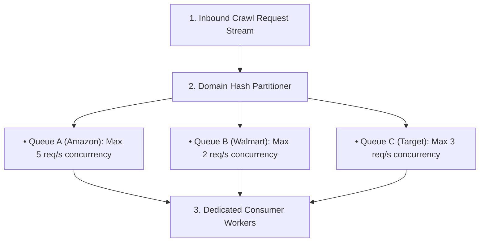
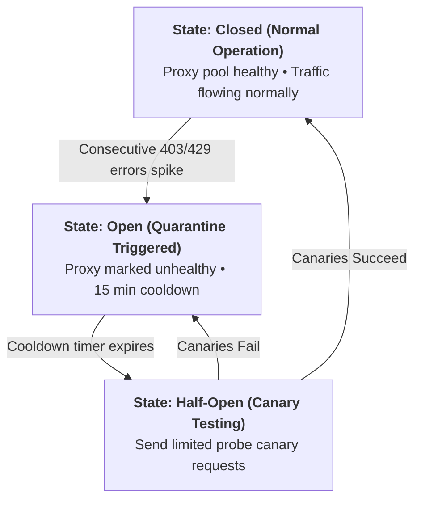

> **TL;DR:** Large-scale scraping fails on queue coordination and proxy backpressure rather than raw compute. Resilient architectures decouple crawling from ingestion using token-bucket rate limiters and circuit breakers.




---

## 1. Domain-Partitioned Message Queues

When crawling hundreds of different websites simultaneously, **never dump all URLs into a single monolithic FIFO queue**.

A burst of 100,000 URLs from `target-a.com` will starve workers crawling `target-b.com`, or trigger an immediate DDoS alert on `target-a.com` by hitting it with 500 concurrent connections.



* **Domain Partitioning:** Route tasks into separate queues indexed by domain hash (`hash(url.hostname) % num_partitions`).
* **Per-Domain Throttling:** Each worker pulls tasks strictly according to the target domain's rate-limiting policy.

---

## 2. Distributed Token-Bucket Rate Limiter in Redis

To enforce strict per-domain request rates across a fleet of 50 distributed worker nodes, implement an atomic **Token Bucket** in Redis:

```python
import time
import redis

r = redis.Redis(host='localhost', port=6379, db=0)

def acquire_rate_token(domain: str, max_tokens: int = 10, refill_rate_per_sec: float = 2.0) -> bool:
    """Atomic token-bucket rate limiter using Redis Lua script."""
    lua_script = """
    local key = KEYS[1]
    local max_tokens = tonumber(ARGV[1])
    local refill_rate = tonumber(ARGV[2])
    local now = tonumber(ARGV[3])
    
    local data = redis.call('HMGET', key, 'tokens', 'last_updated')
    local tokens = tonumber(data[1]) or max_tokens
    local last_updated = tonumber(data[2]) or now
    
    -- Calculate refilled tokens based on elapsed time
    local delta = math.max(0, now - last_updated)
    tokens = math.min(max_tokens, tokens + delta * refill_rate)
    
    if tokens >= 1.0 then
        tokens = tokens - 1.0
        redis.call('HMSET', key, 'tokens', tokens, 'last_updated', now)
        return 1
    else
        return 0
    end
    """
    cmd = r.register_script(lua_script)
    allowed = cmd(keys=[f"rate:{domain}"], args=[max_tokens, refill_rate_per_sec, time.time()])
    return bool(allowed)
```

If `acquire_rate_token("target.com")` returns `False`, the worker sleeps or yields back to the queue, guaranteeing your distributed fleet never overwhelms the target server.

---

## 3. Proxy Circuit Breaker Architecture

At 10,000,000 requests per day, proxy failures are not an exception—they are a continuous baseline reality.



* **Closed (Normal):** Requests route through the proxy subnet normally.
* **Open (Tripped):** If the proxy returns three consecutive `403 Forbidden` or `429 Too Many Requests` responses, the circuit trips. Traffic is instantly redirected to backup subnets, and the failing IP is quarantined for 15 minutes.
* **Half-Open (Testing):** After 15 minutes, send 5 test canary requests. If they return `200 OK`, restore the subnet to full rotation.

---

## Production Reliability Checklist for Engineers

- [ ] **Decouple Fetch from Parse:** Workers should only fetch raw HTML and dump it into an S3 bucket or Kafka topic. Data extraction (parsing CSS/XPath) should run in a separate pipeline so parser bugs never force a recrawl.
- [ ] **Enforce Timeout Caps:** Set strict socket connect timeouts (5s) and read timeouts (10s). Hanging sockets tie up worker threads and exhaust connection pools.
- [ ] **Schema Drift Detection:** If an extraction job suddenly returns 0 fields for 50 consecutive pages, alert immediately—the target site likely deployed a frontend redesign.
- [ ] **Idempotent Job Tracking:** Use content-addressable hashing (`sha256(canonical_url)`) to avoid crawling the same URL twice within a 24-hour cycle.
