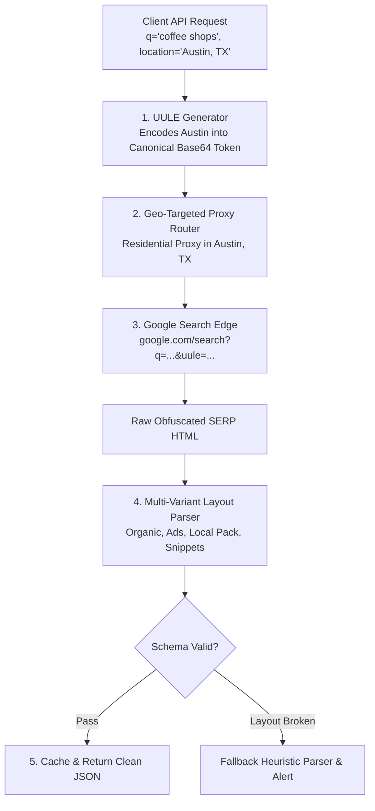

> #### ⚡ TL;DR in 30 Seconds
> * **What a SERP API Does:** Accepts a query, target location, and device type, fetches the live Search Engine Results Page (SERP) from Google or Bing, and returns structured JSON (organic links, rankings, ads, knowledge graphs).
> * **Why It's Deceptively Hard:** Google does not have a single search layout. It runs hundreds of simultaneous multi-variant A/B tests with completely obfuscated, non-semantic CSS class names (`.MjjYud`, `.yuRUbf`) that mutate weekly.
> * **The Geo-Targeting Challenge:** Delivering city-level accuracy (e.g. *restaurants in Austin, TX*) requires reverse-engineering Google's proprietary **UULE Base64 coordinate encoding** combined with localized residential proxy exit nodes.
> * **The Architecture:** High-availability SERP platforms combine TLS-impersonated HTTP clients, fallback layout parsers, dynamic UULE generators, and real-time schema validation engines.



---

## 1. The Obfuscated DOM Nightmare

Google does not build pages with semantic class names like `<div class="search-result">`.

Instead, modern Google SERP HTML is a labyrinth of randomly generated, minified class names that change across browser versions and geographic regions:

```html
<!-- Real Google SERP HTML Snippet -->
<div class="MjjYud">
  <div class="g Ww4FFb vt6azd tF2Cuc">
    <div class="yuRUbf">
      <a href="https://example.com" jsname="UWckNb">
        <h3 class="LC20lb MBeuO DKV0Md">Example Domain Title</h3>
      </a>
    </div>
  </div>
</div>
```

If your parser relies on brittle class selectors like `div.LC20lb`, **your API will break every time Google deploys a frontend update**.

### The Solution: Semantic Hierarchy Parsing
Production SERP parsers avoid brittle CSS classes. Instead, they navigate DOM relational anchors:
* Locate the main result container via landmark roles (`role="main"` or `div#search`).
* Traverse anchor tags containing `h3` child headings.
* Extract display URLs by querying sibling link metadata rather than hardcoded container classes.

---

## 2. Geographic Localization: Cracking the UULE Parameter

When a user in Austin searches for *"best plumber"*, Google returns completely different results than it does for a user in Boston.

To force Google to return search results for a specific physical city without relying solely on proxy geolocation, SERP APIs inject the secret **`uule` parameter**:

```text
https://www.google.com/search?q=plumber&uule=w+CAIQICIaQXVzdGluLFRleGFzLFVuaXRlZCBTdGF0ZXM=
                                            └──────────────────────────────────────────────┘
                                                 Base64 Encoded Canonical Location Token
```

### The UULE Encoding Algorithm:
1. Google takes the canonical location string (e.g., `Austin,Texas,United States`).
2. It calculates the character length of the string (e.g., 26 characters).
3. It maps the length to an ASCII lookup character (26 &rarr; `a`).
4. It concatenates `w+CAIQICI` + length code + standard Base64 encoding of the location.

```python
import base64

def generate_uule(canonical_location: str) -> str:
    """Generates Google's proprietary UULE parameter for geo-targeting."""
    secret_keys = (
        "ABCDEFGHIJKLMNOPQRSTUVWXYZ"
        "abcdefghijklmnopqrstuvwxyz"
        "0123456789-_"
    )
    length = len(canonical_location)
    key = secret_keys[length]
    encoded_location = base64.b64encode(canonical_location.encode()).decode()
    return f"w+CAIQICI{key}{encoded_location}"

# Example: Generate UULE for Austin, Texas
print(generate_uule("Austin,Texas,United States"))
# Output: w+CAIQICIaQXVzdGluLFRleGFzLFVuaXRlZCBTdGF0ZXM=
```

---

## 3. High-Throughput SERP API Data Schema

A production-grade SERP API normalizes heterogeneous Google layout widgets into a clean, predictable JSON response:

```json
{
  "search_metadata": {
    "query": "best coffee shops",
    "location": "Austin, Texas, United States",
    "total_results": 142000000,
    "time_taken_ms": 284
  },
  "organic_results": [
    {
      "position": 1,
      "title": "15 Best Coffee Shops in Austin | Eater Austin",
      "link": "https://austin.eater.com/maps/best-coffee-shops-austin",
      "displayed_link": "https://austin.eater.com › maps",
      "snippet": "Discover the finest roasters and cafes across downtown Austin..."
    }
  ],
  "local_map_pack": [
    {
      "title": "Houndstooth Coffee",
      "rating": 4.6,
      "reviews": 842,
      "address": "401 Congress Ave, Austin, TX"
    }
  ]
}
```

---

## Production Reliability Checklist for SERP Engineers

- [ ] **Dual Layout Testing:** Always maintain automated regression tests comparing desktop SERPs vs mobile SERPs (`google.com` vs mobile viewport).
- [ ] **Consent Modal Bypass:** In the European Union, Google displays GDPR cookie consent banners (`consent.google.com`). Inject pre-consented cookies (`SOCS=CAESEwgDEgk2...`) into your HTTP requests to skip the wall.
- [ ] **Automated Parser Canary:** Run hourly test queries across 50 benchmark keywords. If schema validation failure exceeds 2%, page engineers immediately before customer queries fail.
