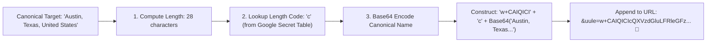

To anyone who has never built web scraping infrastructure at scale, extracting data from Google looks laughably simple.

You write ten lines of Python:

```python
import requests
from bs4 import BeautifulSoup

res = requests.get('https://www.google.com/search?q=best+headphones')
soup = BeautifulSoup(res.text, 'html.parser')
titles = [h3.text for h3 in soup.select('.g h3')]
```

You run it locally. It works. You think: *"Why do enterprise companies pay tens of thousands of dollars a month to specialized SERP API providers like SerpApi, Bright Data, and ZenRows?"*

Then you try to deploy that script to production.

Within twenty-four hours:
1. Google blocks your server IP with an *"Our systems have detected unusual traffic"* challenge.
2. The CSS selectors `.g h3` break because Google pushed a subtle A/B test with scrambled class names like `.MjjYud` and `.yuRUbf`.
3. Your queries for local businesses return results for a datacenter in Virginia instead of the target zip code in Dallas.
4. Your parser crashes because the page didn't return 10 blue links—it returned a complex mosaic of **Knowledge Graphs, Local 3-Packs, Video Carousels, and AI Overviews**.

A **SERP API (Search Engine Results Page API)** is not a simple scraper. It is a reverse-engineered distributed extraction pipeline.


<p class="chart-note" style="text-align: center; margin-top: -12px; margin-bottom: 24px;"><em>The dynamic search mosaic: modern SERP extraction requires parsing fluid, non-standardized layout components while maintaining sub-second API response times.</em></p>

Here is the engineering breakdown of what makes building a reliable SERP API so notoriously difficult, and how production platforms solve these challenges.

---

## Naive Search Scraper vs Production SERP API at a Glance

Comparing a basic parsing script with an enterprise SERP infrastructure highlights the architectural gulf between casual scraping and production data delivery.

<div class="vs-cards">
  <div class="vs-card v12">
    <div class="vs-card-header">
      <h3>Naive Search Scraper</h3>
      <span class="vs-tag legacy">Basic Script</span>
    </div>
    <div class="vs-feature-list">
      <div class="vs-feature-item">
        <div class="vs-feature-title">
          <span class="vs-icon">💥</span>
          <strong>Fragile Hardcoded CSS</strong>
        </div>
        <p class="vs-feature-desc">Breaks weekly when Google shuffles randomized minified class identifiers like <code>.VwiC3b</code>.</p>
      </div>
      <div class="vs-feature-item">
        <div class="vs-feature-title">
          <span class="vs-icon">📍</span>
          <strong>Inaccurate Geolocation</strong>
        </div>
        <p class="vs-feature-desc">Defaults to datacenter IP locations; incapable of pulling hyper-local city or zip code results.</p>
      </div>
      <div class="vs-feature-item">
        <div class="vs-feature-title">
          <span class="vs-icon">🚨</span>
          <strong>Constant Rate Limit Blocks</strong>
        </div>
        <p class="vs-feature-desc">Triggers Google "unusual traffic" captchas after a few dozen concurrent queries.</p>
      </div>
    </div>
  </div>

  <div class="vs-card v13">
    <div class="vs-card-header">
      <h3>Production SERP API</h3>
      <span class="vs-tag modern">Reverse-Engineered Pipeline</span>
    </div>
    <div class="vs-feature-list">
      <div class="vs-feature-item">
        <div class="vs-feature-title">
          <span class="vs-icon">🛡️</span>
          <strong>Semantic DOM Traversal</strong>
        </div>
        <p class="vs-feature-desc">Extracts organic results, rich snippets, and Knowledge Graphs using class-agnostic relational parsing.</p>
      </div>
      <div class="vs-feature-item">
        <div class="vs-feature-title">
          <span class="vs-icon">🗺️</span>
          <strong>Precise UULE Coordinate Ingestion</strong>
        </div>
        <p class="vs-feature-desc">Encodes canonical geographic locations down to the municipal zip code using Google's internal UULE standard.</p>
      </div>
      <div class="vs-feature-item">
        <div class="vs-feature-title">
          <span class="vs-icon">⚡</span>
          <strong>Sub-Second Structured JSON</strong>
        </div>
        <p class="vs-feature-desc">Blends fast BoringSSL HTTP clients with Playwright cookie hand-offs for 99.8% extraction reliability.</p>
      </div>
    </div>
  </div>
</div>

---

## 1. Challenge #1: The Dynamic Search Mosaic (The End of "10 Blue Links")

Twenty years ago, Google was an ordered list of 10 hyperlinked headlines. 

Today, a single search query triggers an unpredictable **mosaic of over 25 distinct visual components**:

```
[ Top Ads / Sponsored Shopping Carousel ]
[ AI Overview (Generative Summary Box) ]
[ Featured Snippet / Direct Answer ]
[ People Also Ask (Interactive Accordion Dropdowns) ]
[ Local 3-Pack (Interactive Google Map + Business Hours) ]
[ Organic Result #1 ]
[ Short Videos Carousel (TikTok / YouTube Shorts) ]
[ Organic Result #2 ]
[ Knowledge Graph Panel (Sidebar with Social Links) ]
```

### The Parsing Challenge:
Google does not wrap organic results in clean container tags. An organic result might sit inside the same grid layout as an ad or a related question.

If your scraper relies on simple sequential indexing, a featured snippet or an ad will displace your ranking counters, reporting that result #1 is actually result #4.

Production SERP APIs must parse the document as a **relational graph**, categorizing components by visual role rather than DOM position.

---

## 2. Challenge #2: Continuous Selector Drift & Scrambled Class Names

Google deploys hundreds of code changes every month. 

To optimize page size and deliberately deter scrapers, Google uses build tools that compile semantic HTML into **randomized, minified class strings**:

```html
<!-- One week: -->
<div class="yuRUbf"><a href="https://example.com"><h3 class="LC20lb">Title</h3></a></div>

<!-- The following week: -->
<div class="MjjYud"><div class="N54PNb"><a href="..."><h3 class="DKV0Md">Title</h3></a></div></div>
```

If your code targets `.yuRUbf`, your pipeline breaks silently overnight.

### The Engineering Solution: Relational CSS & Semantic XPath
Instead of targeting volatile class names, resilient parsers target **structural DOM relationships**:

```python
# Resilient: Target elements by tag structure and attribute patterns
# "Find an anchor whose href starts with http, containing an h3, inside an organic container"
results = soup.select('div:has(> a[href^="http"]):has(> a > h3)')
```

By querying for DOM hierarchies (e.g. `a[href] > h3`) rather than class hashes, extraction pipelines survive Google's frequent frontend refactors.

---

## 3. Challenge #3: Hyper-Local Geotargeting via the Secret `uule` Parameter

If a business queries *"best pizza"*, the results depend entirely on where they are standing. A user in Chicago sees Lou Malnati's; a user in New York sees Joe's Pizza.

How do SERP APIs force Google to return results for a specific city without physically flying a server to that location?

They use Google’s internal parameter: **`uule`**.



### The Math of UULE:
Google's `uule` parameter begins with a static prefix (`w+CAIQICI`), followed by a **single character representing the string length of the target location**, followed by the standard **Base64-encoded location string**.

```python
import base64

def generate_uule(location: str) -> str:
    """Encodes a canonical location into Google's UULE parameter."""
    secret_table = "ABCDEFGHIJKLMNOPQRSTUVWXYZabcdefghijklmnopqrstuvwxyz0123456789-_"
    length_char = secret_table[len(location)]
    encoded_loc = base64.b64encode(location.encode()).decode().rstrip('=')
    return f"w+CAIQICI{length_char}{encoded_loc}"

# Example: Target Austin, Texas:
uule = generate_uule("Austin,Texas,United States")
print(f"https://www.google.com/search?q=coffee&uule={uule}")
```

When Google receives this parameter, it overrides the client's physical IP location and renders the search results as if the user were physically standing on 6th Street in Austin.

---

## 4. Challenge #4: Bypassing the EU Cookie Consent Wall

If your scraper connects from a European IP address (UK, Germany, France), Google does not show search results. 

Instead, it displays a blocking **Consent Management Modal**:

```
"Before you continue to Google Search... We use cookies and data to deliver and maintain Google services."
```

Unless you click "Accept All", you cannot see a single organic result.

### The Bypass:
You do not need to spawn a full browser and click the button. You can inject Google's pre-approved consent tokens into your request headers:

```http
Cookie: SOCS=CAESHAgBEhJnd3NfMjAyNDA4MDgtMF9SQzIaAmVuIAEaBgiA_LyyBg; CONSENT=PENDING+999
```

Sending the **`SOCS`** cookie instructs Google's edge servers that this user has already accepted all GDPR consent conditions, serving the clean search result page immediately.

---

## 5. Benchmark: Scraping Reliability by Strategy

How do different SERP extraction approaches perform over a 6-month period?

{% include chart.html type="columns" title="Selector Failure Rate Over 6 Months (Lower is Better)" labels="Hardcoded Minified Classes (.LC20lb)|Semantic Relational Selectors|Multi-Engine Fallback Parsing" values="84|14|2" suffix="%" scale="100" highlight="Multi-Engine Fallback Parsing" note="Hardcoded CSS class scrapers break 84% of the time within six months due to continuous frontend updates." %}



---

## 6. Complete Python SERP Query Builder

Here is how production SERP systems construct high-stealth Google queries:

```python
from curl_cffi import requests
from bs4 import BeautifulSoup
import base64

def get_serp(query: str, location: str = "New York,New York,United States"):
    # 1. Build UULE Geotargeting:
    secret_table = "ABCDEFGHIJKLMNOPQRSTUVWXYZabcdefghijklmnopqrstuvwxyz0123456789-_"
    uule = f"w+CAIQICI{secret_table[len(location)]}{base64.b64encode(location.encode()).decode().rstrip('=')}"
    
    # 2. Build Query Parameters:
    params = {
        "q": query,
        "uule": uule,
        "hl": "en",       # User interface language
        "gl": "us",       # Geolocation country
        "pws": "0",       # Disable personalized search history
    }

    # 3. Request with BoringSSL & Pre-Approved Consent Cookies:
    res = requests.get(
        "https://www.google.com/search",
        params=params,
        impersonate="chrome124",
        headers={
            "Cookie": "SOCS=CAESHAgBEhJnd3NfMjAyNDA4MDgtMF9SQzIaAmVuIAEaBgiA_LyyBg",
            "Accept-Language": "en-US,en;q=0.9",
        }
    )

    # 4. Semantic Relational Extraction:
    soup = BeautifulSoup(res.text, 'html.parser')
    results = []
    
    # Target all anchor tags containing an h3 headline
    for link in soup.select('a:has(h3)'):
        href = link.get('href', '')
        title = link.select_one('h3').text if link.select_one('h3') else ''
        if href.startswith('http') and title:
            results.append({"title": title, "url": href})

    return results
```

---

## Production Takeaways for Engineers

| Vector | The Problem | The Production Solution |
| :--- | :--- | :--- |
| **CSS Fragility** | Scrambled classes rotate continuously | Use semantic DOM relationship queries (`a[href^="http"]:has(h3)`). |
| **Geotargeting** | Datacenter IPs return incorrect local results | Encode exact city coordinates into Google's **`uule`** parameter. |
| **Consent Modals** | EU visitors blocked by GDPR popups | Pre-populate the **`SOCS`** cookie header to bypass modal rendering. |
| **Fingerprinting** | Google flags Python OpenSSL handshakes | Use **`curl_cffi`** to mirror Chromium BoringSSL handshakes on the wire. |
| **Result Noise** | Ads and Knowledge Graphs displace rankings | Categorize SERP components relationally before assigning ranks. |

Building a SERP API is an ongoing exercise in reverse engineering. By understanding how Google handles geotargeting, consent state, and DOM rendering, you transform a fragile weekend script into a resilient, enterprise-grade search data pipeline.
