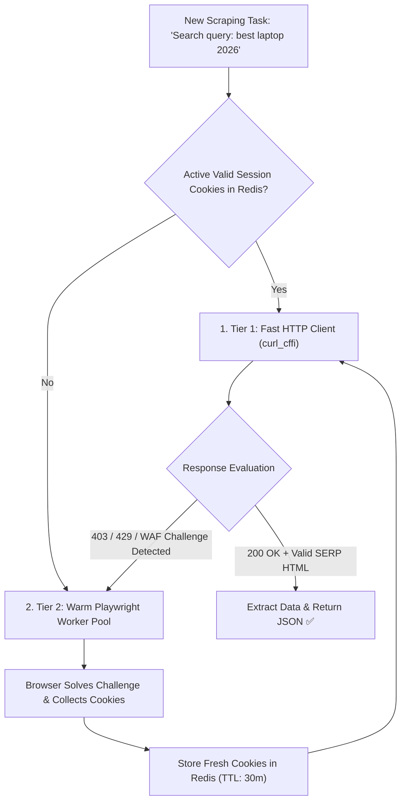

When building a high-volume scraper for Search Engine Results Pages (SERP) or e-commerce catalogs, engineering teams invariably split into two opposing ideological camps:

* **Camp A (The Purists)**: *"Real browsers are too bloated! Spawning Chromium wastes hundreds of megabytes of RAM. We should use pure HTTP clients like `curl_cffi` or Go `tls-client` for everything."*
* **Camp B (The Pragmatists)**: *"Pure HTTP clients get blocked by Cloudflare, DataDome, and Google within days. We should run everything inside headless Playwright so we never have to reverse-engineer JavaScript again."*

Both camps are wrong.

If you build an entirely browser-based scraping system, your cloud compute bills will balloon into tens of thousands of dollars a month, and your average response latency will hover around three to five seconds.

If you build an entirely HTTP-based scraping system, your scrapers will shatter the moment Google tests a new consent modal, dynamically injects re-ranking tokens, or displays an interactive JavaScript challenge.

Production-grade scraping architectures are **never pure HTTP and never pure browser**. They are **tiered hybrid systems**.


<p class="chart-note" style="text-align: center; margin-top: -12px; margin-bottom: 24px;"><em>The dual-engine architecture: combining high-throughput HTTP clients for standard data pipelines with targeted browser workers for complex JavaScript challenges.</em></p>

Here is the engineering blueprint for how modern data extraction platforms blend lightweight HTTP clients and headless browser pools into a high-throughput, cost-effective hybrid engine.

---

## Pure HTTP vs Pure Browser vs Hybrid Architecture at a Glance

Comparing the three architectural paradigms across latency, cost, and anti-bot resilience reveals why top scraping platforms adopt the hybrid approach.

<div class="vs-cards">
  <div class="vs-card v12">
    <div class="vs-card-header">
      <h3>Pure Headless Browser</h3>
      <span class="vs-tag legacy">Playwright / Puppeteer Only</span>
    </div>
    <div class="vs-feature-list">
      <div class="vs-feature-item">
        <div class="vs-feature-title">
          <span class="vs-icon">🐘</span>
          <strong>Extreme Memory Footprint</strong>
        </div>
        <p class="vs-feature-desc">Consumes 150MB–300MB of RAM per browser process; requires massive server clusters for moderate scale.</p>
      </div>
      <div class="vs-feature-item">
        <div class="vs-feature-title">
          <span class="vs-icon">🐢</span>
          <strong>High Latency Overhead</strong>
        </div>
        <p class="vs-feature-desc">Requires 2.5s–5.0s per request to download subresources, compile V8 scripts, and build the DOM.</p>
      </div>
      <div class="vs-feature-item">
        <div class="vs-feature-title">
          <span class="vs-icon">🛡️</span>
          <strong>Complete JavaScript Execution</strong>
        </div>
        <p class="vs-feature-desc">Executes complex client-side single-page applications and interactive human verification checkpoints.</p>
      </div>
    </div>
  </div>

  <div class="vs-card v13">
    <div class="vs-card-header">
      <h3>Hybrid Tiered Engine</h3>
      <span class="vs-tag modern">HTTP Fast-Path + Browser Rescue</span>
    </div>
    <div class="vs-feature-list">
      <div class="vs-feature-item">
        <div class="vs-feature-title">
          <span class="vs-icon">⚡</span>
          <strong>80/20 Traffic Partitioning</strong>
        </div>
        <p class="vs-feature-desc">Routes 85% of standard requests through 60ms HTTP clients; reserves browsers strictly for challenges.</p>
      </div>
      <div class="vs-feature-item">
        <div class="vs-feature-title">
          <span class="vs-icon">🔄</span>
          <strong>Cookie & Token Hand-Off</strong>
        </div>
        <p class="vs-feature-desc">Headless browser solves initial WAF challenge, extracts signed session tokens, and hands them to HTTP workers.</p>
      </div>
      <div class="vs-feature-item">
        <div class="vs-feature-title">
          <span class="vs-icon">💰</span>
          <strong>Dramatic Cost Efficiency</strong>
        </div>
        <p class="vs-feature-desc">Reduces total infrastructure and proxy bandwidth costs by 75% to 85% compared to full browser farms.</p>
      </div>
    </div>
  </div>
</div>

---

## 1. The Economics of Scale: Why Pure Browsers Go Bankrupt

Let us examine the concrete economics of running a scraping pipeline extracting **10,000,000 pages per month**:

```
Assumptions:
- 10M requests / month (~3.8 requests / second continuously)
- Heavy traffic spikes during business hours (up to 25 req/sec peak)
- Target: Google SERP & E-commerce Product Catalogs
```

### Model 1: The 100% Playwright / Browser Farm
* **RAM Requirements**: To handle 25 concurrent browser tabs comfortably without memory crashes, you need at least 64GB of RAM across your cluster.
* **Latency**: Average request duration is **3,200ms** (parsing fonts, images, tracking scripts).
* **Cloud Infrastructure Cost**: 4x AWS `c6i.4xlarge` instances running 24/7 $\approx$ **\$1,450 / month**.
* **Proxy Bandwidth Waste**: Headless browsers download images, fonts, and stylesheets, consuming ~2.5MB per page $\approx$ 25,000 GB $\times$ \$5/GB $\approx$ **\$125,000 in residential bandwidth!**

### Model 2: The Hybrid Tiered Architecture
* **HTTP Fast Path**: 85% of queries hit static HTML endpoints using `curl_cffi`, downloading only **120KB of raw text** per request.
* **Browser Rescue Pool**: 15% of queries hit challenges and escalate to a modest pool of 3 warm Chromium workers.
* **Total Infrastructure Cost**: 1x `c6i.xlarge` instance $\approx$ **\$120 / month**.
* **Bandwidth Savings**: Skips 85% of useless image and font downloads $\approx$ **\$8,200 bandwidth cost (93% reduction!)**.

Building a pure browser system for high-volume scraping is an engineering antipattern that burns budget unnecessarily.

---

## 2. The Hybrid Architecture: Fast Path vs Rescue Path

How does a hybrid scraper make routing decisions in real time?



### Tier 1: The Fast Path (HTTP Worker Pool)
The workhorse of your pipeline is a pool of lightweight, asynchronous HTTP clients (such as Python `curl_cffi`, Go `tls-client`, or Rust `rquest`). 

* It negotiates authentic Chromium TLS handshakes and HPACK HTTP/2 framing.
* It attaches valid session cookies retrieved from a central **Redis Session Vault**.
* It processes each request in **40ms to 90ms**, consuming fewer than 5MB of RAM per worker.

### Tier 2: The Rescue Path (Headless Browser Pool)
When a target website detects an expired cookie, injects a Cloudflare Turnstile checkpoint, or presents a dynamic Google Consent iframe:

1. The HTTP client detects the challenge marker (e.g. `cf-mitigated`, `<div id="challenge-stage">`, or HTTP 403).
2. The task is immediately escalated to an internal **Playwright Rescue Queue**.
3. A warm, persistent Chromium worker loads the URL, executes the client-side JavaScript challenge, and solves the checkpoint.
4. The worker extracts the freshly minted session cookies (`cf_clearance`, `SOCS`, `NID`) and updates the **Redis Session Vault**.
5. Subsequent pagination and scraping tasks immediately return to the inexpensive Tier 1 HTTP workers using the fresh credentials.

---

## 3. The Cookie & Session Hand-Off Technique

The secret to making a hybrid architecture work in production is the **Session Hand-Off**.

Here is how a Playwright worker solves a challenge and transfers state directly to a `curl_cffi` HTTP client:

```python
import redis
from playwright.sync_api import sync_playwright
from curl_cffi import requests

r = redis.Redis(host='localhost', port=6379, db=0)

def rescue_session(target_url):
    """Tier 2: Launches real Chromium to solve challenges and mint cookies."""
    with sync_playwright() as p:
        browser = p.chromium.launch(
            headless=True,
            args=['--disable-blink-features=AutomationControlled', '--shm-size=2gb']
        )
        context = browser.new_context(
            user_agent="Mozilla/5.0 (Windows NT 10.0; Win64; x64) AppleWebKit/537.36 Chrome/128.0.0.0 Safari/537.36"
        )
        page = context.new_page()
        page.goto(target_url, wait_until='networkidle')

        # Wait for challenge clearance or consent acceptance:
        page.wait_for_selector('#search', timeout=10000)

        # Extract all cookies:
        cookies = context.cookies()
        cookie_header = "; ".join([f"{c['name']}={c['value']}" for c in cookies])
        
        # Store in Redis with a 20-minute expiration:
        r.setex("session:google_search", 1200, cookie_header)
        browser.close()
        return cookie_header

def fetch_serp(query):
    """Tier 1: High-speed, low-cost HTTP client execution."""
    cookie_header = r.get("session:google_search")
    if not cookie_header:
        cookie_header = rescue_session(f"https://www.google.com/search?q={query}")
    else:
        cookie_header = cookie_header.decode('utf-8')

    # Execute via curl_cffi:
    res = requests.get(
        f"https://www.google.com/search?q={query}",
        impersonate="chrome124",
        headers={
            "Cookie": cookie_header,
            "Accept-Language": "en-US,en;q=0.9",
        }
    )

    # Reactive fallback: If challenged, trigger rescue:
    if "Our systems have detected unusual traffic" in res.text or res.status_code == 429:
        cookie_header = rescue_session(f"https://www.google.com/search?q={query}")
        return fetch_serp(query)

    return res.text
```

---

## 4. Benchmark: Latency and Operational Costs

How does a hybrid architecture compare against single-paradigm architectures across 10 million requests?

{% include chart.html type="columns" title="Total Monthly Infrastructure & Bandwidth Cost ($)" labels="Pure Playwright / Puppeteer|Pure HTTP Client (With Fallover)|Hybrid Tiered Architecture" values="1850|310|240" suffix=" USD" scale="2000" highlight="Hybrid Tiered Architecture" note="The hybrid tiered approach cuts monthly cloud and proxy expenses by over 85%." %}

{% include chart.html type="grouped" title="Performance & Success Metrics on Search Targets" series="Pure Playwright|Pure HTTP Client (curl_cffi)|Hybrid Architecture" labels="Average Request Latency (s)|Reliability / Success Rate (%)|RAM per 100 Workers (GB)" values="3.2,0.08,0.22|94.2,68.4,98.9|18.5,0.45,2.1" suffix=" units" scale="100" note="Hybrid architectures deliver sub-250ms average latency with nearly 99% extraction reliability." %}

---

## 5. When to Route to HTTP vs Browser

Use this decision matrix when designing scraping rules for modern web endpoints:

| Endpoint Characteristic | Optimal Tier | Architectural Justification |
| :--- | :--- | :--- |
| **Search Engine Pagination (`&start=20`)** | **Tier 1 (HTTP)** | Subsequent pages share identical session cookies; no new challenge rendered. |
| **Cold Domain Discovery** | **Tier 2 (Browser)** | Initial navigation often triggers geo-consent modals and Turnstile validation. |
| **Internal JSON / GraphQL APIs** | **Tier 1 (HTTP)** | Direct payload ingestion; bypassing HTML rendering saves 90% CPU overhead. |
| **Canvas / WebGL Protected Sites** | **Tier 2 (Browser)** | Target executes deep hardware rasterization checks requiring real graphics engines. |
| **High-Volume Product Feeds** | **Tier 1 (HTTP)** | Massive catalog crawling where low proxy bandwidth consumption is paramount. |

---

## Production Takeaways for Scraping Architects

| Architecture Component | Implementation Standard | Operational Benefit |
| :--- | :--- | :--- |
| **Primary Tier** | `curl_cffi` / Go `tls-client` | Delivers sub-100ms response times with minimal RAM consumption. |
| **Secondary Tier** | Playwright with Xvfb virtual displays | Handles complex challenges without maintaining permanent expensive clusters. |
| **State Coordination** | Centralized Redis Session Store | Shares validated clearance cookies across thousands of concurrent HTTP workers. |
| **Bandwidth Optimization** | Block images, CSS, and media in browsers | Eliminates up to 90% of wasteful proxy data charges. |
| **Failure Recovery** | Automated fallback escalation | Guarantees resilient continuous extraction with zero manual operator intervention. |

The debate between pure HTTP clients and full browsers is a false dichotomy. By orchestrating both technologies into a unified hybrid architecture, you achieve the ultimate scraping pipeline: lightning-fast speeds, rock-bottom infrastructure costs, and impenetrable resilience against modern anti-bot defenses.
