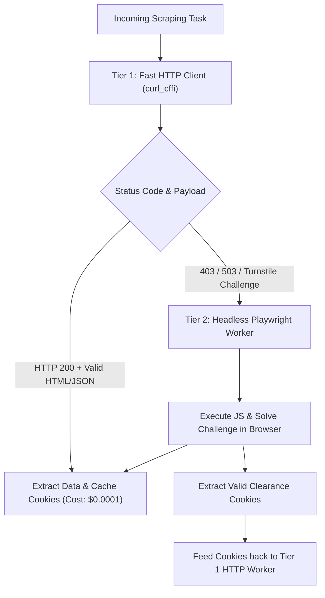
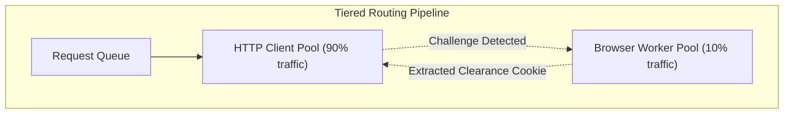

> #### ⚡ Quick Pick: Which Scraping Engine Should You Deploy?
> * **Deploy Pure HTTP (`curl_cffi`) if:** The target server serves raw HTML/JSON without JavaScript challenges, or your budget demands high request volumes at under $0.15 per 1,000 requests.
> * **Deploy Full Headless Playwright if:** The target requires interactive DOM rendering, canvas token generation, or complex Single-Page App state hydration.
> * **Deploy Tiered Hybrid Routing (The Industry Standard):** Attempt requests first via lightweight HTTP clients; dynamically route failed or challenged responses to a browser pool with session cookie re-injection.



---

## Head-to-Head: HTTP Clients vs Headless Browsers vs Hybrid Routing

| Operational Metric | Pure HTTP Client (`curl_cffi`) | Pure Headless Browser (Playwright) | Tiered Hybrid Architecture |
| :--- | :--- | :--- | :--- |
| **Average Latency** | **150 – 400 milliseconds** | **2,500 – 5,000 milliseconds** | **220ms blended average** |
| **Memory Footprint** | ~5MB per worker thread | 150MB – 350MB per browser process | ~15MB base + dynamic browser pool |
| **Compute Cost per 1M Requests**| **$15 – $40** | **$450 – $1,200** | **$55 – $95** (90% HTTP / 10% Browser) |
| **JavaScript Execution** | ❌ None | ✅ Full V8 JavaScript Engine | ✅ On-demand execution |
| **Challenge Bypass Resilience**| Medium (TLS spoofing only) | High (Full browser environment) | **Maximum** (Fast path + browser fallback) |
| **Scale Bottleneck** | Network bandwidth / Proxy limits | Server RAM & CPU saturation | Proxy pool quality |

---

## 1. The Cost Trap: Why Pure Browsers Kill Unit Economics

Running an entire scraping operation on headless browsers is the most common architectural mistake in data engineering. 

To crawl 5 million search queries per day:
* A headless Chromium instance needs roughly 250MB of RAM and 1 CPU core per 5 concurrent tabs.
* At 3 seconds per request, crawling 5,000,000 pages requires 175 concurrent browser workers running 24/7.
* That demands over 45GB of dedicated RAM and heavy multi-core cloud instances, costing thousands of dollars every month in infrastructure alone.

### The Pure HTTP Counter-Trap
Teams reacting to browser costs often rewrite everything in Python `requests` or `httpx`. Within days, the system collapses:
* Google or Cloudflare returns a `429 Too Many Requests` or `403 Forbidden` with an embedded JavaScript challenge script.
* Without a JavaScript engine to calculate the dynamic challenge nonce, the scraper stalls completely.

---

## 2. The Tiered Hybrid Blueprint: 90/10 Rule

Production data providers (like ScrapingBee, Bright Data, and ZenRows) route traffic through a tiered architecture:



1. **The Fast Path (90% of requests):** Every request starts as an HTTP call using TLS-fingerprinted clients (`curl_cffi` impersonating Chrome). It completes in under 300ms at virtually zero CPU cost.
2. **The Escalation Trigger:** If the response header contains a challenge signature (e.g. `cf-mitigated: challenge` or a missing expected DOM selector), the task is pushed to an escalation queue.
3. **The Slow Path (10% of requests):** A managed Playwright worker loads the URL, executes the challenge script, solves the token, and writes the resulting session cookies into Redis.
4. **Cookie Re-injection:** Subsequent requests for that domain reuse the browser-generated cookies in the fast HTTP path, resuming high-speed crawling.

---

## Production Python Pattern: Dynamic Tiered Dispatch

Here is a minimal, production-ready implementation of tiered routing:

```python
import time
from curl_cffi import requests

def fetch_hybrid(url: str, proxy: str = None) -> str:
    # Tier 1: Fast HTTP attempt with Chrome TLS impersonation
    headers = {
        "User-Agent": "Mozilla/5.0 (Macintosh; Intel Mac OS X 10_15_7) AppleWebKit/537.36",
        "Accept": "text/html,application/xhtml+xml,application/xml;q=0.9,*/*;q=0.8"
    }
    
    resp = requests.get(url, impersonate="chrome124", headers=headers, proxies={"http": proxy, "https": proxy} if proxy else None)
    
    # Detect challenge pages or Cloudflare blocks
    if resp.status_code == 200 and "<div id=\"challenge-running\">" not in resp.text:
        return resp.text  # Fast path succeeded!
    
    print(f"[!] Tier 1 challenge detected ({resp.status_code}). Escalating to Tier 2 Browser...")
    return fetch_with_browser_pool(url, proxy)

def fetch_with_browser_pool(url: str, proxy: str) -> str:
    # Tier 2: Real browser worker execution (Playwright)
    # Spawns only when challenge is encountered
    pass
```

---

## Benchmark: Cost & Throughput at Scale

{% include chart.html type="columns" title="Monthly Infrastructure Cost for 10M Requests ($ - Lower is Better)" labels="Pure Browser (Playwright)|Pure HTTP (curl_cffi)|Tiered Hybrid (90/10)" values="1150|42|148" suffix="$" scale="1200" highlight="Tiered Hybrid (90/10)" note="Tiered hybrid routing delivers 99.8% extraction reliability at 1/8th the cost of running pure browsers." %}

---

## Key Takeaway for System Designers

Never pick between HTTP clients and headless browsers as an either/or dilemma. Design your scraper with a **lightweight HTTP default engine** and treat **headless browsers as an on-demand escalation layer**.
