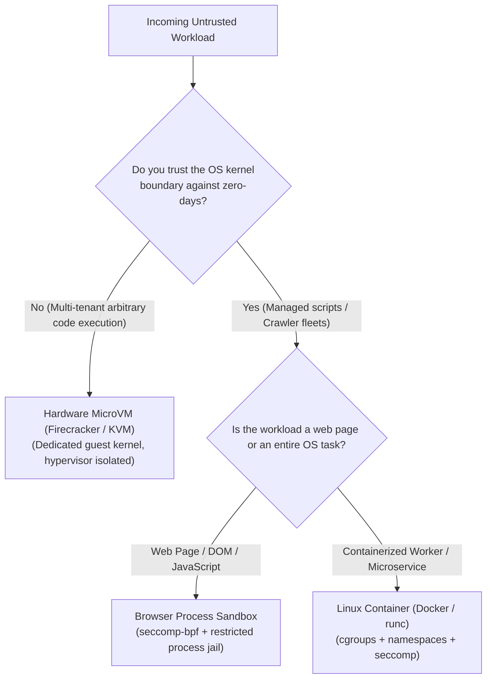
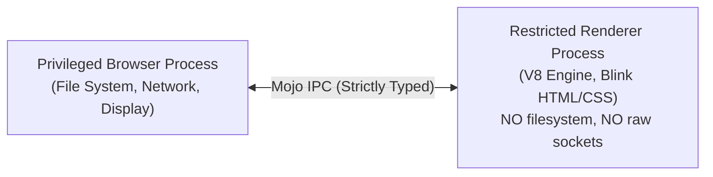
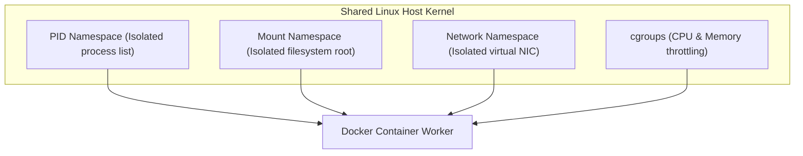
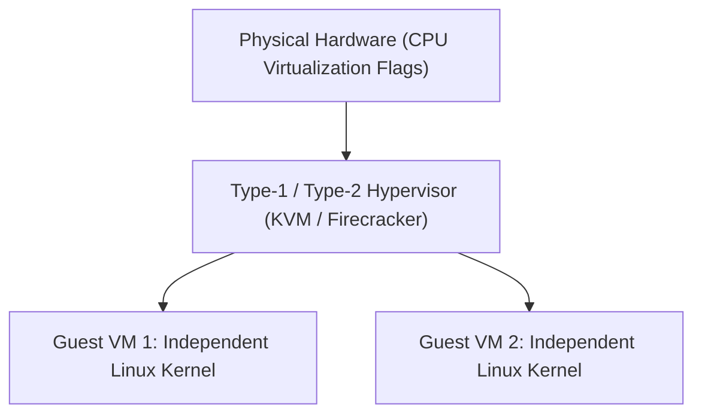

> **TL;DR:** Browser sandboxes isolate renderer processes within the OS; containers partition userspace on a shared kernel; virtual machines enforce hardware-level hypervisor boundaries for untrusted execution.



---

## The Three Isolation Paradigms Head-to-Head

| Architectural Property | Browser Sandbox (Chromium) | Linux Container (Docker) | Hardware Virtual Machine (KVM/Firecracker) |
| :--- | :--- | :--- | :--- |
| **Isolation Boundary** | Application Process (`seccomp-bpf` / Windows Job) | Linux Kernel Namespaces & cgroups | Hardware CPU Virtualization (VT-x / AMD-V) |
| **Kernel Surface** | Shared Host Kernel (Filtered syscalls) | **Shared Host Kernel** (Restricted syscalls) | **Independent Guest Kernel** (Zero host sharing) |
| **Startup Latency** | **5 – 15 milliseconds** | **200 – 800 milliseconds** | **5 – 150 milliseconds** (MicroVM) |
| **Memory Footprint** | ~25MB – 50MB per renderer process | ~50MB – 150MB per container base | ~100MB – 512MB per guest VM |
| **Escape Vector** | Renderer exploit + Broker IPC escape | Kernel privilege escalation (dirty COW, eBPF) | Hypervisor bug (extremely rare) |
| **GPU Acceleration** | Native / Direct OS GPU pass-through | Requires specialized NVIDIA container toolkit | Virtualized GPU / vGPU pass-through required |

---

## 1. The Browser Sandbox: Process-Level Isolation

When Chromium renders a webpage, it splits into two distinct process types:



1. **The Privileged Browser (Broker) Process:** Owns network sockets, disk I/O, window compositing, and user input events.
2. **The Restricted Renderer Process:** Executes V8 JavaScript and parses HTML. On Linux, the renderer is placed inside a `seccomp-bpf` system call jail that denies almost all system calls except `read`, `write` to pipes, and `futex`. 

If malicious JavaScript achieves Remote Code Execution (RCE) inside V8, the attacker remains trapped inside the renderer. To compromise the host machine, they must chain a second zero-day exploit to escape the Mojo IPC broker boundary.

---

## 2. Linux Containers: OS-Level Namespace Slicing

Containers do not virtualize hardware. A Docker container is simply a standard Linux process running with restricted visibility:



### The Container Security Trap
Because all containers share the single underlying host kernel, **a kernel exploit in one container compromises the entire server**. 

If an automated scraper running inside Docker triggers a Linux kernel privilege escalation bug (like an unpatched `io_uring` or `eBPF` flaw), the process gains root control over the physical host and all neighboring containers.

---

## 3. Hardware Virtualization: The MicroVM Breakthrough

For true multi-tenant untrusted workloads, AWS developed **Firecracker**—a minimalist hypervisor running on top of KVM:



* **Dedicated Kernel:** Each microVM boots its own tiny 5MB Linux kernel in 10 milliseconds.
* **Hardware Intercepts:** The physical CPU hardware enforces boundary security using Intel VT-x or AMD-V virtualization extensions. Even a root kernel panic inside the guest VM cannot compromise the underlying host.

---

## Benchmark: Startup Latency & Density



---

## Terminal Verification: Inspect Container Seccomp Syscalls

You can verify how Linux containers restrict system calls on your host right now:

```bash
# Check if your Linux kernel supports seccomp filtering
grep CONFIG_SECCOMP= /boot/config-$(uname -r) || true
```

When running automated browser scrapers in Docker, always drop unneeded capabilities:

```bash
# Run a hardened container dropping root permissions
docker run --cap-drop=ALL --cap-add=CHOWN --security-opt=no-new-privileges:true my-scraper-image
```
