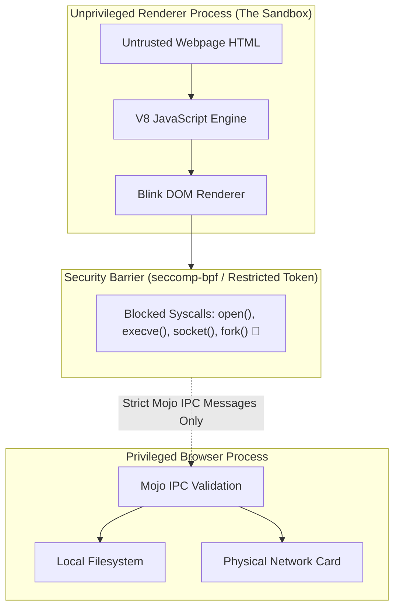
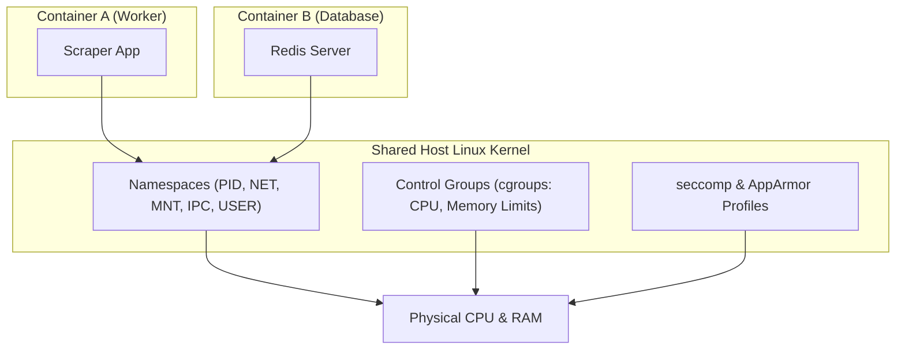
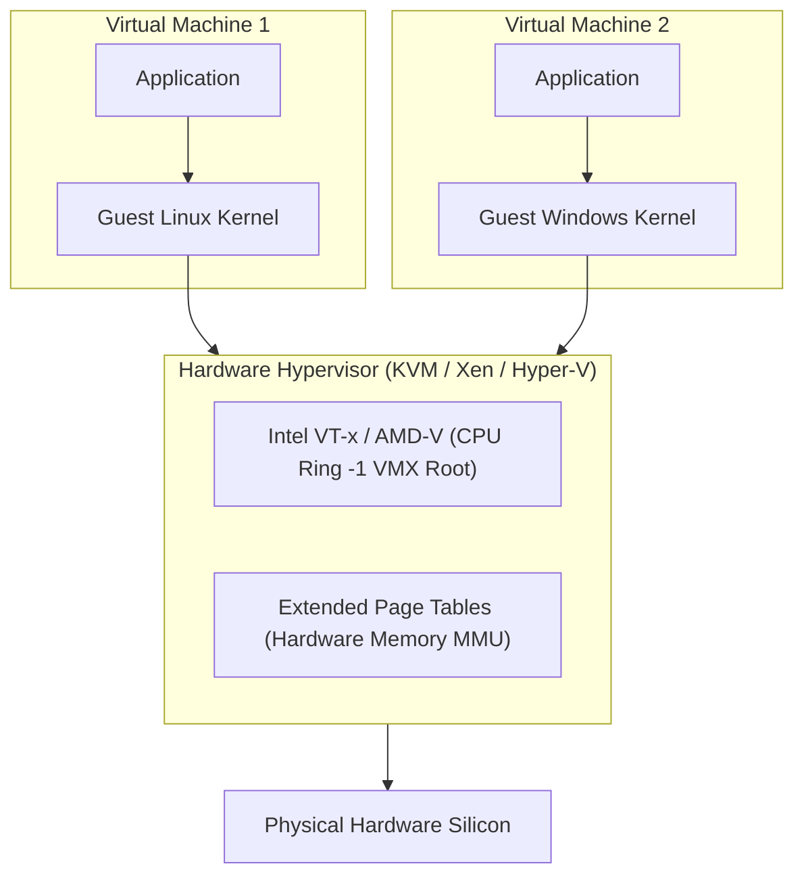
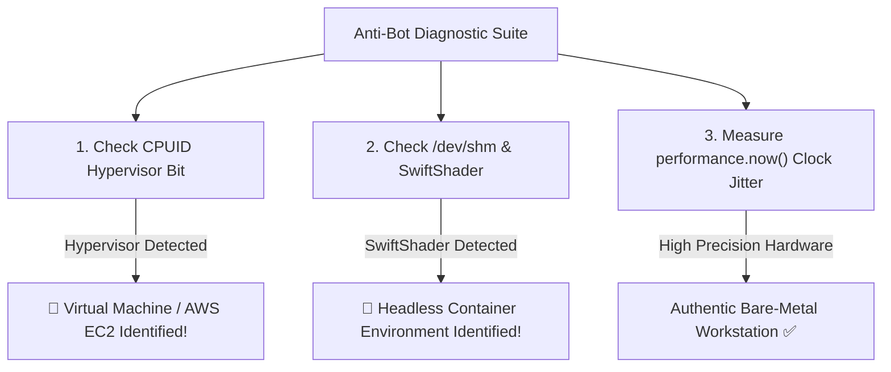

Every time you visit a website, your computer downloads thousands of lines of untrusted JavaScript, complex binary WebAssembly modules, and image decompression algorithms written by unknown third parties.

Your browser executes this untrusted code without hesitation.

Why doesn't visiting a malicious webpage instantly compromise your banking passwords, read your private SSH keys, and encrypt your hard drive?

Because the browser executes that code inside an aggressively restricted **Sandbox**.

When software engineers and DevOps architects design systems to run untrusted workloads—whether automated crawlers, user-submitted code, or multi-tenant microservices—they rely on three distinct layers of isolation:

1. **The Application Sandbox** (Chromium / WebKit)
2. **The Operating System Container** (Docker / OCI / runc)
3. **The Hardware-Assisted Virtual Machine** (KVM / QEMU / Firecracker)


<p class="chart-note" style="text-align: center; margin-top: -12px; margin-bottom: 24px;"><em>Concentric defense: isolation primitives range from lightweight process-level system call filtering to kernel namespace boundaries and hardware hypervisors.</em></p>

Here is the engineering breakdown of how these three isolation primitives work, how their attack surfaces differ, and how anti-bot systems detect which environment you are running in.

---

## The Three Isolation Paradigms at a Glance

Comparing boundaries, performance, and escape vectors reveals the trade-offs between speed and security.

<div class="vs-cards">
  <div class="vs-card v12">
    <div class="vs-card-header">
      <h3>Browser Sandbox</h3>
      <span class="vs-tag modern">Chromium Multi-Process</span>
    </div>
    <div class="vs-feature-list">
      <div class="vs-feature-item">
        <div class="vs-feature-title">
          <span class="vs-icon">⚡</span>
          <strong>Ultra-Low Overhead</strong>
        </div>
        <p class="vs-feature-desc">Spawns in under 15ms; consumes ~30MB of RAM per isolated tab process within the browser.</p>
      </div>
      <div class="vs-feature-item">
        <div class="vs-feature-title">
          <span class="vs-icon">🛡️</span>
          <strong>Process-Level Syscall Jails</strong>
        </div>
        <p class="vs-feature-desc">Restricts untrusted renderers via <code>seccomp-bpf</code> filters, Windows Job Objects, and macOS seatbelt profiles.</p>
      </div>
      <div class="vs-feature-item">
        <div class="vs-feature-title">
          <span class="vs-icon">⚠️</span>
          <strong>IPC Logic Attack Surface</strong>
        </div>
        <p class="vs-feature-desc">Escape requires finding memory corruption in V8 combined with a logic flaw in Chromium's Mojo IPC layer.</p>
      </div>
    </div>
  </div>

  <div class="vs-card v13">
    <div class="vs-card-header">
      <h3>Hardware Virtual Machine</h3>
      <span class="vs-tag modern">KVM / QEMU / Firecracker</span>
    </div>
    <div class="vs-feature-list">
      <div class="vs-feature-item">
        <div class="vs-feature-title">
          <span class="vs-icon">🏰</span>
          <strong>Independent Operating System Kernel</strong>
        </div>
        <p class="vs-feature-desc">Runs an isolated guest OS kernel; zero kernel code or memory structures are shared with the host.</p>
      </div>
      <div class="vs-feature-item">
        <div class="vs-feature-title">
          <span class="vs-icon">🔒</span>
          <strong>Hardware CPU Ring -1 (VMX)</strong>
        </div>
        <p class="vs-feature-desc">Enforced directly by CPU silicon instructions (Intel VT-x / AMD-V) with Second Level Address Translation (SLAT).</p>
      </div>
      <div class="vs-feature-item">
        <div class="vs-feature-title">
          <span class="vs-icon">🐘</span>
          <strong>Heavier Resource Demands</strong>
        </div>
        <p class="vs-feature-desc">Requires 100MB–2GB of dedicated RAM and longer boot times (120ms for MicroVMs, 15s for full VMs).</p>
      </div>
    </div>
  </div>
</div>

---

## 1. Level 1: The Chromium Browser Sandbox

The **Chromium Sandbox** is designed with a fundamental premise: **assume the renderer process will be hacked**.

In Chromium, the browser is split into multiple processes:
* **The Browser Process (Privileged)**: Owns access to your disk, network cards, operating system windows, and user profile data.
* **The Renderer Process (Unprivileged & Sandboxed)**: Parses untrusted HTML, calculates CSS layouts, and executes untrusted V8 JavaScript.



### How the Sandbox Locks the Door:
* **Linux**: Chromium drops all privileges and applies a **`seccomp-bpf`** filter. The renderer is prohibited from calling system calls like `open()`, `fork()`, `execve()`, or `socket()`. If compromised V8 code attempts to read `/etc/passwd`, the Linux kernel immediately kills the process with `SIGSYS`.
* **Windows**: Chromium applies a **Restricted Token** stripping all administrator SIDs and places the process in an isolated **Job Object** that prevents creating child processes or accessing the desktop clipboard.
* **macOS**: Chromium uses Apple's **Sandbox API (`seatbelt`)**, locking the process into a restrictive quarantine profile.

To display a webpage, the renderer cannot write to disk or talk to the network. It must send a structured **Mojo IPC message** to the Browser process: *"Please fetch `https://example.com/data` on my behalf."*

---

## 2. Level 2: Linux Containers (Docker / OCI)

While a browser sandbox confines a single application process, a **Linux Container** isolates an entire user-space environment.

However, containers have an architectural secret: **containers are not virtual machines. They are just standard Linux processes sharing the host operating system kernel.**



### The Primitives of Container Isolation:
1. **Linux Namespaces**: Slices the view of the operating system:
   * **PID Namespace**: Container processes see themselves as PID 1, completely blind to host processes.
   * **NET Namespace**: Assigns a virtual network interface (`eth0`) with independent IP routing.
   * **MNT Namespace**: Isolates filesystem mount points, providing a private root directory.
2. **Control Groups (`cgroups`)**: Enforces hard resource ceilings on CPU cores, RAM allocation, and disk I/O.
3. **Seccomp Filters**: Restricts dangerous system calls (e.g. blocking `ptrace` or `reboot`).

### The Critical Vulnerability of Containers:
Because every container shares the **same host Linux kernel**, any privilege escalation zero-day in the Linux kernel (such as *Dirty COW*, *io_uring* flaws, or eBPF verifier bugs) allows a container process to escape container boundaries and gain full root control over the host server.

---

## 3. Level 3: Hardware-Assisted Virtual Machines (KVM / QEMU)

When multi-tenant security cannot tolerate a shared kernel, engineers turn to **Hardware Virtualization**.

Virtual machines run beneath the operating system kernel, mediated directly by the computer's physical silicon:



### The Silicon Boundary:
Modern processors feature specialized operational modes: **VMX Root Operation (Ring -1)**.

1. **Independent Guest Kernels**: Each VM boots its own dedicated kernel. If an attacker crashes or exploits the guest kernel, only their virtual machine crashes. The host hypervisor remains completely unaffected.
2. **Hardware MMU Isolation**: **Extended Page Tables (EPT)** ensure the guest kernel’s physical memory addresses are translated by CPU hardware. A guest OS cannot read or modify host memory even if it tries.
3. **MicroVMs (Firecracker)**: Modern cloud architectures (such as AWS Lambda and Fly.io) use minimalist hypervisors like AWS Firecracker. By stripping legacy BIOS drivers and virtualized floppy controllers, Firecracker boots a hardware-isolated Linux MicroVM in **under 120 milliseconds**.

---

## 4. The Anti-Bot & Fingerprinting Perspective

How do anti-bot systems like Cloudflare, DataDome, and Kasada know which environment you are running in?



### 1. The CPUID Hypervisor Bit
When code runs inside a Virtual Machine, executing the x86 `CPUID` instruction with register `EAX=1` returns a reserved hypervisor bit in `ECX` (Bit 31). Furthermore, querying `EAX=0x40000000` returns the literal hypervisor vendor string:
* `KVMKVMKVM\0\0\0` (Linux KVM)
* `VMwareVMware` (VMware ESXi)
* `Microsoft Hv` (Hyper-V / Azure)

### 2. High-Resolution Timer Clamping
Inside virtual machines, CPU instruction timing and hypervisor context switches (VM-Exits) introduce measurable clock jitter. Anti-bot scripts measure `performance.now()` over 1,000 tight mathematical loops. 

If the clock precision exhibits hypervisor quantization or clamping, the threat score increases.

---

## 5. Benchmark: Startup Latency and Memory Overhead

How do the three tiers compare across operational metrics?





---

## 6. How to Detect Virtualization via CLI

You can check whether your server or crawler is running inside a container or VM using standard Linux utilities:

```bash
# 1. Detect virtualization technology:
systemd-detect-virt
# Returns: 'kvm', 'vmware', 'docker', or 'none' (bare metal)

# 2. Check container namespace environment:
cat /proc/1/cgroup | head -5

# 3. Check CPU hypervisor flags:
grep -E "hypervisor|vmx|svm" /proc/cpuinfo
```

---

## Production Takeaways for Security Architects

| Isolation Tier | Security Boundary | Best Production Use Case | Anti-Bot Footprint |
| :--- | :--- | :--- | :--- |
| **Browser Sandbox** | Syscall filters (`seccomp-bpf`) + Mojo IPC | Executing untrusted Web JavaScript and CSS | Lowest (Authentic desktop hardware) |
| **Linux Container** | Linux Namespaces + Control Groups (`cgroups`) | Stateless scraping workers and microservices | Medium (SwiftShader & missing fonts leak) |
| **Hardware MicroVM** | CPU Ring -1 (VMX) + Hardware EPT | Multi-tenant untrusted code execution | High (CPUID hypervisor bit exposed) |
| **Full Hardware VM** | Dedicated virtualized hardware stack | Core database and compliance infrastructure | High (Virtual ACPI tables & hypervisor tags) |

No single isolation technology fits every engineering requirement. By understanding the architectural boundary separating process sandboxes, container namespaces, and hardware hypervisors, you can build systems that balance lightning-fast execution speed with impenetrable security.
