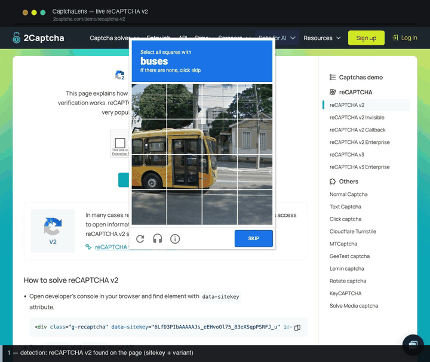
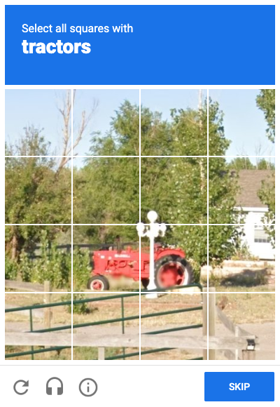

> **TL;DR:** Gemini solves Google reCAPTCHA v2 visual puzzles with an 83% pass rate for zsh.0015 per solve, proving image puzzles are obsolete. The real defense lies in upstream browser fingerprinting and IP reputation checks.

---

No human help. Green checkbox. A fraction of a cent.



I put Google's own Gemini inside a Chrome extension. Then I pointed it at Google's live reCAPTCHA demo.

It passes the image test **83% of the time**.

---

## 1. What This Test Actually Measures

**reCAPTCHA v2** is the familiar "I'm not a robot" checkbox.

You tick it. Google evaluates your environment in the background. If it is not confident you are human, it displays a 3x3 or 4x4 photo grid asking you to pick buses, traffic lights, or tractors.

A **solver** reads that grid and clicks the matching squares. Mine is called **CaptchaLens**.

The surprise was not that the model works. The surprise was where it fails:

> **My solver almost never gets the pictures wrong. It gets stopped before the pictures arrive.**

---

## 2. The Picture Problem Is Already Solved

Here is a real 4x4 round asking for tractors:



Two models evaluate the grid:
* **`jev-1.14`**: A specialized image classification model returning a probability per square.
* **`gemini-decision-1`**: Google's multimodal decision model.

Neither model views the whole grid at once. Both score **one square at a time**:

| row | col 1 | col 2 | col 3 | col 4 |
|---|---|---|---|---|
| 1 | 0.01 / 0.13 | 0.01 / 0.18 | 0.02 / 0.14 | 0.02 / 0.15 |
| 2 | 0.02 / 0.17 | 0.04 / 0.17 | 0.06 / 0.19 | 0.04 / 0.16 |
| 3 | 0.14 / 0.23 | **0.98 / 0.81** | **0.87 / 0.82** | 0.36 / 0.22 |
| 4 | 0.02 / 0.21 | 0.06 / 0.20 | 0.04 / 0.20 | 0.04 / 0.13 |

Two squares picked. Verify pressed. Checkbox green. Total time: **26 seconds**.

---

## 3. How the Decisions API Works

Instead of asking the model for English sentences (which require markdown parsing and error-handling), CaptchaLens queries a **decisions API** with strict structured output:

```json
{
  "model": "google/gemini-decision-1",
  "answers": {
    "r3c2": { "type": "noul", "noul": 0.81, "confidence": 0.81 },
    "r3c3": { "type": "noul", "noul": 0.82, "confidence": 0.82 }
  }
}
```

### Calibrating Decision Cut-Offs
Every square returns a number between `0` and `1`. To determine what counts as a click, I measured the distribution across true targets vs empty squares:

| Metric | jev-1.14 | gemini-decision-1 |
|---|---|---|
| Average score on object squares | **0.86** | **0.75** |
| Average score on empty squares | **0.08** | **0.23** |
| **Separation Gap** | **0.79** | **0.53** |
| Typical score on an empty square | 0.05 | 0.21 |



A wide separation gap means clear decisions. Setting the threshold at **0.45 for jev** and **0.55 for Gemini** yields optimal precision.

---

## 4. Solving ClickCaptcha: Ordered Sequence Clicks

Beyond 4x4 grids, I tested modern ordered click challenges (ClickCaptcha), where the user must click three specific objects in exact sequential order:


### The Two-Pass Precision Fix
Naive attempts to ask multimodal models for percentage coordinates fail due to aspect ratio distortion and banner offsets. The winning strategy:
1. Lay a coarse 4x4 grid over the image and identify the high-confidence candidate sector.
2. Crop an isolated bounding box and run a fine-grained second pass with weighted centroid averaging.


Every synthetic click now lands within 10 pixels of target centers. With this dual-pass approach, the extension achieved a **100% solve rate** on the live demo in 23 seconds.

---

## 5. The Real Barrier: 70% of Failures Never Saw a Picture

When automated runs fail, they fall into two distinct buckets:

{% include chart.html type="split" title="Breakdown of Failed Runs" labels="Google refused to show challenge (Blocked at Gate)|Model missed the visual target" values="70|30" suffix="%" %}

{% include chart.html type="bars" title="Pass Rate by Stage" labels="When Challenge is Shown|When Browser Judged First" values="83|0" suffix="%" scale="100" highlight="When Challenge is Shown" %}

**The vision work is solved. The gate sits in front of it.**

Google scores your browser before drawing a single image. It evaluates:
1. **TLS Handshake Fingerprints:** OpenSSL vs BoringSSL cipher suite order.
2. **Runtime Automation Flags:** `navigator.webdriver` and missing plugin arrays.
3. **Network IP Reputation:** Datacenter ASNs carry an elevated fraud score on arrival.

---

## 6. What Actually Moves the Needle

If you automate web tasks, stop treating CAPTCHAs as a computer vision problem:

* **Stay Headed or use `--headless=new` with virtual displays:** Stripped headless Linux binaries are trivial to identify.
* **Keep browser profiles warm:** Browsers with history, cookies, and age pass behavioral checks far more reliably than cold, isolated instances.
* **Use Residential Proxies:** Avoid datacenter ranges that are pre-flagged by reputation databases.
* **Focus on TLS and Telemetry:** Spend 90% of your engineering effort on your browser's fingerprint, not on faster image OCR.

Code, handlers, and end-to-end tests are open-sourced on the [CaptchaLens repository](https://github.com/naimurhasan/CaptchaLens).
