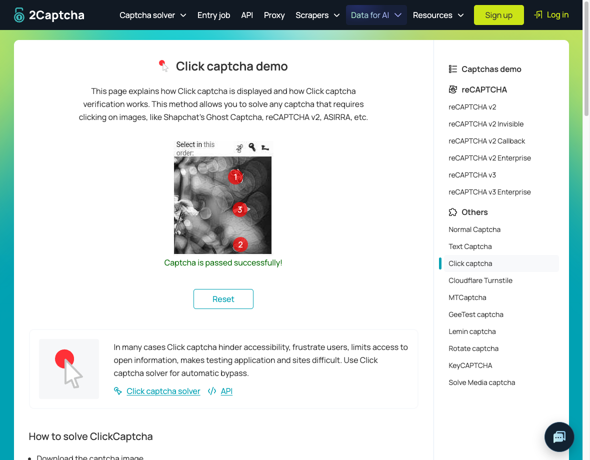
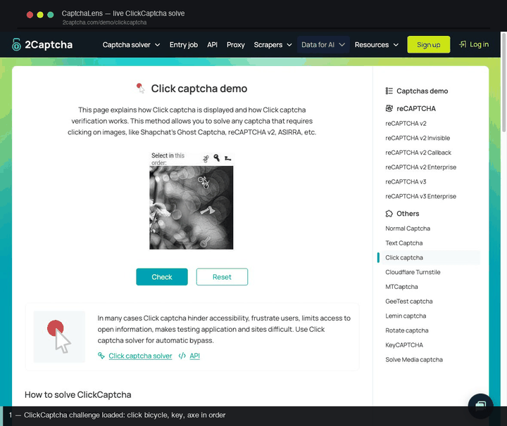

Zero human input. Green checkbox. A fraction of a cent.


I wired Google's own Gemini into a Chrome extension and pointed it at Google's live reCAPTCHA demo.

It clears the image grid **83% of the time**.

The surprise was not that it works. It is where it fails.

**70% of my failures happened before a single image reached the model.** Google scored the browser, refused to open a challenge, and the solver never got asked anything.

---

## The vision problem is already over

Here is a real 4x4 round asking for tractors.


The tractor spans two tiles. Both models score every tile on its own. First number is jev, second is Gemini.

| row | col 1 | col 2 | col 3 | col 4 |
|---|---|---|---|---|
| 1 | 0.01 / 0.13 | 0.01 / 0.18 | 0.02 / 0.14 | 0.02 / 0.15 |
| 2 | 0.02 / 0.17 | 0.04 / 0.17 | 0.06 / 0.19 | 0.04 / 0.16 |
| 3 | 0.14 / 0.23 | **0.98 / 0.81** | **0.87 / 0.82** | 0.36 / 0.22 |
| 4 | 0.02 / 0.21 | 0.06 / 0.20 | 0.04 / 0.20 | 0.04 / 0.13 |

Two tiles picked. Verify pressed. Checkbox green. 26 seconds.

Look at the tile scoring 0.36. Partial tractor, correctly left alone.

---

## Nothing here asks a model for prose

I use a decisions API. You declare typed questions. You get typed answers with probabilities attached.

How a round works:

1. Screenshot the challenge frame.
2. Ask one question per tile: does any part of a tractor appear in row 3, column 2?
3. Tell the model that one object often spans several tiles, so a sliver still counts.
4. Pick every tile above its model's threshold.
5. Click them, press verify, read the result.

The answer comes back shaped, not as a sentence to parse:

```json
{
  "model": "google/gemini-decision-1",
  ...
  "answers": {
    "r3c2": { "type": "noul", "noul": 0.81, "confidence": 0.81 },
    "r3c3": { "type": "noul", "noul": 0.82, "confidence": 0.82 },
    "r3c4": { "type": "noul", "noul": 0.22, "confidence": 0.22 }
  },
  ...
}
```

No parsing layer. No stripped markdown fences. No retry because a model wrapped JSON in an apology.

One gotcha cost me a morning. Every question needs an instructions field. Leave it out and both models reject the call outright.

Same frame in, same numbers out. That is what makes a threshold mean something.

---

## Two models, measured

I run both on every tile and take the union of their picks. The thresholds are not taste. They fall out of the numbers.

| Measure | jev-1.14 | gemini-decision-1 |
|---|---|---|
| Mean score on tiles it picks | 0.86 | 0.75 |
| Mean score on tiles it rejects | 0.08 | 0.23 |
| Separation | 0.79 | 0.53 |
| Median rejected tile | 0.05 | 0.21 |

Separation is the gap between those two means. The wider it is, the less a threshold matters.



Gemini is mushier on negatives, so it gets a higher bar. I use 0.45 for jev and 0.55 for Gemini.

The union earns its cost. **23% of picked tiles are picked by only one of the two models.** Drop either one and you lose real targets.

On what the challenge is even asking, the two agreed **100% of the time**.

Gemini is also the only one that takes audio. So the routing is simple. Vision to jev, audio to Gemini, both on tiles.

---

## The ordered-click captcha, where it all broke

Different challenge. Three icons on a photo, and a thumbnail strip saying `Select in this order`.

You click them in the order shown, not the order they sit on the page.



Look at the markers. 1 at the top, 2 at the bottom, 3 in the middle. Order read from thumbnails, not from geometry.

Reading the order worked at once, around 90% confidence. **The clicking failed 100% of the time.**

The old approach asked a small chat model for object centres as percentages. Three bugs, stacked:

- The bounded image element secretly includes the instruction banner. That is 13% of its height.
- The screenshot padded another 60 pixels on every side. So percentages were decoded against a frame 120 pixels too big.
- The model normalises to its own roughly 2:3 canvas, not the image's real 0.91 shape.

The last one is the killer. Error grows the further down the image you go.

| object | model said | truth | drift |
|---|---|---|---|
| bicycle | y 30% | y 30% | 0% |
| axe | y 47% | y 59% | 12% |
| key | y 65% | y 91% | 26% |

{% include chart.html type="bars" title="Vertical drift by position in frame" labels="bicycle, near top|axe, mid frame|key, near bottom" values="0|12|26" suffix="%" scale="30" %}

No constant offset fixes a growing error.

A grounded box localizer was honest but not enough. It nailed the bicycle at 0.92 confidence, then returned 0.30 and 0.49 on the other two. That is a model correctly reporting that it is lost.

---

## The fix: stop asking where

Point localization became tile classification, which the pipeline is already good at.

1. Crop the banner off the top.
2. Upscale until the image clears the API's minimum size.
3. Split into a 4x4 grid. Ask only: is the key inside this cell?
4. Take the winning cell, crop a window around it, split that into 4x4 again.
5. Average the strong cells, weighted by confidence, to get a point.



Every click now lands within about ten pixels. Since the fix it has passed **100% of attempts**, in 23 seconds, with a spread of barely a second and a half.

> When a model is better at answering whether something is inside a region than at saying where it is, grid search turns the weak skill into the strong one.

That lesson has nothing to do with captchas. Use it anywhere you need visual grounding.

---

## Most failures never reached a model

This is the part that changed how I think about the whole category.

{% include chart.html type="split" title="Where the failures came from" labels="Browser refused a challenge|Models missed the targets" values="70|30" suffix="%" %}

The 70% cost nothing, because no model was ever called. The 30% cost a few API calls.

Pass rate, split by whether Google actually served the test:

{% include chart.html type="bars" title="Pass rate by whether the test was served" labels="Challenge served|Browser pre-judged" values="83|0" suffix="%" scale="100" highlight="Challenge served" %}

It never failed on answers it was allowed to give. It failed on being allowed.

Stock automated Chromium gets flagged no matter how good the answers are. Running under patchright, a Playwright fork, is what moved the rate into usable territory.

> The test is no longer about whether you can see. It is about whether your browser looks bored enough.

---

## What it costs

You would struggle to spend a dollar on this.

Price per 1000 solves:



The $1.56 is the honest number, because it counts the attempts that failed. That is level with the cheapest human tiers and roughly twice CapSolver's list price.

I am not cheaper than the best service. Services still beat me on speed. Human farms beat me on consistency, because a person is never refused the challenge for having the wrong TLS fingerprint.

Price is not the win. No account, no deposit, no screenshot leaving the machine, a probability on every decision, and zero marginal cost against a local model. Those are.

---

## What to watch out for

Two limits, stated plainly. The ordered-click demo serves one fixed image, so that 100% shows pipeline reliability, not generalisation. The order reading still works from a fixed set of permutations instead of naming objects freely.

If you run crawlers, stop treating captchas as a vision problem. The image grid is close to solved and costs almost nothing.

Your blocks come from fingerprinting, TLS signatures and behavioural scoring, long before any picture is drawn. Spend your effort on the context your browser presents, not on reading traffic lights faster.

That is why CaptchaLens ships as a detector with no automatic bypass. Knowing which vendor gated your test run, and why, is what makes CI debuggable.

Code, handlers and the end-to-end harnesses are on [the CaptchaLens repository](https://github.com/naimurhasan/CaptchaLens) under MIT. Geetest, Arkose and DataDome have no handler yet. Each one is a single file.
