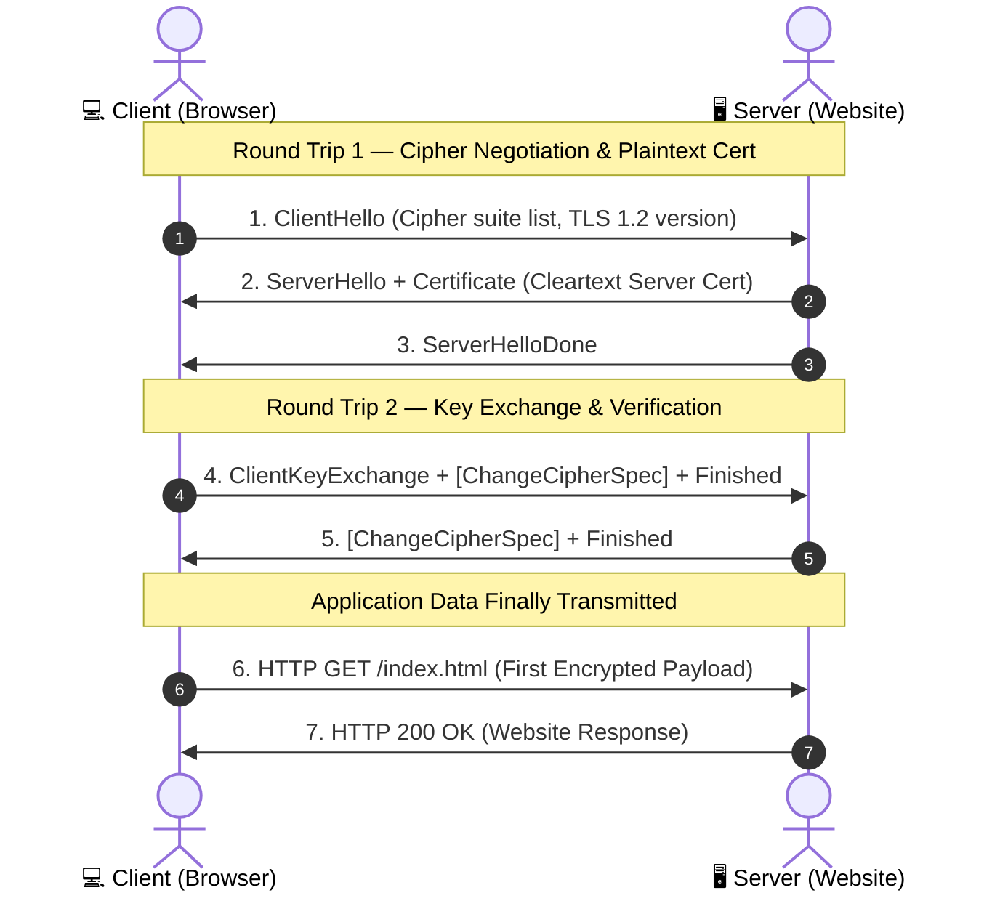
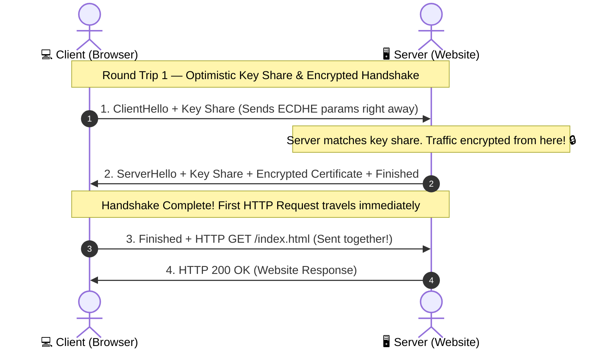

Every time you open a website or initiate an API request, an invisible negotiation occurs in milliseconds. That negotiation is governed by **TLS (Transport Layer Security)**.

TLS is the protocol that turns vulnerable `http://` into encrypted `https://`.


<p class="chart-note" style="text-align: center; margin-top: -12px; margin-bottom: 24px;"><em>The invisible shield: every HTTPS connection begins with a rapid cryptographic negotiation that locks your data—and reveals your client's fingerprint.</em></p>

For a decade, the web ran on **TLS 1.2** (RFC 5246, 2008). While reliable, it suffered from high connection latency and carried obsolete cryptographic debt from the 1990s. 

In 2018, the IETF published **TLS 1.3** (RFC 8446) — cutting handshake latency in half, mandating **Perfect Forward Secrecy (PFS)**, and laying the cryptographic foundation for **QUIC** and **HTTP/3**.

Beyond speed and privacy, TLS plays another decisive role on the modern internet: **anti-bot fingerprinting**. Security systems like Cloudflare, Akamai, and DataDome inspect the very first packets of your TLS handshake to instantly detect whether a request came from Python, `curl`, Firefox, or Chrome.

---

## TLS 1.2 vs TLS 1.3 at a Glance

<div class="vs-cards">
  <div class="vs-card v12">
    <div class="vs-card-header">
      <h3>TLS 1.2</h3>
      <span class="vs-tag legacy">Legacy (2008)</span>
    </div>
    <div class="vs-feature-list">
      <div class="vs-feature-item">
        <div class="vs-feature-title">
          <span class="vs-icon">⏱️</span>
          <strong>2-RTT Handshake</strong>
        </div>
        <p class="vs-feature-desc">Needs two full round trips (ping-pong) before data flows.</p>
      </div>
      <div class="vs-feature-item">
        <div class="vs-feature-title">
          <span class="vs-icon">🔓</span>
          <strong>Cleartext Metadata</strong>
        </div>
        <p class="vs-feature-desc">Server certificates and extensions sent unencrypted.</p>
      </div>
      <div class="vs-feature-item">
        <div class="vs-feature-title">
          <span class="vs-icon">⚠️</span>
          <strong>300+ Cipher Suites</strong>
        </div>
        <p class="vs-feature-desc">Bloated with weak algorithms (CBC, RC4, static RSA).</p>
      </div>
      <div class="vs-feature-item">
        <div class="vs-feature-title">
          <span class="vs-icon">⏳</span>
          <strong>Optional Forward Secrecy</strong>
        </div>
        <p class="vs-feature-desc">Stolen private keys can decrypt recorded historical traffic.</p>
      </div>
      <div class="vs-feature-item">
        <div class="vs-feature-title">
          <span class="vs-icon">🚫</span>
          <strong>Incompatible with HTTP/3</strong>
        </div>
        <p class="vs-feature-desc">Cannot run on top of modern QUIC transport.</p>
      </div>
    </div>
  </div>

  <div class="vs-card v13">
    <div class="vs-card-header">
      <h3>TLS 1.3</h3>
      <span class="vs-tag modern">Modern Standard (2018)</span>
    </div>
    <div class="vs-feature-list">
      <div class="vs-feature-item">
        <div class="vs-feature-title">
          <span class="vs-icon">⚡</span>
          <strong>1-RTT Handshake</strong>
        </div>
        <p class="vs-feature-desc">Halves connection time; 0-RTT on returning visits.</p>
      </div>
      <div class="vs-feature-item">
        <div class="vs-feature-title">
          <span class="vs-icon">🔒</span>
          <strong>Encrypted Metadata</strong>
        </div>
        <p class="vs-feature-desc">Server certificates and extensions are shielded.</p>
      </div>
      <div class="vs-feature-item">
        <div class="vs-feature-title">
          <span class="vs-icon">🛡️</span>
          <strong>5 Clean AEAD Ciphers</strong>
        </div>
        <p class="vs-feature-desc">Modern, bulletproof authenticated encryption.</p>
      </div>
      <div class="vs-feature-item">
        <div class="vs-feature-title">
          <span class="vs-icon">🔑</span>
          <strong>Mandatory Forward Secrecy</strong>
        </div>
        <p class="vs-feature-desc">Ephemeral Diffie-Hellman enforced by default.</p>
      </div>
      <div class="vs-feature-item">
        <div class="vs-feature-title">
          <span class="vs-icon">🚀</span>
          <strong>Native HTTP/3 Support</strong>
        </div>
        <p class="vs-feature-desc">Embedded directly into QUIC UDP packets.</p>
      </div>
    </div>
  </div>
</div>

---

## 1. What TLS Does (The Core Security Triad)

Without TLS, network traffic travels in plain text across public routers, ISPs, and Wi-Fi networks. Any device along the route can read, tamper with, or reroute packets.

<div class="layer-stack">
  <div class="layer-item">
    <span class="layer-name">Application Layer</span>
    <span class="layer-desc">HTTP/2, HTTP/3, WebSockets, REST APIs</span>
  </div>
  <div class="layer-item active-layer">
    <span class="layer-name">Security Layer: TLS 1.2 / 1.3</span>
    <span class="layer-desc">Encryption, Authentication, Tamper Sealing</span>
  </div>
  <div class="layer-item">
    <span class="layer-name">Transport Layer</span>
    <span class="layer-desc">TCP (Streams) or UDP (QUIC)</span>
  </div>
  <div class="layer-item">
    <span class="layer-name">Internet Layer</span>
    <span class="layer-desc">IP Packet Routing</span>
  </div>
</div>

TLS guarantees three fundamental properties:

| Pillar | Threat Prevented | How It Works |
| :--- | :--- | :--- |
| **Confidentiality** | Eavesdropping & Packet Sniffing | Encrypts payload data with symmetric ciphers (AES-GCM, ChaCha20-Poly1305) so observers only see scrambled ciphertext. |
| **Authentication** | Impersonation & MITM Attacks | Uses X.509 digital certificates and asymmetric signatures to verify that the server is genuinely who it claims to be. |
| **Integrity** | Packet Tampering & Injection | Signs every record with Authenticated Encryption (AEAD) to detect if a single bit has been altered in transit. |

---

## 2. Interactive Handshake Simulator: The Ping-Pong Problem

Packets take time to travel across physical fiber lines and cell towers. Because of propagation delay, network messages do not travel instantaneously; they travel **at an angle over time**.

In networking, this is known as a **ladder spacetime diagram**.

Use the interactive simulator below to watch packets bounce diagonally back and forth across the wire:



---

## 3. Handshake Architecture: 2-RTT vs 1-RTT

Why does TLS 1.2 feel noticeably slower than TLS 1.3 on mobile connections? The answer lies in how keys are negotiated.

### TLS 1.2 Handshake (2 Full Round Trips)

In TLS 1.2, algorithm negotiation and key calculation are split across two sequential round trips:



* **Trip 1 (Negotiation):** The client provides a list of supported ciphers. The server chooses one and sends its certificate in cleartext.
* **Trip 2 (Key Derivation):** The client verifies the certificate, generates key material, sends `ClientKeyExchange`, and switches to encrypted mode.
* **Application Data:** Only begins on the **third trip** after the TCP 3-way handshake has already finished!

---

### TLS 1.3 Handshake (1 Full Round Trip)

TLS 1.3 removes the negotiation delay through **optimistic key exchange**.

Because TLS 1.3 only allows modern Diffie-Hellman curves (like `X25519`), the browser anticipates the server's choice and sends its **Key Share** right inside the very first `ClientHello`:



#### What Changed?
1. ⚡ **Handshake Latency Cut in Half:** The connection is established in just **1-RTT**.
2. 🔒 **Encrypted Metadata:** The server certificate and extensions are completely encrypted. Eavesdroppers on public Wi-Fi cannot see which certificate is presented.
3. 🚀 **HTTP Data Attached:** The browser transmits its confirmation and its first HTTP request inside the same packet (Flight 3).

---

## 4. Performance Benchmarks: Vertical Column Comparison

{% include chart.html type="columns" title="Round Trips Wasted Before First Web Byte" labels="TLS 1.2 (Legacy)|TLS 1.3 (Modern)|TLS 1.3 Resumption (0-RTT)" values="2|1|0" suffix=" RTT" scale="2" highlight="TLS 1.3 Resumption (0-RTT)" note="Lower is better. TLS 1.3 cuts round-trip network delays by 50% to 100%." %}

{% include chart.html type="columns" title="Cipher Suite Surface Area (Number of Permitted Options)" labels="TLS 1.2 (Bloated Combinations)|TLS 1.3 (Standardized AEAD Only)" values="300|5" suffix=" Ciphers" scale="320" highlight="TLS 1.3 (Standardized AEAD Only)" note="TLS 1.3 removed 98% of obsolete cryptographic code, leaving zero room for insecure configurations." %}

### Connection Delay Across Network Tiers

{% include chart.html type="grouped" title="Connection Latency to First Byte (ms by Network Type)" series="TLS 1.2 (3 RTTs Total)|TLS 1.3 (2 RTTs Total)|TLS 1.3 Revisit 0-RTT (1 RTT Total)" labels="Fiber Broadband (15ms ping)|Fast 4G / 5G (50ms ping)|High-Latency Mobile (100ms ping)|Satellite / Transatlantic (200ms ping)" values="45,30,15|150,100,50|300,200,100|600,400,200" unit="" suffix="ms" scale="650" note="Calculated as (TCP Handshake + TLS Handshake) * ping time. On high-latency mobile networks, TLS 1.3 saves 200ms on every click." %}

---

## 5. Comprehensive Comparison Table

<div class="table-wrap">
  <table class="table-styled">
    <thead>
      <tr>
        <th style="width: 25%;">Property</th>
        <th style="width: 35%;">TLS 1.2 (RFC 5246)</th>
        <th style="width: 40%;">TLS 1.3 (RFC 8446)</th>
      </tr>
    </thead>
    <tbody>
      <tr>
        <td><strong>Handshake Latency</strong></td>
        <td><span class="pill pill-bad">2 RTT</span> (4 flights before data)</td>
        <td><span class="pill pill-good">1 RTT</span> (Optimistic key share)</td>
      </tr>
      <tr>
        <td><strong>Session Resumption</strong></td>
        <td><span class="pill pill-warn">1 RTT</span> (Session Tickets / IDs)</td>
        <td><span class="pill pill-good">0-RTT</span> (Pre-Shared Key Early Data)</td>
      </tr>
      <tr>
        <td><strong>Certificate Visibility</strong></td>
        <td><span class="pill pill-bad">Plain Text</span> (Visible to network observers)</td>
        <td><span class="pill pill-good">Encrypted</span> (Shielded after ServerHello)</td>
      </tr>
      <tr>
        <td><strong>Forward Secrecy (PFS)</strong></td>
        <td><span class="pill pill-warn">Optional</span> (Static RSA skips PFS)</td>
        <td><span class="pill pill-good">Mandatory</span> (Ephemeral DHE/ECDHE only)</td>
      </tr>
      <tr>
        <td><strong>Cipher Suite Architecture</strong></td>
        <td><span class="pill pill-bad">300+ monolithic combinations</span></td>
        <td><span class="pill pill-good">5 standardized AEAD suites</span></td>
      </tr>
      <tr>
        <td><strong>Symmetric Ciphers</strong></td>
        <td>CBC mode, RC4 stream, GCM</td>
        <td><span class="pill pill-good">AEAD only</span> (GCM, CCM, Poly1305)</td>
      </tr>
      <tr>
        <td><strong>Vulnerabilities Purged</strong></td>
        <td>Prone to POODLE, BEAST, Lucky13, ROBOT</td>
        <td><span class="pill pill-good">Immune by design</span> (Legacy primitives deleted)</td>
      </tr>
      <tr>
        <td><strong>HTTP/3 & QUIC Support</strong></td>
        <td><span class="pill pill-bad">Incompatible</span> (Cannot bind with QUIC UDP)</td>
        <td><span class="pill pill-good">Native Foundation</span> (Embedded directly in QUIC)</td>
      </tr>
      <tr>
        <td><strong>Client Hello Fingerprinting</strong></td>
        <td>Cleartext `ClientHello` (JA3 / JA4)</td>
        <td>Cleartext `ClientHello` (JA3 / JA4 still active)</td>
      </tr>
    </tbody>
  </table>
</div>

---

## 6. How Anti-Bot Systems Fingerprint TLS (JA3 & JA4)

If you have ever built a web scraper with Python `requests` or `urllib`, you have probably encountered this frustrating scenario:

You configured realistic request headers:
```python
headers = {
    "User-Agent": "Mozilla/5.0 (Macintosh; Intel Mac OS X 10_15_7) AppleWebKit/537.36 (KHTML, like Gecko) Chrome/122.0.0.0 Safari/537.36",
    "Accept-Language": "en-US,en;q=0.9",
    "Accept": "text/html,application/xhtml+xml,application/xml;q=0.9,*/*;q=0.8"
}
```
Yet Cloudflare, Akamai, or DataDome blocked your script with an immediate **403 Forbidden** or a Cloudflare Turnstile challenge page.

**Why did you get caught? Because your TLS fingerprint gave you away before your User-Agent was even received.**

### The Mechanism: Fingerprinting the `ClientHello`

HTTP headers are sent at Layer 7 (Application). But TLS handshakes occur at Layer 5/6 (Session/Presentation). 

When a client initiates a connection, it sends an unencrypted **`ClientHello`** packet containing its cryptographic capabilities. Security firewalls inspect these parameters and generate a deterministic hash:

<div class="ja3-pipeline">
  <div class="ja3-packet-card">
    <div class="ja3-card-header">
      <span class="pill pill-info">Layer 5/6 Record</span>
      <strong>ClientHello Packet Parameters</strong>
    </div>
    <ul class="ja3-fields">
      <li><span class="f-num">1</span> <span><strong>TLS Version:</strong> <code>0x0303</code> (negotiates TLS 1.2 or 1.3)</span></li>
      <li><span class="f-num">2</span> <span><strong>Accepted Ciphers:</strong> Ordered list of ~15–50 cipher suite IDs</span></li>
      <li><span class="f-num">3</span> <span><strong>Extensions:</strong> SNI, ALPN (<code>h2</code>), Supported Groups, Key Shares</span></li>
      <li><span class="f-num">4</span> <span><strong>Elliptic Curves:</strong> <code>X25519</code>, <code>secp256r1</code>, etc.</span></li>
      <li><span class="f-num">5</span> <span><strong>Point Formats:</strong> Uncompressed elliptic curve formats</span></li>
    </ul>
  </div>
  <div class="ja3-arrow">
    <span class="ja3-hash-label">MD5 Cryptographic Hash</span>
    <span class="ja3-down-icon">↓</span>
  </div>
  <div class="ja3-result-card">
    <span class="ja3-tag">JA3 Fingerprint</span>
    <code>b32309a26951912be7dba376398abc3b</code>
  </div>
</div>

Because different HTTP libraries, operating systems, and browsers use different cryptographic engines, their `ClientHello` signatures are completely distinct.

### Build a Client, Get a Verdict

Reading about a fingerprint mismatch is one thing; causing one is another. The lab below lets you assemble a `ClientHello` field by field, then runs the same consistency checks a WAF runs. Drag the parts into the packet (or tap them on mobile), and watch which field betrays you.



Three lessons fall out of playing with it:

* **The library is not the fingerprint.** Load the `curl_cffi` preset: stock OpenSSL emitting Chromium's byte layout still passes, because the server hashes the bytes on the wire, not the code that produced them.
* **Headers cannot rescue a handshake.** The `requests + fake Chrome UA` preset is the trap most scrapers fall into — the verdict is already decided one layer below HTTP.
* **An unknown fingerprint is worse than a known bot.** Mix Chromium ciphers with Firefox extension ordering and you match no shipping client at all, which scores higher on anomaly detection than simply admitting you are `curl`.

---

### 4-Way Client Breakdown: Python vs `curl` vs Chrome vs Firefox

Here is how anti-bot engines tell clients apart:

| Client | Cryptographic Engine | GREASE Extensions | ALPN Support | Extension Ordering | Anti-Bot Verdict |
| :--- | :--- | :--- | :--- | :--- | :--- |
| **Python `requests`** | OpenSSL (via urllib3) | ❌ Absent | ❌ No `h2` (HTTP/1.1 only) | OpenSSL alphabetical / default order | 🚨 **Instant Bot Flag** (Spoofed browser UA mismatch) |
| **`curl`** | OpenSSL or LibreSSL | ❌ Absent | ⚠️ Only with `--http2` | Minimal CLI extension set | 🚨 **Flagged as Automated Tool** |
| **Google Chrome / Brave** | BoringSSL (Chromium) | ✅ Injected (`0x?a?a`) | ✅ `h2`, `http/1.1` | Chromium-specific sequence | ✅ **Legitimate Human Browser** |
| **Mozilla Firefox** | NSS (Mozilla) | ❌ Absent | ✅ `h2`, `http/1.1` | Firefox NSS sequence | ✅ **Legitimate Human Browser** |

#### 1. Python `requests` (OpenSSL Defaults)
Python `requests` relies on system OpenSSL. It advertises standard OpenSSL cipher suites, lacks modern browser extensions like ALPN (`h2`), and omits signature algorithm configurations used by real browsers. 
* If the incoming User-Agent claims to be *Chrome 122*, but the TLS fingerprint matches OpenSSL, the anti-bot firewall flags the request immediately as an impersonation attempt.

#### 2. `curl` (Command Line)
Standard `curl` sends a minimal extension footprint. Unless explicitly configured with `--http2`, it omits modern application layer protocol negotiation, immediately exposing CLI usage.

#### 3. Google Chrome (BoringSSL & GREASE)
Chrome implements **GREASE (Generate Random Extensions And Sustain Extensibility)** (RFC 8701). Chrome intentionally injects random dummy values (like `0x1a1a` or `0x3a3a`) into cipher suites, supported groups, and extension lists to prevent servers from hardcoding assumptions.
* If a request claims to be Chrome but lacks GREASE values in its `ClientHello`, Cloudflare knows it is an automated clone.

#### 4. Mozilla Firefox (NSS Engine)
Firefox does not use GREASE, but its Network Security Services (NSS) engine orders ciphers and extensions in a unique pattern distinct from Chromium. Firefox places `server_name` first, uses custom signature algorithm preferences, and groups elliptic curves differently.

---

### Did TLS 1.3 Kill TLS Fingerprinting?

**No.** While TLS 1.3 encrypts the server's response (certificate and extensions), the client's initial **`ClientHello` must remain in plain text** so the server can inspect the client's supported key share curves.

As a result:
* **JA3** and **JA4** fingerprints still read the cleartext `ClientHello`.
* In fact, TLS 1.3 added *new* fingerprintable parameters, including the **`supported_versions`** extension (`0x002b`), the **`key_share`** extension (`0x0033`), and **`psk_key_exchange_modes`** (`0x002d`).

### How Modern Automation Bypasses TLS Fingerprinting

To bypass anti-bot defenses in 2026, automation engineers no longer rely on simple Python `requests`:

1. **`curl_cffi`**: A Python wrapper around a modified `curl` binary that mimics the exact TLS `ClientHello` and HTTP/2 settings of Chrome, Safari, and Firefox.
2. **`tls-client`**: A Go library built on top of BoringSSL that dynamically swaps cipher suite ordering, extension lists, and GREASE tokens to spoof real browser fingerprints.
3. **Headless Chrome with Puppeteer / Playwright**: Running real Chromium instances ensures genuine BoringSSL handshakes, avoiding fingerprint mismatches entirely.

---

## 7. How to Verify Your Site's TLS Configuration

You can inspect the TLS version and cipher negotiation of any domain using standard CLI tools:

### Using `curl`
```bash
# Force TLS 1.3 negotiation
curl -Iv --tlsv1.3 --tls-max 1.3 https://yourdomain.com/
```
In the verbose output, verify the protocol and cipher:
```text
* SSL connection using TLSv1.3 / TLS_AES_256_GCM_SHA384
* Server certificate: yourdomain.com
```

### Using `openssl`
```bash
openssl s_client -connect yourdomain.com:443 -tls1_3
```
Look for the negotiated protocol:
```text
New, TLSv1.3, Cipher is TLS_AES_256_GCM_SHA384
Protocol  : TLSv1.3
Key shares: supported_groups=X25519:P-256
```

---

## Production Takeaways

1. **Deprecate TLS 1.0 and 1.1:** Formally retired by RFC 8996 and forbidden by PCI DSS. Ensure your web server has them disabled.
2. **Enable TLS 1.3 by default:** All major CDNs (Cloudflare, Fastly, AWS CloudFront) and reverse proxies (Nginx, Caddy, Envoy) support TLS 1.3 out of the box.
3. **Maintain TLS 1.2 with ECDHE for legacy devices:** Keep TLS 1.2 enabled strictly with modern AEAD ciphers (`AES-GCM`) and ephemeral Diffie-Hellman (`ECDHE`) to safely support older embedded devices and smart TVs.
4. **Understand your client's fingerprint:** When developing API clients or data collection pipelines, remember that your HTTP headers represent only half the identity story. Your cryptographic handshake speaks first.
