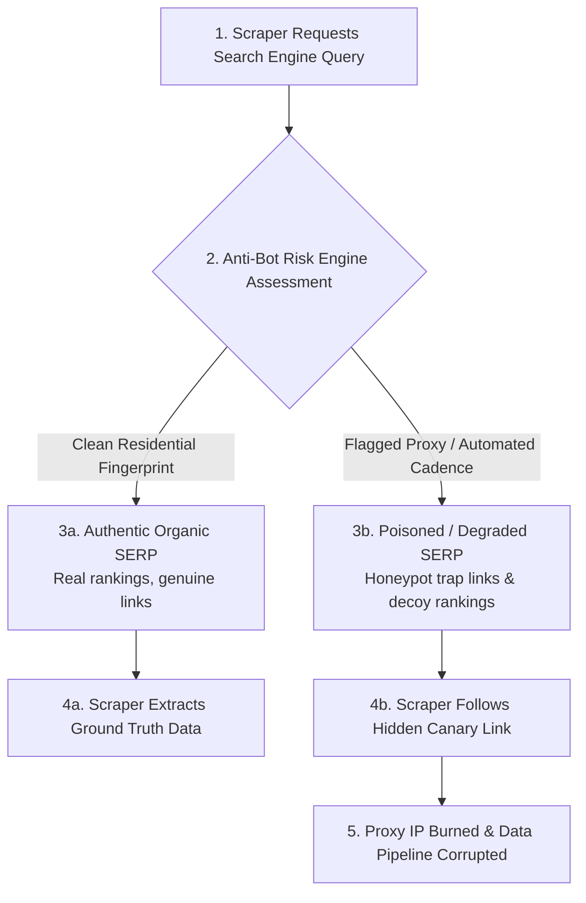

> **TL;DR:** Anti-bot systems and search engines deploy SERP poisoning—serving synthetic rankings, honeypot canary links, and cloaked landing pages—to silently corrupt scraper datasets and burn proxy pools. Defeat it with invisible element filtering, multi-probe consensus audits, and dual-persona DOM validation.



---

## 1. The Scraper's Nightmare: Why 403s Are Safe, but Poisoned SERPs Are Fatal

In data engineering, a `403 Forbidden` or `429 Too Many Requests` status code is a gift. It is loud, explicit, and unambiguous. When your worker encounters an HTTP 403, your proxy orchestrator immediately catches the exception, retires the request, rotates the proxy IP, and logs the incident.

**SERP Poisoning does not throw exceptions.** The HTTP status code is a crisp `200 OK`. The HTML payload arrives complete with valid doctypes, script tags, and search result containers. But the contents inside are subtly, maliciously poisoned.

```text
┌────────────────────────────────────────────────────────────────────────┐
│               EXPLICIT BLOCKS VS SILENT SERP POISONING                 │
├───────────────────────────────────┬────────────────────────────────────┤
│ EXPLICIT BLOCK (HTTP 403 / 429)   │ SERP POISONING (HTTP 200 OK)       │
├───────────────────────────────────┼────────────────────────────────────┤
│ • Exception raised immediately    │ • Silent success; zero alert fires │
│ • Proxy rotated automatically     │ • Corrupted data enters database   │
│ • No data recorded in pipeline    │ • ML models trained on fake inputs │
│ • Target acknowledges detection   │ • Scraper burns budget on garbage  │
└───────────────────────────────────┴────────────────────────────────────┘
```

Anti-scraping defense engines (Google, Cloudflare, Akamai, PerimeterX) increasingly favor silent poisoning over hard blocking for three tactical reasons:
1. **Economic Asymmetry:** A scraper that receives a 403 rotates in 200ms. A scraper that receives a 200 OK parses the page, downloads assets, processes text, and writes to storage—burning compute and residential proxy bandwidth on worthless data.
2. **Telemetry Infiltration:** By serving unique canary URLs in the poisoned search result, the defense engine tracks which downstream IPs crawl those specific honeypots, allowing them to map out and blacklist your entire proxy pool.
3. **Model & Decision Contamination:** If you scrape SERPs for price intelligence, competitor ranking tracking, or LLM pre-training, poisoned SERPs pollute your datasets with artificial ranking shifts and hallucinated entities without your team ever knowing.

---

## 2. The 3 Poisoning Vectors That Target Web Scrapers

Anti-scraping defenses deploy SERP poisoning across three distinct layers of the crawling lifecycle:

```text
┌────────────────────────────────────────────────────────────────────────┐
│                 SERP POISONING VECTORS TARGETING SCRAPERS              │
├───────────────────┬───────────────────┬────────────────────────────────┤
│ 1. CANARY HONEYPOTS│ 2. DEGRADED SERPS │ 3. TARGET CLOAKING GATES       │
│ Invisible trap    │ Synthetic results,│ Landings serve decoy HTML to   │
│ links in DOM to   │ randomized ranks, │ datacenter IPs while serving   │
│ flag scrapers.    │ dummy snippets.   │ real data to human browsers.   │
└───────────────────┴───────────────────┴────────────────────────────────┘
```

### Vector 1: Invisible Canary & Honeypot Links
To identify automated crawlers that naively harvest all `<a>` tags on a page, modern SERPs inject invisible trap links into the DOM. These anchors are hidden from real users via CSS:

```html
<!-- Real-world honeypot canary injected into SERP markup -->
<a href="/url?q=https://canary-telemetry-trap.net/token=8f9a2b" 
   style="display: none; visibility: hidden; opacity: 0; position: absolute; left: -9999px;" 
   tabindex="-1" aria-hidden="true" rel="nofollow">
   Sponsored Link Overview
</a>
```

A human user never sees this link, cannot click it, and will never request it. But a naive Python scraper using `[a['href'] for a in soup.find_all('a')]` pulls the link, schedules it into the crawling queue, and requests it. The moment your worker hits that URL, your proxy IP is flagged as a confirmed bot across the entire threat intelligence network.

### Vector 2: Synthetic & Scrambled SERP Layouts
When a search engine detects anomalous query velocity or suspicious TLS signatures that don't quite warrant a CAPTCHA, it shifts into a **degraded SERP mode**:
* The top 3 organic results are swapped with generic, non-authoritative domains or outdated cached snapshots.
* Rich snippets, local map packs, and knowledge graphs are omitted or populated with dummy text.
* Algorithmic rankings are subtly randomized so competitor rank-tracking software records volatile false ranking drops.

### Vector 3: Cloaked Target Landing Pages (TDS Gates)
Even if the SERP itself is clean, the destination websites listed in top search results frequently employ **Traffic Distribution Systems (TDS)** and SEO cloaking:


When your scraper follows an organic search link to scrape the target e-commerce or SaaS page, the target's edge firewall inspects the client:
* If the visitor has an AWS/GCP datacenter IP or missing browser runtime properties: The server serves a benign decoy page (Status 200) with dummy prices or empty catalog listings.
* If the visitor is a genuine human from a residential ISP: The server returns the real product catalog and pricing.

---

## 3. Why Naive Scrapers Fall into Every Poisoning Trap

Most scraping teams build extractors that assume web data is cooperative. They fall into three classic engineering pitfalls:

1. **Greedy Anchor Harvesting:** Extracting all links matching `a[href]` without inspecting computed CSS styles or parent container attributes.
2. **Single-Probe Trust:** Querying Google once from a single proxy and storing the result as absolute ground truth, completely blind to localized or canary-degraded SERP variants.
3. **Ignoring Redirect Chains:** Following HTTP 302 redirects blindly without analyzing the intermediary hops, allowing cloaking gateways to silently route scrapers into infinite pagination loops or honeypot domains.

---

## 4. The Scraper's Defense Blueprint: 5 Engineering Tactics

To build a resilient SERP scraping pipeline that survives poisoned results and honeypot traps, implement this five-layer defensive filter:

| Defensive Layer | Tactical Mechanism | What It Prevents |
| :--- | :--- | :--- |
| **DOM Filter** | **Zero-Pixel & Hidden Element Pruning** | Strips invisible canary links before parsing URLs. |
| **Container Anchor** | **Strict Organic Result Sandboxing** | Extracts links strictly from verified organic blocks (`div.g`). |
| **Consensus Engine** | **Multi-Probe Dual-ASN Auditing** | Detects synthetic SERPs by comparing results across distinct subnets. |
| **Persona Audit** | **Dual-Persona Landing Page Diffing** | Compares lightweight HTTP response vs headless browser DOM to catch cloaking. |
| **Safety Jail** | **Download & Executable Interception** | Aborts `.exe`, `.msi`, `.iso`, and `.zip` payloads in browser runners. |

### Tactic 1: Filtering Invisible Elements Before Extraction
Before parsing URLs, remove every element carrying CSS styles indicative of off-screen or invisible honeypot anchors. Check both inline attributes and class rules:
* `display: none`
* `visibility: hidden`
* `opacity: 0`
* `height: 0px` / `width: 0px`
* `left: -9999px` / `top: -9999px`
* `aria-hidden="true"` on parent wrapper links

### Tactic 2: Strict Parent Container Scoping
Never execute global anchor queries across the entire document (`soup.find_all('a')`). In Google SERPs, organic results live inside strict container hierarchies:
* Locate verified organic containers (e.g. `div.g` or elements containing `h3` tags with clean ping attributes).
* Validate that the target link possesses a valid visible title child element.
* Reject orphan links that exist outside the organic hierarchy.

### Tactic 3: Multi-Probe Consensus Verification
For critical queries (such as price benchmarks or brand monitoring), deploy a **Consensus Scraper**:
* Dispatch the identical query simultaneously through two independent proxy pools (e.g. Residential Pool A on Comcast vs Residential Pool B on AT&T).
* Compute the **Jaccard Similarity** of the top 10 returned URLs:

$$\text{Jaccard}(A, B) = \frac{|A \cap B|}{|A \cup B|}$$

* If Jaccard similarity is $\ge 0.8$, the SERP is considered clean ground truth.
* If similarity is $< 0.5$, one of the workers was served a poisoned or localized canary SERP. Quarantine the result and re-sample.

---

## 5. Production Python Implementation: Poison-Resistant SERP Parser

Here is a complete, production-grade parser using `curl_cffi` that implements hidden honeypot pruning, strict organic container scoping, and redirect validation:

```python
import re
from urllib.parse import urlparse, parse_qs, unquote
from bs4 import BeautifulSoup
from curl_cffi import requests

def is_hidden_element(tag) -> bool:
    """Detects CSS and attribute patterns commonly used in honeypot canary links."""
    style = tag.get("style", "").lower().replace(" ", "")
    hidden_patterns = [
        "display:none",
        "visibility:hidden",
        "opacity:0",
        "font-size:0",
        "left:-",
        "top:-",
        "width:0",
        "height:0"
    ]
    if any(pat in style for pat in hidden_patterns):
        return True
    
    # Check accessibility hiding attributes
    if tag.get("aria-hidden") == "true" or tag.get("tabindex") == "-1":
        return True
        
    return False

def clean_google_url(raw_href: str) -> str:
    """Decodes Google /url?q= wrapper redirects and strips tracking parameters."""
    if raw_href.startswith("/url?"):
        parsed = urlparse(raw_href)
        query_params = parse_qs(parsed.query)
        if "q" in query_params:
            return query_params["q"][0]
    return raw_href

def extract_clean_serp_results(query: str, proxy: str = None) -> list:
    """
    Fetches Google search results with TLS impersonation, prunes honeypots,
    and returns validated organic search listings.
    """
    url = f"https://www.google.com/search?q={query}&hl=en&num=10"
    headers = {
        "User-Agent": "Mozilla/5.0 (Windows NT 10.0; Win64; x64) AppleWebKit/537.36 (KHTML, like Gecko) Chrome/124.0.0.0 Safari/537.36",
        "Accept-Language": "en-US,en;q=0.9",
        "Accept": "text/html,application/xhtml+xml,application/xml;q=0.9,*/*;q=0.8"
    }

    resp = requests.get(
        url,
        impersonate="chrome124",
        headers=headers,
        proxies={"http": proxy, "https": proxy} if proxy else None,
        timeout=15
    )
    
    if resp.status_code != 200:
        raise RuntimeError(f"SERP fetch failed with status {resp.status_code}")

    soup = BeautifulSoup(resp.text, "html.parser")
    validated_results = []
    
    # Target verified organic result containers (div.g or search blocks containing h3)
    containers = soup.select("div.g, div[data-hveid]")
    
    for container in containers:
        # Check if the container itself is hidden
        if is_hidden_element(container):
            continue
            
        h3 = container.find("h3")
        anchor = container.find("a", href=True)
        
        if not h3 or not anchor:
            continue
            
        # Verify anchor visibility
        if is_hidden_element(anchor):
            continue
            
        clean_url = clean_google_url(anchor["href"])
        title = h3.get_text(strip=True)
        
        # Filter internal Google navigation or malformed links
        if not clean_url.startswith("http") or "google.com" in clean_url:
            continue
            
        validated_results.append({
            "rank": len(validated_results) + 1,
            "title": title,
            "url": clean_url
        })
        
    return validated_results

# Example Usage:
# results = extract_clean_serp_results("best residential proxies")
# for item in results:
#     print(f"#{item['rank']}: {item['title']} -> {item['url']}")
```

---

## 6. The Scraper Engineer's Checklist Against SERP Poisoning

- [ ] **Never Harvest Bare `<a>` Tags:** Always scope selectors to confirmed organic result cards (`div.g`) and verify that an active, visible headline (`<h3>`) is present.
- [ ] **Drop Hidden CSS Styles:** Check for `display:none`, `visibility:hidden`, and negative coordinate offsets before following any URL.
- [ ] **Run Dual-Probe Consensus Audits:** For sensitive scraping tasks, verify that results match across distinct proxy ASNs before committing rows to your production database.
- [ ] **Block Binary File Downloads in Headless Browsers:** Configure CDP (`Page.setDownloadBehavior`) to deny file downloads and reject `.exe`, `.msi`, `.iso`, and `.zip` requests.
- [ ] **Audit Redirect Trails:** Inspect HTTP 302 chains for traffic distribution gateways that serve different DOMs based on incoming IP reputation.
