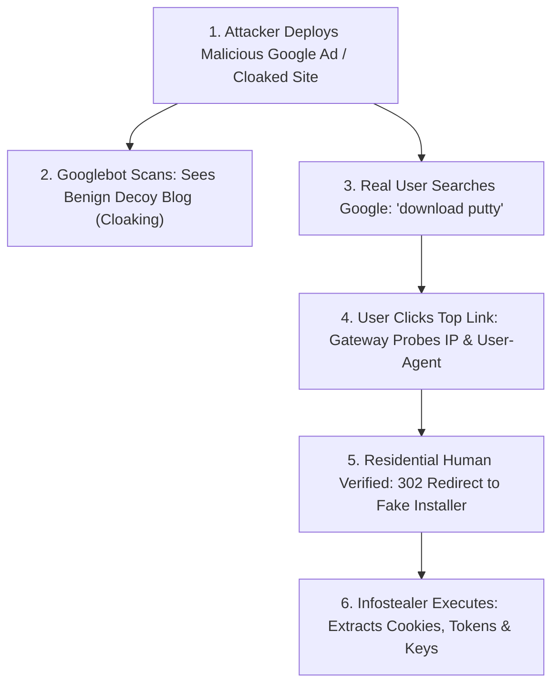
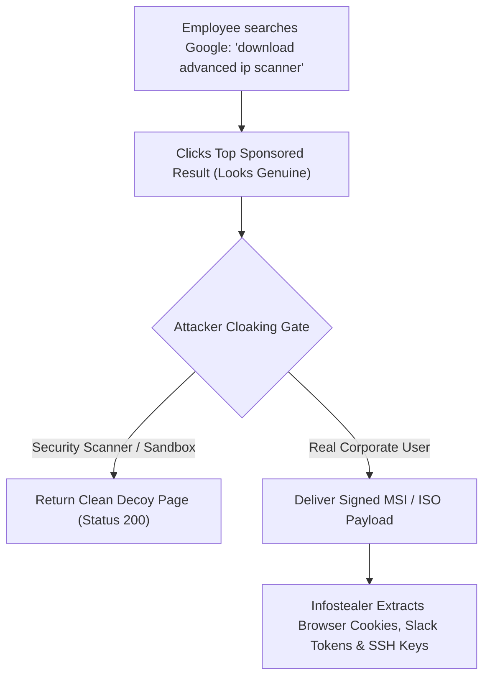

> **TL;DR:** Attackers hijack Google search results and sponsored ads for tools like PuTTY and VLC, using cloaking to serve clean pages to crawlers while redirecting real users to infostealers. Defend with protective DNS filtering, ad-blockers, and package managers.



---

## 1. The Anatomy of SERP Poisoning: 3 Attack Vectors

Attackers hijack search engine results pages using three primary deployment vectors:

```text
┌────────────────────────────────────────────────────────────────────────┐
│                        SERP POISONING VECTORS                          │
├───────────────────┬───────────────────┬────────────────────────────────┤
│ 1. MALVERTISING   │ 2. SEO CLOAKING   │ 3. AGED DOMAIN HIJACKING       │
│ Bidding on Google │ Serving clean     │ Purchasing expired authority   │
│ Sponsored Ads to  │ pages to crawlers │ domains with established       │
│ bypass organic SEO│ and malware to us.│ PageRank and backlink equity.  │
└───────────────────┴───────────────────┴────────────────────────────────┘
```

### Vector 1: Google Ads Malvertising (The Fast Path)
Rather than waiting months for organic search engine optimization, threat actors purchase sponsored ads via Google Ads or Bing Ads:
* Attackers bid on exact-match keywords: `"download OBS studio"`, `"keepass windows 11"`.
* They exploit Google's display URL mismatch: the ad displays `www.putty.org`, but the actual tracking link routes through an attacker-controlled redirect gateway.
* Because sponsored ads sit above all organic search results, users click the fraudulent link before seeing the genuine open-source homepage.

### Vector 2: SEO Cloaking (The Crawler Bypass)
Search engine crawlers evaluate pages to detect malware. To evade Google Safe Browsing and Microsoft SmartScreen, attackers employ **conditional cloaking**:
* If `User-Agent` contains `Googlebot` or `IP` belongs to a Google cloud ASN: The server serves a 100% clean, harmless WordPress article about photography or gardening.
* If the visitor arrives from a real residential ISP with a Google referrer header (`Referer: https://www.google.com/`): The server returns a 302 redirect to a weaponized payload server.

### Vector 3: Hijacking Expired High-Authority Domains
Attackers acquire expired domains that previously belonged to universities, government agencies, or established publications. Because these domains retain historical PageRank and thousands of trusted backlinks, search algorithms immediately trust them, allowing malicious download hubs to rank on Google's first page within days.

---

## 2. Why SERP Poisoning Bypasses Traditional Security

Corporate networks spend millions on email security gateways (Proofpoint, Mimecast) to quarantine malicious attachments and phishing links. 

SERP poisoning completely bypasses the email gateway because **the attack is initiated by the user**:



1. **High User Intent:** The user actively wants the software. They willingly click *"Keep anyway"* or ignore Windows SmartScreen warnings because they assume Google vetted the top link.
2. **Valid Code Signing:** Attackers increasingly sign malicious installers with stolen or illicitly purchased Sectigo/DigiCert certificates, bypassing basic operating system security prompts.
3. **Instant Cookie Theft:** The payload is typically an infostealer (Lumma, RedLine, Vidar). Within 800 milliseconds of execution, the malware dumps all session cookies, Chrome passwords, and active Slack/AWS tokens to a Telegram bot or C2 server.

---

## 3. The Technical Defense Blueprint: Enterprise Remedies

Defending against SERP poisoning requires a multi-layered defense architecture across DNS, endpoint policies, and automated monitoring.

| Layer | Defensive Mechanism | Technical Implementation |
| :--- | :--- | :--- |
| **DNS Layer** | **Protective DNS Filtering** | Block newly registered domains (< 30 days old) and dynamic DNS gateways via Cloudflare Gateway, Quad9, or Cisco Umbrella. |
| **Browser Layer** | **Enforced Ad-Blocking** | Deploy centralized enterprise policies (via Google Workspace or Intune) enforcing uBlock Origin, suppressing malicious sponsored ad carousels entirely. |
| **Endpoint Layer** | **Application Allowlisting & AppLocker** | Restrict execution of downloaded executables in `AppData` or `Downloads` directories; enforce WDAC (Windows Defender Application Control). |
| **Network Layer** | **TLS Inspection of Referrer Headers** | Detect outbound requests containing search engine referrers connecting to unclassified foreign IP addresses. |

---

## 4. Building an Automated SERP Poisoning Canary Scanner

If you maintain an open-source project or manage brand security, you can detect when attackers begin bidding on or poisoning your keywords using an automated Python monitoring pipeline:

```python
import re
from curl_cffi import requests
from bs4 import BeautifulSoup

def audit_serp_for_poisoning(target_keyword: str, legitimate_domain: str):
    """
    Crawls Google Search for a keyword and flags suspicious domains
    occupying top organic and sponsored positions.
    """
    url = f"https://www.google.com/search?q={target_keyword}"
    headers = {
        "User-Agent": "Mozilla/5.0 (Windows NT 10.0; Win64; x64) AppleWebKit/537.36 Chrome/124.0.0.0"
    }
    
    # Use Chrome TLS impersonation to receive genuine SERP HTML
    resp = requests.get(url, impersonate="chrome124", headers=headers)
    if resp.status_code != 200:
        print(f"[!] Failed to fetch SERP: {resp.status_code}")
        return

    soup = BeautifulSoup(resp.text, "html.parser")
    links = []

    # Extract all external search result links
    for a in soup.find_all("a", href=True):
        href = a["href"]
        if href.startswith("http") and "google.com" not in href:
            links.append(href)

    print(f"\n[+] Auditing SERP for query: '{target_keyword}'")
    for idx, link in enumerate(links[:5], 1):
        is_legit = legitimate_domain in link
        flag = "[OK] LEGITIMATE" if is_legit else "[!] SUSPICIOUS DOMAIN"
        print(f"  Rank #{idx}: {flag} -> {link}")

# Example: Check if the top result for 'putty download' points to the official site
audit_serp_for_poisoning("putty download", "putty.org")
```

---

## 1-Minute Action Plan for Developers & System Admins

1. **Never click sponsored Google Ads for software downloads:** Scroll down past the "Sponsored" section to the verified organic domain.
2. **Deploy an ad-blocker across all company machines:** Eliminating search ads neutralizes 85% of malvertising delivery channels.
3. **Use package managers instead of web downloads:** On Windows, install software via `winget install <tool>`; on macOS, use `brew install <tool>`. Package managers pull from audited manifest repositories with verified SHA-256 hashes.
4. **Monitor your brand's search results:** If you maintain software, set up daily SERP monitors to catch malicious clones before they compromise your users.
