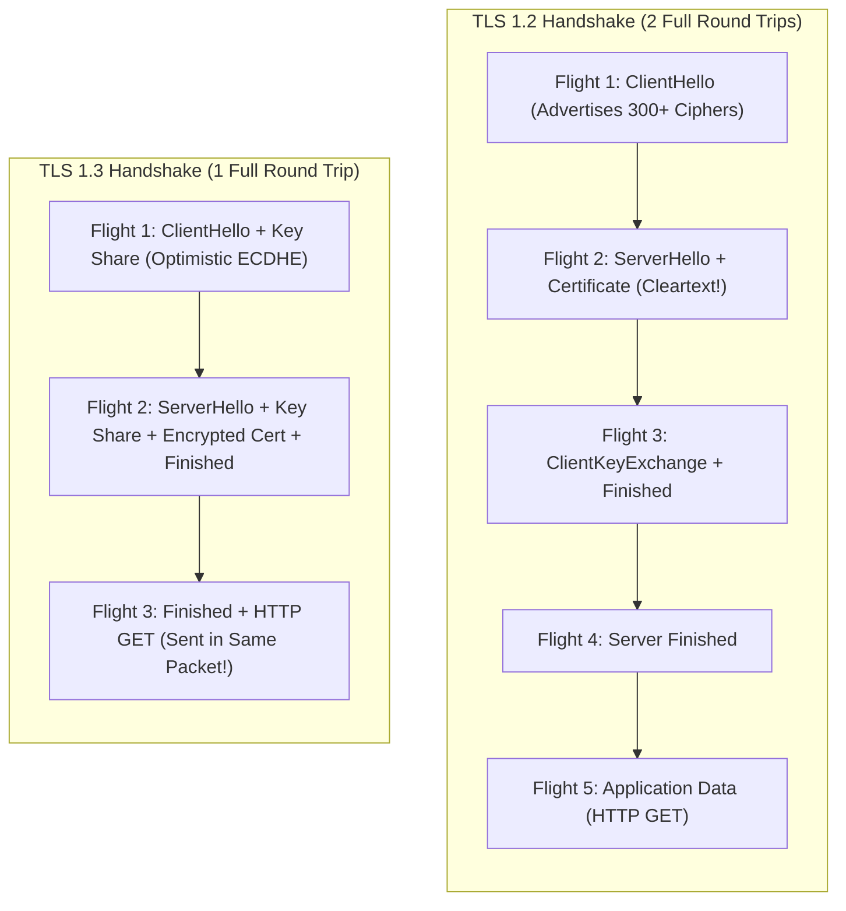

> **TL;DR:** TLS 1.3 halves handshake latency from 2-RTT to 1-RTT, encrypts server certificates on the wire, and purges insecure legacy cipher suites in favor of mandatory Perfect Forward Secrecy.

---

## TLS 1.2 vs TLS 1.3 at a Glance

<div class="vs-cards">
  <div class="vs-card v12">
    <div class="vs-card-header">
      <h3>TLS 1.2</h3>
      <span class="vs-tag legacy">Legacy (2008)</span>
    </div>
    <div class="vs-feature-list">
      <div class="vs-feature-item">
        <div class="vs-feature-title">
          <span class="vs-icon">⏱️</span>
          <strong>2-RTT Handshake</strong>
        </div>
        <p class="vs-feature-desc">Needs two full round trips (ping-pong) before data flows.</p>
      </div>
      <div class="vs-feature-item">
        <div class="vs-feature-title">
          <span class="vs-icon">🔓</span>
          <strong>Cleartext Metadata</strong>
        </div>
        <p class="vs-feature-desc">Server certificates and extensions sent unencrypted.</p>
      </div>
      <div class="vs-feature-item">
        <div class="vs-feature-title">
          <span class="vs-icon">⚠️</span>
          <strong>300+ Cipher Suites</strong>
        </div>
        <p class="vs-feature-desc">Bloated with weak algorithms (CBC, RC4, static RSA).</p>
      </div>
      <div class="vs-feature-item">
        <div class="vs-feature-title">
          <span class="vs-icon">⏳</span>
          <strong>Optional Forward Secrecy</strong>
        </div>
        <p class="vs-feature-desc">Stolen private keys can decrypt recorded historical traffic.</p>
      </div>
      <div class="vs-feature-item">
        <div class="vs-feature-title">
          <span class="vs-icon">🚫</span>
          <strong>Incompatible with HTTP/3</strong>
        </div>
        <p class="vs-feature-desc">Cannot run on top of modern QUIC transport.</p>
      </div>
    </div>
  </div>

  <div class="vs-card v13">
    <div class="vs-card-header">
      <h3>TLS 1.3</h3>
      <span class="vs-tag modern">Modern Standard (2018)</span>
    </div>
    <div class="vs-feature-list">
      <div class="vs-feature-item">
        <div class="vs-feature-title">
          <span class="vs-icon">⚡</span>
          <strong>1-RTT Handshake</strong>
        </div>
        <p class="vs-feature-desc">Halves connection time; 0-RTT on returning visits.</p>
      </div>
      <div class="vs-feature-item">
        <div class="vs-feature-title">
          <span class="vs-icon">🔒</span>
          <strong>Encrypted Metadata</strong>
        </div>
        <p class="vs-feature-desc">Server certificates and extensions are shielded.</p>
      </div>
      <div class="vs-feature-item">
        <div class="vs-feature-title">
          <span class="vs-icon">🛡️</span>
          <strong>5 Clean AEAD Ciphers</strong>
        </div>
        <p class="vs-feature-desc">Modern, bulletproof authenticated encryption.</p>
      </div>
      <div class="vs-feature-item">
        <div class="vs-feature-title">
          <span class="vs-icon">🔑</span>
          <strong>Mandatory Forward Secrecy</strong>
        </div>
        <p class="vs-feature-desc">Ephemeral Diffie-Hellman enforced by default.</p>
      </div>
      <div class="vs-feature-item">
        <div class="vs-feature-title">
          <span class="vs-icon">🚀</span>
          <strong>Native HTTP/3 Support</strong>
        </div>
        <p class="vs-feature-desc">Embedded directly into QUIC UDP packets.</p>
      </div>
    </div>
  </div>
</div>

---

## 1. The Core Security Triad

Without TLS, network traffic travels in plain text across public routers and ISPs. TLS guarantees three fundamental security properties:

<div class="layer-stack">
  <div class="layer-item">
    <span class="layer-name">Application Layer</span>
    <span class="layer-desc">HTTP/2, HTTP/3, WebSockets, REST APIs</span>
  </div>
  <div class="layer-item active-layer">
    <span class="layer-name">Security Layer: TLS 1.2 / 1.3</span>
    <span class="layer-desc">Encryption, Authentication, Tamper Sealing</span>
  </div>
  <div class="layer-item">
    <span class="layer-name">Transport Layer</span>
    <span class="layer-desc">TCP (Streams) or UDP (QUIC)</span>
  </div>
  <div class="layer-item">
    <span class="layer-name">Internet Layer</span>
    <span class="layer-desc">IP Packet Routing</span>
  </div>
</div>

| Pillar | Threat Prevented | How It Works |
| :--- | :--- | :--- |
| **Confidentiality** | Eavesdropping & Packet Sniffing | Encrypts payload data with symmetric ciphers (AES-GCM, ChaCha20-Poly1305). |
| **Authentication** | Impersonation & MITM Attacks | Uses X.509 certificates and asymmetric signatures to verify server identity. |
| **Integrity** | Packet Tampering & Injection | Signs every record with Authenticated Encryption (AEAD) to detect tampering. |

---

## 2. Interactive Handshake Simulator: The Ping-Pong Problem

Packets take physical time to travel across fiber lines and cell towers. Use the interactive simulator below to watch packets bounce diagonally back and forth across the wire:



---

## 3. Handshake Architecture: 2-RTT vs 1-RTT

Why does TLS 1.2 feel noticeably slower than TLS 1.3 on mobile connections? The answer lies in how cryptographic keys are negotiated.



* **TLS 1.2 (2-RTT):** Cipher negotiation and key derivation occur sequentially. Application data cannot transmit until the 5th flight.
* **TLS 1.3 (1-RTT):** Because modern clients use known elliptic curves (e.g. `X25519`), the browser sends its key share immediately in `ClientHello`. The server accepts it, encrypts its certificate, and attaches HTTP data to Flight 3.

---

## 4. Performance Benchmarks

{% include chart.html type="columns" title="Round Trips Wasted Before First Web Byte (Lower is Better)" labels="TLS 1.2 (Legacy)|TLS 1.3 (Modern)|TLS 1.3 Resumption (0-RTT)" values="2|1|0" suffix=" RTT" scale="2" highlight="TLS 1.3 Resumption (0-RTT)" note="TLS 1.3 cuts network round-trip setup delay by 50% to 100%." %}



---

## 5. Comprehensive Feature Comparison Table

| Technical Dimension | TLS 1.2 (RFC 5246) | TLS 1.3 (RFC 8446) |
| :--- | :--- | :--- |
| **Initial Connection Latency** | 2-RTT (4 packet flights before data) | **1-RTT** (Optimistic key share) |
| **Session Resumption** | 1-RTT (Session Tickets / IDs) | **0-RTT** (Pre-Shared Key Early Data) |
| **Certificate Visibility** | Plain text (Visible to Wi-Fi sniffers) | **Encrypted** (Shielded after ServerHello) |
| **Forward Secrecy (PFS)** | Optional (Static RSA skips PFS) | **Mandatory** (Ephemeral DHE/ECDHE only) |
| **Cipher Suite Architecture** | 300+ monolithic combinations | **5 standardized AEAD suites** |
| **Legacy Vulnerabilities** | Prone to POODLE, BEAST, Lucky13 | **Immune by design** (Vulnerable primitives deleted) |
| **HTTP/3 & QUIC Support** | ❌ Incompatible | **Native Foundation** (Embedded in QUIC) |
| **Client Hello Fingerprinting** | Cleartext `ClientHello` (JA3 / JA4) | Cleartext `ClientHello` (JA3 / JA4 still active) |

---

## 6. How Anti-Bot Systems Fingerprint TLS (JA3 & JA4)

If you configure realistic Chrome headers in Python `requests`, edge firewalls (Cloudflare, Akamai) still block you with `403 Forbidden`.

Why? Because your **TLS fingerprint speaks before your HTTP headers arrive**.

<div class="ja3-pipeline">
  <div class="ja3-packet-card">
    <div class="ja3-card-header">
      <span class="pill pill-info">Layer 5/6 Record</span>
      <strong>ClientHello Packet Parameters</strong>
    </div>
    <ul class="ja3-fields">
      <li><span class="f-num">1</span> <span><strong>TLS Version:</strong> <code>0x0303</code> (TLS 1.2 or 1.3)</span></li>
      <li><span class="f-num">2</span> <span><strong>Accepted Ciphers:</strong> Ordered list of cipher suite IDs</span></li>
      <li><span class="f-num">3</span> <span><strong>Extensions:</strong> SNI, ALPN (<code>h2</code>), Supported Groups, Key Shares</span></li>
      <li><span class="f-num">4</span> <span><strong>Elliptic Curves:</strong> <code>X25519</code>, <code>secp256r1</code></span></li>
      <li><span class="f-num">5</span> <span><strong>Point Formats:</strong> Uncompressed curve formats</span></li>
    </ul>
  </div>
  <div class="ja3-arrow">
    <span class="ja3-hash-label">MD5 Cryptographic Hash</span>
    <span class="ja3-down-icon">↓</span>
  </div>
  <div class="ja3-result-card">
    <span class="ja3-tag">JA3 Fingerprint</span>
    <code>b32309a26951912be7dba376398abc3b</code>
  </div>
</div>

### Interactive Fingerprint Lab: Build a Client

Drag parts into the packet to watch which parameter betrays your scraper:



### 4-Way Client Signature Breakdown

| Client | Cryptographic Engine | GREASE Extensions | ALPN Support | Extension Sequence | Anti-Bot Verdict |
| :--- | :--- | :--- | :--- | :--- | :--- |
| **Python `requests`** | OpenSSL (urllib3) | ❌ Absent | ❌ No `h2` | OpenSSL default | 🚨 **Instant Bot Flag** |
| **`curl`** | OpenSSL / LibreSSL | ❌ Absent | ⚠️ Only with `--http2` | Minimal CLI set | 🚨 **Flagged as Automated** |
| **Google Chrome** | BoringSSL | ✅ Injected (`0x?a?a`)| ✅ `h2`, `http/1.1` | Chrome order | ✅ **Legitimate Human** |
| **Mozilla Firefox** | NSS Engine | ❌ Absent | ✅ `h2`, `http/1.1` | Firefox order | ✅ **Legitimate Human** |

---

## 7. Hands-On Verification CLI

Inspect the TLS version and cipher negotiation of any domain from your terminal:

```bash
# Force TLS 1.3 and inspect connection output
curl -Iv --tlsv1.3 --tls-max 1.3 https://cloudflare.com/ 2>&1 | grep -E "SSL connection|Server certificate"
```

```bash
# Query negotiated protocol with openssl
openssl s_client -connect cloudflare.com:443 -tls1_3 </dev/null 2>/dev/null | grep -E "Protocol|Cipher|Key shares"
```

---

## Production Takeaways for Architects

1. **Enable TLS 1.3 by default:** All modern CDNs (Cloudflare, Fastly, AWS CloudFront) and reverse proxies (Nginx, Caddy, Envoy) support TLS 1.3 out of the box.
2. **Retire TLS 1.0 and 1.1:** Formally deprecated by RFC 8996 and forbidden by PCI DSS compliance standards.
3. **Keep TLS 1.2 with ECDHE for legacy devices:** Safely support legacy embedded clients and smart TVs by enforcing ephemeral Diffie-Hellman (`ECDHE`) and modern AEAD ciphers.
4. **Align TLS with User-Agent:** When building scrapers or API tools, ensure your TLS handshake matches your claimed browser version using tools like `curl_cffi` or Playwright.
