<style>
.content p, .post-content p {
  text-align: left;
}
.kpi-strip {
  display: grid;
  grid-template-columns: repeat(4, minmax(0, 1fr));
  gap: 12px;
  margin: 1.25rem 0 1.5rem;
}
@media (max-width: 720px) {
  .kpi-strip { grid-template-columns: repeat(2, minmax(0, 1fr)); }
}
@media (max-width: 440px) {
  .kpi-strip { grid-template-columns: 1fr; }
}
.kpi-card {
  background: var(--paper-sunk);
  border: 1px solid var(--rule);
  border-top: 2px solid var(--accent);
  border-radius: 6px;
  padding: 12px 14px;
}
.kpi-label {
  font-family: var(--mono);
  font-size: 0.68rem;
  letter-spacing: 0.06em;
  text-transform: uppercase;
  color: var(--ink-faint);
  margin: 0 0 6px;
}
.kpi-val {
  font-family: var(--mono);
  font-size: 1.15rem;
  font-weight: 600;
  color: var(--ink);
  margin: 0 0 4px;
}
.kpi-sub {
  font-size: 0.78rem;
  color: var(--ink-soft);
  margin: 0;
  line-height: 1.35;
}
.apology-note {
  background: var(--paper-sunk);
  border: 1px solid var(--rule);
  border-left: 3px solid var(--accent);
  border-radius: 6px;
  padding: 12px 16px;
  margin: 1.25rem 0;
  font-size: 0.94rem;
  line-height: 1.55;
}
.apology-note strong {
  color: var(--ink);
}
.comm-card {
  background: var(--paper-sunk);
  border: 1px solid var(--rule);
  border-radius: 8px;
  padding: 16px 18px;
  margin: 1.25rem 0 1.75rem;
}
.comm-meta {
  display: flex;
  flex-wrap: wrap;
  gap: 8px 14px;
  font-family: var(--mono);
  font-size: 0.75rem;
  color: var(--ink-soft);
  margin-bottom: 12px;
  padding-bottom: 10px;
  border-bottom: 1px solid var(--rule);
}
.comm-shot {
  margin: 12px 0;
  border-radius: 6px;
  overflow: hidden;
  border: 1px solid var(--rule);
}
.comm-shot img {
  display: block;
  width: 100%;
  height: auto;
  margin: 0;
}
.comm-caption {
  font-size: 0.78rem;
  color: var(--ink-faint);
  margin-top: 6px;
}
</style>

> **TL;DR:** Bot guards update almost every day, and the race between bot guards and scrapers never stops. Keeping up alone is tough. Here is my personal list of YouTube channels, Discord servers, subreddits, blogs, and events that help me stay connected, learn new tricks, and stay ahead.

Web scraping changes fast. One week your script runs smoothly, and the next week a bot guard updates its TLS check, browser fingerprint, or challenge page. Because this bot-guard vs. anti-bot-guard race keeps moving every day, **community is what keeps you ahead**. When you hang out where other scraper builders share what just broke and what still works, you save hours of guessing—and you never feel left out.

> #### ⚡ Quick Pick: Where to Hang Out
> - **Want fast chat & help?** Jump into Discord ([Extract Data](https://discord.com/invite/extract-data-community-993441606642446397), [Scrapy](https://discord.com/invite/mv3yErfpvq), or [Oxylabs](https://discord.com/invite/6jkDvaC9dS)).
> - **Want open discussions?** Browse Reddit ([r/webscraping](https://www.reddit.com/r/webscraping/) or [r/WebScrapingInsider](https://www.reddit.com/r/WebScrapingInsider/)).
> - **Learn best by watching?** Follow [Apify](https://www.youtube.com/@Apify), [The Web Scraping Guy](https://www.youtube.com/@the-web-scraping-guy), [WebHarvy](https://www.youtube.com/@WebharvyVideos), and [ScrapeStorm](https://www.youtube.com/@scrapestorm).
> - **Want deep guides?** Read the [Zyte](https://www.zyte.com/blog/), [Apify](https://blog.apify.com/), and [ScrapingBee](https://www.scrapingbee.com/blog/) blogs.

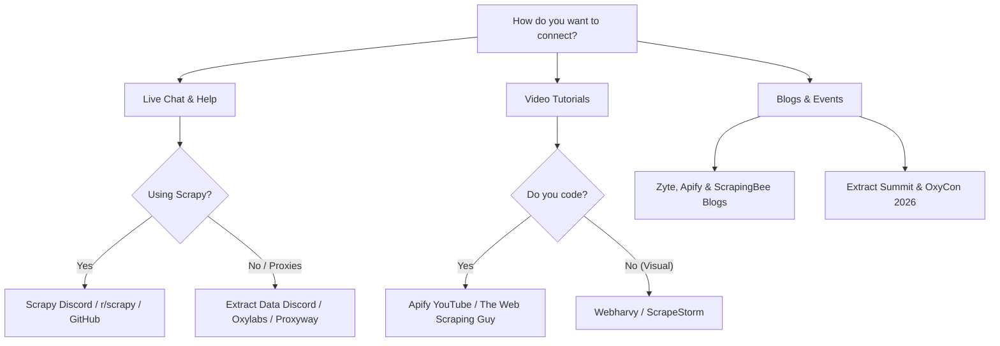

<div class="kpi-strip">
  <div class="kpi-card">
    <div class="kpi-label">Biggest Discord</div>
    <div class="kpi-val">21,008</div>
    <p class="kpi-sub">Members in Extract Data Community</p>
  </div>
  <div class="kpi-card">
    <div class="kpi-label">Top YouTube</div>
    <div class="kpi-val">44.4K</div>
    <p class="kpi-sub">Subscribers on Apify (323 videos)</p>
  </div>
  <div class="kpi-card">
    <div class="kpi-label">Stack Overflow</div>
    <div class="kpi-val">51,600+</div>
    <p class="kpi-sub">Questions tagged <code>web-scraping</code></p>
  </div>
  <div class="kpi-card">
    <div class="kpi-label">2026 Events</div>
    <div class="kpi-val">2 Major</div>
    <p class="kpi-sub">Extract Summit &amp; OxyCon (3,000+ attendees)</p>
  </div>
</div>

<div class="apology-note">
  <strong>A quick apology:</strong> There are so many great scraping groups out there, and I could not list every single one here. If your favorite YouTube channel, Discord server, or blog is missing right now, I am really sorry! This is just my growing list of friendly, active spaces—send me your favorites and I will happily add them.
</div>

---

## YouTube Channels

Seeing how someone builds a scraper step by step makes everything click much faster. Here are the channels I like keeping in my feed.

### 1. Apify (`@Apify`)

<div class="comm-card">
  <div class="comm-meta">
    <span><strong>Channel:</strong> <a href="https://www.youtube.com/@Apify/videos" target="_blank" rel="noopener">youtube.com/@Apify</a></span>
    <span><strong>Subscribers:</strong> 44.4K</span>
    <span><strong>Videos:</strong> 323</span>
    <span><strong>Playlists:</strong> 26</span>
  </div>
  <div class="comm-shot">
    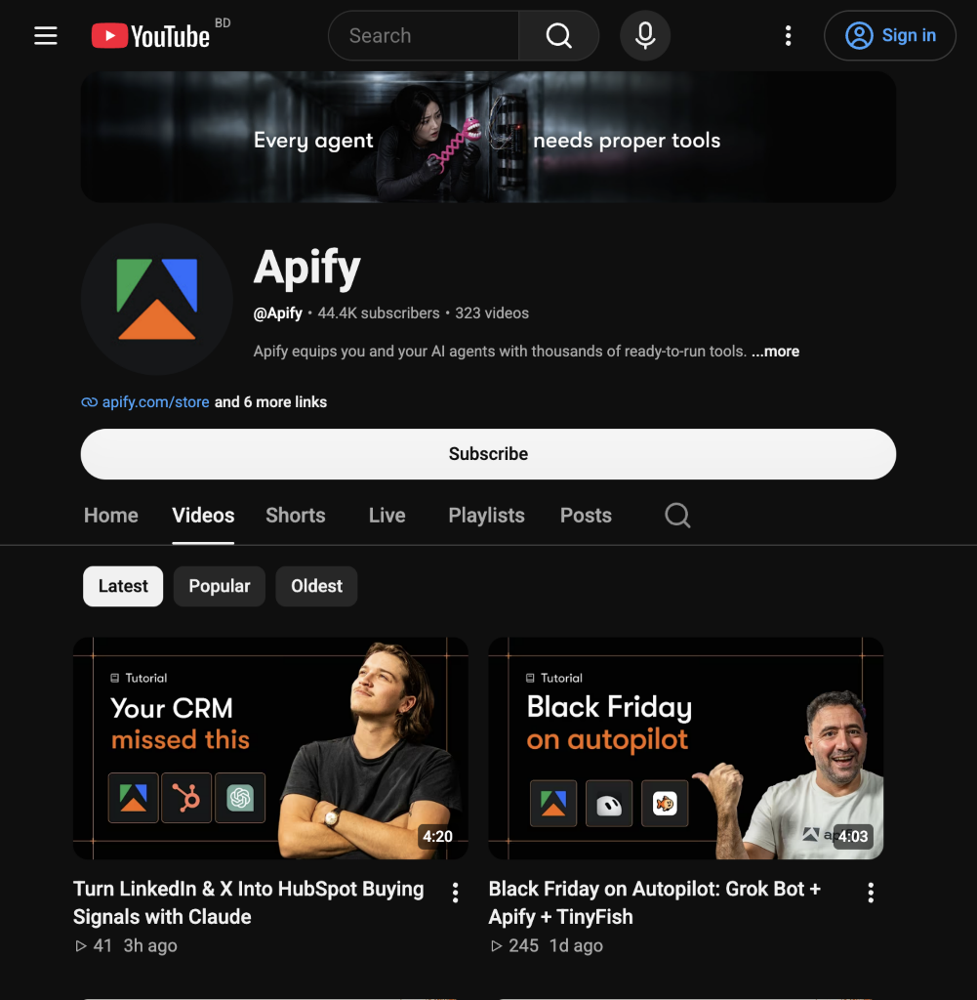
  </div>
  <p class="comm-caption">Apify YouTube channel — super active with AI agents, MCP, and Crawlee tutorials.</p>

  <p><strong>Recent Videos:</strong> <em>Turn LinkedIn &amp; X Into HubSpot Buying Signals with Claude</em> · <em>Black Friday on Autopilot: Grok Bot + Apify + TinyFish</em> · <em>Agents as First-Class Citizens (Run by Apify 2026)</em> · <em>Server Actors, Sandboxes, and the Tools Every Agent Needs</em>.</p>
  <p><strong>Popular Playlists:</strong> <em>AI Agents &amp; MCP</em>, <em>Crawlee &amp; Apify SDK</em>, <em>Python</em>, <em>Prague Crawl 2026</em>, plus dedicated playlists for Google, Instagram, TikTok, and YouTube scraping.</p>
</div>

### 2. Adrian | The Web Scraping Guy (`@the-web-scraping-guy`)

<div class="comm-card">
  <div class="comm-meta">
    <span><strong>Channel:</strong> <a href="https://www.youtube.com/@the-web-scraping-guy/videos" target="_blank" rel="noopener">youtube.com/@the-web-scraping-guy</a></span>
    <span><strong>Subscribers:</strong> 4.15K</span>
    <span><strong>Videos:</strong> 122</span>
  </div>
  <div class="comm-shot">
    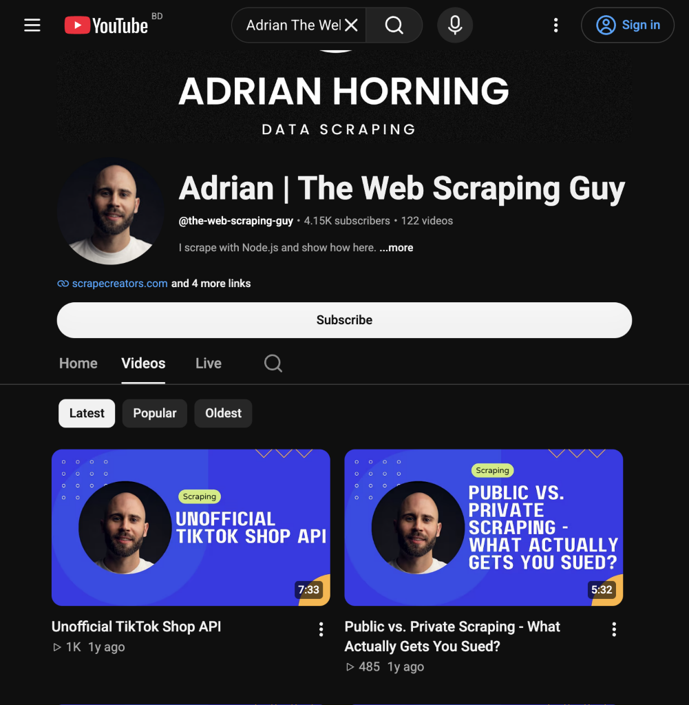
  </div>
  <p class="comm-caption">Adrian | The Web Scraping Guy — practical Node.js and social API builds.</p>

  <p><strong>Recent Videos:</strong> <em>Unofficial TikTok Shop API</em> · <em>Public vs. Private Scraping - What Actually Gets You Sued?</em> · <em>Truth Social API</em> · <em>How to build an N8N Community Node</em> · <em>STEAL your competitors Facebook Ads with this FREE AI Tool</em>.</p>
  <p><strong>Popular Topics:</strong> No playlists tab, but his 122 videos are packed with Node.js scraping, social media APIs, Meta/LinkedIn ad libraries, and scraping law basics.</p>
</div>

### 3. ScrapeStorm (`@scrapestorm`)

<div class="comm-card">
  <div class="comm-meta">
    <span><strong>Channel:</strong> <a href="https://www.youtube.com/@scrapestorm/videos" target="_blank" rel="noopener">youtube.com/@scrapestorm</a></span>
    <span><strong>Subscribers:</strong> 813</span>
    <span><strong>Videos:</strong> 181</span>
  </div>
  <div class="comm-shot">
    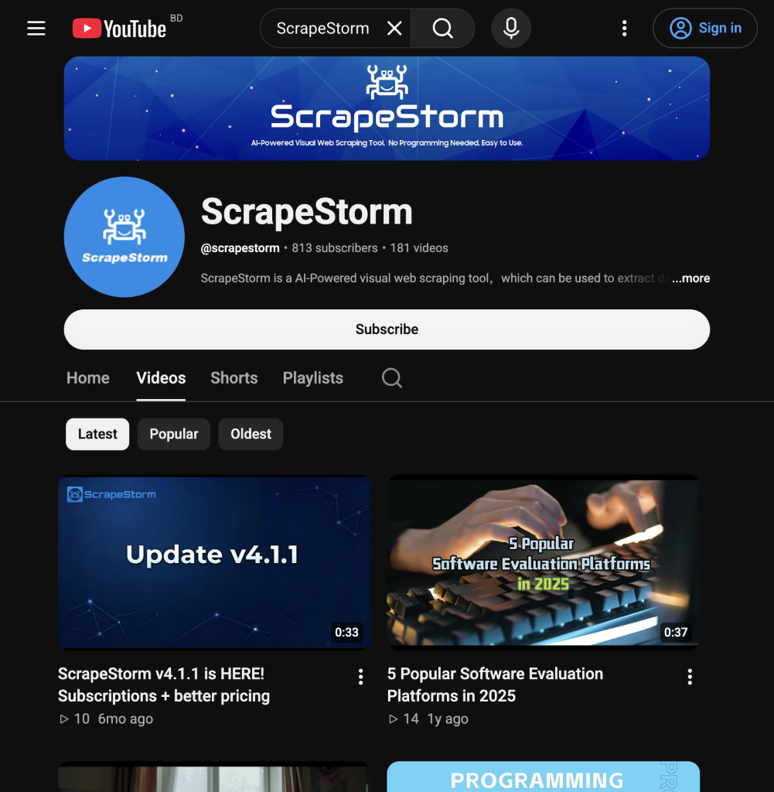
  </div>
  <p class="comm-caption">ScrapeStorm — visual, no-code AI scraping tutorials.</p>

  <p><strong>Recent Videos:</strong> <em>ScrapeStorm v4.1.1 is HERE! Subscriptions + better pricing</em> · <em>5 Popular Software Evaluation Platforms in 2025</em> · <em>5 learning sites for programming skills</em>.</p>
  <p><strong>Popular Playlists:</strong> <em>Getting Started</em> (with their 67K-view beginner guide), <em>Smart Mode</em>, <em>Flowchart Mode</em>, and <em>Popular Web Scraping Tool</em>.</p>
</div>

### 4. Webharvy Videos (`@WebharvyVideos`)

<div class="comm-card">
  <div class="comm-meta">
    <span><strong>Channel:</strong> <a href="https://www.youtube.com/@WebharvyVideos/videos" target="_blank" rel="noopener">youtube.com/@WebharvyVideos</a></span>
    <span><strong>Subscribers:</strong> 670</span>
    <span><strong>Videos:</strong> 918</span>
  </div>
  <div class="comm-shot">
    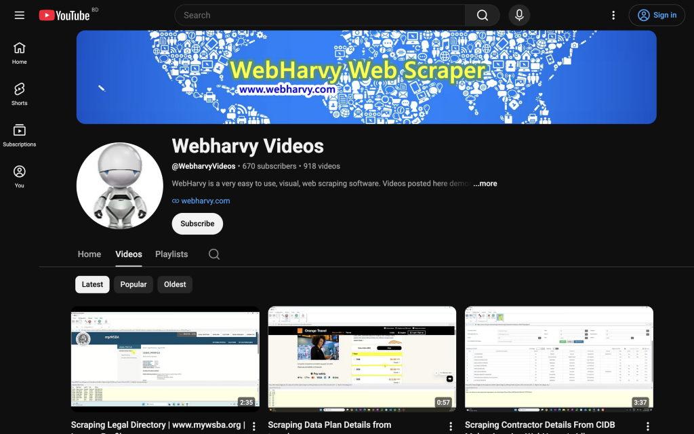
  </div>
  <p class="comm-caption">Webharvy Videos — 918 quick point-and-click scraping demos.</p>

  <p><strong>Recent Videos:</strong> <em>Scraping Legal Directory (mywsba.org)</em> · <em>Scraping Data Plan Details from travel.orange.com</em> · <em>Scraping Contractor Details From CIDB Malaysia</em> · <em>Scraping multi-SKU high res images (willislane.com.au)</em>.</p>
  <p><strong>Popular Playlists &amp; Topics:</strong> <em>Open Popup</em> and <em>Regular Flow</em> playlists, plus hundreds of real-site demos for business directories, product catalogs, and reviews.</p>
</div>

---

## Discord & Slack Communities

When a bot guard blocks you at midnight, Discord and Slack are where you get real-time answers from people fighting the same blocks.

### 1. Extract Data Community (Zyte)

<div class="comm-card">
  <div class="comm-meta">
    <span><strong>Invite:</strong> <a href="https://discord.com/invite/extract-data-community-993441606642446397" target="_blank" rel="noopener">Join Discord</a></span>
    <span><strong>Members:</strong> 21,008</span>
    <span><strong>Online:</strong> 780</span>
  </div>
  <div class="comm-shot">
    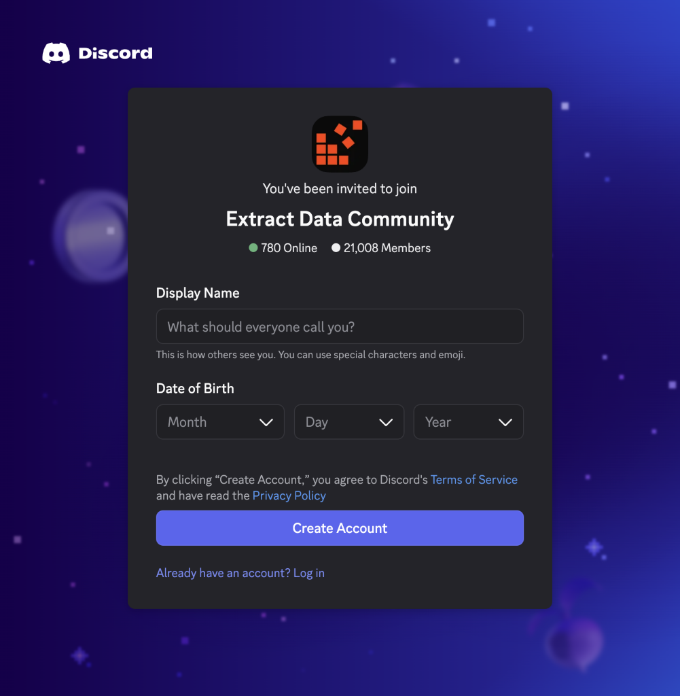
  </div>
  <p class="comm-caption">Extract Data Community — the biggest scraping Discord server.</p>
  <p><strong>Popular Topics:</strong> Scrapy tips, anti-bot strategies, proxies, webinars, and web scraping job posts.</p>
</div>

### 2. Oxylabs Community

<div class="comm-card">
  <div class="comm-meta">
    <span><strong>Invite:</strong> <a href="https://discord.com/invite/6jkDvaC9dS" target="_blank" rel="noopener">Join Discord</a></span>
    <span><strong>Members:</strong> 5,093</span>
    <span><strong>Online:</strong> 622</span>
  </div>
  <div class="comm-shot">
    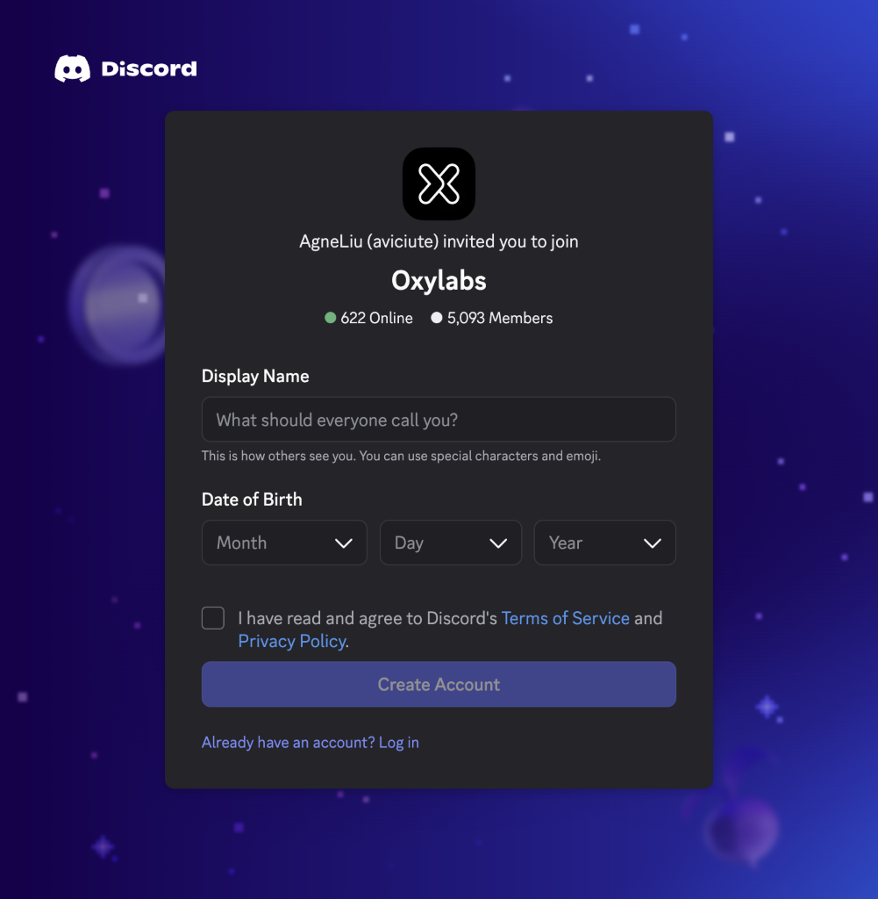
  </div>
  <p class="comm-caption">Oxylabs Discord — active proxy and unblocking discussions.</p>
  <p><strong>Popular Topics:</strong> Proxy setups, unblocking hard websites, Data APIs, and OxyCon talks.</p>
</div>

### 3. Scrapy (Official Discord)

<div class="comm-card">
  <div class="comm-meta">
    <span><strong>Invite:</strong> <a href="https://discord.com/invite/mv3yErfpvq" target="_blank" rel="noopener">Join Discord</a></span>
    <span><strong>Members:</strong> 3,197</span>
    <span><strong>Online:</strong> 233</span>
    <span><strong>Site:</strong> <a href="https://scrapy.org/community/" target="_blank" rel="noopener">scrapy.org/community</a></span>
  </div>
  <div class="comm-shot">
    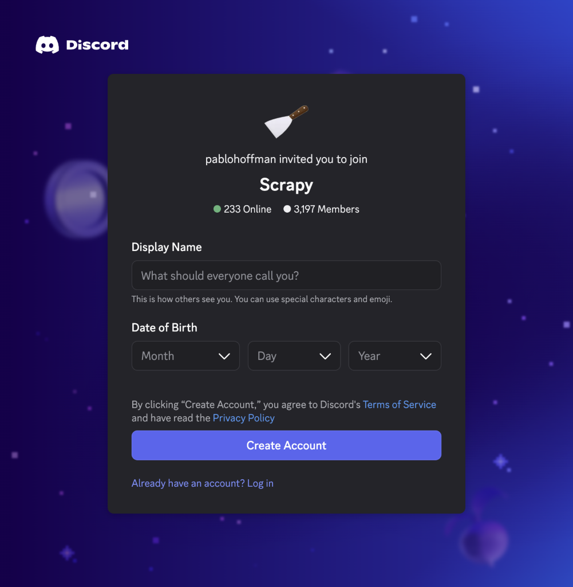
  </div>
  <p class="comm-caption">Scrapy Official Discord — chat directly with Scrapy maintainers.</p>
  <p><strong>Popular Topics:</strong> Spider debugging, middlewares, Scrapy releases, and sharing Python scraping projects.</p>
</div>

### 4. Proxyway Discord

<div class="comm-card">
  <div class="comm-meta">
    <span><strong>Invite:</strong> <a href="https://discord.com/invite/9v9WXdeDNZ" target="_blank" rel="noopener">Join Discord</a></span>
    <span><strong>Members:</strong> 954</span>
    <span><strong>Online:</strong> 97</span>
  </div>
  <div class="comm-shot">
    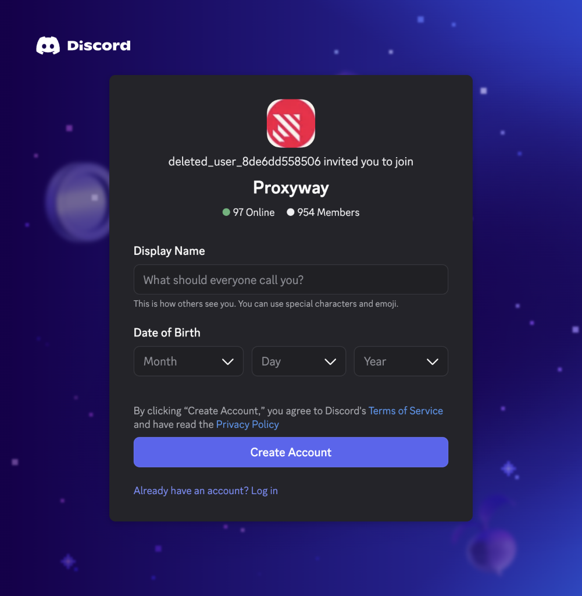
  </div>
  <p class="comm-caption">Proxyway Discord — focused on proxy testing and reviews.</p>
  <p><strong>Popular Topics:</strong> Comparing proxy providers, IP rotation habits, and residential vs. ISP proxies.</p>
</div>

### 5. Web Scrapers (Slack) & Other Discords

<div class="comm-card">
  <div class="comm-meta">
    <span><strong>Join:</strong> <a href="https://intoli.com/blog/slack-for-web-scrapers/" target="_blank" rel="noopener">intoli.com/blog/slack-for-web-scrapers</a></span>
    <span><strong>Workspace:</strong> <code>webscrapers.slack.com</code></span>
  </div>
  <div class="comm-shot">
    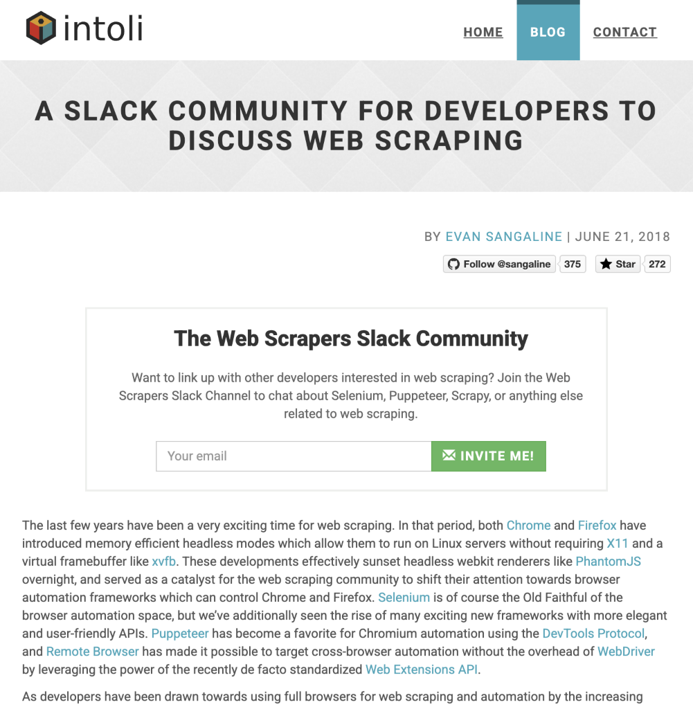
  </div>
  <p class="comm-caption">Intoli signup page for the Web Scrapers Slack group.</p>
  <p><strong>Popular Topics:</strong> Casual developer chat around Selenium, Puppeteer, Scrapy, mobile APIs, and proxies.</p>
</div>

*(You can also check out **Scraping Enthusiasts** for deep anti-bot bypass chat, and **Scraping In Prod** for running large scraping pipelines.)*

---

## Reddit Communities

Reddit is my favorite place to read real stories, tool launches, and long discussions on anti-bot updates.

### 1. r/webscraping

<div class="comm-card">
  <div class="comm-meta">
    <span><strong>Link:</strong> <a href="https://www.reddit.com/r/webscraping/" target="_blank" rel="noopener">reddit.com/r/webscraping</a></span>
    <span><strong>Weekly Visitors:</strong> 25,814</span>
    <span><strong>Weekly Contributions:</strong> 269</span>
  </div>
  <div class="comm-shot">
    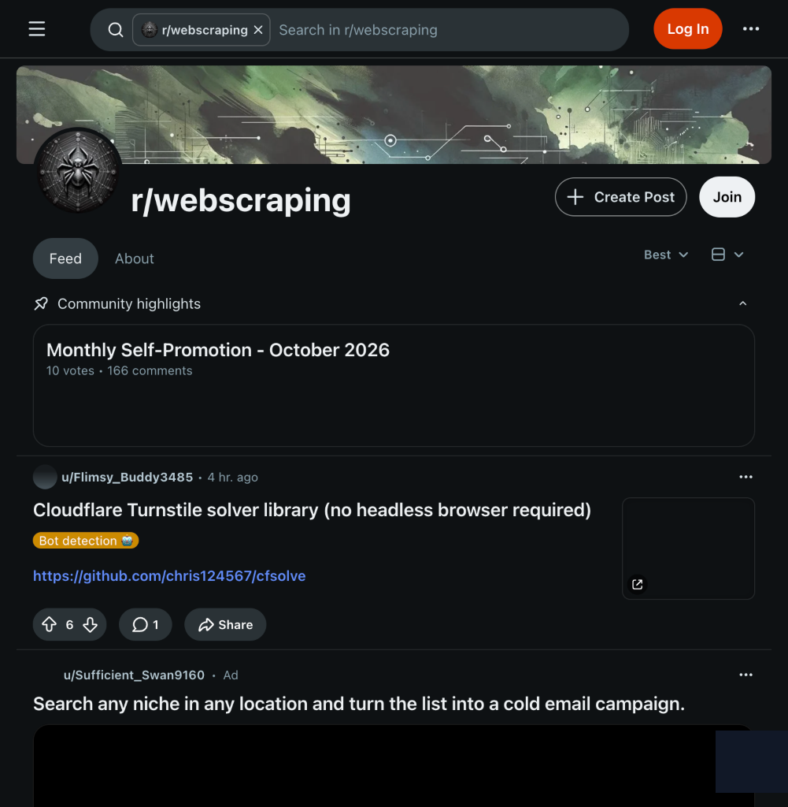
  </div>
  <p class="comm-caption">r/webscraping — the main home for all things web scraping on Reddit.</p>

  <p><strong>Popular &amp; Recent Topics:</strong> <em>Yahoo sent me a cease and desist over my open-source Python library</em> · <em>Browser fingerprinting 101: why sites flag scrapers</em> · <em>New detection tests added to browsers-benchmark</em> · <em>Cloudflare Turnstile solver library</em> · <em>Monthly Self-Promotion</em>.</p>
</div>

### 2. r/WebScrapingInsider

<div class="comm-card">
  <div class="comm-meta">
    <span><strong>Link:</strong> <a href="https://www.reddit.com/r/WebScrapingInsider/" target="_blank" rel="noopener">reddit.com/r/WebScrapingInsider</a></span>
    <span><strong>Weekly Visitors:</strong> 2,815</span>
    <span><strong>Weekly Contributions:</strong> 173</span>
  </div>
  <div class="comm-shot">
    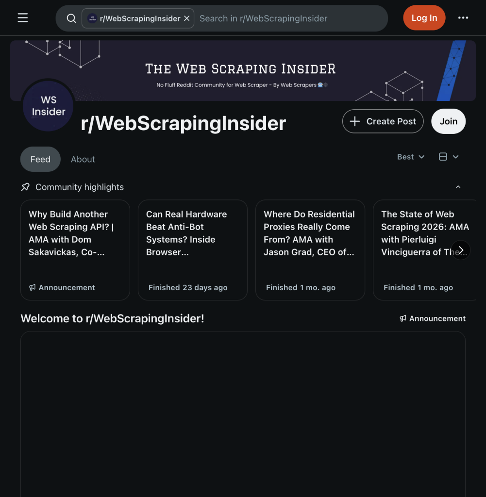
  </div>
  <p class="comm-caption">r/WebScrapingInsider — zero-fluff pro community with founder AMAs.</p>

  <p><strong>Popular &amp; Recent Topics:</strong> <em>AMA with Dom Sakavickas (ScrapeBadger)</em> · <em>AMA with Alexander Spring (Driver) on real hardware vs. anti-bot systems</em> · <em>Scoping a scraping project</em> · <em>What would you build in 2027?</em></p>
</div>

### 3. r/scrapy

<div class="comm-card">
  <div class="comm-meta">
    <span><strong>Link:</strong> <a href="https://www.reddit.com/r/scrapy/" target="_blank" rel="noopener">reddit.com/r/scrapy</a></span>
    <span><strong>Focus:</strong> Official Python Scrapy subreddit</span>
  </div>
  <div class="comm-shot">
    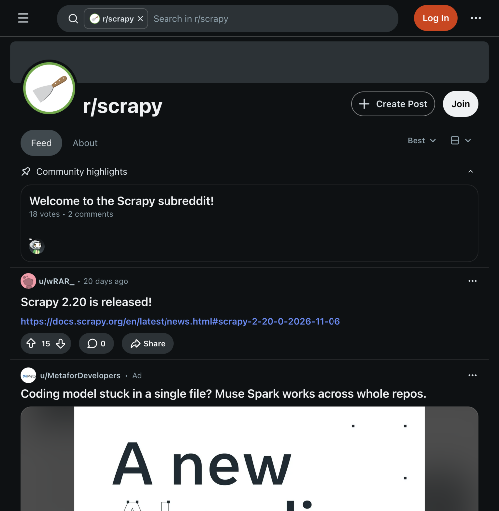
  </div>
  <p class="comm-caption">r/scrapy — release news, spider tips, and Scrapy MCP updates.</p>

  <p><strong>Popular &amp; Recent Topics:</strong> <em>Scrapy 2.20 is released!</em> · <em>Scrapy Official MCP (let an AI agent inspect a live crawl)</em> · <em>curl to Scrapy converter with curl_cffi check script</em> · <em>Scrapy 2.19.0 &amp; 2.18.0 releases</em>.</p>
</div>

**Other Subreddits to Know:** `r/Selenium`, `r/Puppeteer`, `r/ShoeBots` (surprisingly great for e-commerce anti-bot tricks), and `r/ProxyLists` (just filter out vendor ads).

---

## Q&A & GitHub Discussions

### 1. Scrapy GitHub Discussions

<div class="comm-card">
  <div class="comm-meta">
    <span><strong>Link:</strong> <a href="https://github.com/scrapy/scrapy/discussions" target="_blank" rel="noopener">github.com/scrapy/scrapy/discussions</a></span>
    <span><strong>Category:</strong> Q&amp;A</span>
  </div>
  <div class="comm-shot">
    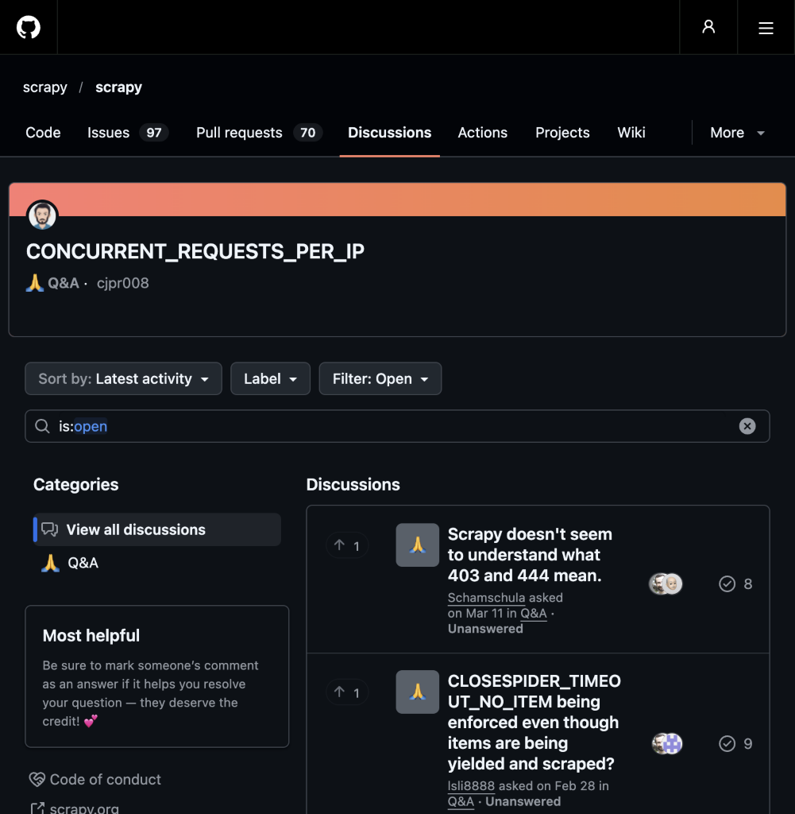
  </div>
  <p class="comm-caption">Scrapy GitHub Discussions — great for framework-specific questions.</p>

  <p><strong>Recent Active Threads:</strong> <em>Scrapy doesn't seem to understand what 403 and 444 mean</em> · <em>CLOSESPIDER_TIMEOUT_NO_ITEM behavior</em> · <em>Custom DownloadHandlers settings</em> · <em>CONCURRENT_REQUESTS_PER_IP</em>.</p>
</div>

### 2. Stack Overflow (`[web-scraping]`)

Stack Overflow holds **51,600+ questions** under [`web-scraping`](https://stackoverflow.com/questions/tagged/web-scraping), making it the quickest archive for BeautifulSoup, Scrapy, and Playwright errors.

---

## Blogs & Newsletters

When a new bot guard rolls out, these three engineering blogs are usually the first to explain how it works.

### 1. Zyte Blog

<div class="comm-card">
  <div class="comm-meta">
    <span><strong>URL:</strong> <a href="https://www.zyte.com/blog/" target="_blank" rel="noopener">zyte.com/blog</a></span>
    <span><strong>Topics:</strong> Anti-ban, AI extraction, Data quality</span>
  </div>
  <div class="comm-shot">
    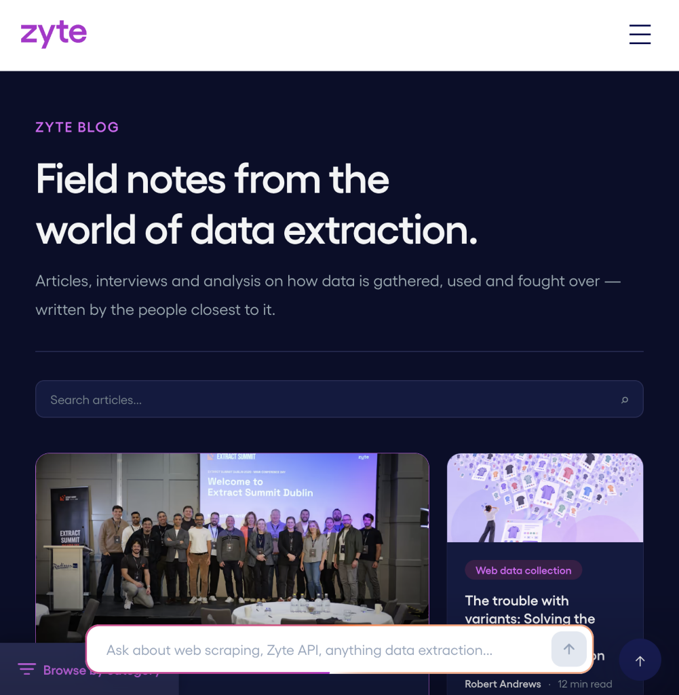
  </div>
  <p class="comm-caption">Zyte Blog — deep engineering notes on anti-ban and self-healing spiders.</p>

  <p><strong>Recent Posts:</strong> <em>Competitor price monitoring with Zyte's MCP in Claude</em> · <em>Real estate is the hardest industry to scrape after retail</em> · <em>Inside the anti-block engine: 320,000-strategy web access hero</em> · <em>The spider that fixes itself</em>.</p>
</div>

### 2. Apify Blog

<div class="comm-card">
  <div class="comm-meta">
    <span><strong>URL:</strong> <a href="https://blog.apify.com/" target="_blank" rel="noopener">blog.apify.com</a></span>
    <span><strong>Topics:</strong> AI, MCP, Crawlee, Python/JS</span>
  </div>
  <div class="comm-shot">
    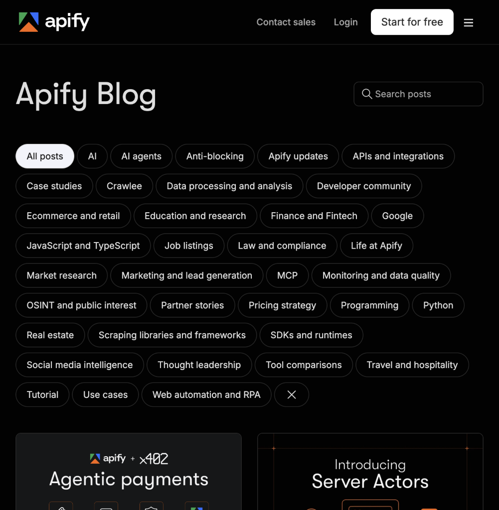
  </div>
  <p class="comm-caption">Apify Blog — practical guides on MCP, RAG, and browser automation.</p>

  <p><strong>Recent Posts:</strong> <em>Connect ChatGPT to real-time web data in 5 minutes (MCP)</em> · <em>What is retrieval-augmented generation (RAG)?</em> · <em>Let your AI agent pay for Apify Actors with x402</em> · <em>How to build an MCP server</em>.</p>
</div>

### 3. ScrapingBee Blog

<div class="comm-card">
  <div class="comm-meta">
    <span><strong>URL:</strong> <a href="https://www.scrapingbee.com/blog/" target="_blank" rel="noopener">scrapingbee.com/blog</a></span>
    <span><strong>Topics:</strong> Fingerprinting, Anti-blocking, Tool guides</span>
  </div>
  <div class="comm-shot">
    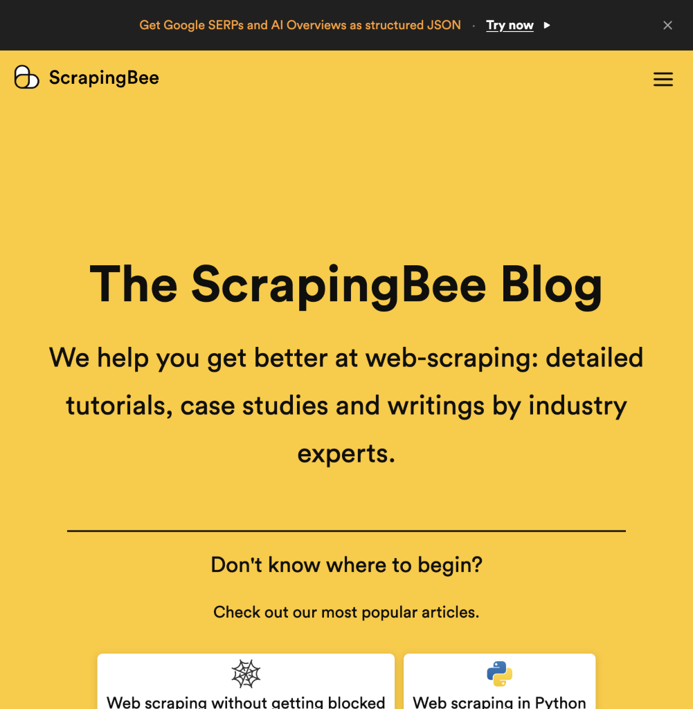
  </div>
  <p class="comm-caption">ScrapingBee Blog — great breakdowns of TLS, HTTP/2, and JA4 fingerprinting.</p>

  <p><strong>Recent Posts:</strong> <em>10 Best AI Web Scraping Tools in 2026</em> · <em>17 Best Web Scraping Tools Tested &amp; Ranked</em> · <em>Browser Fingerprint Consistency: TLS, HTTP/2, and JS Signals</em> · <em>Bypassing JA4 Fingerprinting in Python with curl_cffi and uTLS</em>.</p>
</div>

---

## Conferences & Events (2026)

If you want to hear talks from anti-bot engineers and framework creators, these two 2026 events are worth watching.

### 1. Extract Summit 2026 (by Zyte)

<div class="comm-card">
  <div class="comm-meta">
    <span><strong>URL:</strong> <a href="https://www.extractsummit.io/" target="_blank" rel="noopener">extractsummit.io</a></span>
    <span><strong>2026 Editions:</strong> Austin (Oct 7–8) &amp; Dublin (Nov 10–11)</span>
    <span><strong>Tracks:</strong> Business, Antiban, AI</span>
  </div>
  <div class="comm-shot">
    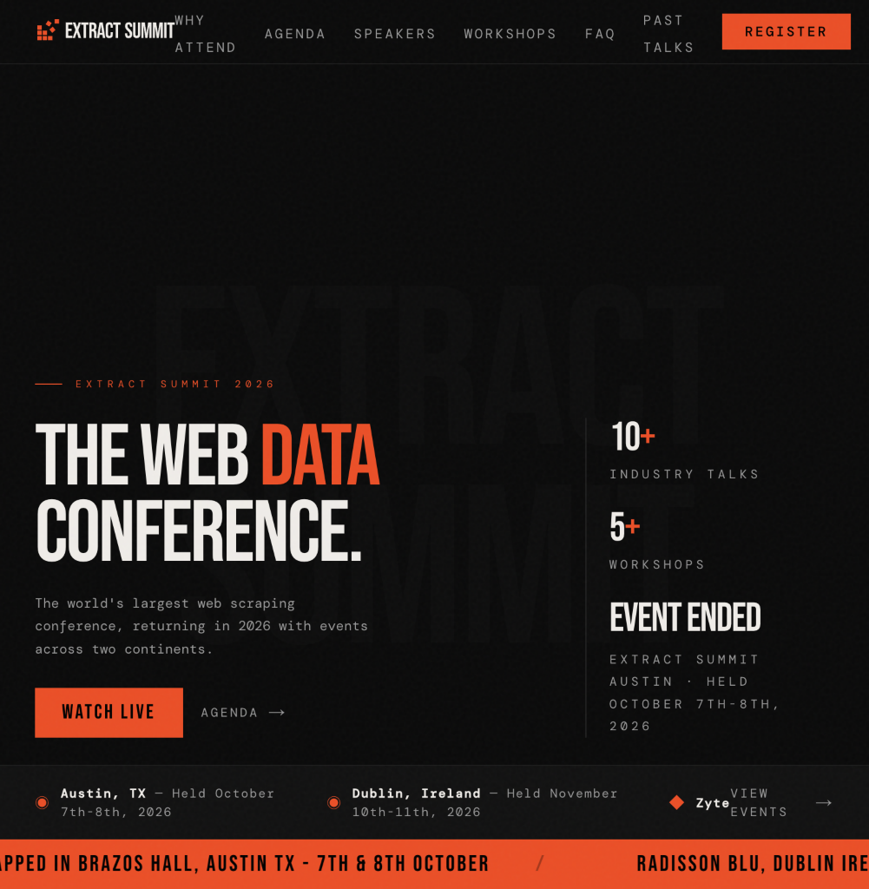
  </div>
  <p class="comm-caption">Extract Summit 2026 — workshops and talks on AI, antiban, and scale.</p>

  <p><strong>Highlights:</strong> 5 hands-on Zyte workshops (AI parsing, browser automation, anti-bots, Zyte API + CDP) plus talks like <em>Antibots, Explained by a Machine</em> (Pierluigi Vinciguerra), <em>Beating LLM reverse engineering</em> (Robert Vähhi), and <em>The legal side of web data in 2026</em> (Sally Hinfey).</p>
</div>

### 2. OxyCon® 2026 (by Oxylabs)

<div class="comm-card">
  <div class="comm-meta">
    <span><strong>URL:</strong> <a href="https://oxylabs.io/oxycon" target="_blank" rel="noopener">oxylabs.io/oxycon</a></span>
    <span><strong>Format:</strong> Free Virtual (On-Demand)</span>
    <span><strong>Scale:</strong> 3,000+ attendees · 10 sessions</span>
  </div>
  <div class="comm-shot">
    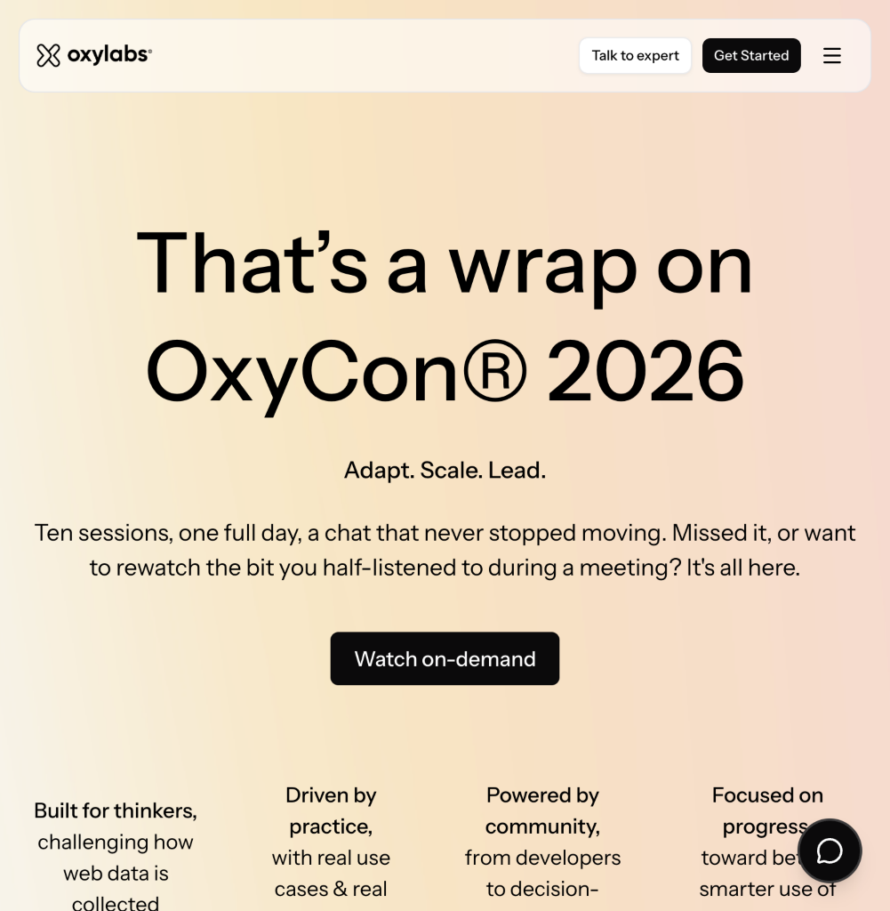
  </div>
  <p class="comm-caption">OxyCon® 2026 — free on-demand sessions from 15 industry speakers.</p>

  <p><strong>Highlights:</strong> 10 sessions covering AI-native extraction, fast infrastructure, and 2026 data compliance with speakers from Adobe, Bluefish AI, Black Forest Labs, ScrapingBee, BBC, and Oxylabs.</p>
</div>

---

## Quick Tips Before You Join

- **Skip the spam:** Proxy forums like `r/ProxyLists` get a lot of promo posts—stick to moderated spaces like `r/WebScrapingInsider` and `r/scrapy` for real advice.
- **Share details:** When asking for help, include the HTTP status code and a short snippet so people can actually help you.
- **Scrape respectfully:** Honor `robots.txt` where it applies, keep your request rate polite, and stay mindful of site rules.

```bash
# Quick check: pull the latest posts from Apify's RSS feed in your terminal
curl -sL https://blog.apify.com/rss | grep -E '<title>|<link>' | head -n 12
```

---

*Did I miss your favorite channel, Discord, or blog? Sorry if it is not on this list yet—drop me a message and I will gladly add it!*
